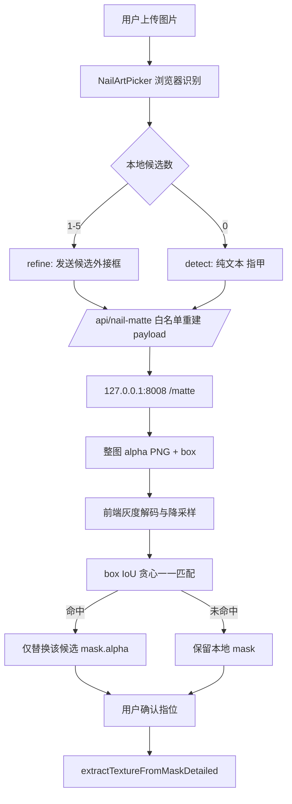

## 用户需求

先对项目做全面审查（代码质量、架构合理性、性能表现、安全性、依赖项、技术债务），给出关键问题及优先级；再基于审查结论制定 WeVisOne-VL 模型接入计划，覆盖接入目标、模型类型与用途、阶段划分与顺序、前置条件与依赖、风险评估、验证与回滚方案，并明确审查与计划的输出结构和判定标准。

## 产品概述

甲如（JiaRu）是浏览器端美甲试色、AI 生图与 AR 试戴应用。本次在既有"上传照片 → 识别甲面候选 → 用户确认指位 → 提取纹理"流程中，新增一条**本机精细抠图**辅助路径：用户完成常规识别后，可主动触发一次本地 GPU 抠图，取回软边甲面蒙版替换当前候选轮廓，再进入原有纹理提取。该能力仅作辅助，不改变正式识别仍处发布阻塞的现状，也不计入正式成功率。

## 核心功能

1. **项目审查报告**：六维度逐项结论、证据位置、P0—P3 优先级、判定标准与通过条件，形成可长期查阅的文档。
2. **精细抠图入口**：仅在服务可用时出现；首次使用以一次性说明告知图片会发送到自托管抠图服务、仅用于本次处理，可取消。
3. **轮廓精修**：返回的软边蒙版与现有候选按位置一一匹配，只替换轮廓，不增删候选、不改指位推导与置信度等级。
4. **状态反馈**：处理中显示已用秒数并可取消；成功显示"已精细处理 N/M 个甲面"；服务忙或超时保留本地结果并明确提示，不自动重试。
5. **降级与兜底**：未配置服务时入口整体不渲染；本地无候选时可发起一次兜底识别，结果标为最低置信并要求逐指人工确认。
6. **契约同步**：新增接口登记、隐私说明改写、环境变量样例与项目接口文档同步更新，版本号顺延并记入当日开发日志。

## 视觉与交互效果

在识别侧栏底部新增一块与现有新拟态风格一致的轻量面板：默认收起为一行"精细抠图（本机）"操作；展开后显示说明、状态行与取消按钮；成功以中性文案反馈数量，降级以琥珀色提示说明已保留本地结果。全程不出现"自动识别成功"字样。

## 一、审查基线与判定标准

### 1.1 技术栈（实测确认，不引入新框架）

- Next.js 16.3.6 App Router + React 19.2.4 + TypeScript 5 + Tailwind 4，`src` 120 个 TS/TSX。
- 浏览器推理：ONNX Runtime Web 1.27（WebGPU/WASM）+ MediaPipe Hands（自托管 `/vendor/mediapipe/hands/`）。
- 服务端：自研 HS256 JWT + `node:sqlite`；生图走 Agnes 2.5 Flash 与火山方舟 Seedream 5 双路由。
- 测试：332 个 `.test.ts`（node:test，`--test-concurrency=1`）+ 133 个 Python 测试 + 2 个 Playwright spec；最近串行全量 1208/1208 pass。

### 1.2 审查输出结构（固定六段，逐段给结论）

`代码质量 / 架构合理性 / 性能表现 / 安全性 / 依赖项 / 技术债务`，每段内部统一为：**实测指标 → 问题清单（含文件:行证据）→ 严重度 → 处置建议**。

### 1.3 判定标准

| 严重度 | 定义 | 通过条件 |
| --- | --- | --- |
| P0 阻断 | 可导致未授权访问、任意文件读取、数据泄露或发布契约被破坏 | 0 项遗留才可进入接入实施 |
| P1 高 | 影响正确性、可回归性或可发布性 | 本阶段关闭或有书面风险接受 |
| P2 中 | 架构/性能/可维护性缺陷 | 排期关闭，允许带项推进 |
| P3 低 | 整洁性、命名、死代码 | 随手清理 |


复现要求：每条结论必须给出可复核证据（源码位置、机器报告路径或命令），不接受"代码存在即通过"。

### 1.4 审查结论摘要（已交付对话，计划据此展开）

| 级别 | 结论 | 证据 |
| --- | --- | --- |
| P0 | 上游 `/matte` 接受 `imagePath` 直读本地文件，且未设 token 时完全放行、无 CORS/TLS | `model/VlM_Model/server.py:167`、`:95-99` |
| P1 | 生产构建门未闭合，v1.2.160—162 三轮改动无对应构建证据 | `output/build-redesign-final-20261027.txt` |
| P1 | 被否决模型 candidate57 ONNX（49.5MB）位于 `public/models/`，构建即公网可下载，`src`/`scripts` 零引用 | 目录实测 + 全量搜索 |
| P1 | `ArView.tsx` 1248 行、`NailArtPicker.tsx` 1039 行，几何/状态/渲染耦合 | 行数实测 |
| P1 | e2e 仅 2 个 spec，摄像头 + WASM 链路无自动化覆盖 | `e2e/` 实测 |
| P2 | 无 CSP/HSTS；`public/` 84.37MB；两条生图路由重复校验与配额；`nail-texture-dataset.ts` 810 行仅测试引用；`three@0.184` 零引用；限流与配额为进程内存态 | 各文件实测 |
| 通过 | SQL 参数化 + 列白名单、JWT 固定 alg 与 iss/aud 校验、生产缺密钥抛错、Origin CSRF、双层限流、付费路由配额熔断 | `auth/db.ts:309-315`、`auth/jwt.ts:76-100`、`auth/config.ts:14-16`、`middleware.ts:61-67` |


## 二、模型接入方案

### 2.1 接入目标（可验证）

1. 浏览器端可在"有候选"与"无候选"两种场景下，主动请求一次本机抠图并获得软边蒙版。
2. 蒙版必须能替换既有候选的轮廓并沿用原有纹理提取链路，输出纹理与替换前在几何位置上一致（同一 `scale`/`origin` 口径）。
3. 服务不可用、忙、超时、鉴权失败、体积超限六类异常下，产品行为可预测且不丢用户已有结果。
4. 全流程不新增任何正式质量统计：不改 PRODUCT HOLD、不写生产 manifest、不产生 releaseIdentity、不消费 Goal 冻结的 18 次 CPU ORT 预算。

**非目标**：实时 AR 帧内抠图（12—16.5s/张、并发固定 1）、替代正式纹理模型、写入训练真值或阈值校准、公网默认开放上传通道。

### 2.2 模型分工（边界表）

| 能力 | 承担者 | 输出 | 是否计入正式质量 |
| --- | --- | --- | --- |
| 手部关键点与指位 | MediaPipe Hands（浏览器） | 21 点 | 否（辅助定位） |
| 甲面候选与正式 mask | 正式 ONNX 双阶段（未部署，HOLD） | 像素级 mask | 是（发布门） |
| 软边精细抠图 | WeVisOne-VL-4B int4（本机 GPU） | 整图 mode L alpha | 否（辅助能力） |
| 纹理提取 | `extractTextureFromMaskDetailed` | 纹理与预览 | 沿用原口径 |


### 2.3 架构与数据流



### 2.4 关键决策与权衡

1. **本机自托管而非公网 GPU 主机**：现有云主机无 GPU，公网形态单图 12—16.5s 且并发 1，体验不可接受；同机回环调用零网络成本，且默认关闭入口，安全面最小。代价是公网用户用不到，作为可接受的功能边界。
2. **只替换 mask、不增删候选**：`inferSuggestedFingers(candidateCount)` 按数量推导指位，候选数一变全部错位；限定为"替换"可保证指位、置信度、来源语义零变化。
3. **保留软 alpha 而非二值化**：`buildFeatheredAlphaMask` 当前只消费 0/1，透明甲尖的软边是该路径的主要价值，因此在 `NailMask` 增可选 `alpha` 字段并取 `min(soft, ramp)`；不传该字段时行为完全不变，全部既有调用方零改动。
4. **转发层白名单重建 payload**：上游第 167 行存在 `imagePath` 回退分支，任何透传都等于把本机文件系统暴露给调用方；只允许 `image/task/query/boxes` 四个字段可从根上关闭该面。
5. **复用既有身份与限流体系**：不新建鉴权或计数机制，在 `rate-limit.ts` 的枚举、默认规则、环境变量映射三处同步新增条目，避免出现第二套配额语义。
6. **不重试、不排队**：上游忙时立即 503、单任务 120s 超时，前端重试只会放大排队；降级即返回本地结果，由用户决定是否再试。

### 2.5 前置条件与依赖

| 类别 | 内容 |
| --- | --- |
| 硬件 | 具备 CUDA 的 GPU（实测 RTX 4060 Laptop 8GB），显存常驻约 5.26GiB，进程内存峰值约 10.1GiB |
| 运行环境 | Python 3.11.12 + torch 2.11.0+cu128 + transformers 5.12.1（`model/VlM_Model/requirements.txt`） |
| 权重 | `models/WeVisOne-VL-4B-bf16/` 9.04GB，本地存在且被 `.gitignore` 排除，不入库 |
| 服务启动 | `python server.py --port 8008 --token <随机串>`，仅绑定 `127.0.0.1` |
| 配置项 | 新增 `VLM_MATTE_URL`、`VLM_MATTE_TOKEN` 至 `.env.local.example`；未配置即入口不可见 |
| 反向代理 | `deploy/nginx/jiaru.conf` 新增 `/api/nail-matte` location 与独立 `limit_req_zone`（建议 6r/m，burst 2），沿用 `jiaru-proxy.conf` 的超时与 12m 体积上限 |
| 文档契约 | 白皮书 §3、§5、§6.1、§10 与 `/privacy` 页面须同批改写，头部版本顺延至 v1.2.163，当日日志记「白皮书 v1.2.163」标记 |


### 2.6 阶段划分与顺序

| 阶段 | 任务 | 产出 | 退出条件 |
| --- | --- | --- | --- |
| R0 | 审查报告固化 | `docs/project-review-2026-10-28.md` | 六维度齐全、每条含证据、P0—P3 分级完成 |
| P0 | 服务端收口 | `/api/nail-matte` 路由 + `nail-matte-api.ts` + 限流条目 + 白名单 | 单测覆盖六类错误码；`imagePath` 不可达；未配置返回 `enabled:false` |
| P1 | 前端能力 | `vlm-refinement.ts` + `mask-matching.ts` + `NailMask.alpha` + 羽化合并 | 匹配与 alpha 单测通过；既有 1208 项无回归 |
| P2 | 界面接入 | 独立面板组件 + `NailArtPicker` 挂载 + 来源标签 | 五种状态可复现；候选数、指位、置信度零变化 |
| P3 | 契约同步 | 白皮书 v1.2.163、`/privacy`、环境变量样例、Nginx 片段、README | 文档与实现一致，编码审计通过 |
| P4 | 功能验收 | 本机 GPU 端到端一次真实运行记录 | 记录图片 SHA、实例数、耗时、匹配结果；明确不构成质量门 |


依赖关系：P0 依赖 R0（先确认无其他 P0）；P1 依赖 P0 的响应契约；P2 依赖 P1 的数据结构；P3 依赖 P2 的最终形态；P4 依赖 P3。

### 2.7 目录结构

```text
docs/
└── project-review-2026-10-28.md          # [NEW] 六维度审查报告：指标、问题清单（文件:行证据）、P0—P3 分级、判定标准与通过条件、处置建议与责任阶段。作为后续排期与回归的引用基线。
src/app/api/nail-matte/
└── route.ts                              # [NEW] GET 返回 {enabled,ready,busy} 不触发推理；POST 预检 content-length ≤8MB、重建白名单 payload、Bearer 鉴权、150s 超时、状态码映射 503/504/502/413、剥离 response/metrics 等上游文本字段。
src/lib/
└── nail-matte-api.ts                     # [NEW] 上游调用封装：读取 VLM_MATTE_URL/TOKEN、AbortSignal 超时、错误归一化（disabled/busy/timeout/upstream_error/auth_misconfigured/invalid_image）、实例截断至 10 并回传 omittedInstances、量化字段透传。供 route 与单测共用，禁止被客户端组件引入。
src/lib/nail-texture-recognition/
├── vlm-refinement.ts                     # [NEW] 前端编排：图片压至长边 ≤1600 JPEG q0.85、请求体组装、候选框换算、alpha PNG 解码（取 R 通道）、降采样至长边 ≤1024、构造 NailMask（scale=原图宽/mask 宽，origin 0）、统计与警告码。纯函数为主，便于单测。
├── mask-matching.ts                      # [NEW] matchMasksByIou(candidates, instances, minIou=0.3)：贪心一一匹配、同实例不复用、输入乱序稳定、空实例返回空、可选返回未匹配原因。
├── types.ts                              # [MODIFY] NailMask 增可选 alpha?: Uint8ClampedArray；NailTextureCandidateSource 增 "vlm-matte"。不改既有字段语义，不设默认值。
└── extract-mask-texture.ts               # [MODIFY] buildFeatheredAlphaMask 在 mask.alpha 存在时取 Math.min(soft, ramp)，不存在时保持原逻辑；补一条分支单测。
src/components/
├── NailMattePanel.tsx                    # [NEW] 独立面板：入口可见性、首次说明、进行中计时与取消、成功计数、降级提示。只接收 props、不发请求，避免组件继续膨胀。
└── NailArtPicker.tsx                     # [MODIFY] 挂载面板、持有 refine/detect 两种调用、把命中结果写回原候选（保持 id/几何/指位/置信度）、来源标签「本机精细抠图」与「需复核」恒真。
src/lib/rate-limit.ts                     # [MODIFY] RateLimitName 增 nailMatte，同步 DEFAULT_RULES 与 ENV_OVERRIDES（JIARU_RL_NAIL_MATTE），三处缺一不可。
tests/
├── nail-matte-route.test.ts              # [NEW] mock fetch 覆盖 200/400/401/413/503/504/超时；断言 imagePath 被剥离、token 不出现在响应、超限在解析前拒绝、未配置返回 enabled:false。
├── mask-matching.test.ts                 # [NEW] 一一匹配、IoU 边界、同实例不复用、乱序、空实例、多候选竞争同一实例。
└── nail-matte-mask.test.ts               # [NEW] 灰度取 R 通道、阈值、降采样尺寸、scale 计算、软 alpha 保留与 min 合并。
.env.local.example                        # [MODIFY] 追加 VLM_MATTE_URL / VLM_MATTE_TOKEN 占位与注释（默认留空即关闭）。
deploy/nginx/jiaru.conf                   # [MODIFY] 新增 nail_matte 限流区与 /api/nail-matte location，注释说明仅内网/本机可用。
src/app/privacy/page.tsx                  # [MODIFY] 增加该数据流：图片发送至自托管抠图服务、仅本次处理、不转发第三方、可关闭入口。
docs/technical-whitepaper.md              # [MODIFY] §3 状态行、§5 API 清单、§6.1 候选契约、§10 隐私表述；头部版本顺延 v1.2.163。
dev-log/2026-10-28.md                     # [MODIFY] 追加本轮实施记录与「白皮书 v1.2.163」标记。
```

### 2.8 关键代码结构

```ts
// 转发层与前端共用的响应形状（仅保留必要字段，上游 response/metrics 不外泄）
export interface NailMatteInstance {
  index: number;
  box: [number, number, number, number];   // 原图像素，来自 box01 × 宽高
  bbox: [number, number, number, number];  // alpha>127 外接框
  area: number;
  alphaPng: string;                        // data:image/png;base64，整图 mode L
  width: number;
  height: number;
}
export interface NailMatteResult {
  ok: true;
  width: number;
  height: number;
  instances: NailMatteInstance[];
  omittedInstances: number;                // 超过 10 个被截断的数量，不静默丢弃
  model: string;
  quant: "int4" | "none";
  elapsedMs: number;
}
```

```ts
// NailMask 扩展：新增字段可选，未提供时全部既有行为不变
export interface NailMask {
  width: number;
  height: number;
  data: Uint8Array;                        // 二值几何，非零即前景
  originX: number;                         // 恒 0，与 postprocess.ts 一致
  originY: number;
  scale: number;                           // 原图宽 / mask.width
  alpha?: Uint8ClampedArray;               // 软边 0..255，仅 vlm-matte 来源提供
}
```

### 2.9 性能要点

- 上游单图 12—16.5s，并发 1；入口为显式按钮触发，不参与任何自动流程，不进入实时帧链路。
- 请求体积：浏览器侧压至长边 ≤1600 JPEG q0.85，`content-length` 预检 8MB，上游硬上限 12MB。
- 响应体积：单实例整图 alpha 可达数 MB，实例上限 10 且显式报告截断；前端栅格降采样至长边 ≤1024 后持存。
- 匹配复杂度 O(n×m)，n、m ≤ 10，可忽略；解码与降采样放主线程一次执行，避免引入 Worker 增加复杂度。

### 2.10 风险与缓解

| 风险 | 影响 | 缓解 |
| --- | --- | --- |
| 上游 `imagePath` 与无鉴权 | 任意文件读取、GPU 被占用 | 转发层白名单；启动强制 `--token`；服务只绑回环；Nginx 不对外暴露该 location |
| 实例数不稳定（同图 4 vs 5） | 匹配错位或重复替换 | box IoU 一一匹配、同实例不复用、不补齐不按分截断；数量不一致如实展示 |
| 12—16.5s、并发 1 | 用户等待、多人抢占 | 显式触发、进度计时、可取消、忙时直接降级且不重试 |
| 软 alpha 未做原像素审核 | 被误解为"更准" | 文案只称"更精细的软边蒙版，需复核"；不计入任何成功率 |
| 上游限定研究用途 | 商用范围受限 | 商用前确认条款；未确认前仅本机开发与内部演示，正式站默认关闭 |
| 出现真实上传通道 | 隐私承诺失真 | 同批改写 §10 与 `/privacy`，明确自托管、仅本次、不转发第三方 |
| 进程内限流单实例假设 | 多实例失效 | 沿用现有语义并注释；Nginx 层另有一道限流 |
| 面板导致 `NailArtPicker` 继续膨胀 | 可维护性下降 | 面板抽独立组件，只传 props；请求编排放 `vlm-refinement.ts` |


### 2.11 验证与回滚

**验证门（按顺序，全部串行）**

| 门 | 方法 | 通过条件 |
| --- | --- | --- |
| G1 静态 | `npm.cmd run lint`、`npm.cmd run typecheck`、`npm.cmd run typecheck:tests` | 均 0 问题 |
| G2 单测 | 新增 3 个测试文件 + 受影响既有单测 | 新增全绿；断言 `imagePath` 剥离、token 不外泄、超限前置拒绝 |
| G3 全量 | `npm.cmd run test`（Python 3.13 置 PATH 首位，无并行负载） | ≥1208 项全通过，0 fail |
| G4 编码 | `npm.cmd run audit:encoding` | 通过 |
| G5 构建 | `npm.cmd run build`（串行，可清理 `.next` 的环境） | exit 0；若仍受宿主删除守卫阻断，保留为环境失败，不据此宣称通过 |
| G6 降级 | 停服务后访问页面 | 入口不渲染或提示不可用；已有候选与纹理结果不变 |
| G7 端到端 | 本机 GPU 启服务，真实照片一次运行 | 记录图片 SHA、实例数、匹配 N/M、耗时、服务 `/stats`；写明不构成质量门 |
| G8 文档 | 白皮书与实现逐条比对、`/privacy` 文案核对 | 接口、状态、隐私表述一致，版本 v1.2.163 与日志标记同批 |


**回滚方案**

1. **能力级**：删除或清空 `VLM_MATTE_URL` 即整块面板消失，路由返回 `enabled:false`，无需回退代码；这是首选回滚路径。
2. **代码级**：单次提交只涉及新增文件与 4 处小改动（`types.ts`、`extract-mask-texture.ts`、`NailArtPicker.tsx`、`rate-limit.ts`），`NailMask.alpha` 为可选字段、羽化分支有 else 兜底，回退不破坏既有类型与运行路径。
3. **服务级**：停 Python 进程即可；路由在上游不可达时返回 `degraded`，前端保留本地结果。
4. **回滚验证**：清空配置后重跑 G1—G4，确认既有 1208 项仍全通过，且面板节点不出现在 DOM。

### 2.12 审查结论的落地边界

本计划只关闭与接入直接相关的 P0（上游安全面）；candidate57 静态资产、构建门、`three` 死依赖等 P1/P2 作为独立清理项排期，不与模型接入混在同一批改动内，避免扩大回归面。

## Agent Extensions

### SubAgent

- **code-explorer**
- Purpose: 在改动 `NailMask` 与 `buildFeatheredAlphaMask` 前，穷举全仓 `NailMask` 构造点与羽化函数调用点，确认新增可选字段不会破坏既有分支。
- Expected outcome: 输出受影响文件与调用位置清单，作为类型扩展的影响面基线。

### Skill

- **playwright-cli**
- Purpose: 在无 GPU 服务与有服务两种条件下验证面板的可见性、降级提示与既有纹理提取链路未回归。
- Expected outcome: 面板隐藏、降级提示、成功文案三类状态的可复现截图与断言记录。