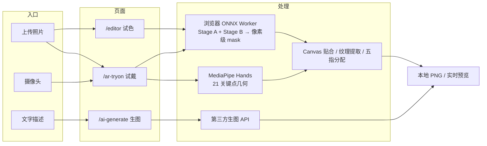
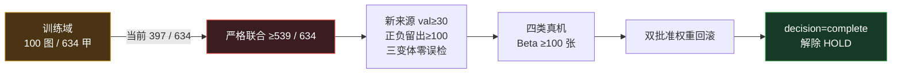
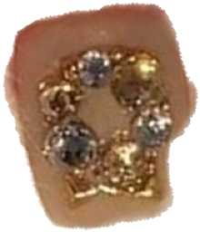
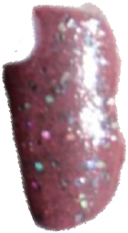
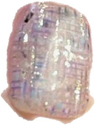

# 甲如 JiaRu — 让每一次抬手都遇见未来

**Web 端美甲试色应用**：浏览器直接打开，上传照片试色、文字描述生成款式、或开启摄像头实时试戴。照片与摄像头帧默认留在本地处理。

[](https://nextjs.org) [](https://react.dev) [](https://www.typescriptlang.org) [](https://tailwindcss.com)   

<p align="center">
  
  
  
</p>
<p align="center"><sub>仓库内真实素材：手部参考图 · Seedream 灵感图（<code>public/nail-gallery/</code>）</sub></p>

> 本页按技术白皮书 **v1.2.447（2026-11-22）** 的当前口径维护，只登记状态与接口；逐版本实验过程、指标与历史失败见 [`dev-log/`](dev-log/) 和 [`docs/archive/`](docs/archive/)。

---

## 一眼看懂



**状态图例**：✅ 已完成或已发布　🚧 进行中　📌 待验证　⬜ 占位　⛔ 发布阻塞

---

## 现在做到哪一步

| 维度 | 当前口径 |
| --- | --- |
| 浏览器业务模型 | ✅ **已发布**：`nail-texture-seg-geometry64-browser-aa4-v2`，manifest `deploymentStatus: "deployed"`，经 register/switch 登记 |
| 推理链 | Stage A 512 letterbox 候选 → Stage B radial-refine（2048 角向 + 4×4 边缘覆盖率，另有可选 RMS 有界半径平滑字段）→ 像素 mask → 五指分配 → 纹理提取（alpha 双线性重采样）；发布对拍绑定 **WASM** 单后端 |
| 识别入口 | 参考图、编辑器、个性化分析共享浏览器 ONNX 优先链路；甲尖方向优先按指位手部几何取值，无手部几何时退回收尖判据；本机 Python/GPU 服务作降级与显式重试，降级时 UI 明确提示人工确认 |
| 正式质量现值 | 训练域真值 v5 / 范围 v3（100 名义图 / 634 甲）原 2px：等权侧缘头同来源五折 **严格联合 397 / 634**（门 ≥539 / 634），两端逐像素头首折 98 / 115；实际浏览器双分辨率上传链实测 634 甲一一匹配、原图 2px 严格 **0 / 634**、平均 Boundary IoU 0.316（正式参考 0.725），同 ROI 搬运完整五折轮廓可达 397 / 634 并保留原通过 248 甲 |
| 商用完成门 | ⛔ **PRODUCT HOLD**，completion audit 返回 `ok=true / decision=complete` 前保持 |
| 当前唯一活动 | **ACTIVE / 甲缘贴合改进**：在隔离真实相机中验证甲根纹理与逐指贴合质量（quality-first-v7 甲根颜色保护已接入生产渲染默认路径），并回收真实局部修边盲测 |
| 工程门 | 全量测试 1530 / 1530（2026-11-05）、`test:ci` 13 份独立契约套件、双 tsconfig typecheck / lint / build 通过、AR 相关单测 43 / 43（2026-11-22） |



`▓▓▓▓▓▓▓▓▓▓▓▓▓▓▓▓▓▓▓▓▓░░░░░░░` 严格联合 397 / 539（分母 634）。业务发布已完成，商用完成门仍待闭合。

---

## 功能一览

| 模块 | 入口 | 状态 | 一句话 |
| --- | --- | :---: | --- |
| 首页与统一导航 | `/` | ✅ | 桌面顶部 5 项、移动底部 5 项；风格卡直达个性化分析 |
| 上传试色编辑器 | `/editor` | 🚧 | 甲面框 + 纹理套装点选贴合、对象面板、键盘操作、会话草稿、原尺寸本地导出；识别提供「本地 \| 云端」模式 |
| AI 美甲生图 | `/ai-generate` | ✅ | Agnes Image 2.5 Flash 默认 / 火山方舟 Seedream 5.0 pro·lite 可选，10 风格 × 50 段提示词、参考图图生图、配额与预算熔断（Seedream 浏览器呈现待确认） |
| 灵感图库 | `/gallery` | ✅ | 6 张本地灵感图、试戴方式弹层、本地收录五态与删除撤销 |
| AR 实时试戴 | `/ar-tryon` | 📌 | 五指贴色与纹理试戴、甲根锚定、长宽比保真、逐指翻转与校准、V7 甲根颜色保护；真机纹理模式 17.9—18.4fps（贴住 MediaPipe 约 18.5fps 上限），真实相机贴合待多设备真机 |
| 纹理自动识别 | `/editor`、`/ar-tryon`、`/nail-analysis` | ✅ | 浏览器业务模型已发布，全站识别入口统一 |
| 个性化分析 | `/nail-analysis` | 📌 | 纯本地规则引擎（ITA° / 手型 / 甲型 / 色系）+ 可解释推荐；真实照片与真机验收待补 |
| 账号与隐私 | `/login`、`/account`、`/privacy` | 🚧 | 手机号 / 微信登录即注册、JWT + SQLite、限流与 CSRF、改进计划开关；商户与云同步未开始 |
| 独立 AR 演示 | `/ar-demo` | ⬜ | iframe 桥接访问者本机 Python demo，公网演示不可用 |
| 消费者端新版设计提案 | 独立预览 `127.0.0.1:4318` | 📌 | 手机 / 平板优先的设计评审原型，真实模型与云同步未接入，详见[设计说明](docs/consumer-redesign-design-brief.md) |

### 编辑器里的 5 套真实纹理

| 黑耀碎闪 | 奶茶金饰 | 玫红爆闪珍珠 | 蓝粉珍珠混搭 | 裸粉白星法式 |
| :---: | :---: | :---: | :---: | :---: |
|  |  |  |  |  |

每套 5 指 RGBA PNG，从真实照片经本机抠图提取，自带 alpha 轮廓、甲尖朝上。

---

## 快速开始

| 前置 | 要求 |
| --- | --- |
| Node.js | ≥ 22.15（`node:sqlite` 需要） |
| npm | ≥ 10，Windows 下用 `npm.cmd` |
| Python | 3.13（数据治理 / 模型相关测试需要，须置于 PATH 首位） |
| 浏览器 | 摄像头功能须经 `localhost` 或正式 HTTPS 访问 |

```powershell
git clone https://github.com/yaoyinyu/JiaRu.git
cd JiaRu
npm.cmd install
npm.cmd run dev          # 自动启用实验性 HTTPS：https://localhost:3000
```

```powershell
npm.cmd run build
npm.cmd run start
```

| 验证命令 | 用途 | 最近记录 |
| --- | --- | --- |
| `npm.cmd run lint` | ESLint | 0 problems |
| `npm.cmd run typecheck` / `typecheck:tests` | 产品 + 测试双 tsconfig | 通过 |
| `npm.cmd run test` | 全量串行测试（376 个 TS 测试文件） | 1530 / 1530（2026-11-05） |
| `npm.cmd run test:ci` | 13 份独立产品 / 发布契约套件 | 已接入 CI |
| `npx.cmd playwright test` | 浏览器端到端（2 个 spec） | 本地回归 |
| `npm.cmd run audit:encoding` | 文本编码审计 | 通过 |
| `npm.cmd run build` | Next.js 生产构建 | 通过 |

CI（Windows runner）执行 `npm ci` → 双 typecheck → lint → `test:ci` → build；全量测试依赖本地数据与 Python，在本机串行执行。全量测试与生产构建须串行，避免临时目录与子进程竞争造成假失败。

---

## 项目结构

| 目录 | 内容 |
| --- | --- |
| `src/app/` | App Router 页面（11 个）与 `/api/*` 路由 |
| `src/components/` | AR 视图、编辑器画布、纹理选择器、图库与共享交互基元 |
| `src/lib/` | 识别子系统、纹理与几何、认证、个性化分析、异步任务等纯逻辑 |
| `src/workers/` | 纹理识别 Web Worker 入口 |
| `public/models/` | 生产 manifest、发布登记快照；`*.onnx` 存于本地、由 `.gitignore` 隔离 |
| `public/nail-textures/`、`public/nail-gallery/` | 5 套 × 5 指纹理、6 张灵感图（运行时必需资产） |
| `model/` | 训练、数据治理、审核脚本与本地报告（数据、权重、产物不入库） |
| `scripts/`、`tests/`、`e2e/` | 发布治理脚本、376 个 TS 测试文件、2 个 Playwright spec |
| `docs/`、`dev-log/` | 白皮书与专项规则、132 篇按天日志（2026-06-21 至今） |

仓库只跟踪可运行代码、测试、配置模板、运行时必需资产与必要说明；模型权重、数据集、审核截图、训练输出及可重建的机器报告留在本机并由 `.gitignore` 隔离。

---

## 核心能力速记

| 能力 | 关键做法 |
| --- | --- |
| AR 渲染 | MediaPipe Hands 21 关键点 + 4 传感器朝向 + 贝塞尔甲形 + 长宽比保真纹理（甲根锚定、逐指 180° 翻转、quality-first-v7 甲根精确面积采样与 1–2px 保护、逐指合成层缓存与单帧重建预算） |
| 试色编辑器 | 上传校验 → 甲面辅助定位 → 点选套装贴合 → 逐框微调 → 原尺寸离屏导出 PNG |
| AI 生图 | 双引擎、8 种比例 × 尺寸档位、请求快照隔离 / 上一版 / 取消终态、失败分类、身份与配额保护 |
| 浏览器识别 | ONNX Runtime Web + Web Worker（超时自动降级）→ 候选质量排序 → 五指分配 → 带 mask 纹理提取与自动摆正（甲尖按指位定向、alpha 双线性重采样） |
| 账号安全 | HS256 JWT + SQLite 会话、按 IP 限流、Origin CSRF 校验、错误脱敏、隐私开关 |

---

## 环境变量

| 组 | 变量 | 用途 |
| --- | --- | --- |
| AI 生图 | `AGNES_API_KEY`、`AGNES_API_BASE_URL`、`AGNES_IMAGE_MODEL` | Agnes（默认引擎） |
| | `VOLCENGINE_ARK_API_KEY`、`ARK_SEEDREAM_PRO_MODEL`、`ARK_SEEDREAM_LITE_MODEL` | Seedream 引擎 |
| | `AI_QUOTA_*` | 游客 / 登录用户 / 全局配额与并发熔断 |
| 账号与安全 | `JWT_SECRET`、`JIARU_DB_PATH`、`SMS_PROVIDER`、`WECHAT_APP_ID` / `WECHAT_APP_SECRET` | 生产 `JWT_SECRET` 必须 ≥16 位，缺失会导致认证接口报错 |
| | `JIARU_TRUST_PROXY`、`JIARU_ALLOWED_ORIGINS`、`JIARU_RL_*` | 反向代理、CSRF 白名单、限流阈值覆盖 |
| 识别与部署 | `NEXT_PUBLIC_NAIL_TEXTURE_MODEL_MANIFEST_URL` | manifest 路径（有默认值） |
| AR 渲染 | `NEXT_PUBLIC_AR_ROOT_COLOR_PROTECTION` | 甲根颜色保护回退开关；默认启用，设为 `off` 恢复现行采样，变更后需重新构建 |
| | `VLM_MATTE_URL` / `VLM_MATTE_TOKEN`、`ARK_VISION_MODEL`、`NAIL_CLOUD_MATTE_*`、`NAIL_CANDIDATE_*` | 本机精细抠图、云端识别与本机候选试用，均为可选辅助通道 |

```powershell
copy .env.local.example .env.local
```

完整变量、默认值与可选通道说明见 `.env.local.example`。

---

## 文档索引

| 文档 | 说明 |
| --- | --- |
| [技术白皮书](docs/technical-whitepaper.md) | 唯一集成入口：功能状态、接口契约、生效合同、已知限制（现行 v1.2.447） |
| [正式纹理模型 Goal](docs/nail-texture-current-goal.md) | 目标、核心要求、当前状态、下一步；每轮只保留一项活动里程碑 |
| [素材审核与标注 Goal](docs/nail-texture-annotation-goal.md) | 独立会话负责的真实素材审核与标注目标 |
| [本机业务候选说明](docs/nail-texture-business-candidate.md) | Python/GPU 候选通道与降级对照 |
| [边缘精修评审](docs/nail-texture-edge-refinement-review.md) | 4×4 覆盖率抗锯齿的对照、重放与产品接入结论 |
| [AR 渲染性能现状](docs/ar-render-performance-status.md) | 真机测量方法、当前帧率数据、已处理开销与遗留项；性能口径以白皮书 §4.5 为准 |
| [本机推理实施规范](docs/nail-texture-local-inference-implementation-spec.md) / [进度](docs/nail-texture-local-inference-implementation-progress.md) | 运行时、数值门、端侧合同与逐阶段执行记录 |
| [项目协作规则](AGENTS.md) + `docs/agent-rules/` | 任务读取矩阵、持续授权、文档生命周期与专项执行细则 |
| [UI 设计规范](docs/ui-design-spec.md) / [开发规范](docs/coding-standards.md) / [技术架构](docs/technical-architecture.md) | 设计令牌、代码约定与架构选型 |
| `docs/archive/` | 实验历史、历史变更、数据集契约史、[原生精度复验历史](docs/archive/whitepaper-native-precision-history.md) 八份归档，只增不改写 |
| [`dev-log/`](dev-log/) | 132 篇按天日志；白皮书实质变更以「白皮书 v1.2.x」标记并入当日日志 |

全仓检索默认排除 `docs/archive/`；当前事实查白皮书与 Goal，历史证据按归档头部编号指向查找。

---

## 隐私与数据

**默认在浏览器本地处理；用户改进计划默认开启，可随时关闭。**

| 功能 | 数据处理 |
| --- | --- |
| 涂色编辑器 / AR 试戴 | 照片与摄像头帧留在本机内存，保存为本地 PNG，不录制 |
| AI 生图 | 文字描述发往所选引擎；仅主动上传参考图时该图才发送，且仅用于本次生成 |
| 纹理识别 | 浏览器 Worker 本地推理；精细抠图 / 云端识别须用户显式选择与隐私确认 |
| 个性化分析 | 照片、候选、肤色采样全部本地计算，分析结果不外发 |
| 用户系统 | 手机号 / 微信身份与 JWT 会话存服务端 SQLite，用于账号管理 |
| 改进计划 | 开关位于 `/privacy`，登录用户可在 `/account` 同步偏好 |

完整说明见应用内 `/privacy` 页面；项目无 Cookie 追踪与广告追踪，联系邮箱 `3181484805@qq.com`。

---

## 路线图

| 阶段 | 状态 | 交付与剩余 |
| --- | :---: | --- |
| Phase 1 · MVP | ✅ | 首页、编辑器、图库、隐私页与工程门 |
| Phase 2 · AI 生成 | ✅ | 双引擎、提示词库、参考图图生图，用户真实验收通过 |
| Phase 3 · AR 实时试戴 | 📌 | 摄像头 / 关键点 / 朝向 / 甲形 / 纹理管线完成；多设备真机、阈值调优待补 |
| Phase 4 · 纹理识别模型 | ⛔ | 浏览器业务已发布；严格联合、独立来源留出、真机 / Beta、双批准回滚待闭合 |
| Phase 5 · 个性化分析 | 📌 | 纯本地规则引擎与工程门完成；真实照片原分辨率与真机验收待补 |
| 待规划 | ⬜ | 内容后台、商户体系与云同步、TLS / 域名与 HSTS、正式 API 鉴权 |

**当前唯一活动**：甲缘贴合改进——在隔离真实相机中验证甲根纹理与逐指贴合质量，画质锁定后安排长会话与真机成本验收；同时回收真实局部修边盲测记录。已结项或已证伪的候选路线（candidate 系列、开发循环、预标注真值供给、mask 替换后处理等）统一归档到 [`docs/archive/`](docs/archive/) 与当日日志，README 不逐条复述。

---

## 技术栈

| 层级 | 技术 | 版本 / 方式 |
| --- | --- | --- |
| 框架 | Next.js App Router | 16.3.6 |
| UI | React + TypeScript + Tailwind CSS | 19.2.4 / 5.x / 4.x |
| 手部关键点 | MediaPipe Hands | 本站同源 `/vendor/mediapipe/hands/`，固定 0.4.1675469240 |
| 纹理推理 | ONNX Runtime Web | 1.27.0（发布对拍绑定 WASM；WebGPU 未启用） |
| AI 生图 | Agnes Image 2.5 Flash / 火山方舟 Seedream 5.0 | 服务端 API，引擎可选 |
| 部署 | 腾讯云轻量 + Nginx 反向代理 | 应用仅监听 `127.0.0.1:3000`；当前为 HTTP，TLS / HTTPS 域名待配置 |
