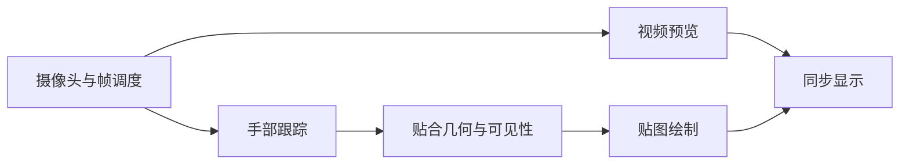

# AR 实时贴合性能现状与遗留问题

本文汇总 `/ar-tryon` 实时贴合的移动端性能与重设计方案。当前生产实现见白皮书 §4.5，测量过程见 `dev-log/2026-11-22.md` 和 `dev-log/2026-11-23.md`。接手入口、证据清单和待验项见 [AR 实时贴图性能交接](ar-render-performance-handoff.md)。

## 1. 测试环境与测量方法

| 项 | 值 |
| --- | --- |
| 设备 | OPPO PA2373，Android 15 |
| 浏览器 | Edge for Android 155（Chromium），WebGL2 |
| 视口 | 1120×653 CSS px，DPR 2.5，横屏桌面版视口 |
| 服务访问 | `adb reverse tcp:3000` → `http://localhost:3000/ar-tryon` |
| 驱动方式 | `adb forward` 暴露 `chrome_devtools_remote`，通过 CDP 注入钩子并读取计数 |
| 手部输入 | 整手展示照合成 `MediaStream` 作为摄像头输入（`public/nail-gallery/hero-hand.jpg`） |
| 纹理输入 | 按生产路径「上传单纹理」→ 裁剪确认 → 「应用到全部」五指 |
| 早期基线计数 | 主画布 `clearRect` 次数/秒、`requestAnimationFrame` 次数/秒 |
| 候选验收计数 | 主画布实际贴图且绑定唯一源帧的次数/秒。视频提交、主线程回调和清屏单列，见 §5.4 |

测量脚本位于 `.tmp/ar-perf/`（已被 `.gitignore` 覆盖，不进版本库）：`frame-budget.mjs` 输出每帧 `send`/绘制/间隔的均值与 p50/p90，`texture-bench2.mjs` 输出各 2D 方法累计耗时排名。

## 2. 当前数据

| 场景 | 会话首次基线 | 第一轮优化后 | 第二轮优化后 |
| --- | --- | --- | --- |
| 纯色贴合 | 12.5fps | 18.0—18.4fps | 18.25fps |
| 五指 alpha 纹理 | 8.75fps | 12.8—16.8fps | 17.9—18.4fps |

第二轮终点帧内预算（8 秒窗口，五指纹理）：`send` 均值 48.7ms，绘制均值 2.2ms、p90 8.5—10.9ms，帧间隔均值 54.6ms。纯色路径同期为 `send` 47.2ms、绘制均值 3.0ms。

## 3. 已定位并处理的开销

| 开销 | 证据 | 处理 |
| --- | --- | --- |
| 环境光逐指回读 | 每帧 5 次 `OffscreenCanvas.getImageData`，单次约 4.4ms | 改为整帧缩略一次读取，五指共享像素后取 5×5 邻域均值；`getImageData` 从约 59 次/秒降到 4.5 次/秒 |
| 环境光缩略帧本身 | `drawImage(video→CPU 画布)` 单次约 8.9ms（144×80） | 降到 96×54、TTL 220ms→320ms |
| 合成层逐帧重建 | 单次重建含 3 次 `getImageData`（各约 4.9ms）与 3 次 guard `drawImage`（各约 4.6ms），五指同帧重建把 p90 推到 30ms 以上 | 逐指合成层缓存（尺寸相对变化 <15%、亮度差 <0.12 才重建）+ 单帧重建预算 1 指 + 最小间隔 100ms |
| UI 状态逐帧写 React | `handCnt`/`handLabel`/朝向每帧 `setState` | 仅在变化时写入 |

## 4. 仍然存在的问题

### 4.1 推理固定开销决定约 18.5fps 上限（未解决）

前轮 `hands.send()` 单帧 47—50ms，在 480×270、640×360、960×540、1280×720 四档送帧尺寸与 `modelComplexity` 0/1 之间无实质差异。11 月 23 日复测的三次五指 alpha 贴图为 17.22–17.71fps，`hands.send()` 均值 49.79–51.56ms（含结果回调），绘制回调均值 2.84–3.06ms。推理占据主要帧预算，合成层重建仍影响长尾。只跳过 Hands 输出图的 JS 转换后，贴图 17.42fps，`send` 均值 49.85ms。此项降级为次要方向。

### 4.2 贴合画面按推理节奏更新（未解决）

现有 `ArView` 在 `requestAnimationFrame` 内串行等待 `hands.send()`，达到约 24fps 的节流间隔后才能启动下一次推理，收到结果才重画贴图。以 60Hz 的实测空载节奏为例，41.7ms 门槛跨过三个刷新间隔，当前调度即使零推理耗时也只产生约 20 次回调/秒。优化模型以后还需同时复核送帧调度。

### 4.3 合成层重建的残余尖峰（已缓解）

单帧预算把五指同帧重建摊到后续帧后，p90 从 30ms 级降到 8.5—10.9ms。单指重建仍需 20—29ms（像素回读占大头），在第一帧建层、纹理切换、亮度突变时会出现单帧抖动。GPU 加速后端与 CPU 后端的对比实验中两者差异在噪声范围内，当前保留加速后端。

### 4.4 环境光缩略帧的整帧回读（部分缓解）

缩略帧读取属于 GPU→CPU 拷贝，即使降到 96×54 仍是每 320ms 一次的同步回读。光照变化本身很慢，进一步降频或改用更小尺寸仍有空间，但收益量级在 1% 以内。

### 4.5 测试覆盖不足（未解决）

- 只在单一机型（OPPO PA2373）与单一浏览器（Edge 155）上测过，白皮书要求的中低端机型、iOS Safari 均未验证。
- 视口为横屏 1120×653 的桌面版模式。本轮数据只覆盖该布局，竖屏的画布尺寸、绘制耗时和摄像头裁切仍需测量。
- 五指对照使用静态展示照合成流，真实前摄复测窗口无手入镜。快速移动、侧转、遮挡、手心切换时的真实画质和跟手延迟待测。

### 4.6 Worker 原型与同机对照（2026-11-23）

在测试页临时接入同版本 Hands `0.4.1675469240`，逐帧只允许一个任务在途，沿用生产 `ArView` 绘制。每臂约 6.5 秒，使用相同横屏画布及实际带透明通道的 PNG，经上传、裁剪和「应用到全部」配置。报告计数区分主线程 `requestAnimationFrame`、视频提交与贴图；空画布的 `clearRect` 只算清屏。下表两臂来自同一轮，均确认画布存在贴图像素。

| 路径 | 贴图刷新 | 主线程 rAF | 合成流视频提交 | 送帧到回调均值 | 贴图帧间隔 p95 |
| --- | ---: | ---: | ---: | ---: | ---: |
| 生产主线程 WebGL 2 | 17.22fps | 21.64fps | 9.60fps | 51.56ms | 80.6ms |
| 诊断 Worker WebGL 2 + `VideoFrame` | 14.00fps | 59.99fps | 29.69fps | 64.36ms | 94.9ms |

- 隔离原型依次发现三个实际障碍。Blob Worker 的旧版依赖出现无效 URL，同源脚本又尝试把 `.tflite` 作为 JavaScript 导入，隔离修正数据文件与 GL 上下文后发现旧分支实际建的是 WebGL 1。该分支虽每帧返回 21 点，左右手与部分坐标异常，画布没有贴图像素。把诊断上下文初始化对齐到 WebGL 2 后，左右手结果与两个抽查点回到基线附近，画布有贴图。完整关键点、运动和贴合一致性仍待复验。
- 此机 `MediaStreamTrackProcessor` 暴露于 Window，测试 Worker 内为 `undefined`。`VideoFrame` 对象构造均值约 0.08ms，Worker 实例处理一帧均值 59.53ms。原型的运行结果支持主线程卸载价值，同时显示原版模型迁移后独立跟踪吞吐下降。合成流视频显著恢复，但其帧源也由主线程定时绘制，真机相机供帧与展示速度另测。

### 4.7 真实前摄供帧（2026-11-23）

同一前摄 `getSettings().frameRate` 在 1920×1080 和 1280×720 都报告 30。无手入镜，保留页面预览并跳过 Hands 实际推理时，两个尺寸的视频提交分别为 19.84fps、19.69fps，主线程 rAF 均约 60fps。通过 `MediaStreamTrackProcessor` 从克隆轨道读取 `VideoFrame.timestamp`，两档实测均为 19.90fps（分别采到 129、130 帧）。保留推理的 1080p 对照中，视频提交为 19.74fps、主线程 rAF 34.43fps。当前条件下，约 20fps 的限制已出现在浏览器收到的视频轨，具体是相机光照、系统相机配置或浏览器采集策略所致仍待分辨。

## 5. 实时试戴链路重设计

### 5.1 重做范围

建议替换 `/ar-tryon` 的实时会话和帧管线。现有 `ArView` 在同一循环里决定何时送帧、等待推理，再由模型回调完成坐标变换、贴图和 UI 状态更新。即使推理变快，约 24fps 的 rAF 节流在 60Hz 上也会把送帧量化到约 20fps。直接迁移旧 Hands 已实测会牺牲跟踪吞吐。19.9fps 的前摄限制出现在视频轨，需单独处理采集条件。

重用现有试戴页面、逐指校准、手心判定、透视与甲根锚定、连续 alpha 和甲根颜色保护。静态参考图的识别、裁剪和纹理提取继续沿用现有入口。首版以现有 Canvas 2D 为画质对照，接口稳定后可独立比较渲染后端；目前平均绘制约 3ms，优先解决供帧、推理和结果时效。

### 5.2 实时架构

| 模块 | 职责与约束 |
| --- | --- |
| 会话 | 统一持有相机轨道、帧回调、跟踪器和贴图会话状态。关闭、隐藏、启动失败或卸载都走同一释放逻辑。先使当前会话标识失效，再取消回调、释放帧、停止轨道并清空画布。晚到的回调只负责释放资源。React 接收权限、就绪、丢手、错误和用户配置等变化。 |
| 采集与调度 | 优先按 `requestVideoFrameCallback` 的新视频帧送帧，兼容路径用 rAF 加视频时间去重。每个会话只允许一个推理在途，最多保留一个可被替换的最新候选，旧帧立即释放。跟踪空闲即取最新帧。采集实际速率独立计量，摄像头低速时仍按真实输入工作。 |
| 跟踪 | 一个接口接收实际输入帧及有序时间戳，返回同一帧的关键点、左右手和跟踪状态。适配器负责模型坐标、旋转、裁切和镜像的归一化，明确深度单位及左右手语义。CPU、GPU、主线程和 Worker 是同一接口下的测试选项，生产按能力与实测选用。Worker 只返回贴合所需数据。 |
| 贴合与显示 | 结果生成带帧身份和时间的逐指几何。视频预览独立推进，画布仅在新几何、校准、材质变化或明确清除时提交。在可用的浏览器时钟域计算结果年龄，超时则隐藏过期贴图。有手心或丢失结果时在下一次绘制机会清除，清空平滑历史。保留一个共享的 cover/镜像变换，布局变化时复算，供视频、画布与触控校准使用。 |

帧身份包含会话、单调序号、媒体时间及实际送入跟踪器的尺寸和映射关系。`VideoFrame` 或 `ImageBitmap` 按能力实测选择并明确转移后的释放方。媒体时间和页面单调时钟分开记录，只有存在已验证的采集时间或外部对拍时才报告相机到屏幕延迟。参考 [Chrome 视频帧回调](https://web.dev/articles/requestvideoframecallback-rvfc) 和 [WebCodecs 帧传输](https://developer.chrome.com/docs/web-platform/best-practices/webcodecs)。

### 5.3 实施顺序与决策点

| 阶段 | 实施 | 据此决定 |
| --- | --- | --- |
| 1. 复现实机基线 | 在 PA2373 竖屏对照前后摄、日常与充足光照、720p 与 1080p。相机先单跑，再带五指贴图。覆盖静止、横移、快速反向、侧转、翻掌、遮挡和丢手重入。记录视频轨供帧、画面提交、有效跟踪和几何随时间的变化。 | 若视频轨仍约 20fps，把采集原因作为独立事项继续定位。用固定 30fps 的同源运动输入评估浏览器处理上限，同时报告真机相机结果。 |
| 2. 最小纵向原型 | 在隔离入口接通新调度、跟踪器和现有五指绘制。先让旧 Hands 分别跑旧/新调度，隔离调度收益。再在相同新调度下对比 MediaPipe Tasks Hand Landmarker `VIDEO` 模式的 CPU/GPU，在运行时核验实际后端，逐项测主线程与 Worker 的传输、跟踪和总延迟。 | 只有跟踪吞吐、主线程响应与贴合质量同时改善才选新的生产候选。已有旧 Hands Worker 结果作为对照。Google 的公开示例只用于配置参考，PA2373 收益以本机测量为准。[Google Hand Landmarker 文档](https://developers.google.com/edge/mediapipe/solutions/vision/hand_landmarker?tab=Web) |
| 3. 接回正式入口 | 用验证过的组合接回 `/ar-tryon`，用一个内部开关按会话选择实时引擎。旧路径作为迁移期回滚，同一会话仅一条路径持有相机和画布。覆盖低端 Android、iOS Safari 和项目要求的真机类别，再切换默认。 | 默认路径稳定后清理临时插桩和过渡分支，继续维护一个帧调度、一套几何和一套质量回归用例。浏览器支持不足时沿用经验证的兼容路径。 |

如果同一台机器在等效镜头和光照下，Web 采集持续偏低，可先用 Android CameraX 做等条件供帧对照。如果供帧已达标但 Web 跟踪仍超预算，可加测原生 Hand Landmarker。只有原生实测在供帧、跟踪或延迟上有足以兑现体验目标的优势，才值得承担 Android 客户端的维护成本。如果瓶颈集中在贴图重建长尾，再加测 GPU 合成。如果跟踪已达吞吐目标，优先解决几何时效和显示同步。短窗预测仅在实测运动误差改善后纳入，并在掌面、遮挡、时间断点或丢手时立即失效。[Android CameraX 图像分析](https://developer.android.com/media/camera/camerax/analyze)

### 5.4 工程验收草案

- **吞吐和时序**。同帧配对，固定纹理、布局与分辨率。先做预热，再做至少三组各 30 秒的对照窗口，候选加一次 10 分钟连续运行看温升和掉速。约 30fps 的实际输入下，首个目标是稳定可见手背上每秒至少 27 次绑定不同源帧的有效五指姿态更新，帧间隔 p95 不高于 50ms。供帧只有约 20fps 的窗口，同时报告覆盖输入的比例和最长丢帧间隔。记录输入、有效跟踪、实际贴图、主线程帧间隔及各段延迟，重复绘制、清屏或预测插帧单列。端到端延迟 p95 与同条件旧版配对，评估默认切换时要求无回退。
- **贴合质量**。固定姿态回放逐指核对甲根、两侧、甲尖和 alpha，真实运动用对应画面做逐帧复核。观察快速反向的拖尾、过冲、翻掌误贴和重新入镜时的残留。对齐左右手、旋转、镜像、裁切和触控坐标，保留既有甲根保护与校准回归。任何出现关键点非有限值、误贴掌面或跨会话残留的候选返回诊断。
- **会话与兼容性**。关闭、切后台、卸载、权限拒绝、引擎初始化失败、切镜头和反复启停均检查活动轨道、在途帧、Worker、画布与内存。切换引擎的配置和失败原因可从本地诊断读取，稳态只采集计数与时序。摄像头画面持续在端侧内存处理。以上数值用于比较诊断候选，正式发布按白皮书和现行验收执行。

### 5.5 首轮实施结果（2026-11-23）

- PA2373 已切到物理竖屏，实测页面为 787×986 CSS px。当天同环境的四个约 8 秒无手、无推理窗口中，前摄 1080p/720p 的轨道时间戳分别为 19.89/19.90fps，后摄分别为 29.82/29.84fps；浏览器四组均报告协商 30fps。后摄提供同机接近 30fps 的真机输入。前摄的光照和系统采集配置仍待配对。
- `src/lib/ar-video-frame-loop.ts` 已接通本机开发环境的 `/ar-tryon?arScheduler=video-frame`。它按新视频帧计时，合并等待时到达的帧信号，并在会话停止时取消等待。旧 Hands 此轮仍直接读取当前 `<video>`，因此信号时序仅用于调度对照，暂无逐源帧绑定的贴图证据。
- 同一真机用合成运动源和五指 alpha 纹理做了各三次 30 秒的 A/B。旧调度清屏 17.16–17.75 次/秒，新调度 12.46–12.73 次/秒，清屏间隔 p95 从 79.1–81.6ms 变为 106.4–113.5ms。新调度的主线程 rAF 为 27.65–28.30fps，旧调度为 20.99–24.43fps。六个窗口均有关键点，五个窗口结束时画布读到贴图像素，旧调度一个窗口结束时画布采样为 0。该对照的输入由主线程定时绘制，计数用于调度比较，完整运动画质和真实输入的逐帧验收仍待执行。
- 固定 30fps 的本地 WebM 运动源已复验，卷入主线程定时绘制的影响减少。每臂约 12 秒，同用生产五指绘制。第一组旧调度/新调度的实际贴图绘制约 14.0/11.8 次/秒。Hand Landmarker `0.10.35` 在新调度下的 CPU/GPU 配置分别平均约 53.6/41.7ms 跟踪，两组均输出 21 点但贴图为 0，返回的左右手与旧 Hands 相反。CPU 日志确认 XNNPACK；GPU 配置观察到 WebGL 2，实际算子落点仍待细分验证。
- 在同一固定视频上临时对齐左右手后，GPU 配置恢复至约 10.8 次实际贴图绘制/秒、绘制间隔 p95 235.7ms，同轮旧版为约 13.0 次/秒、p95 149.6ms。CPU 仍为 0 次贴图。左右手修正只用于该夹具，真实姿态的坐标、深度尺度和拒贴逻辑需单独对照。绘制计数来自有 `drawImage` 的画布刷新，源帧身份尚未逐一绑定。
- 旧调度保留为默认。Worker 版 Hand Landmarker 的继续对照见 §5.6。

### 5.6 Worker 跟踪候选（2026-11-23）

- PA2373 竖屏 787×986 CSS px，沿用生产画布。相同原运动片段下，GPU 配置 Worker 在 16 秒内返回 445 个带独立帧号的结果，实际贴图 366 次（22.87 次/秒），主线程 rAF 60.06fps。平均跟踪 31.70ms，创建 `VideoFrame` 0.04ms，双向消息与调度额外均值 1.21ms。现有门共拒绝 79 次，原因均为竖屏 cover 后手部出画面。CPU Worker 的 386 帧同样都返回 21 点，全部因出画面拒贴，平均跟踪 39.70ms（XNNPACK）。GPU 配置观察到 Worker WebGL 2，算子精确落点仍待跟踪器级证据。左右手适配依旧限于合成夹具。
- 浏览器测试服务使用端侧解码固定 30fps VP9，帧均在本机浏览器内处理。启动异常与合成夹具边缘拒贴单列，保留原始窗口。Worker 原型暂由本地诊断脚本接入，生产模型和默认配置见白皮书 §4.5。
- 居中运动夹具不触发出画面拒绝。同机各三组 30 秒交错对照，旧 Hands 实际绘制 18.20–18.69 次/秒、绘制间隔 p95 73.3–77.7ms。GPU 配置 Worker 按帧号去重有效贴图为 854/851/852 次（28.37–28.47 次/秒）、p95 47.8–48.9ms，主线程 rAF 约 60fps。此结果覆盖工程草案的短窗合成吞吐目标，真实相机跟手质量和长跑单独记录。帧号绑定 Worker 收到的快照及媒体时序，旧版绘制频率仅计 `drawImage` 调用。
- 已构建 Android 原生离线探针。设备在安装本地调试 APK 时要求身份验证，已退出安装流程，当前无原生推理测量。浏览器路径继续验证。
- 居中运动夹具在同机连续运行 600 秒。实际贴图 17,718 次，全部绑定不同输入帧。视频提交 29.85fps，贴图平均 29.53 次/秒，每分钟 28.78–29.80 次/秒，帧间隔 p95 全窗 48.1ms、逐分钟 47.0–49.5ms，主线程 rAF 60.13fps。末分钟贴图率 28.78 次/秒。USB 连接期间电池温度 20.4–21.0°C，Android 热状态各次采样均为 0。该窗口覆盖固定回放的持续运行门。

### 5.7 接入决策

- 把实时会话做成独立模块，统一相机轨道、帧调度、跟踪结果、画布提交的启动与关闭。`ArView` 管理交互和校准入口，贴合几何继续消费归一化关键点。引擎选项集中在会话启动阶段，优先验证 Hand Landmarker Worker，旧 Hands 作为初始化失败、能力缺失或迁移回滚的会话级兼容路径。两条引擎共享贴合与拒贴规则。
- 独立会话已接入相机启动、等待和释放。PA2373 上，默认调度和视频帧调度均复验显式关闭、重新启动及视频解绑。切到系统桌面再恢复这一步，两种调度均有约 1.9 秒页面动画回调间断，网页未收到所监听的可见性、焦点、冻结或轨道事件，返回后网页轨道仍处于 live。系统占用探针在前台也未识别到 Edge，后台硬件状态待另测。
- 接入前先固定适配器合同，明确同帧标识、时钟、左右手、坐标、旋转、裁切和镜像。用真实前后摄验证左右手、翻掌、侧转、遮挡、离开并重新入镜、快速反向，以及切镜头和后台恢复后的资源释放。后摄用于接近 30fps 的真机对照，前摄另做同镜头同光照下的供帧测量，并报告覆盖比例和最长更新间隔。
- PA2373 同场景竖屏、720 档、无手无跟踪的四个前摄窗口中，请求 30fps 上限、精确 30fps 或优先 60fps，均协商到 30fps，真实供帧 19.91–19.92fps，帧间隔中位数约 50.2ms，p95 55.5–58.6ms。后摄同轮精确 30fps 实测 29.86fps、p95 37.1ms。
- 前摄继续做自动→手动 10ms→手动 20ms→自动的配对探针。自动两窗为 19.91/19.92fps，手动两窗为 29.95/29.94fps，浏览器回报曝光值为 100/200，模式为 `none`。片尾内存抽样的 8 位平均亮度为 12.54→0.35→0→11.29，手动画面几乎全黑，保留自动曝光。曝光设置改变了这次测试的供帧速率，充分光照下的自动曝光上限与实拍画质仍待复核。[W3C 摄像头曝光时间定义](https://www.w3.org/TR/image-capture/#exposure-time)
- 通过三组短窗、10 分钟持续运行及真实运动质量对照后，再以内部开关接回正式入口。端到端延迟与旧版配对达标、其他目标手机通过后切换默认。去掉迁移期的独立调度与调试钩子，统一会话与绘制入口。原生方案按 §5.3 的同机对照条件排期。

### 5.8 本机入口接入与系统相机交叉验证

- 本机开发入口已可通过查询参数 `arTracker=worker` 选择候选，Worker 初始化失败时回落 Hands。每次实际采集生成 `VideoFrame`，仅保留一个处理中的帧和一个可替换候选，回包必须匹配被处理的帧号。生产默认继续使用 Hands。开发探针仍使用独立本机资产服务和夹具核对过的左右手适配。
- PA2373 同页 30 秒居中回放，Worker 三窗实际贴图 864、855、852 次，全部对应独立输入帧。贴图速率为 28.80、28.50、28.40 次/秒，间隔 p95 为 47.4、49.4、50.7ms。第三窗超过 50ms 目标。同页旧版对照为 18.10 次/秒、76.9ms。Worker 视频回调至完成贴图处理的 p95 为 69.9–72.3ms，真实采集和显示时延另测。
- 后摄实拍无手窗口 30 秒，视频提交 29.90fps，Worker 回包 898 帧；无手关键点、贴图与画布残留均为 0。该窗口验证相机和 Worker 连通、空场拒贴。
- 默认、视频帧调度和 Worker 各复验一次切后台。Android 相机服务日志三次均显示前台 `CONNECT`、后台 `DISCONNECT`、回前台重新 `CONNECT`。网页未收到所监听的生命周期事件，视频轨保持 live。硬件释放已复验，网页回前台仍需手动启动这一产品要求尚未满足。
- Worker 绘制采用 150ms 帧龄上限，从页面观察到视频帧计时。过期回包拒贴，已有覆盖超时清屏；空场后的同状态帧跳过重复清屏。PA2373 15 秒正常回放有效贴图 431 次、间隔 p95 49.1ms；注入 220ms 回包延迟后 52 个过期结果全数拒贴，结束画布无残留。
- 加入时效保护后，三组各 30 秒居中回放为 841、873、862 次有效贴图，28.03–29.10 次/秒，间隔 p95 分别为 50.1、47.6、48.5ms。仍有一组略过 50ms 上限，暂保留旧默认。
- 用 MediaPipe 官方左手、右手测试照片做 4 个输入对照，包括两张原图及各自的水平镜像。Worker 对两张原图返回与官方样本标签一致的左右手，镜像后各自反转。旧 Hands 的原始标签在 4/4 个输入上恰好相反，确认 Worker 进入旧绘制判定时需要适配标签。真实摄像头的镜像和用户界面左右手仍待实拍核对。[官方 Hand Landmarker 测试](https://github.com/google-ai-edge/mediapipe/blob/master/mediapipe/tasks/cc/vision/hand_landmarker/hand_landmarks_detector_graph_test.cc)

### 5.9 公开运动片段自动对照

- 使用 TensorFlow.js 手部关键点测试的 25fps、13 秒真实运动片段。原 H.264 4:4:4 在测试页未启动。保留 4:4:4 色度的 VP9 与原片 325/325 帧解码哈希一致；PA2373 的该格式视频轨提交 24.97fps，Worker 回包 741 次、识别到手 0 次。旧 Hands 也持续返回空结果，等待识别成功的探针超时。[TensorFlow.js 原始测试](https://github.com/tensorflow/tfjs-models/blob/master/hand-pose-detection/src/tfjs/tfjs_test.ts)
- 原片每 20 帧完整解码成 PNG，两路径均识别 17/17 帧。357 个同帧关键点相互差异中位数 0.66px、p95 4.14px。与上游随片发布的模型输出相比，Worker 的 2D 差异 p95 为 9.50px，旧 Hands 为 9.21px。此对照衡量跟踪器差异，甲面位置和实际相机跟手另行验收。原图中的左右手映射 17/17 与上节一致。
- 转为 PA2373 可用的 VP9 4:2:0，保留 620×1080、25fps、325 帧和原顺序，色度采样发生变化。同一片段各跑 30 秒，Worker 747/747、旧 Hands 550/550 识别结果均判为手心并拒贴，两臂贴图及结束画布像素均为 0。Worker 页面视频提交 24.97fps、主线程 rAF 62.23fps，旧 Hands 分别为 22.51fps 和 31.46fps。该片仅覆盖手心拒贴，无手背贴合验收。

### 5.10 采集与输入开销对照

- PA2373 固定 30fps 居中夹具，原尺寸与 Worker 内缩到 640px 长边各两组 15 秒回放。原尺寸实际贴图 29.00/28.87 次/秒、间隔 p95 48.5/48.6ms；缩小为 27.13/27.73 次/秒、p95 50.1/50.5ms。缩小分支含图像重采样开销，实际测得更慢，继续保留原尺寸。
- 本机 Worker 通过 `arCapture=track` 加测媒体轨道原始帧。该路径共享同一个最新候选队列和 Worker，直接转移克隆轨道上的 `VideoFrame`，关闭时释放读者与克隆并保留预览主轨的所有权。不支持时沿用视频回调快照。后摄无手 15 秒单组对照，两路径的视频提交均为 29.80fps，快照与轨道路径分别处理 440/448 帧。经各自浏览器取帧接口观察到帧至返回处理的 p95 分别为 62.7/50.4ms，包含取帧观察点差异，光学端到端延迟需单独测量。
- 去掉额外的轨道测量克隆后，两条路径各交错测试三组 15 秒，主线程均约 60fps。视频快照 432/416/415 次贴图，间隔 p95 50.7/50.4/49.1ms；轨道转移 414/417/417 次，p95 48.1/50.5/48.4ms。两条路径每窗均超过 27 次/秒，仍有窗口超过 50ms，暂保留视频快照作为 Worker 候选的默认输入，轨道转移限对照。

### 5.11 页面候选长跑与兼容回落

- PA2373 当前页面候选固定 30fps 移动夹具跑满 600 秒，实际贴图 17,398 次，全部绑定独立帧号，0 次过期。平均 29.00 次/秒，逐分钟 28.65–29.32 次/秒，贴图间隔 p95 全窗 48.4ms、逐分钟 46.8–49.0ms。主线程约 60fps，Android 热状态全程为 0，电池 19.4–20.0°C。该测试覆盖本机页面版本的固定回放长跑，短窗偶发超过 50ms 的原始记录保留。
- Windows Chrome 和 Edge 各测默认 Hands、缺少 `VideoFrame`、Worker 构造失败三个入口。6/6 均识别回放帧，关闭后轨道已结束并解除视频绑定。另一次无头 Chrome 运行 Worker 已初始化，但连续运行报告推理失败；仅以明确完成的回落入口作为跨浏览器证据。
- PA2373 用带阶段标记的切换回放逐帧核对画布。130 个手心结果与 77 个空场结果均无贴图，三个手心首结果和三个空场首结果的画布像素均为 0。三次重入镜均在首个返回结果恢复贴图，手背两个阶段共贴图 309 次。三帧过期结果均未贴图。此为切换回放和画布清理证据，未测物理手部跟手延迟；探针含同步读回，帧率不作比较。
- 另做无阶段读回的 30 秒抖动归因。865 次贴图、p95 47.3ms。按绘制处理完成计的 32 个大于 50ms 的间隔全部出现在连续源帧间；40 个跨源帧间隔均未超过 50ms。这 32 个慢间隔的当帧 Worker 推理中位数为 37.6ms，连续源帧总体为 29.6ms，优先排查推理长尾和回包时序。
- Worker 连续三次取帧或推理失败时，停止旧帧循环和 Worker，清空覆盖与跟踪状态，再切换到 Hands，同次会话保留相机。Chrome 和 Edge 注入式运行失败各一组均在三次错误后终止 Worker 一次，由 Hands 恢复识别，关闭后轨道结束并解绑。更新后 PA2373 正常回放 15 秒实际贴图 423 次，间隔 p95 51.7ms，该窗仍高于 50ms。

### 5.12 Worker 输入与贴图间隔归因

- PA2373 物理竖屏，视口 787×986、DPR 2.5，固定 1280×720 移动回放、同一 GPU 模型和五指 alpha 纹理。两臂都从页面接收 `VideoFrame`；实验臂在 Worker 内先转原尺寸 `ImageBitmap`，Worker 耗时含转换。三对各 30 秒交替执行，六窗均有实际画布贴图，绑定的源帧号唯一，无过期拒绝。

| 对照顺序 | 直接 VideoFrame 贴图数 / 间隔 p95 / Worker p95 | 转 ImageBitmap 贴图数 / 间隔 p95 / Worker p95 |
| --- | --- | --- |
| A，直接输入先跑 | 827 / 49.6ms / 43.0ms | 843 / 49.5ms / 41.9ms |
| B，转换先跑 | 851 / 49.3ms / 40.3ms | 862 / 48.1ms / 39.8ms |
| C，直接输入先跑 | 858 / 48.4ms / 40.4ms | 841 / 49.6ms / 41.7ms |

- 六窗都达到 27 次/秒和 50ms 的回放门，转换臂第三对的吞吐及间隔回退，继续直接传 `VideoFrame`。输入对照的帧源一致，用于性能比较，甲面轮廓仍需按逐帧质量门验收。
- 只读复算 §5.11 的 32 个慢间隔。相邻结果对应的视频观察间隔中位数为 33.2ms，帧龄差中位数为 +19.8ms。逐帧拆开后，推理耗时差中位数为 +6.0ms，其余帧龄差中位数为 +14.9ms，包含排队、传输和绘制处理。各分项中位数独立统计。
- 追加三组各 30 秒真机回放，在页面同一时钟下分别记录帧观察、发给 Worker、收到回包、应用结果结束。三窗实际贴图 850/863/859 次，间隔 p95 49.5/46.7/50.4ms，第三窗保留为超门；每窗第一个在途帧在计时开始前已发出，分段统计分别纳入 849/862/858 帧。
- 等待送帧 p95 31.8–33.3ms、Worker 推理 39.7–40.4ms、消息往返扣除推理 2.0–2.3ms、应用结果和绘制 11.7–12.2ms。按应用结果结束计算的 108 个慢间隔中，101 个对应相邻源帧。各窗慢间隔内，应用及绘制耗时比上一帧多 10.7–13.2ms（中位数），推理多 5.6–8.7ms。等待送帧增加了帧龄，但三窗的慢间隔内相邻等待时长差的中位数仅 +0.2～+1.1ms。下一轮优先定位应用及绘制中的同步像素读回或层重建，并验证能否从每帧提交的关键路径移出，其次比较推理长尾。

### 5.13 绘制尖峰与环境光采样

- 在 PA2373 固定移动回放追加两组 30 秒 Canvas 细分计时，分别实际贴图 881/899 次、间隔 p95 49.2/48.5ms。分段覆盖 881/898 帧，按应用结果结束计有 44/33 个慢间隔，其中 33/22 个对应帧刷新了环境光。
- 两窗只刷新环境光的 88/89 帧，绘制处理 p50 为 12.2/12.3ms，缩略绘制及读回 p50 为 11.0/11.4ms。两项都命中缓存的 791/806 帧，绘制处理 p50 均为 0.8ms。两窗仅五帧观察到甲根保护的层像素写回，环境光为该夹具稳态抖动的主要可干预开销。距离变化、换款和突变光照下的层重建仍需独立验证。
- 独立采样 Worker 探针与同步采样交错各三组 30 秒，过程保持同一手部推理和绘制规则。同步路径贴图 822/838/851 次，间隔 p95 50.5/49.5/48.5ms；异步路径 863/876/882 次，p95 46.7/45.8/44.6ms。应用及绘制 p95 从 12.0–13.0ms 降至 1.4–1.6ms，观察帧至处理完成 p95 从 71.8–77.6ms 降至 64.5–67.0ms。夹具含 267 次异步采样，稳态同步回退 0 次。探针在刷新时复用上一张缩略图至下一个刷新点。
- 同一安卓浏览器以两个固定夹具的 16 个暂停画面、三种视口比例（竖屏、横屏、窄竖屏）对拍。独立 Worker 采样与现行主线程视频缩略像素 48/48 组逐字节一致。该对照核验裁切和取样的像素一致，动态光照响应及最终贴图质量仍待验。
- 本机开发页 `/ar-tryon?arTracker=worker&arLighting=worker` 可启用独立采样。同一会话只允许一个环境光样本在途，完成后立即供下一次贴图复用；尚无有效近帧、采样失败或跟踪回落时沿用同步采样。相机关闭时释放采样 Worker。PA2373 接入后正常三窗为 881/892/885 次独立源帧贴图，间隔 p95 43.0/43.8/43.7ms，三次摄像头关闭均验证轨道结束、视频解绑、环境光 Worker 终止一次。
- PA2373 注入环境光 Worker 首次传帧失败，确认 Worker 终止一次，手部跟踪与同步采样继续处理，30 秒完成 848 次独立贴图、间隔 p95 49.8ms，关闭后轨道结束并解绑。接入版的长跑与明暗切换见 §5.14。

### 5.14 独立环境光采样长跑与动态复验

- PA2373 接入版固定运动回放 600 秒，视频回调 29.84fps、主线程 rAF 60.12fps。17,708 个独立源帧实际贴图，平均 29.51 次/秒，贴图间隔 p95 44.7ms。逐分钟 29.43–29.58 次/秒、p95 43.9–45.2ms，十分钟窗口均达到目标。
- 全窗共 17,715 个已追踪源帧，另有 5 个出画拒贴、1 个超龄结果和 1 个无朝向事件结果，均未进入贴图计数。环境光 1,785 次请求全部回包，活动期未终止。电池 19.7–20.1°C，12 次 Android 热状态读数均为 0。关闭后轨道结束、视频解绑、环境光 Worker 终止一次。
- 固定画面每两秒明暗切换，左右臂用同一帧标记与五指合成层记录。同步和独立采样两臂分别 14/14 次完整切换后五指均达到目标调暗强度，五指明暗稳态调暗系数逐项一致。首次观察到变化至五指进入稳定范围的耗时中位数分别为 510.9/482.5ms，最大值 648.9/670.7ms。探针从实际送给跟踪器的帧同步读标记，仅用于状态和相对响应，性能门采用无此读回的回放。
- PA2373 实机权限拒绝时未请求轨道或创建 Worker。前后摄交替四次使用探针指定镜头、确认实际轨道 `facingMode`，每次主动关闭均结束轨道并终止两个 Worker。站内切到图库后，等待 React 卸载再验轨道结束和两个 Worker 退出。该探针覆盖重新启停时对前后摄的适配，当前产品按钮只反转显示手性。
- 快速反向的固定几何回放见 §5.15。真人侧转、遮挡与对照时延、多设备及应用切后台复位验收按 §5.4 继续。

### 5.15 往返运动与贴图位移误差

- 固定手背姿态，1280×720、30fps，画面按源帧平移 6px，往返极值 ±48px，并周期性回到原点静止。128/128 帧的独立位移标记经解码复算。PA2373 的绘制探针在 Worker 入参读位移，并在同一帧的五次画布贴图记录仿射中心。各指用静止原点分别标定基准，指标为对已知平移的横向差值（CSS px）。该诊断含逐帧同步读取，帧率不作吞吐验收。
- 普通滤波两组各 30 秒，进入五指位移计算 441/445 帧；共有 31/33 个完整的反向首结果。移动阶段五指中心位移误差 p95 为 11.11/11.26px，原始指尖关键点位移误差 p95 为 7.13/7.48px；反向首结果的中心误差 p95 为 6.72/8.41px。静止与移动阶段分开统计，五指中心与指尖均使用各自基准。
- 本机候选参数 `arPose=translation` 在手背稳定且关键点时间、画面尺寸和手性连续时，提取手腕和四个掌指关节的一致位移。把位移用于更新上一帧滤波状态，逐指局部几何仍用原滤波，提交依旧绑定当前结果。两组候选各触发 87 帧，稳定静止段 0 次。

| 30 秒窗口 | 五指有效帧 | 移动位移误差 p95 | 反向首结果误差 p95 | 稳定静止位移误差 p95 |
| --- | ---: | ---: | ---: | ---: |
| 同轮原滤波 | 485 | 11.32px | 6.30px | 1.45px |
| 平移分离 1 | 456 | 6.83px | 6.05px | 1.34px |
| 平移分离 2 | 460 | 7.42px | 4.87px | 1.18px |

- 这是已知几何平移的同源窗口对照，各窗口实际送达的源帧不同。逐指移动误差 p95 都下降；原始指尖移动误差 p95 分别为 7.46/6.74/7.53px。保留该能力于本机候选，并用独立混合姿态验证手指局部运动和旋转时的行为。
- 开启平移分离后，157 个手心帧、72 个空场帧均无贴图，六次切换到手心或空场的首帧画布透明，三次重入首帧恢复贴图。两帧超龄结果均未贴图。无标记读回的 30 秒移动回放为 862 次独立贴图（28.73 次/秒），间隔 p95 45.3ms，0 次过期，关闭后相机与环境光 Worker 正常释放。

### 5.16 旋转和平移混合时的候选诊断

- 对固定手背画面生成静止、±24° 平面旋转、旋转叠加 ±30px 横向与 ±16px 纵向平移三个阶段。夹具 120/120 帧的几何编号与实际解码标记一致；PA2373 两个各 30 秒的窗口都经实际手部跟踪。在候选窗口，静止 97 帧、纯旋转 156 帧均未触发平移分离，混合移动 148 帧触发 5 次。
- 与由源画面变换计算的五指中心相比，原滤波与候选的误差 p95 分别为纯旋转 16.44/14.87 CSS px、混合移动 17.14/15.78 CSS px。混合移动角度误差 p95 4.29°/4.46°，同轮原始指尖误差也不同。该结果支持纯旋转不误触发，混合阶段只作观察；真实手部绕画面内轴的侧转仍待验收。
- 独立小指反折对照给两条路径注入相同的 120 组关键点，运动只发生在小指末两关节。反折阶段原滤波 110/111 帧、候选 109/110 帧正确显示四指。两条路径各在采样首条多画一次小指，其余四指在稳态反折段的绘制中心和角度偏差 p95 均为 0，候选全程未触发平移分离。
- 另外两个冷启动窗口从首个模型结果开始注入反折姿势。首结果超龄未绘制，首个有效结果均画了五指；其后首个有效结果均正确显示四指。现有逐指可见性以 1 初始化，更新权重 0.3、阈值 0.5，即使输入从第一帧判为不可见，首个更新仍可通过绘制门。下一轮候选应将初始可见性从首个有效判定初始化，并用持续反折、重新伸直和重入对照稳态迟滞。

### 5.17 Worker 候选逐指可见性初始化

- 每次启动候选 Worker 会话，或手心、丢手、覆盖过期触发跟踪状态重置后，逐指从该指首个有效判定建立可见性状态。可见性与关键点和甲面几何分别平滑，连续跟踪沿用现有迟滞。绘制与 UI 读取同一组分数。
- PA2373 原滤波与平移补偿各验 69 个有效结果、2 个过龄结果。相同反折输入的冷启动首个有效结果由两臂各画五指改为各画四指；两臂冷启动各 6/6 帧、反折重入各 8/8 帧都只画四指。伸直重入各 6/6 首帧起画五指，持续伸直最迟第 3 个有效结果恢复五指。两次丢手的首结果画布 alpha 均为 0。
- 去掉逐帧同步标记读回后，连续跟踪的 5/5 次单帧反折保持五指，另一次反折前确认覆盖因过期清空，该次按新姿态画四指，随后伸直第 3 个有效结果恢复。首版无过期清屏归因，严格防闪烁断言失败，保留其记录。当前验证范围为注入关键点下的绘制状态；真人跟手、端到端配对时延与多设备仍按 §5.4 验收。

- 无逐帧标记读回的独立 30 秒移动回归为 869 次唯一源帧贴图（28.97 次/秒），间隔 p95 45.0ms，0 次过期。关闭后停轨、解绑并释放环境光 Worker。

### 5.18 浏览器预览到贴图的时延对照

- PA2373 用同一 1280×720、30fps 平面旋转和移动夹具，保持相同布局及五指 alpha 纹理，以 Hands→Worker、Worker→Hands、Hands→Worker 顺序各测 30 秒。Hands 在实际 WebGL 视频上传处取原始时间戳，Worker 在捕获并转交的同一帧保留原时间戳。仅当该时间戳与预览回调的原始帧和媒体时间一致时，计入预览提交至最后一次贴图绘制调用完成的延迟。一次预览帧有多次贴图时，以首次完成计入。 [WebCodecs VideoFrame](https://www.w3.org/TR/webcodecs/#videoframe) · [浏览器视频帧回调](https://wicg.github.io/video-rvfc/)

| 对照组 | Hands 有效配对的唯一帧 | Worker 有效配对的唯一帧 | Hands 延迟 p95 | Worker 延迟 p95 |
| --- | ---: | ---: | ---: | ---: |
| 1 | 281 | 595 | 148.9ms | 124.5ms |
| 2 | 264 | 610 | 152.5ms | 126.3ms |
| 3 | 275 | 606 | 144.6ms | 124.8ms |

- 这是各路线内部按同一帧身份核对的时延。浏览器实际预览提交 Hands 为 16.66–17.45fps，Worker 为 29.79–30.17fps。Hands 分别有 64、62、50 次贴图缺可靠的预览配对，另有重复贴图。Worker 对应 1、0、1 次，跨预热边界单列。已匹配帧的 p95 连续降低 19.8–26.2ms，p50 则由 65.6–67.7ms 增为 76.1–78.9ms。此组证据未覆盖两路线共同的固定画面编号分布及物理相机到屏幕的延迟。

- 独立解码器按 30fps 从同一夹具喂帧，两路径各 12 秒均送出 361 帧，预览实际 29.77/30.00fps。轨道帧时间戳按夹具编号验证，计时前各抽查 12 个画面标记全部吻合。107 个共同源帧的送帧至贴图 p95 为 Hands 106.5ms、Worker 131.5ms。预览至贴图 p95 为 105.8/130.6ms。预览至实际推理输入 p95 为 31.4/60.9ms，输入至贴图 p95 为 81.8/76.6ms。等供帧对照出现延迟回退，优先检查取帧与排队，不触发默认切换。
- 同一混合旋转夹具去掉逐帧身份配对后单独跑 30 秒，Worker 实际 598 次独立贴图（19.93 次/秒），间隔 p95 81.2ms、0 次过期。预览实际 29.73fps。该窗口未达 §5.4 的贴图稳定门，需保留与此前固定移动夹具 28.97 次/秒、45.0ms 的分场景差异。

- 独立软件解码复测加入直接轨道取帧。12 秒与反序 30 秒三路共有 85、247 个源帧。按 Hands、Worker 视频回调、Worker 直接轨道顺序，送帧至贴图 p95 分别为 112.7/123.3/113.4ms 和 92.3/128.9/127.0ms。长窗直接轨道把预览至实际输入 p95 从 59.7ms 降至 50.2ms，输入至贴图 p95 从 71.5ms 升到 81.5ms，完整窗口实际贴图由 20.42 变为 20.09 次/秒。继续保留两种采集用于归因，优先分离贴图合成层重建与推理长尾。

### 5.19 混合旋转下的合成层重建与推理重叠

- PA2373 两个 30 秒固定回放分别画 605、594 个唯一源帧。贴图间隔超过 50ms 的 282、281 次中，255、254 次对应合成层重建。重建帧的结果处理 p50 为 17.1、17.0ms，缓存命中时为 0.9、0.8ms。同步像素回读在重建帧占 13.7、13.6ms（p50）。重建帧的推理 p95 也高于缓存命中帧，分别是 59.9、59.1ms 对 51.0、51.5ms。该分组反映同帧关联。
- 让下一帧 Worker 推理先发，再通过独立任务应用已完成结果。两个交叉对照的候选各有 390、401 次实际重叠超过 1ms，实际贴图从 19.93、20.03 次/秒增至 21.69、23.90 次/秒。贴图间隔 p95 由 80.3、82.0ms 变为 84.4、72.4ms，结果完成时龄期 p95 由 124.0、125.6ms 增至 152.5、131.6ms。主线程长任务从各 1 次增至 40、20 次，过期结果从 0、1 次增至 4、2 次，已撤回延后贴图候选。

- 本机 `arLayers=readback` 候选为逐指合成层及 1px/2px 保护源启用 Canvas 读回优化，维持原甲根保护、仿射几何和图层重建策略。首轮注入对照与反序代码接入对照的实际贴图分别为 20.20→25.63、20.77→25.39 次/秒，间隔 p95 为 83.6→54.5、78.7→53.6ms，重建帧读回 p50 为 13.5→4.7、13.0→4.6ms。两组均 0 次过期，候选仍低于 §5.4 的 27 次/秒且高于 50ms。 [HTML Canvas 读回设置](https://html.spec.whatwg.org/multipage/canvas.html#concept-canvas-will-read-frequently)
- 固定画面和同一组关键点的像素对照中，两臂五指仿射变换逐项一致。Canvas 最终 RGBA 字节存在差异，612,324 像素中 1,849 像素 alpha 改变，阈值 128 的覆盖 IoU 为 0.99424，双方均覆盖像素的 RGB 平均绝对差为 1.05/255。候选继续处于开发验证，甲根、侧缘、甲尖及动态光照仍需覆盖。
- 生产接入建议沿用 §5.3 受控切换。固定 Worker、跟踪模型和 WASM 版本，部署同源资产，用内部开关选择候选，保留 Hands 回落，调试参数限开发环境。生产默认切换要通过混合运动、端到端时延、实拍贴合和多设备验收。

### 5.20 Worker 接入隔离生产构建

- 设置 `NEXT_PUBLIC_AR_WORKER_CANDIDATE=1` 后执行 `npm.cmd run build`，再以相同设置运行 `npm.cmd run start`。使用独立 `.next-ar-worker` 输出目录。默认构建走 Hands，调试参数仍仅用于开发环境。普通开发构建要使用 Worker 探针时，先执行 `npm.cmd run prepare:ar-worker`。
- 预构建从 npm 锁定的 MediaPipe Tasks Vision 0.10.35 整理浏览器入口和 WASM，官方 float16 v1 模型绑定 SHA-256 `fbc2a30080c3c557093b5ddfc334698132eb341044ccee322ccf8bcf3607cde1`。离线构建可用 `AR_WORKER_MODEL_FILE` 指定同一文件。页面、脚本、模型与 WASM 由同一源提供，生成资产不入库。候选加载失败或持续取帧、跟踪失败时回落 Hands，使用同一个摄像头会话。
- PA2373 Edge 隔离生产构建通过正常运行、模型返回 404、连续三帧有效结果后注入 Worker 运行错误三项测试。两次回落均重新产生贴图，主动关闭后均确认 Worker 只终止一次、轨道结束且视频解绑。正常组从请求相机至 Worker 就绪约 1.08 秒；混合旋转暖机后 30 秒内绑定 745 个 Worker 帧序号，24.83 次/秒，按每帧首次贴图统计间隔 p95 56.9ms。候选仅启用图层读回优化，未打开环境光 Worker 或掌部运动分解。该回放仍未通过 §5.4 的吞吐及间隔门。
- 同机真实后摄空场连续 30 秒，浏览器协商 1920×1080、30fps，Worker 回包 879 次，检出手部和贴图均为 0，未触发回落。主动关闭后轨道结束、视频解绑，Worker 终止一次。
- 桌面 Chrome 无头回放两次正常测试都发生回落。诊断改进后确认 Worker 已初始化，但首个有效结果前发生 2 秒响应超时。Hands 接管后继续贴图。桌面失败按原口径保留，后续需要核查桌面 WebGL 后端与输入传输。报告和校验值见当日开发日志。

### 5.21 甲根窄带读回对照

- PA2373 横屏 1120×653 CSS px，沿用 1280×720 混合旋转回放、同一五指纹理、Worker 跟踪、环境光 Worker 和掌部运动分解。四个 30 秒窗口按整层、窄带、窄带、整层顺序运行，贴图更新分别为 27.93、27.16、24.83、26.73 次/秒，更新间隔 p95 分别为 48.9、51.6、56.2、49.8ms。各窗均无过期回包，窄带两窗均未过间隔门。
- 有贴图的重建帧中，整层两窗的读回像素数中位数为 8064、9000，窄带两窗均为 1800。同步读回耗时中位数按实验顺序为 3.5、3.5、4.1、3.9ms。四窗分别有 305、301、254、312 个贴图重建帧，每帧实际执行 3 次同步读回。缩小读回区域未减少同步调用次数；下一轮先验证能否合并 1px 和 2px 保护域的回读。
- 12 个合成输入上，保留上下相邻行的窄带计算与完整平面逐字节一致。实机固定姿态横屏对照通过姿态绑定，但双方共同覆盖 2879 像素，低于原像素检查要求的 3000；保留失败报告。只读统计另记录 621264 像素中有 945 像素 RGBA 改变，395 像素 alpha 有差异，alpha≥128 的覆盖 IoU 为 0.99896。撤回窄带候选，生产隔离候选仍用整层读回优化。

### 5.22 合并甲根保护域读回

- PA2373 横屏以同一混合旋转源按分开、合并、合并、分开各跑 30 秒。合并把两张保护图放入同一离屏画布，在各自裁切范围内按原规则绘制，再一次读回。贴图重建帧的同步读回从 3 次降至 2 次，耗时中位数从 3.7–3.8ms 降到 3.6ms。基线两窗贴图为 27.07、27.03 次/秒，间隔 p95 为 50.8、51.2ms。合并两窗为 26.87、26.90 次/秒，间隔 p95 为 50.4、50.7ms。各窗均无过期结果，合并两窗均未达到吞吐及间隔门。
- 独立同帧核验复算 81 次双保护域读回，503776 个 alpha 字节中 3 个不同。实验保留原报告并撤回。下一项验证在保留两次原保护域栅格化的前提下，复用两版保护域重叠像素的精确面积采样，避免重复计算。

### 5.23 甲根重叠像素的采样复用

- 在同一贴图重建内使用双精度缓存复用相同像素的精确面积采样，沿用两次保护域栅格化、各自的邻域约束、原混合规则和 alpha。隔离副本的同帧对照中，82 次重建的 1015504 个最终 RGBA 字节全等，省去 4543/9660 次采样。
- PA2373 横屏以固定源码副本按基线、复用、复用、基线各跑 30 秒，并保留独立环境光采样和掌部运动分解。基线 27.07、24.80 次/秒，贴图间隔 p95 为 49.8、56.0ms。复用 27.40、27.20 次/秒，间隔 p95 为 49.1、50.6ms。两组均无过期结果。复用有改善迹象，四个窗口之间仍有波动，复用第二窗亦超过 50ms 门。
- 共享工作区的首轮对照期间发生重新编译，原报告保留作诊断。采样复用原型撤回，下一项优先在隔离生产候选上验证独立环境光采样，使用现有合成层策略和贴合规则。

### 5.24 环境光采样接入隔离生产候选

- 两份隔离生产构建只改变环境光采样的执行位置，沿用同一个跟踪器、贴合几何、甲根保护和合成层缓存。PA2373 Edge 用同一混合旋转和平移回放，按同步、Worker、Worker、同步对照，暖机后每窗 30 秒，按唯一回包序号统计实际贴图。

| 环境光采样 | 实际贴图次数 | 贴图次数/秒 | 贴图间隔 p95 | 主线程环境光读回 | Worker 采样回包 |
| --- | ---: | ---: | ---: | ---: | ---: |
| 同步 1 | 766 | 25.53 | 55.2ms | 88 | 0 |
| Worker 1 | 788 | 26.27 | 50.9ms | 0 | 89 |
| Worker 2 | 803 | 26.77 | 50.1ms | 0 | 88 |
| 同步 2 | 768 | 25.60 | 56.1ms | 89 | 0 |

- 两个候选窗口稳态均无主线程环境光读回，各在暖机阶段同步采样一次。主动注入第一次环境光帧传输失败后，采样 Worker 退出，跟踪 Worker 继续运行。其后 10 秒同步读回 29 次，并正常绘制 257 个不同帧序号。所有窗口关闭后均停轨、解绑视频，已启动的 Worker 各终止一次。
- 保留独立采样于 `NEXT_PUBLIC_AR_WORKER_CANDIDATE=1` 的隔离构建。两候选窗口仍未同时达到每秒 27 次、间隔 p95 ≤ 50ms 的门槛。下一项隔离验证无同步像素读回的 GPU 合成原型，沿用帧身份、五指变换和现有甲根保护与 alpha 输出要求。先在绑定同帧的固定姿态对照核对甲根、侧缘和甲尖，再在同一混合回放对照贴图间隔和跟踪推理尾延迟，评估两者争用 GPU 的影响。

### 5.25 WebGL2 甲根保护同帧对照

- 在隔离生产源码副本中保留 Canvas 的摄影纹理、根部渐隐和后续光泽处理。把基线和两张保护域的 Canvas 栅格作为纹理上传，由 WebGL2 计算逐源像素面积覆盖、邻域限色及 1px/2px 保护色混合。原型把结果拷回既有 Canvas 层继续合成，计时路径的甲根保护没有显式像素读回。
- 整数和浮点前缀积分表原型的甲根颜色均有明显偏差。一次整数纹理变体测试期间，PA2373 浏览器标签崩溃，已恢复 AR 原地址。改用普通 RGBA8 纹理按重叠面积直接采样后，同帧对照覆盖静止 8 次、混合运动 88 次合成层重建，共 294560 个像素。每个像素的 alpha 和所有不透明像素的 RGB 均一致，参考算法共修改 2758 个不透明像素。该对照读回的是甲根保护阶段输出，最终上屏和真人贴合仍需验证。

| 同源混合运动（每窗 30 秒） | 贴图次数/秒 | 贴图间隔 p95 | 甲根保护阶段耗时 p95 | 跟踪推理 p95 |
| --- | ---: | ---: | ---: | ---: |
| Canvas 1 | 26.03 | 53.7ms | 9.3ms | 41.9ms |
| WebGL2 1 | 19.50 | 88.0ms | 22.0ms | 57.0ms |
| WebGL2 2 | 19.90 | 84.7ms | 21.6ms | 54.7ms |
| Canvas 2 | 26.60 | 52.3ms | 8.4ms | 42.3ms |

- WebGL2 两窗的甲根处理和跟踪推理尾部同时变长，两个窗口均未达到 §5.4 的吞吐和间隔门。现有对照尚未拆出上传、着色及回拷各自的代价。原型仅留本地隔离副本，现行生产候选继续使用 Canvas。
- 下一项隔离验证 CPU 材质合成 Worker，把逐指材质重建和跟踪几何更新拆成两条独立路径。按纹理与配置版本提交最新所需材质，绘制用当前新鲜几何和同版本已就绪材质，丢手、切纹理或结束会话时丢弃失效回包。沿用当前 Canvas 甲根保护和材质算法，先对拍完整合成层 RGBA，再测传输和结果提交成本、混合运动吞吐及间隔。

### 5.26 独立 CPU 材质合成 Worker

- 隔离生产源码副本让主线程和 Worker 调用同一套 Canvas 材质函数，逐指贴合仍用跟踪回包的当前几何。首个兼容材质在主线程建立，稳态重建只允许一个材质任务在途。返回的位图直接上屏，后续渲染按当前几何缩放；切换纹理、丢手和会话结束时通过版本或会话状态失效旧结果。
- PA2373 用同一纹理、尺寸、亮度、甲根变换及固定颗粒种子比较完整合成层。静止 3 次、混合运动 84 次，共 1036944 个 RGBA 字节全部一致。核验读取的是经 Worker 转移回主线程的成品位图。

| 同源混合运动（每窗 30 秒） | 贴图次数/秒 | 贴图间隔 p95 | 主线程重建 | Worker 位图应用 | 跟踪推理 p95 |
| --- | ---: | ---: | ---: | ---: | ---: |
| 主线程 1 | 26.40 | 51.2ms | 281 | 0 | 41.5ms |
| 材质 Worker 1 | 29.37 | 43.7ms | 1 | 267 | 39.4ms |
| 材质 Worker 2 | 28.83 | 44.1ms | 1 | 266 | 40.4ms |
| 主线程 2 | 26.10 | 53.5ms | 235 | 0 | 42.9ms |
| 材质 Worker 3 | 28.77 | 44.2ms | 1 | 293 | 40.5ms |
| 主线程 3 | 25.20 | 53.6ms | 283 | 0 | 43.4ms |

- 三个候选窗口均达到 §5.4 的短窗吞吐及间隔目标。材质 Worker 本身计算 p95 为 33.1–35.4ms，提交至收到位图 p95 为 35.4–36.6ms。贴图仍使用最新手部几何，并复用已就绪的同版本材质，因此这段材质耗时不直接阻塞贴图。
- 注入材质帧传输失败后，恢复主线程重建，跟踪继续使用 Worker，10 秒绘制 250 个唯一帧。另将一张材质位图延迟 300ms，并注入 13 次丢手结果，迟到位图被丢弃，重新入镜后后续材质继续上屏。两组均正常释放所有 Worker 和媒体轨道。
- 独立原型的 10 分钟混合回放为 17389 次实际贴图，平均 28.98 次/秒、间隔 p95 44.9ms。逐分钟 28.65–29.18 次/秒、间隔 p95 44.2–46.0ms。窗口内主线程合成重建 3 次，Worker 成品应用 5638 次。电池温度由 20.9°C 到 21.2°C，起止热状态均为 0。
- ADB 恢复后，接入草案通过 PA2373 四组生产烟测。正常 30 秒绘制 880 个唯一帧，29.33 次/秒、p95 44.1ms，并显示 236 张 Worker 成品位图。材质故障与丢手迟到两组分别继续贴图 262、279 次，迟到位图被关闭且未绘制，跟踪故障回落 Hands 后也恢复贴图。草案已合入工作区默认关闭候选（白皮书 v1.2.454）：`ArView.tsx` 与三个材质模块随 `NEXT_PUBLIC_AR_WORKER_CANDIDATE=1` 启动，工作区较新的侧缘保护提取版 `extract-mask-texture.ts` 保留；定向 ESLint、源码与测试 TypeScript、94 项 AR 回归及隔离生产构建通过。下一项在同机复跑生产烟测并补核集成后的持续运行、换纹理与相机启停。端到端配对时延、真人和多设备验收仍按 §5.4 执行。

### 5.27 材质 Worker 集成复验（2026-11-24）

- 草案合入工作区默认关闭候选（白皮书 v1.2.454）后，同一 PA2373 Edge 复跑四组生产烟测（竖屏、1280×720 混合旋转和平移回放、同一纹理）：正常 30 秒绘制 883 个唯一帧，29.43 次/秒、间隔 p95 49.0ms，显示 265 张 Worker 材质位图，主线程同步读回 0；材质传输故障后 10 秒绘制 281 帧（28.1 次/秒）；迟到位图＋丢手组绘制 299 帧（29.9 次/秒、p95 47.9ms），迟到位图被关闭且未绘制；跟踪故障后 Hands 恢复贴图。四组均停轨、解绑视频，已启动 Worker 各按会话终止一次，页面错误 0。报告 `production-material-release-replay-20261123-234303.json`，SHA-256 `76a96c81420f43ee5e7d142e8a6486bc832ca48509ce1556b9bdec5594f98a36`。
- 10 分钟连续运行：17,604 个唯一帧贴图，平均 29.34 次/秒，逐分钟 29.18–29.5 次/秒、p95 43.5–45.5ms，主线程环境光读回 0，Worker 成品应用 5,587 次；电池 22.8–23.3°C，Android 热状态全程 0。换纹理、横竖布局切换与纯色切换均通过：换纹理后 15 秒 29.6 次/秒、p95 48.4ms；横屏窗口 29.8 次/秒、48.2ms；纯色期间材质 Worker 停止提交与上屏、跟踪继续，回纹理 27 次/秒、49.1ms。报告 `production-material-integrated-endurance-20261123-234644.json`（SHA-256 `7cda2fc99f52213a77c97ef85176da99db5b805c8e97084f7c606b821deee797`）与 v2 `production-material-integrated-endurance-v2-20261124-000005.json`（`3135d8020bef6849e8eb5f4a954ea43075dc80acb716b48006d74d89c636ac81`）。
- 相机启停×3（10 秒暖机＋30 秒窗口）：初测第三窗 p95 50.4ms 略超门，排查确认漂移来自探针自身——合成视频源在会话结束后未释放，多个 webm 解码器并行造成累积负载；修正探针（新会话启动前 pause/卸载旧源）后三轮 28.9/28.97/29.33 次/秒、p95 44.2/45.3/43.3ms 全过门，逐会话 Worker 启动/终止计数精确。最终构建（含切后台看门狗）复测三轮亦全过门（末轮 28.77 次/秒、45.1ms）。产品会话释放逻辑无缺陷。报告 v3 `production-material-integrated-endurance-v3-20261124-001302.json`（`1a5b7cc91506388659927c37c16a287adb8bf8d3de8a29f240ec1fc360bb6183`）、v5 `production-material-integrated-endurance-v5-20261124-002632.json`（`3ecc3a90cb29245d0dc37b9a2e443a2fbc6051a8adea2166d147313cb41a5979`）、最终 `production-material-integrated-final-20261124-005047.json`（`cfcdca27f4c6b3c90320ece01bbb0fae985e470b16de9eb0430cc5fbc887c90e`）；新鲜窗口 `production-material-integrated-fresh-window-20261124-001836.json`（`68f1f3054798f143f4a97a1b5c6c16a97555d7fec6b5e7f835580247724028c4`）。首轮 v1 脚本把纯色模式的颗粒层 drawImage 误判为异常，v2 修正判定口径；原始失败报告保留。
- 应用切后台：实测 PA2373 Edge 切后台时不派发 visibilitychange，页面仍报告 visible、定时器照常，但视频帧呈现停摆、跟踪冻结，原隐私复位路径失效（探针 `app-switch-visibility-probe-20261124-003630.json`，`8ff67481e24378d6c6a7243487ff4376d5aff5e9e944a0fe6c871997b7f54199`；计数探针 `app-switch-counters-probe-20261124-004552.json`，`222e251e0fada5d27df556f7ae58741781a3146bc0c8e33422e66f0e4e49a5d7`）。新增 `src/lib/ar-background-watchdog.ts`：定时器周期检查距最近一次跟踪结果的间隔，超过 5 秒即停用会话；applyResults 恢复路径同阈值兜底（定时器被节流时）。判定探针确认后台约 6–8 秒内轨道 ended、Worker 终止、启动按钮恢复（`app-switch-teardown-probe-20261124-004845.json`，`227bb975d6c6e5b2993cc3795f8c89ce2914081ae625ea7b92a385c6563940ae`）；最终构建复验切后台复位后重启 15 秒 29.2 次/秒、p95 44.2ms。4 项看门狗单测通过。检测延迟上限约 6 秒（阈值 5s＋tick 1s），正常浏览器仍由 visibilitychange 即时复位。
- 端到端时延配对（同一 webm 源帧、30 秒、预览帧呈现到贴图完成）：Hands 默认构建 p50 60.9ms、p95 168.2ms、max 235.6ms，预览 12.09fps；集成候选 p50 41.1ms、p95 63.3ms、max 90.9ms，预览 30.33fps；匹配 878/879 对 469/490。候选 p95 较 Hands 下降 62%，无回退。报告 `ar-production-latency-paired-20261124-005633.json`（`709705108079ae20d52aae113c0e800cf81fd678011ce096d6e2dfcecda9abdd`）；首轮 hands 就绪计数误置于测量窗内导致超时，修正后重跑，失败报告保留。
- 第二平台（桌面 Windows Chrome，同一候选构建 `oVZ0qO2lO-BBJSW6Kh8pT`、同一回放夹具与纹理、430×932 窗口）：四组生产烟测通过。正常 30 秒 895 个唯一帧、29.83 次/秒、p95 46.4ms、459 张 Worker 材质位图、同步读回 0、推理 p95 7.3ms；材质故障 30.2 次/秒、47.0ms；迟到位图组 30.3 次/秒、46.4ms；跟踪故障回落 Hands 通过。首跑 normal 因桌面首次 WASM/GPU 冷编译超 30 秒就绪等待，重跑全过。报告 `production-material-desktop-chrome-v2-20261124-010423.json`（SHA-256 `8d188fbdbb8476af382fc0854302f6842244ef528fbc6143910e8c9ea704480c`）；首跑失败报告 `production-material-desktop-chrome-20261124-010249.json` 保留。多机型档仍需补充手机硬件。
- 真人实拍（PA2373 真实前摄，`real-hand-acceptance.mjs`）：脚本已就绪——真实 getUserMedia、上传纹理、手部稳定 3 秒后开 30 秒测量窗＋3 张整屏截图，有效窗要求贴图 ≥300 次（前摄供帧受曝光限制约 19.9fps，见 §5.7，27 次/秒门以 30fps 回放输入为准，本窗为定性验收的量化伴随）。五轮尝试均未取得有效窗：v1 计数钩子 URL/消息字段不匹配（手部实际出现过）；v2 手部仅 10 帧、贴图 0，会话中途结束，截图显示手机平放镜头朝天花板；v3 启动等待逻辑缺陷；v4/v5 摄像头存活 5–6 分钟但无手部入镜（v5 已在设备屏幕注入验收提示）。失败报告 v3 `137499cecb3d30c78d7bc13f7a9f366f3416bdb31a01e334618e33c7d7b716e6`、v4 `1941ef08c7e4c87e1f8f461cc3abb5aa3f21a21934e0b41e6fc7af5c37049d1a`、v5 `97c4fef169369ecaa95fb8496aa3c575e303b3eefa5492ef74b954d58faadec1` 保留。该项需用户拿起手机、手背朝前摄持续在镜 60 秒，无法由自动化单独产生证据。
- 结论：集成候选在 PA2373 通过 §5.4 短窗、持续运行、交互、会话释放、切后台复位与端到端时延配对门，并在桌面 Chrome 第二平台通过四组生产烟测；真人实拍需用户参与（脚本与流程已就绪）、多机型需补充硬件，默认不切换。

## 6. 变更口径

§5 为候选架构与实验方案。现行接口、发布状态和性能口径见白皮书 §4.5 的实时渲染性能及摄像头释放契约，产品状态为 `PRODUCT HOLD`。
