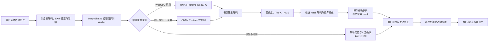

# 手部美甲纹理抠图模型端侧实施技术规范

版本：v1.7
日期：2026-09-10
状态：当前活动合同；candidate57 TEST HOLD，发布链待完成
适用项目：JiaRu 美甲参考图纹理提取与 AR 试戴

## 1. 文档目的

本文档用于把“用户设备本地完成美甲纹理识别和抠图”的产品想法，落实为可实施、可测试、可验收、可回滚的工程方案。

本文档重点回答以下问题：

1. 端侧方案是否适合普通电脑和主流手机。
2. MVP 应承诺什么，不应承诺什么。
3. 模型训练、浏览器推理、后处理和纹理提取如何衔接。
4. 第一版、Beta 和正式发布分别使用什么验收标准。
5. 用户需要提供什么，工程侧需要完成什么。
6. 什么情况下可以继续、暂缓或回滚模型发布。

## 2. 结论与核心决策

### 2.1 总体结论

方案技术上可行，建议继续实施。

推荐产品形态是：

> 模型在开发机或训练服务器离线训练，导出轻量 ONNX；用户上传的参考图片只在其浏览器内完成解码、推理、mask 后处理和透明纹理提取。

端侧推理本身不是项目的主要风险。更大的风险来自独立来源和长尾场景覆盖不足、训练与浏览器预后处理或发布身份不一致、批准生产ONNX缺失，以及反光、遮挡和复杂纹样造成的纹理质量问题。真实ONNX输出协议和smoke加载链已经工程验证，不能再把它们写成当前质量阻塞。

### 2.2 MVP 边界

MVP 包含：

- 用户上传一张本地参考图。
- 自动识别 1 到 10 个甲面实例。
- 输出每个实例的位置、置信度、方向和二值/软 mask。
- 从原始分辨率图片提取透明背景纹理。
- 允许用户移动、旋转、缩放、删除、补加和分配手指。
- WebGPU 不可用时回退到 WASM。
- 模型加载或推理失败时进入明示的辅助定位与人工确认；该路径不得计作正式识别成功。
- 图片不因识别和抠图流程被上传到服务器。

MVP 不包含：

- 在用户设备上训练或微调模型。
- 对摄像头每一帧运行完整 640×640 实例分割。
- 对任意图片承诺像素级完美边缘。
- 自动消除全部高光、阴影、透视和甲面曲率。
- 生成新的美甲设计。
- 医疗级或工业检测级指甲分割。

### 2.3 实时 AR 的边界

静态参考图纹理抠图与实时 AR 甲面跟踪是两条不同链路：

- 参考图：允许一次较重但高质量的实例分割。
- 实时 AR：使用手部关键点、低频检测和帧间跟踪，不应每帧运行全图实例分割。

如果未来需要实时分割，应采用“低频重新检测 + 高频关键点/光流跟踪 + 状态平滑”，而不是简单提高完整分割模型调用频率。

## 3. 当前项目基线

### 3.1 已具备能力

仓库目前已经具备以下工程基础：

- Next.js 浏览器应用和本地图片处理 UI。
- `onnxruntime-web` 依赖。
- `NailArtPicker` 自动识别和手动修正入口。
- Worker 客户端、Worker 入口和统一识别服务。
- WebGPU、WASM与明示辅助定位/人工确认的降级结构。
- 最长边 800 像素的检测输入限幅。
- 规则检测 baseline 和模型失败回退。
- mask 纹理提取、边缘羽化和调试诊断。
- 数据导入、标注转换、拆分、审计、训练、评估和 ONNX 导出脚本。
- 性能门禁、纹理质量门禁、模型发布和回滚工具链。

相关实现：

- `src/components/NailArtPicker.tsx`
- `src/lib/nail-texture-recognition/`
- `src/workers/nail-texture-recognition.worker.ts`
- `model/training/`
- `scripts/verify-recognition-performance.ts`
- `scripts/verify-texture-quality-gate.ts`

### 3.2 当前尚未闭环的事项

当前工程脚手架已完成Worker运行时判断、ONNX Runtime静态加载、letterbox、输出转置、候选筛选、NMS、mask解码和Python对照测试；这些历史问题不得继续写成当前阻塞。当前不能宣称正式模型可用，原因是：

1. `public/models/nail-texture-seg/manifest.json`仍是输入640的占位manifest，目录内没有其指向的批准生产ONNX；smoke ONNX只证明工程链可加载，不是生产资产。
2. candidate57已经完成唯一一次有效受保护test100，虽以531/554匹配、479个完整mask通过召回和完整率子门，但漏甲图片率`0.13`与加权杂散率`0.04693141`失败，固定为TEST HOLD；禁止重跑、反调、导出、登记、接入或部署。
3. 旧val30和旧test100已经被多轮候选、阈值、插值和组合选择自适应使用，只能保留为受保护历史回归；下一候选尚缺train内来源组开发折、全新来源校准集和运行时锁定后的全新一次性正样本发布留出。
4. completion audit已升级为v3：历史实验与当前发布要求分离，统一`releaseIdentity`、固定逐实例schema v3重放和正样本发布留出一次性消费台账已接入；当前因没有批准发布身份及其正式证据继续HOLD，而不是沿用candidate5/6/57跨候选拼接。
5. 全新未见困难负样本三变体、生产ONNX/manifest一致性、PT→ONNX→WebGPU/WASM输出一致性、真实浏览器、Windows性能/内存、真实用户失败案例、四类移动真机、Beta100、产品质量和双版本回滚仍未完成。
6. 模型不可用时，现有MediaPipe/颜色/边界辅助候选仍可能被界面表述为“可直接提取”；正式接入前必须统一为辅助定位/人工确认，并从模型成功率和Beta直接可用率排除。
7. 高光修复启发式仍可能误伤法式白边、珍珠、银白和低饱和纹样，需要在同一发布身份的浏览器/Beta证据中验证。

### 3.3 当前数据的正确定位

当前规范训练输入已达到328张正图、1981个完整mask、112个来源组，并另含160张训练角色困难负样本；不能再概括为“主体为同一来源组的AI合成图片”。真正不足的是独立父图与来源组的长尾覆盖，以及全新校准和发布留出。

现有数据按角色定位：

- 经来源、standing授权绑定、原分辨率完整甲面审核和角色隔离通过的真实/允许训练图片，可进入train；不得因为来自同一商家、会话、生成批次或近重复派生而重复计算来源多样性。
- AI生成正样本可用于训练、增强和消融，但不能替代真实域正样本发布留出；AI困难负样本可构成独立压力门，但不能替代真实域负样本与真实用户失败案例。
- 旧val30和旧test100只作受保护历史回归，禁止参与下一候选配方、阈值、数据选择或最终未见发布结论。
- 已被模型筛选、错误分析或训练规划使用的困难负样本不得再作为下一候选的全新未见留出。
- 下一候选应优先补充透明/低对比、相邻长甲、侧视、多手和复杂背景的独立父图与来源组，禁止用大量近重复ROI替代数据多样性。

## 4. 总体架构



训练链路与用户推理链路必须隔离：

```mermaid
flowchart LR
    A["standing授权的train数据"] --> B["原分辨率真值审核"]
    B --> C["sourceGroup开发折"]
    C --> D["离线训练与配方选择"]
    D --> E["全新校准集一次选阈值"]
    E --> F["锁定releaseIdentity"]
    F --> G["全新正样本发布留出"]
    G --> H["全新困难负样本"]
    H --> I["导出ONNX与多后端一致性"]
    I --> J["浏览器、真机、Beta与回滚"]
    J --> K["模型版本发布"]
```



## 5. 端侧部署策略

### 5.1 浏览器本地推理

浏览器本地推理是当前项目的主路线，原因是它与现有 Next.js、Canvas、ImageBitmap 和 Worker 架构一致，无需先引入桌面或移动原生容器。

执行后端优先级：

1. ONNX Runtime Web + WebGPU。
2. ONNX Runtime Web + WASM。
3. 明示的辅助定位/人工确认，不计正式模型成功。
4. 用户手动添加和修正区域。

### 5.2 设备分级

| 设备档位 | 推荐后端 | 推荐输入 | 产品策略 |
| --- | --- | ---: | --- |
| 桌面 Chromium，WebGPU 可用 | WebGPU | 512 | 当前正式质量口径；复用 Session |
| 中端 Android Chromium | WebGPU | 512 | 使用同一发布身份完成真机性能与内存门 |
| 桌面无 WebGPU | WASM | 512 | 接受更长等待，保持 UI 可取消并验证与WebGPU一致 |
| iPhone / Safari | WASM | 512 | 单独建立真机基线，不承诺与 Android 同速 |
| 极弱设备或运行时失败 | 辅助定位/人工确认 | 非模型输入 | 持续提示模型不可用，不计正式识别成功 |

当前发布合同固定512输入，不能按浏览器临时切换尺寸。384/448/640只能作为未来独立运行时变体；若启用，必须建立新的`releaseIdentity`并重新完成校准、正负发布留出、多后端一致性和对应真机门。

### 5.3 “本地处理”与“完全离线”的区别

本地处理表示图片不上传，推理发生在用户设备。

完全离线还要求：

- ONNX 模型已缓存或随应用分发。
- WASM 文件本地托管并可离线访问。
- MediaPipe 等第三方资产不依赖 CDN。
- 应用本身具备 PWA/Service Worker 缓存或桌面封装。

第一阶段承诺“图片本地处理”，不默认承诺首次访问即可完全离线。

## 6. 模型方案

### 6.1 正式候选模型合同

当前没有批准的正式候选。下一候选使用单类别实例分割模型；架构大小由发布质量、ONNX体积和真实设备性能共同决定，不再预先限定为nano：

- 类别：`nail_texture`。
- 模型级别：优先评估可达到发布门的最小YOLO segmentation；nano/small/medium均须使用同一部署合同实测。
- 固定 batch：1。
- 正式部署输入：512×512，使用方形letterbox；不得按设备临时改变。
- 640×640只可作诊断；384×384、448×448仅可作为未来另行校准和验收的独立发布变体。
- 输出：box、置信度、mask coefficients、mask prototype。
- 浏览器生产资产目标：单模型ONNX优先不超过15MB；若质量合格候选超过该值，必须在晋级前以真实浏览器下载、初始化、P95和峰值内存证据决定是否接受，不能把PT文件大小直接当成ONNX大小。
- 理想体积：8–12MB；这是性能目标，不得用来绕过正样本质量门。
- 第一版先导出 FP32 基线，再评估 FP16/INT8。

量化不能先于基线准确率验证。只有当 FP32 模型输出协议、准确率和浏览器性能稳定后，才评估量化误差和算子兼容性。

### 6.2 输出协议与发布身份必须显式版本化

manifest 除现有字段外，建议逐步增加：

```json
{
  "schemaVersion": "nail-texture-manifest-v2",
  "version": "nail-texture-seg-v1",
  "candidateId": "candidate-N",
  "releaseIdentityCoreSha256": "",
  "runtimeSelectionLockSha256": "",
  "task": "segment",
  "inputSize": 512,
  "inputLayout": "NCHW",
  "colorOrder": "RGB",
  "normalization": "zero_to_one",
  "resizeMode": "letterbox",
  "preprocessContract": "square-letterbox-rgb-zero-to-one-v1",
  "backendPreferences": ["webgpu", "wasm"],
  "modelFile": "nail-texture-seg-v1.onnx",
  "outputContract": "ultralytics-seg-raw-v1",
  "postprocessContract": "nail-product-dedupe-v1",
  "scoreThreshold": 0.35,
  "labels": ["nail_texture"],
  "modelSizeBytes": 0,
  "sha256": ""
}
```

`outputContract`用于避免模型升级后输出维度变化却继续被旧后处理误读；`releaseIdentityCoreSha256`绑定candidate、全部模型、输入、阈值、预后处理和运行时锁等不含manifest自身哈希的规范核心，不能仅复制candidate名称。运行时选择锁也必须是pre-manifest锁，不得反向包含候选或生产manifest哈希。manifest写入该core哈希后再计算自身SHA-256，正式报告以“identity core + core哈希 + manifest哈希”形成最终`releaseIdentity`，从而避免manifest、选择锁与发布身份互相包含哈希的循环。上述v2字段是下一生产manifest的目标合同，当前加载器尚未全部实现，不能把文档示例误报为运行时PASS。

`scoreThreshold`是模型版本自身在全新来源隔离校准集上只选择一次的候选置信度阈值，必须是`0 < value < 1`的有限数。旧manifest缺省时继续使用`0.35`仅是兼容行为，不是新候选的校准证据；不得因诊断扫描直接修改共享默认值，候选还必须通过逐实例正样本、误检、候选数量、直接可用率和Beta门禁。

阈值校准必须只读取来源隔离的 `val` split，并绑定数据集、来源报告、模型权重、评估指标和预测制品哈希；`test`、冻结发布测试及其派生物一律不得用于选阈值。正式校准证据至少需要30张验证图、零无效真值polygon，并且全部验证图通过原分辨率完整甲面审核；校准器必须读取审核报告，校验dataset路径/哈希、逐标签SHA-256、审核覆盖数以及pass/rework/exclude计数，未提供或被拒绝的审核只能生成诊断结果。任一图片仍需返修/排除或存在漏甲、误标、重复、污染、裁断和未声明交叠时，整套split不得用于模型选择或阈值校准。真值合格后还须满足召回、每图误检和单图候选数门槛；条件不足时只能输出诊断点，`manifestScoreThreshold`必须为空。

### 6.3 条件性两阶段路线（当前停止）

当前活动路线固定为单阶段YOLO实例分割、部署512方形letterbox和产品去重。candidate53/55把328张父图展开为13795/15531个近重复ROI，candidate57在test100没有任何stage2晋级且最终始终使用stage1 polygon；因此当前“stage2只重新打分、不替换mask”的实现已经止损，不得继续扩展或作为下一候选默认路径。

只有新增独立来源数据后仍由边界质量主导失败，且单阶段已满足完整图片召回/唯一性门时，才允许预注册以下真正的两阶段方案：

1. 全图轻量甲面检测器，输入 384/512。
2. 只对 Top-K 甲面 ROI 运行共享二值 mask refiner，输入 192/256。
3. 在原图尺度进行边缘细化和羽化。

两阶段必须真正输出并替换完整mask，使用足够的真实proposal负样本，并在训练前先定义多模型manifest、Worker组合、总体下载体积、WebGPU/WASM回退、延迟、内存和四类真机合同。否则保持单阶段，不得用ROI内部mAP代替完整图片识别结果。

### 6.4 教师辅助与蒸馏的可选实验策略

教师链不是当前正式候选的必选前置。直接使用通过原分辨率审核的硬polygon训练可独立推理模型是默认主线；只有较大模型在train内开发折证明可迁移增益，且端侧体积/延迟确需压缩时，才允许做受控蒸馏对照。任何自动输出都不得直接当作真值：

下列1—18项保留candidate9—18的历史演进证据，其中关于“当前最佳”“下一候选”“使用val30/冻结test100”的操作指令已经失效，统一由第51节当前活动合同取代；不得删除其失败事实，也不得据此重新开启旧路线。

1. GPT-5.6 Sol 只承担原分辨率语义审核与难例判断，检查漏甲、半甲、透明/低对比甲尖、皮肤或背景污染、重复mask、饰件跟随和异常结构；它不直接授予训练资格。
2. 当时最佳轻量候选只作高召回定位教师，以低阈值输出候选框；候选数量不足、位置冲突或来源身份漂移必须转返修，禁止按置信度自动PASS。
3. SAM2.1 large作为像素教师，按逐甲提示生成完整甲面候选；每个polygon继续通过合法性、同图零交叠、提示几何和原图/叠加逐甲放大视觉审核。
4. 只有审核通过且来源角色隔离的mask才能进入学生模型训练。透明裸色、镜面、侧视、十甲同框、复杂姿态和历史漏检难例可提高采样权重，但冻结val/test/holdout及其父来源不得回流训练。
5. 学生模型仍以浏览器端nano级实例分割为首选；若数据质量稳定后较大教师在来源隔离val30上显著更优，可用其软目标或审核后伪标签蒸馏学生，但最终阈值、冻结test100和困难负样本发布门全部按学生模型独立重跑。
6. 当学生在冻结正样本上表现为“漏甲下降但重复实例上升”时，下一轮不得只重复训练或只降低阈值。必须先扩大经审核的完整甲面真值，确认每枚可见甲面恰好一个mask；训练后处理必须加入同甲候选的mask-IoU/包含关系抑制，并在val30固定阈值后分别报告漏甲、重复、额外候选、无效mask和直接可提取图片数。当前`quality.ts`已实现像素mask交并比与“小mask被大mask包含”双判据：默认mask IoU阈值0.60、较小mask包含率0.85、完整大mask替换高分局部mask的分数容差0.12；它先处理同甲mask，再保留原有box抑制，空间分离的相邻甲不得互相删除。该实现只通过了合成契约专项回归，必须先在来源隔离val30锁定参数并证明不损害召回，随后才能用固定参数对冻结test100作一次诊断；禁止根据test100结果反向选择这三个参数。
7. 大模型教师向端侧学生传递能力时，只允许使用两类输入：已授权train角色源图上经原分辨率逐甲终审通过的完整polygon真值，以及val30输出的匿名聚合失败类别。匿名画像不得包含文件名、图片SHA、来源组或逐图预测，`trainingUse`必须为`prohibited`；它只能确定下一批train候选应覆盖的视觉类型。冻结test100及独立困难负样本的逐图身份、标签、预测和派生物不得参与选样、返修或训练。每次学生训练前必须至少形成可核验的新增真值批，完成规范物化和输入深审；只有在部署输入尺寸上相对既有候选改善预先声明的主门，才允许锁定阈值/后处理并消费一次冻结测试。
8. 自candidate9返修阶段起，训练执行采用“识别优先的教师闭环”：目标优先级固定为完整甲面召回、同甲唯一实例、边界无污染、端侧性能。GPT-5.6 Sol按原图与逐甲证据给出难例分类和返修路由，优先处理透明/裸色、镜面、侧视、遮挡、饰件和多手场景；SAM或人工polygon只负责产生可审核候选。每轮训练前必须形成新增的审核真值、明确的采样/损失调整或可独立验证的后处理改动，禁止在数据和算法均未变化时重复训练。水印图片可进入训练，但水印不得成为甲面候选或标签；训练/评测继续保留无水印和水印隔离消融，防止学生学习来源标记。
9. 项目范围图像和本机计算资源沿用standing商业授权，不再为同一train角色的标注、物化、训练启动或质量门内的返修重复等待用户确认；机器必须继续判定原分辨率源图与mask质量、稳定图片身份、角色用途和来源隔离。val30、冻结test100、已消费holdout及其父来源永久不得回流训练，训练后仍须建立全新未见困难负样本并独立通过发布门。
10. 下一学生采用“三类可核验增量”再训练，不等待全部返修清空，也不做无效小步重训：相对candidate9首轮至少新增10张且50枚原分辨率审核真值，并覆盖透明/裸色、镜面或高光、侧视/遮挡、多甲同框/复杂姿态中至少4类；同时绑定上述同甲唯一性后处理版本。第二轮21张/130 mask达到首次触发门，后续扩展到30张/180 mask；`00451…_6`因侧视甲面与皮肤不可可靠分离而整图排除，`01126`吞入黑色背景的人工v2隔离，仅保留原分辨率复核通过的v1。合并输入为240张/1390 mask正样本与160训练负样本，train400/val30/test0且深审通过。
11. candidate13从candidate9检查点在上述扩展真值上重训，candidate14从candidate11最优检查点以AdamW 0.0001继续训练；两者正式部署512 val30在阈值0.50均为121/144匹配、23漏检、26误检、召回0.84028和F1=0.83162，未优于candidate11的122匹配、22漏检。两者必须在val阶段否决，不建立选择锁、不运行test100。后续不再对同一输入做容量、学习率或冻结层排列组合；只允许按val30的抽象错误类别（不得使用图片、预测、标签或派生裁片）从train角色补入来源隔离的透明低对比、侧视/遮挡、小甲面及复杂姿态完整真值，形成可核验增量后再训练并由val30选择。任何冻结test100信息都不得反向选择样本、参数或模型。
12. 截至candidate15，项目所称“强教师蒸馏”仍主要是教师辅助的数据蒸馏：GPT-5.6 Sol负责语义审核，SAM2.1 large负责像素候选，人工原分辨率终审后以离散polygon硬标签训练学生。训练实参明确为`distill_model: null`，尚未执行教师logit、类别/目标置信度、mask边界概率或中间特征对齐，因此不得把当前结果表述为已完成端到端知识蒸馏。下一候选采用双轨推进：主轨继续扩充经审核的高价值完整甲面硬真值，保证立刻改善数据覆盖；实验轨只在同一隔离train/val30合同下建立“硬标签基线 vs. 真实软目标/特征蒸馏”对照，预先冻结学生架构、部署512后处理和主评价门。教师必须先在val30证明相对学生具有可迁移增益，蒸馏实现必须记录教师权重、层映射、温度、各损失权重和数据身份；仅当val30完整召回、额外候选和直接可提取率联合改善时才允许锁定学生并消费一次冻结test100。禁止因加入蒸馏损失而降低原分辨率真值门、来源隔离或发布门。
13. candidate16起采用五段式强教师链路，并把各模型能力限制写入证据合同：GPT-5.6 Sol只做原图语义审查、难例分类和返修路由；OpenAI官方`gpt-image-2`只生成或编辑与受保护数据来源隔离的新训练候选，不被描述为可输出logit、特征层或边界张量的可微教师；SAM2.1 large只生成逐甲像素候选；通过部署512来源隔离val30资格门的本地YOLO11s-seg才可作为可微教师；YOLO11n-seg保持为浏览器部署学生。Agnes `agnes-image-2.1-flash`继续只服务已验收的AI美甲生图产品，不计入正式识别模型的训练、蒸馏或发布证据。
14. 真实蒸馏合同固定保留硬polygon监督，并额外传递四类连续信号：教师分数加权的颈部特征L2、温度化Bernoulli类别概率、DFL框分布KL、由mask系数与prototype重建的anchor对齐软mask及其边界梯度。首版固定`temperature=2`、`feature=1.0`、`score=0.25`、`box=0.25`、`mask=0.50`、`boundary=0.25`、`topK=24`；训练报告必须绑定教师/学生权重SHA-256、输入审计SHA-256、层映射和全部损失权重。实现位于`model/training/nail_texture_distillation.py`并由`train-yolo-seg.py --distill-model`显式启用；未提供教师时保持原硬标签训练，禁止静默把普通训练记为知识蒸馏。
15. 可微教师必须先独立完成部署512的val30阈值扫描，并相对当前学生证明可迁移增益；只有教师资格通过，才允许在同一candidate15深审train407/val30/test0输入上运行“candidate15硬标签基线 vs. 蒸馏学生”受控对照。学生仍只由val30比较完整甲面匹配、漏甲、重复/额外候选、无效mask和直接可提取图片数；冻结test100在学生锁定前不得运行，`gpt-image-2`生成图、教师输出和val30逐图身份也不得进入冻结test或未见困难负样本。
16. 本地教师不是发布依赖，也不是每轮训练的强制步骤。“学生模型”只表示其在蒸馏对照中的相对角色；未启用`--distill-model`时，同一架构就是使用完整甲面硬真值直接监督训练、可独立推理的部署模型，不需要先生成教师权重。网页与生产manifest只加载最终通过门禁的部署模型。直接硬真值训练是默认主线；蒸馏学生若在同一val30联合门失败，必须保留上一直接模型基线、停止进入test100，并把教师/蒸馏权重组合记为失败实验。candidate16实证为：YOLO11m教师在阈值0.50达到127/144匹配、17漏检、28误检并通过资格门，但首版多信号YOLO11n学生无合格阈值，因此不再把教师训练设为下一候选前置。只有端侧体积或时延要求确实需要压缩，且较大直接模型先在val30证明可迁移优势时，才允许恢复蒸馏对照；后续直接候选必须由新增硬真值或预先声明且可验证的损失改动驱动。
17. “教师/学生”是实验角色，不是权重的永久属性。若某个较大模型本身由批准硬真值直接训练、能够独立推理，并在来源隔离val30按预注册门优于当前候选，可在不改权重字节的前提下另建哈希绑定选择锁，将其登记为直接部署候选；这不等于蒸馏成功，也不允许跳过浏览器体积、延迟和内存门。candidate17据此把`46b8af32…5087`登记为直接YOLO11m-seg候选：冻结test100达到503/554匹配、51漏甲和0.90794实例召回，但完整mask比例、缺甲图片率、重复、额外候选及无效mask仍未过门，因此当时只能作为阶段最优识别基线，不能导出或部署。后续训练仍以新增来源隔离硬真值的直接模型为主，冻结test100逐图信息禁止反向进入选样、损失或参数设计。
18. candidate18证明新增严格硬真值可直接推动部署模型，无需本地教师前置。43张/287 mask补强真值与既有基线合并后形成253张/1497 mask正样本、160困难负样本的train413/val30/test0输入；从candidate17权重直接微调YOLO11m-seg，`distillation=null`。候选选择只读取val30，并以完整甲面召回不低于0.88为主约束，在0.30阈值取得128/144匹配、16漏检、21误检，相对candidate17形成召回与误检的Pareto改善。锁定后冻结test100一次评估虽把匹配/完整mask/可直接提取图提高到515/461/50，把漏甲/重复/额外/无效降至39/14/25/22，但完整mask比例0.83213、缺甲图片率0.22和唯一性门仍失败。下一轮只允许由新增来源隔离train真值或预先声明的算法改动触发；candidate18 test逐图身份与失败不得反向进入选样、返修、阈值或损失设计。

candidate15质量提升有限不是单一“蒸馏轮次不足”：新增教师真值只有37张/234 mask，难例覆盖仍窄；训练目标仍是通用检测/分割损失，而产品门同时要求每枚甲面完整、同甲唯一并抑制非甲候选；部署512还会压缩小甲、侧视甲和低对比边界；增加正样本召回会扩大决策边界并带来额外候选。candidate12扩大模型容量仍在val30失败，也排除了“只换大一点学生”这一单因解释。优先级因此固定为：原分辨率高价值真值覆盖 > 可验证的真实蒸馏对照 > val30联合目标选择 > 固定参数后一次冻结test100；单纯增加epoch、调整学习率或重复同一硬标签训练不再算有效推进。

“大模型辅助”只减少人工定位和返修成本，不替代真实证据，也不放宽完整甲面、来源隔离或发布质量门。

## 7. 预处理协议

训练、Python 评估和浏览器推理必须使用同一协议。

### 7.1 图片解码

- 处理 EXIF 方向。
- 将 alpha 与明确的背景策略统一处理。
- 过滤异常尺寸和损坏图片。
- 保留原始宽高，用于最终纹理采样。
- 检测输入最长边继续限制为 800 像素，避免高分辨率 RGBA 缓冲占用过大。

### 7.2 Letterbox

不得把任意横竖图直接拉伸为正方形。

预处理必须返回：

- `originalWidth`、`originalHeight`
- `resizedWidth`、`resizedHeight`
- `scale`
- `padLeft`、`padTop`
- `inputWidth`、`inputHeight`

模型坐标还原顺序：

1. 从模型坐标中去除 padding。
2. 除以 letterbox scale。
3. clamp 到检测输入范围。
4. 再映射到原始图片范围。

### 7.3 Tensor 格式

- 颜色顺序：RGB。
- 数据类型：FP32 基线。
- 数值范围：0 到 1。
- 内存布局：NCHW。
- batch：1。

预处理协议必须通过固定像素 fixture 测试，不仅测试 tensor 长度，还要测试颜色通道、采样位置和坐标逆变换。

## 8. Worker 与运行时设计

### 8.1 环境识别

不能使用“是否存在 `window`”区分浏览器和服务端，因为 Web Worker 本来就没有 `window`。

建议区分：

- 主线程浏览器：存在 `window` 和 `document`。
- Worker 浏览器：存在 `self`、`WorkerGlobalScope` 或 `OffscreenCanvas`，且不存在 `document`。
- Node.js/服务端：不存在浏览器 Worker 所需能力。

### 8.2 ONNX Runtime 加载

目标：让 Next.js 构建器明确收集 ONNX Runtime 和所需 WASM 资产。

要求：

- 避免用 `new Function()` 隐藏包导入。
- WebGPU 与 WASM 使用可被构建器分析的明确入口。
- 确保 WASM 文件的 URL 与部署路径一致。
- WebGPU Session 创建失败后，允许重新创建 WASM Session。
- Session 按“模型版本 + 后端 + 输入尺寸”缓存。
- 切换模型版本或后端时显式释放旧 Session 和 GPU 资源。

### 8.3 Worker 生命周期

- 通过 Transferable 传输 `ImageBitmap`。
- Worker 内复用 Session，不为每张图重新初始化模型。
- 支持取消、超时和组件卸载清理。
- 同一时间限制并发识别数量，避免多张图造成内存峰值叠加。
- Worker 崩溃后能够重建，并把当前请求安全回退到规则识别。

### 8.4 运行时状态

UI 至少显示或记录：

- `backend`: model / fallback
- `executionProvider`: webgpu / wasm
- `modelVersion`
- `coldStartMs`
- `elapsedMs`
- `workerElapsedMs`
- `warnings`

产品界面不必暴露全部调试字段，但调试导出必须保留。

## 9. 模型后处理协议

### 9.1 真实输出契约验证

接入首个真实模型时必须保存：

- 输入名称与维度。
- 每个输出名称与维度。
- 小规模输出 sample。
- 模型版本和导出配置。
- 与 Python 参考推理的结果对照。

不能依靠测试 fixture 猜测真实 YOLO 输出布局。

### 9.2 建议处理顺序

1. 识别输出 tensor 和维度布局。
2. 必要时把通道优先输出转置为候选行。
3. 计算类别置信度。
4. 过滤低置信度候选。
5. 限制预 NMS Top-K。
6. 执行 NMS。
7. 限制最终 1 到 10 个候选。
8. 只为最终候选解码 mask。
9. mask 按候选框裁切。
10. 去除 letterbox padding 并映射回原图。
11. 计算主方向、质量提示和建议手指。

### 9.3 性能约束

- prototype tensor 只转换或读取一次。
- 不为每个候选重复 `Array.from` 整个 prototype。
- 不为被置信度或 NMS 淘汰的候选解码 mask。
- 尽量复用 typed array 和临时缓冲。
- 保留候选数量上限，避免异常图片产生不可控计算量。

### 9.4 mask 质量处理

- mask threshold 必须由真实验证集调参。
- 仅进行轻量孔洞填充、孤立点去除和边缘羽化。
- 形态学操作不能明显吞掉细窄法式边或尖甲轮廓。
- 模型 mask、后处理 mask 和用户修正结果必须能分别记录，以便定位误差来源。

## 10. 透明纹理提取

### 10.1 原图采样

模型只负责在缩小图上定位和分割，最终纹理必须从原始分辨率图片采样，以避免模型输入尺寸限制纹理细节。

提取流程：

1. 将 mask 映射回原图。
2. 计算甲面紧致边界。
3. 按方向旋转到统一朝向。
4. 生成带 alpha 的纹理图。
5. 对边缘进行小半径羽化。
6. 输出 `ImageBitmap` 或等价浏览器纹理资产。

### 10.2 高光处理

高光修复属于纹理恢复，不属于基础分割，必须独立控制。

要求：

- MVP 默认保留原始高光。
- 高光修复作为可关闭的增强选项。
- 白色法式边、珍珠、银白、镜面和低饱和设计必须加入专项测试。
- 高光修复前后分别保留诊断结果，不能不可逆覆盖唯一纹理资产。

### 10.3 透视与曲率展开

首版可以只做旋转和紧致裁剪。

当真实测试表明甲面透视导致 AR 纹理明显变形时，再引入四点透视或 TPS 展平。该能力应通过产品可用率证明必要性，而不是提前增加模型复杂度。

## 11. 数据方案

### 11.1 数据角色

| 数据类型 | 允许角色 | 发布证据约束 |
| --- | --- | --- |
| AI合成正样本 | train、训练增强、消融 | 不得替代真实域正样本发布留出；生成批次必须按同一`sourceGroup`隔离 |
| standing授权真实参考图 | train、开发折、全新校准或全新发布留出中的唯一一种 | 同一图片、父图、近重复和稳定`sourceGroup`只能分配一个角色 |
| 真实产品用户图 | 失败案例、Beta或在产品侧另有明确数据使用依据后的训练/评测 | 项目开发standing授权不自动覆盖未来终端用户上传数据；必须遵守产品采集时的实际许可与退出选择 |
| AI困难负样本 | train或独立压力留出中的唯一一种 | 可用于零误检压力门，但不能替代真实域负证据；被模型筛选后不得再充当下一候选未见留出 |
| 真实负样本 | train、失败案例或全新独立留出中的唯一一种 | 必须按来源组隔离并记录是否曾被候选推理/选样 |
| 旧val30、旧test100、已消费holdout | 只读受保护历史回归 | 永久禁止训练、配方/阈值/数据选择及再次冒充最终未见证据 |

### 11.2 真实数据覆盖

真实数据至少覆盖：

- 不同肤色、手型和年龄段外观。
- 裸甲、透明甲、浅色甲、深色甲和黑色甲。
- 法式边、猫眼、亮片、珍珠、镜面、渐变和复杂图案。
- 圆甲、方甲、尖甲、长甲、短甲和人工甲片。
- 单甲、单手和双手；独立甲片板、练习甲或非手上模板只进入单独压力测试/失败案例，不冒充真实手上正域。
- 横图、竖图、方图和不同分辨率。
- 可确认全部应标甲面轮廓的远景、近景和低照度；任何应标甲面被裁边，或运动模糊/失焦到无法确认完整轮廓的正图必须在源图门排除，可另存为失败案例但不得进入正训练。
- 戒指、饰品、手指互相遮挡和复杂背景。
- 无美甲图片、花瓣、珠宝、印刷纹理等 hard negative。

### 11.3 数据规模是阶段性目标

数量不是质量保证，以下范围仅用于安排工作量：

| 阶段 | train / 开发证据 | 校准 | 一次性正样本发布留出 | 困难负样本发布留出 | 目的 |
| --- | --- | ---: | ---: | ---: | --- |
| 工程冒烟 | fixture或少量样例 | 0 | 0 | 0 | 验证链路，不判断泛化 |
| 模型试验 | 足够覆盖目标长尾的来源组，使用train内部开发折 | 0 | 0 | 0 | 低成本判断配方能否学习真实域 |
| 候选冻结 | 原分辨率真值与角色隔离全部通过 | ≥30张全新来源，只选一次阈值 | ≥100张，运行时锁定后原子冻结且只评估一次 | 候选锁定后另建≥100张全新未见样本 | 建立不可变发布资格 |
| Beta / 正式发布 | 不再修改权重和运行时 | 使用已锁定阈值 | 保持只读 | 保持只读并通过三变体零误检/零delta | 用同一`releaseIdentity`验证产品体验、设备和回滚 |

如果样本高度重复，即使数量达标也不能通过 readiness gate。

### 11.4 数据拆分

必须按以下信息分组拆分：

- 用户或来源。
- 拍摄 session。
- 连拍批次。
- 同一商家或同一套图。
- AI 生成批次。

同一组不得跨 train、val、test。近似重复图必须在拆分前检测和归组。

### 11.5 标注与授权

- 每张图片保留来源、许可声明、授权范围、创建时间、稳定图片身份、`sourceGroup`、用途角色和SHA-256。
- 用户已对本项目范围内由其提供或放置、且有权授权并可由Codex访问的图像资源与本机计算资源授予standing商业模型开发使用权；逐批、逐清单、训练启动和满足机器证据门后的原子freeze无需再次请求确认。
- 精确清单、来源、用途、角色和SHA-256仍须由机器绑定并重放，用于追溯与隔离，不是人工批准等待点。该授权不允许已消费test/holdout回流训练，也不替代未来产品终端用户上传数据的实际许可、外部付费服务或真实Beta/物理设备证据。
- mask 必须贴合真实甲面，不使用固定模板替代人工复核。
- 记录遮挡、人工甲片、甲面形状、质量等级和失败原因。
- 标注审计 error 必须为零；warning 必须人工确认后才能用于正式训练。

## 12. 评测指标与明确口径

### 12.1 模型指标

- box mAP50。
- mask mAP50。
- AP75 和 mAP50:95。
- Dice / IoU。
- Boundary-F1。
- 每图漏检率。
- 每图误检数和 hard negative 误检率。
- 方向角误差。

### 12.2 产品指标

#### 直接可用率

定义：候选纹理无需移动 mask、补边或删除背景，即可被审核者接受用于 AR 试戴的实例比例。

必须明确：

- 纯粹调整手指分配是否仍算直接可用。
- 轻微旋转是否算直接可用。
- 由几名审核者判断以及分歧如何处理。

建议正式口径：不修改甲面几何和 alpha 边缘即可使用；仅改变手指分配不视为抠图失败。

#### 背景/皮肤泄漏率

建议按实例计算：

```text
leakageRate = predictedMask 中位于 GT 甲面外的面积 / predictedMask 总面积
```

#### 甲面缺失率

```text
missingRate = GT 甲面中未被 predictedMask 覆盖的面积 / GT 甲面总面积
```

泄漏率和缺失率必须分别报告，避免通过缩小 mask 人为降低污染率。

#### 人工修正成本

- 需要修正的实例比例。
- 每张图平均修正时间。
- 删除、补加、移动、旋转和修边的操作次数。

### 12.3 分组指标

总体平均值不能掩盖特定人群或场景失败。至少按以下维度报告：

- 肤色区间。
- 甲色深浅。
- 反光/非反光。
- 遮挡/无遮挡。
- 横图/竖图。
- 单甲/多甲/甲片板。
- 简单背景/复杂背景。
- 目标设备和执行后端。

## 13. 性能测量口径

### 13.1 冷启动

冷启动单独统计：

- 模型下载或缓存读取。
- WASM 资产加载。
- WebGPU adapter/device 初始化。
- ONNX Session 创建与图优化。

冷启动可以超过热推理预算，但必须显示明确加载状态，并避免重复发生。

### 13.2 热推理端到端时间

热推理从用户图片已经解码后开始，覆盖：

1. 检测图缩放和像素准备。
2. `createImageBitmap`。
3. Worker 排队与传输。
4. tensor 预处理。
5. ONNX 推理。
6. NMS 和 mask 后处理。
7. 候选返回主线程。

正式报告使用 P50、P95 和最大值，不只使用单次平均值。

### 13.3 建议性能门槛

| 配置 | 阶段 | 门槛 |
| --- | --- | ---: |
| 桌面 Chromium + WebGPU | Beta/正式，热推理端到端 P95 | <800ms |
| 中端 Android + WebGPU | Beta/正式，热推理端到端 P95 | <1500ms |
| 桌面 WASM | 首轮先建立基线 | 基线后冻结门槛 |
| iPhone / Safari WASM | 首轮先建立基线 | 不直接套用 Android 门槛 |

移动端正式门槛必须绑定具体设备档位、浏览器版本、输入尺寸和模型版本。

### 13.4 内存与稳定性

- ONNX 文件 <15MB，理想 8–12MB。
- 移动端识别链路增量峰值内存建议控制在 128–150MiB 以内。
- 连续运行至少 20 次后，内存不能持续单调增长。
- Worker 取消或崩溃后必须释放 `ImageBitmap` 和临时缓冲。
- 同一时刻默认只运行一个识别请求。

内存门槛需要通过真机基准确认，不能只根据 tensor 理论体积推断。

## 14. 分阶段验收标准

### 14.1 阶段 A：工程冒烟版

目标：证明浏览器确实在本地运行真实 ONNX，而不是继续使用 fallback。

必须通过：

- Worker 可识别浏览器 Worker 环境。
- ONNX Runtime 能被构建并加载。
- WebGPU 或 WASM Session 创建成功。
- UI 显示真实模型版本和执行后端。
- 模型失败后进入明确的“辅助定位/人工确认”流程；无像素mask的fallback不得显示为正式识别成功。
- 取消和超时正常。
- 横图、竖图和方图坐标逆变换正确。
- 至少一个真实 ONNX 输出 fixture 进入自动测试。

本阶段不设置 mAP 和直接可用率门槛。

### 14.2 阶段 B：模型试验版

目标：用train内部按`sourceGroup`互斥的开发折证明候选配方能学习完整甲面分割，并以较低成本淘汰失败方向。

建议门槛：

- mask mAP50 ≥0.65（诊断指标）。
- box mAP50 ≥0.75（诊断指标）。
- 直接可用率 ≥60%。
- 单模型ONNX目标<15MB；若超过，必须提前用真实浏览器体积、初始化、P95和峰值内存决定是否继续。
- train开发折没有来源或近似重复泄漏，且不得读取旧val30、旧test100或任一发布留出逐图证据。
- 能形成可解释的失败类型清单。

该门槛只用于train内部实验筛选，不生成正式候选PASS。每轮至多两个短程单变量实验；只有一个胜出配方可进入全量训练和全新校准集。

### 14.3 阶段 C：Beta

目标：在受控用户范围内验证真实产品体验。

建议门槛：

- mask mAP50 ≥0.75。
- box mAP50 ≥0.85。
- 直接可用率 ≥80%。
- 桌面 WebGPU 热推理 P95 <800ms。
- 中端 Android WebGPU 热推理 P95 <1500ms。
- fallback、手动修正和取消能力完整。
- 真实失败样本能够进入授权复核流程。
- Beta、浏览器和性能证据必须绑定同一`releaseIdentity`；fallback样本不计入模型直接可用率。

### 14.4 阶段 D：正式发布

必须通过：

- 配方锁定后使用不少于30张、与train及发布留出来源隔离的全新校准集，仅选择一次阈值；旧val30不得满足该门。
- 权重、512预处理、阈值、后处理和`releaseIdentity`锁定后，原子冻结不少于100张全新正样本发布留出并只正式评估一次。
- 正样本逐实例质量门固定为：实例召回率≥0.90、完整mask比例≥0.85、漏甲图片率≤0.10、加权杂散率≤0.02，并要求每图均有可核验输出；mAP只作辅助诊断。
- 候选锁定后另建不少于100张、未被当前或前代模型筛选的全新困难负样本，原图、裁右下12%、模糊右下角均达到误检图片数=0、误检检测数=0、相对原图delta=0；非右下水印还须增加对应区域消融。
- 直接可用率 ≥85%。
- 明显皮肤/背景污染实例比例 <10%，并同时报告像素级泄漏率。
- 粗糙矩形化实例比例 ≤15%。
- 主要场景分组没有不可接受的明显退化。
- Windows桌面性能/重复运行内存、真实用户失败案例、Android手机、Android平板、iPhone和iPad各至少20次真实验收通过。
- 训练框架、ONNX、WebGPU和WASM在同一冻结样本上的候选数量、置信度、坐标和像素mask一致。
- 模型manifest、大小、SHA-256、指标和发布记录完整，且所有报告绑定同一不可变`releaseIdentity`。
- 至少100张Beta人工质量审核和正式产品质量报告通过。
- 完成双版本回滚bootstrap：一个完整批准版本登记为非当前fallback，另一个不同权重且完整批准版本作为current，并实际验证一键回滚。

## 15. 测试策略

### 15.1 单元测试

- Letterbox 和坐标逆变换。
- RGB/NCHW tensor 生成。
- 输出布局识别和转置。
- 置信度过滤、Top-K 和 NMS。
- mask coefficients × prototype 解码。
- box crop、padding 去除和原图映射。
- 方向估计和候选排序。
- 泄漏率、缺失率和直接可用率统计。

### 15.2 真实输出 fixture 测试

每个支持的 `outputContract` 至少保存一个真实模型输出 dump，并验证：

- 输出名称和维度。
- 候选数量。
- 至少一个候选坐标。
- mask 前景像素范围。
- 与 Python 参考后处理的一致性。

### 15.3 浏览器集成测试

- WebGPU 成功路径。
- WebGPU 失败转 WASM。
- ONNX 加载失败转 fallback。
- Worker 不可用转主线程或 fallback。
- 超时、取消、组件卸载和重复上传。
- 图片全程无识别上传请求。

### 15.4 视觉回归

固定真实样本覆盖：

- 横图和竖图。
- 深色、浅色、透明和镜面甲。
- 法式边和细线图案。
- 复杂背景和遮挡。
- 单甲、五甲和甲片板。

每次候选模型发布都生成 overlay、mask 和透明纹理对照图。

### 15.5 性能测试

- 冷启动与热推理分开。
- WebGPU 与 WASM 分开。
- 输入尺寸分开。
- 桌面、Android 和 iPhone 分开。
- 至少多次运行后计算 P50/P95。
- 同时报告 Worker 时间、主线程开销和峰值内存。

## 16. 执行清单与职责

### 16.1 用户需要完成

- [x] 确认 MVP 首先只做单张上传图片的纹理抠图。
- [x] 指定优先目标设备和最低设备档位。
- [x] 提供首批 50–100 张真实参考图。
- [x] 授予项目范围standing商业模型开发使用权：对用户提供或放置、且有权授权并可由Codex访问的图像资源和本机计算资源，无需逐批、逐清单、训练启动或满足机器证据门后的原子freeze再次确认；机器仍须绑定来源、许可声明、用途角色、清单与SHA-256。
- [ ] 在工程侧准备好可直接执行的验收包后，提供实际用户可能上传的典型失败案例；该项不能由历史测试集或合成样本伪造。
- [ ] 在Beta阶段参与“直接可用/需要修正/不可用”审核；审核记录必须绑定当前`releaseIdentity`。
- [ ] 在工程侧完成所有无需设备的准备后，连接Android手机、Android平板、iPhone和iPad完成真实验收。

### 16.2 工程侧需要完成

#### 当前发布清单

以下七项与进度文档顶部同ID行一一对应，均为`gateRole=current-release; required=true`。audit v3只把这些显式当前项作为本节发布阻断；旧工程履历中的未勾选项不得永久阻断新候选，已勾选项也不得跨候选提供质量PASS。

- [x] `REL-CURRENT-AUDIT-V3-001`：实现active gate、统一`releaseIdentity`、固定逐实例强门和一次性消费台账。
- [ ] `REL-CURRENT-DEVELOPMENT-002`：在train内来源组开发折完成最多两个短程单变量实验，并锁定一个单阶段胜出配方。
- [ ] `REL-CURRENT-CALIBRATION-003`：建立不少于30张全新来源隔离校准集，只选择一次阈值。
- [ ] `REL-CURRENT-POSITIVE-HOLDOUT-004`：锁定运行时后冻结不少于100张全新正样本发布留出，只评估一次并通过0.90/0.85/0.10/0.02合同。
- [ ] `REL-CURRENT-NEGATIVE-HOLDOUT-005`：建立不少于100张全新困难负样本并通过三变体零误检/零delta及实际水印位置消融。
- [ ] `REL-CURRENT-RUNTIME-006`：导出生产ONNX，完成PT/ONNX/WebGPU/WASM一致性并绑定生产manifest。
- [ ] `REL-CURRENT-PRODUCT-007`：完成fallback真实性、浏览器/桌面/四类真机、Beta100、产品质量和双批准版本回滚。

#### 历史工程履历

下列清单保留自早期候选起的可追溯事实。带candidate编号的已完成条目只证明当时对应工程动作或历史候选终局，不构成当前模型质量PASS；所有旧“下一步”由第51节及进度文档顶部dashboard取代。

- [x] 修复 Worker 环境判断和 ONNX Runtime 加载。
- [x] 接入真实 ONNX 冒烟模型。
- [x] 固定并版本化模型输入输出协议。
- [x] 将模型级置信度阈值纳入 manifest、导出、制品校验和浏览器后处理契约；旧 manifest 保持0.35兼容，显式阈值必须位于0和1之间。
- [x] 建立来源隔离验证集专用阈值校准器；硬拒绝test/release-test调参、val来源跨split和未知预测，少于30图或存在无效真值polygon时只输出诊断结果，不生成manifest阈值。
- [x] 建立验证集真值隔离返修与全覆盖视觉审核门；v6旧val的13/13张原分辨率审核仅3张通过、7张返修、3张排除并发现2张交叠，整套split标记为`rejected_as_calibration_truth`，历史高mAP和0.20诊断点不得用于模型选择或manifest。
- [x] 将验证真值审核资格接入阈值校准器；只有`approved_as_calibration_truth`且dataset/逐标签哈希、13/13覆盖及全pass计数一致时才可能校准，缺审核或`rejected_as_calibration_truth`分别输出未审核/已拒绝诊断并保持`manifestScoreThreshold=null`。
- [x] 建立历史候选训练验证诊断门；通用来源隔离审计逐文件核对`sources.csv`与split，旧候选预检要求val-only来源组、不少于30图、全量原分辨率审核通过、逐标签哈希、合法polygon和零交叠，并曾正确拒绝不合格409图集。其外层PASS现仅保留为历史诊断，不再单独授权正式候选；正式授权由后续完整输入深审承担，普通实验继续明确记录`training_intent=experiment`。
- [x] 完成历史`--candidate-validation-report`编排接线并在后续升级为`--candidate-input-report`首步深审；旧报告路径不再作为正式授权，当前候选编排必须先执行`candidate-input-preflight`，缺失、拒绝或漂移证据不得继续环境检查、训练、评估、导出或治理。
- [x] 实现 letterbox 和精确坐标还原。
- [x] 实现真实输出转置、Top-K、NMS 和按框 mask 解码。
- [x] 优化 prototype 和 typed array 内存使用。
- [x] 建立真实输出 fixture 与 Python 对照测试。
- [ ] 完善真实数据来源、授权、分组拆分和人工复核。（train100张/521 mask、val30张/144 mask和冻结test100张/554 mask均完成原分辨率审核与来源隔离。`candidate3-training-v1`精确清单已获商业训练和长期回归授权，明确禁止独立发布测试且不放宽质量门；160张原分辨率终审通过145、裁断或主体不完整排除15，schema v2批准145张/61来源组。第三候选train245/val30/test0物化与GPU输入深审通过并完成续训，但规范val30无阈值同时满足召回≥0.75、每图误检≤1和候选数≤10，冻结test100亦较第二候选退化，故第三候选被拒绝且未消耗新独立留出。下一候选须先恢复val联合门，通过后再冻结不少于100张的新来源独立留出并达到三变体零误检/零delta，同时继续完成Beta人工复核。完整露出甲面仍要求单一完整mask和原图尺寸视觉审核）
- [x] 训练 FP32 基线并评估输入尺寸。
- [x] 完成2026_7_14实拍候选的用途授权、近重复归并和逐图原分辨率完整甲面审核。（目录当前实存1271张/196来源组，初盘1277张中的6张缺失已触发漂移拒绝并重建清单；用户已选择A，允许商业训练、独立发布测试和长期回归。20页逐对视觉审核覆盖156对，最终排除跨历史语料副本、批内副本和非照片模板等105张，4对同场景不同甲色/设计按同来源保留；剩余1166张/193来源组已由分片001—026全部审核，565张仅进入待标注候选、601张排除、0张待审。批次终结器逐分片复验队列、报告和图片身份后输出PASS；所有候选在完整mask审核和来源组互斥分配前均为`trainingUse=prohibited`）
- [x] 建立2026_7_14实拍候选A/B/C授权决策登记契约；授权工具必须绑定候选intake哈希、逐图SHA-256和来源组，A仅授予“完成视觉审核和来源隔离后可训练”的资格，所有未审核条目继续`trainingUse=prohibited`；训练与独立发布测试分配必须互斥。
- [x] 建立授权后逐图审核与用途互斥分配审计；A允许按完整`sourceGroup`分配train、val或独立发布测试，B只允许独立发布测试，C直接归档；A/B必须逐图最终pass/exclude全覆盖，同一来源组不得跨角色，rework、漏审或越权分配必须拒绝，val仍需单独真值审核门。
- [x] 建立实拍候选原分辨率审核工作区生成器；仅接受已确认A/B授权，生成逐图全覆盖CSV、来源组原子分片、逐分片/聚合哈希和空白审核字段，图片或授权证据漂移时拒绝。空字段不得冒充审核通过，原图不复制、不写入Git。
- [x] 完成2026_7_14批次A授权和近重复视觉归并；当前1271张按196个来源组生成28个外部审核分片，近重复构建器绑定授权/盘点及20页联系表哈希，终结器要求156对决策全覆盖。排除105张跨语料重复、批内重复或非照片模板，保留4对相关但不重复样本；判重结论不得替代剩余1166张逐图原分辨率完整甲面审核。
- [x] 建立近重复排除后的逐图质量审核队列；绑定原审核工作区与终结报告哈希，扣除105张后将1166张/193来源组重排为26个来源组原子分片，最大50张，禁止已排除条目回流或同一来源组跨分片；队列仍为空白待审，不自动赋予训练资格。
- [x] 建立逐分片源图质量审核页和终结契约；审核页绑定输入、逐图及逐页SHA-256，联系表只作导航，保留项必须逐图回看原分辨率；终结器要求决策全覆盖并把`trainingUse=prohibited`、`annotationTruthStatus=not-started`写死，禁止把源图适用性当作mask真值通过。分片001已完成48/48审核，29张进入待标注候选、19张教程图/拼图排除。
- [x] 以模糊、裁断、残缺和仅局部甲面为源图训练硬门完成分片002审核；47/47覆盖，24张待标注、23张排除。分片001—002累计95张中53张待标注、42张排除；待标注项在完整mask原分辨率审核前继续禁止训练。
- [x] 完成分片003逐图原分辨率源图审核；48/48覆盖，19张清晰完整单图进入待标注候选，7张模糊/低清、7张裁断/遮挡/仅局部甲面、13张拼图和2张护肤品主体图排除。分片001—003累计143张中72张待标注、71张排除；保留项继续`trainingUse=prohibited`、`annotationTruthStatus=not-started`。
- [x] 完成分片004逐图原分辨率源图审核；44/44覆盖，9张清晰完整单图进入待标注候选，23张拼图/页面排版、9张裁断/遮挡/仅局部甲面和3张模糊低清排除。分片001—004累计187张中81张待标注、106张排除；保留项继续`trainingUse=prohibited`、`annotationTruthStatus=not-started`。
- [x] 完成分片005逐图原分辨率源图审核；44/44覆盖，19张清晰完整单场景图进入待标注候选，19张拼图/页面排版、4张模糊低清和2张遮挡/仅局部甲面排除。分片001—005累计231张中100张待标注、131张排除；决策清单必须使用审核页报告绑定的分片路径和SHA-256，不能混用工作区内同编号旧CSV；保留项继续`trainingUse=prohibited`、`annotationTruthStatus=not-started`。
- [x] 完成分片006逐图原分辨率源图审核；50/50覆盖、13页/9来源组，30张拼图或页面排版、5张模糊低清排除，15张清晰且至少有完整可见甲面的单场景图仅进入待标注候选。分片001—006累计281张中115张待标注、166张排除，另885张仍待源图审核；保留项继续`trainingUse=prohibited`、`annotationTruthStatus=not-started`。
- [x] 完成分片007逐图原分辨率源图审核；47/47覆盖、12页/7来源组，4张像素化或失焦视频帧和1张无美甲主体的人像拼接页排除，42张清晰且至少有完整可见甲面的单场景图仅进入待标注候选。分片001—007累计328张中157张待标注、171张排除，另838张仍待源图审核；保留项继续`trainingUse=prohibited`、`annotationTruthStatus=not-started`。
- [x] 完成分片008逐图原分辨率源图审核；42/42覆盖、11页/9来源组，15张拼图或社交平台页面排版、7张像素化/失焦视频帧和2张边缘裁断甲面图排除，18张清晰且至少有完整可见甲面的单场景图仅进入待标注候选。分片001—008累计370张中175张待标注、195张排除，另796张仍待源图审核；保留项继续`trainingUse=prohibited`、`annotationTruthStatus=not-started`。
- [x] 完成分片009逐图原分辨率源图审核；49/49覆盖、13页/7来源组，23张拼图或社交平台页面排版和7张失焦、像素化或甲缘细节不足图片排除，19张清晰且至少有完整可见甲面的单场景图仅进入待标注候选。分片001—009累计419张中194张待标注、225张排除，另747张仍待源图审核；保留项继续`trainingUse=prohibited`、`annotationTruthStatus=not-started`。
- [x] 完成分片010逐图原分辨率源图审核；46/46覆盖、12页/6来源组，10张拼图或社交平台页面排版、3张边缘截断甲面图和2张明显像素化/偏软图片排除，31张清晰且至少有完整可见甲面的单场景图仅进入待标注候选。分片001—010累计465张中225张待标注、240张排除，另701张仍待源图审核；保留项继续`trainingUse=prohibited`、`annotationTruthStatus=not-started`。
- [x] 完成分片011逐图原分辨率源图审核；38/38覆盖、10页/5来源组，14张甲型示意模板、10张拼图或社交平台页面排版和4张明显像素化/失焦图片排除，10张清晰且存在完整可见甲面的单场景图仅进入待标注候选。分片001—011累计503张中235张待标注、268张排除，另663张仍待源图审核；保留项继续`trainingUse=prohibited`、`annotationTruthStatus=not-started`。
- [x] 完成分片012逐图原分辨率源图审核；45/45覆盖、12页/6来源组，4张明显像素化、压缩涂抹或失焦图片排除，41张清晰且存在完整可见甲面的单场景图仅进入待标注候选，共计277个完整可见甲面。分片001—012累计548张中276张待标注、272张排除，另618张仍待源图审核；保留项继续`trainingUse=prohibited`、`annotationTruthStatus=not-started`。
- [x] 完成分片013逐图原分辨率源图审核；42/42覆盖、11页/5来源组，21张拼图或社交平台页面排版、2张明显像素化/失焦图片和1张画面边缘截断已露出甲面的图片排除，18张清晰单场景图仅进入待标注候选，共计113个完整可见甲面。分片001—013累计590张中294张待标注、296张排除，另576张仍待源图审核；保留项继续`trainingUse=prohibited`、`annotationTruthStatus=not-started`。
- [x] 完成分片014逐图原分辨率源图审核；44/44覆盖、11页/7来源组，12张拼图或社交平台页面排版、3张明显像素化/失焦图片和1张画面边缘截断已露出甲面的图片排除，28张清晰单场景图仅进入待标注候选，共计192个完整可见甲面。分片001—014累计634张中322张待标注、312张排除，另532张仍待源图审核；保留项继续`trainingUse=prohibited`、`annotationTruthStatus=not-started`。
- [x] 完成分片015逐图原分辨率源图审核；48/48覆盖、12页/6来源组，3张拼图或页面排版、4张明显像素化/失焦/压缩图片、5张边缘裁断或仅局部露出甲面图片和1张无美甲主体图片排除，35张清晰单场景图仅进入待标注候选，共计278个完整可见甲面。分片001—015累计682张中357张待标注、325张排除，另484张仍待源图审核；保留项继续`trainingUse=prohibited`、`annotationTruthStatus=not-started`。
- [x] 完成分片016逐图原分辨率源图审核；43/43覆盖、11页/8来源组，2张拼图或嵌入截图、6张明显像素化/失焦/压缩视频帧和6张边缘截断或仅局部露出甲面图片排除，29张清晰单场景图仅进入待标注候选，共计187个完整可见甲面。分片001—016累计725张中386张待标注、339张排除，另441张仍待源图审核；保留项继续`trainingUse=prohibited`、`annotationTruthStatus=not-started`。
- [x] 完成分片017逐图原分辨率源图审核；42/42覆盖、11页/6来源组，29张多图拼贴或社交平台页面排版和10张手绘甲型设计模板排除，3张清晰单场景图仅进入待标注候选，共计25个完整可见甲面。分片001—017累计767张中389张待标注、378张排除，另399张仍待源图审核；保留项继续`trainingUse=prohibited`、`annotationTruthStatus=not-started`。
- [x] 完成分片018逐图原分辨率源图审核；46/46覆盖、12页/5来源组，31张拼图或社交平台页面排版、4张明显模糊或过曝到甲缘不稳定的图片排除，11张清晰单场景图仅进入待标注候选，共计62个完整可见甲面。分片001—018累计813张中400张待标注、413张排除，另353张仍待源图审核；保留项继续`trainingUse=prohibited`、`annotationTruthStatus=not-started`。
- [x] 完成分片019逐图原分辨率源图审核；48/48覆盖、12页/8来源组，11张社交平台页面或拼图、4张明显失焦/像素化/视频压缩图片和2张仅局部露出甲面图片排除，31张清晰单场景图仅进入待标注候选，共计179个完整可见甲面。分片001—019累计861张中431张待标注、430张排除，另305张仍待源图审核；保留项继续`trainingUse=prohibited`、`annotationTruthStatus=not-started`。
- [x] 完成分片020逐图原分辨率源图审核；50/50覆盖、13页/8来源组，21张手绘模板、九宫格或社交平台海报和3张明显失焦/像素化/视频压缩图片排除，26张清晰单场景图仅进入待标注候选，共计145个完整可见甲面。分片001—020累计911张中457张待标注、454张排除，另255张仍待源图审核；保留项继续`trainingUse=prohibited`、`annotationTruthStatus=not-started`。
- [x] 完成分片021逐图原分辨率源图审核；48/48覆盖、12页/11来源组，23张拼图/社交平台海报/模板或教程页、3张失焦/破损甲局部和8张遮挡/边缘截断/仅侧面露出甲面图片排除，14张清晰完整单场景图仅进入待标注候选，共计80个完整可见甲面。分片001—021累计959张中471张待标注、488张排除，另207张仍待源图审核；保留项继续`trainingUse=prohibited`、`annotationTruthStatus=not-started`。
- [x] 完成分片022逐图原分辨率源图审核；50/50覆盖、13页/7来源组，22张甲片展示/产品宣传页/多图拼贴或社交平台海报、3张明显像素化/失焦视频帧和9张边缘裁断/遮挡/仅局部甲面图片排除，16张清晰完整单场景图仅进入待标注候选，共计99个完整可见甲面。分片001—022累计1009张中487张待标注、522张排除，另157张仍待源图审核；保留项继续`trainingUse=prohibited`、`annotationTruthStatus=not-started`。
- [x] 完成分片023逐图原分辨率源图审核；48/48覆盖、12页/9来源组，19张拼图/教程模板/独立甲片展示、6张明显像素化/失焦/压缩视频帧和2张边缘截甲图排除，21张清晰完整单场景图仅进入待标注候选，共计119个完整可见甲面。分片001—023累计1057张中508张待标注、549张排除，另109张仍待源图审核；保留项继续`trainingUse=prohibited`、`annotationTruthStatus=not-started`。
- [x] 完成分片024逐图原分辨率源图审核；45/45覆盖、12页/8来源组，5张手写教程标注页、1张十二宫格拼贴和4张明显像素化/失焦/拖影视频帧排除，35张清晰完整单场景图仅进入待标注候选，共计217个完整可见甲面。分片001—024累计1102张中543张待标注、559张排除，另64张仍待源图审核；保留项继续`trainingUse=prohibited`、`annotationTruthStatus=not-started`。
- [x] 完成分片025逐图原分辨率源图审核；43/43覆盖、11页/12来源组，9张拼图、甲型模板、设计稿或独立甲片展示按非原始单场景排除，12张因像素化/失焦、裁边、遮挡或仅局部甲面排除，22张清晰完整单场景图仅进入待标注候选，共计149个完整可见甲面。分片001—025累计1145张中565张待标注、580张排除，另21张仍待源图审核；保留项继续`trainingUse=prohibited`、`annotationTruthStatus=not-started`。
- [x] 完成分片026逐图原分辨率源图审核；21/21覆盖、6页/2来源组，全部为四宫格、九宫格或其他多场景拼接图，0张保留、21张排除。分片001—026累计1166张中565张待标注、601张排除、0张待审；不从拼图拆格生成派生训练素材。
- [x] 建立实拍源图筛选批次终结门；`finalize-real-material-source-screening-batch.py`逐项复验质量队列、26个分片及审核页报告哈希、1166个文件名/图片SHA-256/来源组和训练禁用状态，要求全量唯一覆盖。真实批次审计为26/26分片、1166/1166图片、193/193来源组，565张待标注、601张排除，批次报告SHA-256为`901f52e531b5a93f4be9b010e2e96f585ca850bd733e5d9a4f5f9865a03335c0`。
- [x] 建立首批来源隔离标注规划器；`plan-real-material-first-annotation-batch.py`绑定A授权、近重复终结和源图筛选批次报告，以稳定种子和来源组原子子集和分配502张train、30张val、33张独立发布test，并从train选择160张/39来源组、预计966个完整甲面作为首批标注。既有互斥审计逐文件复验1271/1271授权条目和原图哈希，来源泄漏0；规划不授予训练资格，当前批次无合格hard negative，约100张负样本另行选择。
- [x] 建立首批160张外部标注工作区并完成YOLO→SAM2候选生成；工作区绑定图片SHA-256和来源组，v6生成881个候选，SAM2完成160/160、881 polygon、0错误、0 fallback，空提示图片输出0 mask候选而不再使批次失败。几何审计796 pass、85 suspect、0 missing；全部继续标记为候选且`trainingUse=prohibited`，必须逐图原分辨率审核后才可晋升真值。
- [x] 建立首批mask原分辨率审核工作区及分片终结契约；绑定工作区、SAM、几何、逐图、分片和审核页SHA-256，按来源组原子形成10个分片/83页。分片001已完成14张原图审核，1张/10 mask暂通过、13张返修；通过项仍待拓扑与最终真值审计，当前训练真值保持0/160，剩余146张待审。
- [x] 完成首批mask审核分片002并建立返修及训练真值候选终结器；13张原分辨率初审0直接通过、13返修。返修终结器绑定初审、提示、SAM、几何、annotation、overlay和人工决定哈希；训练真值候选终结器额外复验原图SHA-256/尺寸、polygon合法性和同图零交叠。首个返修样本1张/10 mask通过全部门，但在整批物化和来源隔离审计前仍禁止训练。累计初审27/160，剩余133张。
- [x] 完成首批mask审核分片003并形成第二个训练真值候选；16张原图与叠加图逐张原分辨率审核为0直接通过、13返修、3张因甲面被图像边缘裁断而排除，未以补mask绕过源图硬门。`nail_00491…_2`删除覆盖整段手指的第5号提示并以SAM2.1 large重建4甲，几何4/4、原分辨率视觉、polygon合法性及同图零交叠通过。累计初审43/160，训练真值候选2张/14 mask，剩余117张；整批物化和来源隔离审计前仍禁止训练。
- [x] 完成首批mask审核分片004；19张原图与叠加图逐张原分辨率审核为0直接通过、19返修、0排除，漏甲、局部甲面、候选重复/交叠及手指、皮肤、饰品、衣物和背景污染均被拦截。累计初审62/160，训练真值候选仍为2张/14 mask，剩余98张；整批物化和来源隔离审计前仍禁止训练。
- [x] 完成首批mask审核分片005并支持初审直接通过项进入最终真值审计；9张原图与叠加图逐张原分辨率审核为1直接通过、6返修、2张因要求甲面遮挡残缺而排除。直接通过样本10/10完整mask经哈希绑定身份、polygon合法性和同图零交叠复验后成为第三个训练真值候选。累计初审71/160，训练真值候选3张/24 mask，剩余89张；另1张人工多边形返修尚未完成终结证据链，不提前计数。
- [x] 建立人工多边形返修的哈希绑定终结链并形成第四个训练真值候选；人工构建器固定候选禁训元数据，返修终结器以互斥`--manual-report`绑定报告并额外要求方法一致、全部polygon合法及同图零交叠，之后继续经过独立最终真值审计。`nail_01241…_3`保留9个已审polygon并人工替换左侧拇指无效回折轮廓，10/10几何、原分辨率视觉、合法性和零交叠通过。累计训练真值候选4张/34 mask，最低train正样本仍缺96张；整批物化和来源隔离前继续禁止训练。
- [x] 完成首批mask审核分片006并形成第5至8个训练真值候选；15张原图和叠加图逐张原分辨率审核为4直接通过、11返修、0排除，漏甲、重复/交叠、人物背景及手指/皮肤污染均被拦截，候选数相等但轮廓污染的样本继续返修。4个直接通过项共18个mask进一步通过原图/annotation/分片哈希、polygon合法性和同图零交叠终审。累计初审86/160，训练真值候选8张/52 mask，剩余74张，最低train正样本仍缺92张；整批物化和来源隔离前继续禁止训练。
- [x] 完成首批mask审核分片007并形成第9个训练真值候选；20张原图和叠加图逐张原分辨率审核为1直接通过、19返修、0排除，漏甲、重复/交叠、整段手指及眼睛/头发误检均被拒绝，4张候选数相等但存在甲缘缺口或皮肤污染的样本没有误通过。唯一直接通过项5个mask进一步通过原图/annotation/分片哈希、polygon合法性和同图零交叠终审。累计初审106/160，训练真值候选9张/57 mask，剩余54张，最低train正样本仍缺91张；整批物化和来源隔离前继续禁止训练。
- [x] 完成首批mask审核分片008并形成第10个训练真值候选；18张原图和叠加图逐张原分辨率审核为0直接通过、16返修、2张因拇指甲受手势遮挡且仅露局部甲尖而排除，漏甲、重复/交叠、首饰、绸布、头发及等计数甲缘缺口均被拦截。`nail_00529…_2`视觉候选在真值预审中暴露第3甲polygon自交与甲根漏标，保留4个完整polygon并人工重绘贝壳装饰甲后，整图/逐甲2×视觉、几何5/5、polygon合法性和同图零交叠通过。累计初审124/160，训练真值候选10张/62 mask，剩余36张，最低train正样本仍缺90张；整批物化和来源隔离前继续禁止训练。
- [x] 完成首批mask审核分片009并形成第11至16个训练真值候选；19张原图和全分辨率叠加图逐张审核为6直接通过、13返修、0排除，漏甲、重复/交叠及首饰、布料、眼睛、嘴唇、手指和皮肤误检均被拦截。6个直接通过项共30个mask进一步通过原图/annotation/分片哈希、polygon合法性和同图零交叠终审。累计初审143/160，训练真值候选16张/92 mask，剩余17张，最低train正样本仍缺84张；整批物化和来源隔离前继续禁止训练。
- [x] 完成首批mask审核分片010并形成第17至18个训练真值候选；17张原图和全分辨率叠加图逐张审核为2直接通过、15返修、0排除，UI按钮、汽车按键、戒指/手链、衣物、整块指腹误检及漏甲与误检抵消成等计数的样本均被拒绝。2个直接通过项共10个mask进一步通过原图/annotation/分片哈希、polygon合法性和同图零交叠终审。首批160/160初审完成，累计15暂通过、138返修、7排除；训练真值候选18张/102 mask，最低train正样本仍缺82张，val真值0/30和约100张hard negative仍未建立，整批物化与来源隔离前继续禁止训练。
- [x] 完成首个低风险误检删除返修批次并形成第19至20个训练真值候选；从分片010选择两张甲面候选本身完整、仅混入戒指或方向盘控件/手链流苏的样本，按1起始提示序号保留10个逐甲框并删除3个非甲提示。SAM2.1 large完成2/2张、10/10提示、0 fallback，几何10 pass/0 suspect；原分辨率确认透明长甲尖、立体装饰可见区域和5枚短甲甲缘均完整，非甲误检已清除。两张进一步通过哈希身份、polygon合法性和同图零交叠终审。训练真值候选累计20张/112 mask，最低100张train正样本完成20%、仍缺80张；val真值0/30和约100张hard negative仍未建立，整批物化与来源隔离前继续禁止训练。
- [x] 完成第二批低风险返修并形成第21至23个训练真值候选；三张/20个提示由SAM2.1 large零fallback重建，几何20 pass/0 suspect，删除整段手指和方向盘控件，补齐棕色甲与星形拇指甲。全部原图、全分辨率叠加图、哈希身份、polygon合法性和同图零交叠通过，训练真值累计23张/132 mask。
- [x] 完成三张侧视拇指返修并形成第24至26个训练真值候选；每张保留四枚正面甲，以紧框、双正点和皮肤负点重建完整侧视拇指。SAM2.1 large完成3/3张、15/15提示、0 fallback，几何15 pass/0 suspect；原分辨率视觉及最终真值门通过，训练真值累计26张/147 mask。
- [x] 将SAM几何审计的同图重复/交叠判据从单纯外接框IoU改为精确polygon交集面积；外接框IoU保留为诊断字段，非法polygon或真实交集仍判suspect。新增“外接框重叠但斜向polygon分离通过”和“polygon真实交叠拒绝”回归，避免误放重复候选，也避免仅因相邻斜甲外接框重叠误拒。
- [x] 完成分片010清理返修批次004并形成第27至28个训练真值候选；三张/14提示均完成、0 fallback，原分辨率审核和精确polygon交集门输出2通过、1返修。`nail_00628…_2`因相邻甲真实交集10960.0713像素继续返修；另两张0非法polygon、0交叠，累计训练真值28张/156 mask，最低100张train正样本完成28%、仍缺72张；val 0/30和约100张hard negative不变。
- [x] 完成`nail_00628…_2`相邻甲人工多边形返修并形成第29个训练真值候选；保留4个已审核完整polygon，人工替换原先与相邻甲交叠10960.0713像素的第5甲。构建器对初稿0.0024像素残余交集保持拒绝，边界内收后5个polygon合法、同图零交叠、几何5 pass/0 suspect；整图及第4/5甲2×原分辨率视觉确认两甲完整覆盖各自可见甲面且无袖口污染。累计29张/161 mask，最低100张train正样本完成29%、仍缺71张。
- [x] 完成`nail_00076…_1`双手十甲复杂返修并形成第30个训练真值候选；保留6个已完整覆盖的甲面提示，以紧框、多正点和邻近皮肤负点重建4个漏甲，删除整段手指与手链误检。SAM2.1 large完成1/1张、10/10提示、0 fallback，几何10 pass/0 suspect；原分辨率整图确认10枚完整露出甲面均由单一完整mask覆盖，最终10个polygon合法且同图零交叠。累计30张/171 mask，最低100张train正样本完成30%、仍缺70张；val 0/30和约100张hard negative不变。
- [x] 完成分片009低风险返修批次007、侧视拇指重试批次008并形成第31至33个训练真值候选；首轮三张/15提示、0 fallback、几何14 pass/1 suspect，仅删除珍珠链误检图通过，两张侧视拇指图继续收紧。重试2/2张、10/10提示、0 fallback、几何10 pass/0 suspect；原分辨率确认三张共15枚完整露出甲面一甲一mask且无皮肤、首饰或背景污染，最终polygon合法、同图零交叠。累计33张/186 mask，最低100张train正样本完成33%、仍缺67张；val 0/30和约100张hard negative不变。
- [x] 完成分片009漏甲/重复分割返修批次009、甲根皮肤重试批次010并形成第34至36个训练真值候选；批次009四张/20提示、0 fallback、几何20 pass/0 suspect，原分辨率仅放行竖指透明延长甲和单一长甲重建项；两枚拇指因皮肤污染重试。批次010两张/10提示、0 fallback、几何10 pass/0 suspect，只接受横向长拇指，带立体装饰拇指继续返修。新增三张共15个合法polygon、同图零交叠；累计36张/201 mask，最低100张train正样本完成36%、仍缺64张；val 0/30和约100张hard negative不变。
- [x] 完成跨分片明显误检删除批次011并形成第37至38个训练真值候选；三张/15提示由SAM2.1 large完成、0 fallback，几何15 pass/0 suspect。原分辨率仅放行删除背景标识误检的`nail_01116…_3`和删除头发/背景误检的`nail_00180…_2`，每张五枚甲面完整；`nail_00531…_5`透明甲右侧边界内缩且局部甲面缺失，继续禁训返修。新增两张/10个合法polygon、同图零交叠；累计38张/211 mask，最低100张train正样本完成38%、仍缺62张；val 0/30和约100张hard negative不变。
- [x] 完成跨分片误检删除批次012、双手侧向拇指重试批次013、单甲误检删除批次014并形成第39至40个训练真值候选；批次012三张/19提示、0 fallback，几何15 pass/4 suspect，只放行四枚低对比裸色甲图，双手图与白色立体装饰长甲图继续返修。批次013定点补两枚拇指后几何10 pass，但原分辨率仍吸收大块指腹且侧向甲面只露局部，整图不计真值。批次014一张/1提示、几何1 pass，星形透明长甲完整通过。新增两张/5个合法polygon、同图零交叠；累计40张/216 mask，最低100张train正样本完成40%、仍缺60张；val 0/30和约100张hard negative不变。
- [x] 完成跨分片漏拇指SAM批次015—016与人工多边形批次017并形成第41至42个训练真值候选；首轮三张/15提示为13 pass/2 suspect，收紧两张后几何10 pass，但原分辨率仍发现拇指mask吸收甲根皮肤，未用几何通过代替视觉门。转人工多边形后每张保留4个已审核完整polygon、仅重绘1枚漏标拇指，2张/10 polygon全部合法、同图零交叠、几何10 pass/0 suspect，并通过整图和逐甲2×原分辨率视觉。累计42张/226 mask，最低100张train正样本完成42%、仍缺58张；val 0/30和约100张hard negative不变，整批物化与来源隔离前继续禁止训练。
- [x] 完成分片008右侧甲根缺口人工多边形批次018并形成第43至44个训练真值候选；两张原候选五甲齐全，仅最右侧淡紫/白色渐变甲存在连续甲面凹口。每张保留4个已审核完整polygon、按原图替换1个问题甲面，构建器输出2张/10 polygon、2个人工polygon、0非法、0交叠，几何10 pass/0 suspect；整图和逐甲2×原分辨率确认甲根、两侧甲缘及方形甲尖完整且无皮肤/衣物污染。累计44张/236 mask，最低100张train正样本完成44%、仍缺56张；val 0/30和约100张hard negative不变，整批物化与来源隔离前继续禁止训练。
- [x] 完成分片001零候选批次019及人工候选批次020—023的质量拦截；00535与00538共10个SAM提示全部完成，但原分辨率发现皮肤吸收、相邻甲交叠及透明低对比甲面边界不可信。00538人工候选虽达到5个合法polygon、零交叠、几何5/5，仍因第3/4甲无法可靠排除指尖皮肤而不生成真值；不得以几何通过替代视觉门。
- [x] 新增训练真值唯一图片索引审计；以`item.fileName`去重，身份、annotation SHA-256与mask数完全一致的重复报告只选最高序号规范记录，任何冲突均拒绝。当前63个批准报告审出62张唯一图片、332 mask、1个冗余同图报告和0冲突；历史`00491…_2`的003与039报告绑定相同annotation，规范选择039。索引SHA-256为`50727dde…356d`，仍禁止训练，待整批物化和来源隔离审计。
- [x] 将分片001已原分辨率直通的`nail_01119…_6`完成最终真值终审；双手10枚完整露出甲面逐甲唯一覆盖，图片/分片/annotation哈希一致，10个polygon合法且同图零交叠，形成第45个批准报告和第44张唯一真值图片。权威累计44张/242 mask，最低100张train正样本完成44%、仍缺56张；val 0/30和约100张hard negative不变。
- [x] 完成分片008`nail_00527…_0`侧视透明拇指返修批次024—027；首轮保留4甲并用多正点/负点SAM补拇指，1张/5提示、0 fallback、几何5/5，但原分辨率发现新增mask吸收三角形指腹而拒绝。转人工多边形覆盖透明主体、绿色装饰可见区域及灰绿色甲尖，同时平滑第1甲右侧皮肤凸起；最终5个polygon合法、零交叠、几何5/5，整图和逐甲2×视觉通过。
- [x] 形成第46个批准真值报告暨第45张唯一真值图片；`nail_00527…_0`五枚完整甲面逐甲唯一覆盖，返修与最终真值哈希绑定通过。唯一索引累计45张/247 mask，最低100张train正样本完成45%、仍缺55张；val 0/30和约100张hard negative不变，整批物化与来源隔离前继续禁止训练。
- [x] 完成分片009`nail_00704…_3`批次028—030；SAM删除人物眼睛误检并补左侧横向甲和右上拇指，虽几何5/5但视觉发现横向mask吸收整段手指而拒绝。转人工多边形重画两枚漏/错甲并收紧中央亮片甲甲根皮肤凸起，最终5个polygon合法、零交叠、几何5/5，整图与逐甲2×视觉通过；形成第47个批准报告暨第46张唯一真值图片。
- [x] 完成分片008`nail_00533…_6`批次031；此前SAM补左侧横向拇指时吸收皮肤并与上方黄色甲交叠，改为保留3枚已审polygon并人工重画两枚问题甲面。最终5个polygon合法、零交叠、几何5/5，整图及逐甲2×确认完整；形成第48个批准报告暨第47张唯一真值图片。唯一索引累计47张/257 mask、1个冗余、0冲突，最低100张train正样本完成47%、仍缺53张；val 0/30和约100张hard negative不变。
- [x] 完成分片008`nail_00531…_4`批次032；保留中间3枚已审polygon，人工补齐左侧短拇指并重画右侧横向长甲，删除原候选吸收的大块毛衣。最终5个polygon合法、零交叠、几何5/5，整图及逐甲2×视觉通过；形成第49个批准报告暨第48张唯一真值图片。
- [x] 完成分片009`nail_00951…_3`批次033—034；两轮SAM补立体装饰拇指均吸收指腹而拒绝，转为保留3枚可信候选、人工重画侧视拇指与蝴蝶结甲，并修正银粉方甲右下甲缘缺口。最终5个polygon合法、零交叠、几何5/5，形成第50个批准报告暨第49张唯一真值图片。唯一索引累计49张/267 mask、1个冗余、0冲突，最低100张train正样本完成49%、仍缺51张；val 0/30和约100张hard negative不变。
- [x] 完成分片007同来源`nail_00274…_0`、`nail_00276…_2`、`nail_00278…_4`批次035—036；首轮只替换初审点名拇指/侧甲后，逐甲2×继续发现其余保留候选存在细小甲根缺口、锯齿或皮肤外刺，第二轮对12枚问题甲面人工重画，仅保留3枚已放大复核polygon。最终3张/15 polygon合法、同图零交叠、几何15/15，整图与逐甲局部视觉通过，形成第51至53个批准报告暨第50至52张唯一真值图片。唯一索引累计52张/282 mask、1个冗余、0冲突，最低100张train正样本完成52%、仍缺48张；val 0/30和约100张hard negative不变，整批物化与来源隔离前继续禁止训练。
- [x] 完成分片007同来源`nail_00277…_3`批次037—038；初始仅3候选且两枚吸收整段手指，五甲全部按原图人工重画。构建器先拒绝相邻甲88.2237像素交叠，按真实遮挡边界分离后零交叠；逐甲2×再补齐左侧侧甲和右上奶牛纹甲可见甲尖。最终5个polygon合法、几何5/5、视觉通过，形成第54个批准报告暨第53张唯一真值图片。唯一索引累计53张/287 mask、1个冗余、0冲突，最低100张train正样本完成53%、仍缺47张；val 0/30和约100张hard negative不变，整批物化与来源隔离前继续禁止训练。
- [x] 原分辨率复核排除分片007同来源`nail_00476…_0`：左侧拇指甲被图像边缘裁断，纠正旧分片完整可见判断；整张源图及派生候选不得生成训练真值。
- [x] 完成分片007同来源`nail_00478…_2`与`nail_00482…_6`批次039—040；先补齐3枚漏甲，再以逐甲2×发现旧候选的根部锯齿、侧缘尖刺和透明甲尖漏标，仅保留3枚已审人工polygon并重画其余7枚。最终2张/10 polygon合法、零交叠、几何10/10、整图和逐甲局部通过，形成第55至56个批准报告暨第54至55张唯一真值图片。唯一索引累计55张/297 mask、1个冗余、0冲突，最低100张train正样本完成55%、仍缺45张；val 0/30和约100张hard negative不变，整批物化与来源隔离前继续禁止训练。
- [x] 原分辨率复核排除分片007同来源`nail_00479…_3`：竖指仅露侧向局部甲尖，完整甲面不可见；整张源图及派生候选不得进入训练。
- [x] 完成分片007同来源`nail_01217…_4`、`nail_01218…_5`与`nail_01220…_7`批次041—044；三图15甲全部人工重画，前两图直接通过，`01220`在首轮逐甲2×发现3枚金粉甲漏掉甲缘外凸立体装饰后，仅保留2枚已审polygon并替换3枚问题甲。最终3张/15 polygon合法、零交叠、几何15/15、整图和逐甲局部通过，形成第57至59个批准报告暨第56至58张唯一真值图片。唯一索引累计58张/312 mask、1个冗余、0冲突，最低100张train正样本完成58%、仍缺42张；val 0/30和约100张hard negative不变，整批物化与来源隔离前继续禁止训练。
- [x] 完成分片007同来源`nail_01216…_3`、`nail_01219…_6`与`nail_01221…_8`批次045—046；首轮删除重复候选并重画吸收大块指腹的拇指，几何15/15后逐甲2×继续发现前后两图旧候选存在甲根凹口，故将其10甲全部人工重画。最终3张/15 polygon合法、零交叠、几何15/15、整图和逐甲局部通过，形成第60至62个批准报告暨第59至61张唯一真值图片。
- [x] 训练真值唯一索引更新为62个批准报告、2个历史拒绝报告、61张唯一图片/327 mask、1个冗余报告、0冲突，SHA-256为`f6479f21…f1db`；最低100张train正样本完成61%、仍缺39张。val 0/30和约100张hard negative不变，整批物化与来源隔离前继续禁止训练。
- [x] 完成分片007同来源`nail_01215…_2`批次047—049；先补横向拇指并删除大块指腹候选，逐甲2×再发现食指吸收戒指、无名指/小指甲根尖刺，重画三甲后又收紧食指甲尖以排除戒指反光。最终1张/5 polygon合法、零交叠、几何5/5、整图和逐甲局部通过，形成第63个批准报告暨第62张唯一真值图片。
- [x] 训练真值唯一索引更新为63个批准报告、2个历史拒绝报告、62张唯一图片/332 mask、1个冗余报告、0冲突，SHA-256为`50727dde…356d`；最低100张train正样本完成62%、仍缺38张。val 0/30和约100张hard negative不变，整批物化与来源隔离前继续禁止训练。
- [x] 完成分片007同来源`nail_01213…_0`与`nail_01222…_9`批次050—051；清除旧候选的整指、重复和漏甲问题，形成2张/10个逐甲完整polygon。逐甲2×发现`01222…_9`第4甲面漏掉左侧甲面附着立体饰品后，以批次051定向补齐；终版多边形全部合法、同图零交叠、几何5/5，整图和逐甲视觉通过。
- [x] 形成第64至65个批准真值报告暨第63至64张唯一真值图片；`01213`返修/真值SHA-256为`ac80f0ab…886a`/`c87d8670…a698`，`01222…_9`为`507aadcc…c11b`/`18e36cc8…b3b`。
- [x] 训练真值唯一索引更新为65个批准报告、2个历史拒绝报告、64张唯一图片/342 mask、1个冗余报告、0冲突，SHA-256为`c95b2a13…772f`；最低100张train正样本完成64%、仍缺36张。val 0/30和约100张hard negative不变，整批物化与来源隔离前继续禁止训练。
- [x] 原分辨率复核排除分片007同来源`nail_00965…_0`：至少一枚应标甲面被相邻手指遮挡，仅露局部甲尖/装饰区域，无法形成完整可见甲面真值；哈希绑定排除记录SHA-256为`91629e0f…4663`，禁止继续用SAM或人工多边形猜测遮挡区域。
- [x] 完成分片007同来源`nail_00967…_2`批次052—053；首轮保留4候选并重画右侧银粉甲后，逐甲2×识别出第1项实际为指间头发/阴影、第5项吸收指腹，第二轮只保留中间3甲并重画两枚问题甲。构建器拦截非法polygon和7.4510像素交叠后修正为5个合法polygon、零交叠、几何5/5，整图和逐甲视觉通过，形成第66个批准报告暨第65张唯一真值图片。
- [x] 训练真值唯一索引更新为66个批准报告、2个历史拒绝报告、65张唯一图片/347 mask、1个冗余报告、0冲突，SHA-256为`8b0f4276…d790`；最低100张train正样本完成65%、仍缺35张。val 0/30和约100张hard negative不变，整批物化与来源隔离前继续禁止训练。
- [x] 完成跨分片低风险完整甲批次054—055；`00495/01268/00227`三张源图均为5枚清晰完整甲面，首轮放大复核拒绝甲根尖刺/皮肤污染、透明甲尖遗漏及相邻甲12.9567像素交叠。批次055以10个人工多边形和5个已审polygon重建，最终15个polygon合法、同图零交叠、几何15/15，整图和逐甲2×视觉确认透明/渐变甲尖及链钻装饰完整。
- [x] 形成第67至69个批准真值报告；训练真值唯一索引更新为69个批准报告、2个历史拒绝报告、68张唯一图片/362 mask、1个冗余报告、0冲突，SHA-256为`d0550359…2385`。最低100张train正样本完成68%、仍缺32张；val 0/30和约100张hard negative不变，整批物化与来源隔离前继续禁止训练。
- [x] 完成跨分片`00229/00193/00496`边缘返修批次056；原分辨率审核拦截透明甲边缘不完整、皮肤外溢、反光缺口、甲根断裂及手指关节/戒指/织物误检，将15枚甲全部改为人工多边形。最终3张/15 polygon合法、同图零交叠、几何15/15，整图与逐甲2×视觉通过。
- [x] 形成第70至72个批准真值报告；训练真值唯一索引更新为72个批准报告、2个历史拒绝报告、71张唯一图片/377 mask、1个冗余报告、0冲突，SHA-256为`2d28a5cf…64b3`。最低100张train正样本完成71%、仍缺29张；val 0/30和约100张hard negative不变，整批物化与来源隔离前继续禁止训练。
- [x] 完成跨分片`00902/00196/00661`清晰五甲返修批次057；删除重复透明甲、圆形背景、衣袖和整段手指误检，15枚甲全部改为人工多边形。首轮放大审核继续拒绝4处短甲/侧视甲指腹污染，收紧后3张/15 polygon合法、同图零交叠、几何15/15，整图与逐甲2×视觉通过。
- [x] 形成第73至75个批准真值报告；训练真值唯一索引更新为75个批准报告、2个历史拒绝报告、74张唯一图片/392 mask、1个冗余报告、0冲突，SHA-256为`28a81e40…e309`。最低100张train正样本完成74%、仍缺26张；val 0/30和约100张hard negative不变，整批物化与来源隔离前继续禁止训练。
- [x] 完成跨分片`00531/00301/00489`批次058并形成第76至78个批准真值报告；15枚甲经多轮原分辨率整图和逐甲2×复核，删除绸布误检，补齐蝴蝶结甲与透明甲尖，并把自然甲收紧到真实甲沟、甲根和透明游离缘。最终3张/15 polygon合法、同图零交叠、几何15/15。唯一索引更新为78个批准报告、77张唯一图片/407 mask、1冗余、0冲突，SHA-256为`b9299635…3a5e`；最低100张train正样本仍缺23张。
- [x] 完成`00194/00906`批次059并形成第79至80个批准真值报告；两图9枚完整可见甲面全部人工重画，原分辨率视觉门拦截并修复头发、皮肤、猫毛宽框污染及蝶形透明长甲根部遗漏。最终2张/9 polygon合法、同图零交叠、几何9/9，整图和逐甲2×视觉通过。唯一索引更新为80个批准报告、2个历史拒绝报告、79张唯一图片/416 mask、1冗余、0冲突，SHA-256为`6e4dadf9…378d`；最低100张train正样本完成79%、仍缺21张，val 0/30和约100张hard negative不变，整批物化与来源隔离前继续禁止训练。
- [x] 完成`00183/00201`批次060并形成第81至82个批准真值报告；两张清晰实拍图各有5枚完整可见甲面，保留7个已通过放大审核的polygon并人工重画3枚问题甲；侧视拇指的白色立体装饰纳入完整甲面轮廓。最终2张/10 polygon合法、同图零交叠、几何10/10，整图和逐甲2×视觉通过。
- [x] 训练真值唯一索引更新为82个批准报告、2个历史拒绝报告、81张唯一图片/426 mask、1个冗余报告、0冲突，SHA-256为`48d5ea4b…ed48`；最低100张train正样本完成81%、仍缺19张。val 0/30和约100张hard negative不变，整批物化与来源隔离前继续禁止训练。
- [x] 完成`00719/01115`批次061并形成第83至84个批准真值报告；两张清晰实拍图各有5枚完整可见长甲，以8个已审SAM polygon和2个人工polygon重建。原分辨率整图与逐甲2×复核收紧`00719`第5甲甲根和`01115`第3甲暗色背景外扩，最终2张/10 polygon合法、同图零交叠、几何10/10。
- [x] 训练真值唯一索引更新为84个批准报告、2个历史拒绝报告、83张唯一图片/436 mask、1个冗余报告、0冲突，SHA-256为`a2942ab0…2d2`；最低100张train正样本完成83%、仍缺17张。val 0/30和约100张hard negative不变，整批物化与来源隔离前继续禁止训练。
- [x] 完成`00722/00723/01118`批次062并形成第85至87个批准真值报告；两轮SAM多点提示仍吸收衣带、皮肤、玩偶绒毛或眼睛后，按门禁切换为13个人工polygon与2个已审SAM polygon。原分辨率整图及全部逐甲2×复核确认3张/15枚完整甲面覆盖甲根、两侧甲缘、装饰区和完整甲尖，15/15 polygon合法、同图零交叠、几何15/15。
- [x] 训练真值唯一索引更新为87个批准报告、2个历史拒绝报告、86张唯一图片/451 mask、1个冗余报告、0冲突，SHA-256为`300ef9ea…28a2`；最低100张train正样本完成86%、仍缺14张。val 0/30和约100张hard negative不变，整批物化与来源隔离前继续禁止训练。
- [x] 完成`00225/00916/00713`批次063并形成第88至90个批准真值报告；逐甲紧框SAM虽生成15个候选，原分辨率整图及逐甲2×视觉门仍拦截整指、皮肤、装饰分裂与背景污染，终版以11个人工polygon和4个已审SAM polygon重建3张/15枚完整甲面。15/15 polygon合法、同图零交叠、几何15/15。
- [x] 训练真值唯一索引更新为90个批准报告、2个历史拒绝报告、89张唯一图片/466 mask、1个冗余报告、0冲突，SHA-256为`7f06410c…16b6`；最低100张train正样本完成89%、仍缺11张。val 0/30和约100张hard negative不变，整批物化与来源隔离前继续禁止训练；权威索引位于审核工作区根目录，`final`内同名文件仅为历史副本。
- [x] 完成`00476/00712/00291`批次064并形成第91至93个批准真值报告；首轮15个SAM候选经原分辨率整图和逐甲2×视觉门拦截金属碎片、衣物、皮肤、邻指及装饰交叠，`00291`收紧重试后仍有污染和第4/5甲75.9302像素交叠。终版以9个已审SAM polygon和6个人工polygon重建3张/15枚完整甲面，15/15 polygon合法、同图零交叠、几何15/15。
- [x] 训练真值唯一索引更新为93个批准报告、2个历史拒绝报告、92张唯一图片/481 mask、1个冗余报告、0冲突，SHA-256为`a9d5936a…2246`；最低100张train正样本完成92%、仍缺8张。val 0/30和约100张hard negative不变，整批物化与来源隔离前继续禁止训练；权威索引仍位于审核工作区根目录。
- [x] 完成`00293/00711/00292`批次065并形成第94至96个批准真值报告；`00915`两轮SAM仍合并手指/手掌后继续返修，以5甲清晰完整的`00292`替换。终版以6个逐甲审核通过的SAM polygon和9个人工polygon重建3张/15枚完整甲面；第二轮原分辨率视觉门进一步移除`00293`拇指甲根皮肤、补齐`00711`第4甲完整银灰甲尖并清除`00292`拇指衣物轮廓，15/15 polygon合法、同图零交叠、几何15/15。
- [x] 训练真值唯一索引更新为96个批准报告、2个历史拒绝报告、95张唯一图片/496 mask、1个冗余报告、0冲突，SHA-256为`12e3d613…3510`；最低100张train正样本完成95%、仍缺5张。val 0/30和约100张hard negative不变，整批物化与来源隔离前继续禁止训练；权威索引仍位于审核工作区根目录。
- [x] 完成`00294/00914/01262`批次066并形成第97至99个批准真值报告；SAM逐甲候选虽完成3图/15提示，但仅7个几何通过、8个疑点，且原分辨率整图复核发现整指、皮肤、背景、错误指腹和甲面交叠污染，因此15枚甲面全部改为人工polygon。多轮逐甲2×复核继续修正`00294`横向拇指可见遮挡边界、`00914`误落弯曲指腹的第5候选以及侧视立体装饰、链钻与雪花甲边界；终版3张/15 polygon合法、同图零交叠、几何15/15，完整覆盖甲根、甲身、附着装饰与甲尖。
- [x] 训练真值唯一索引更新为99个批准报告、2个历史拒绝报告、98张唯一图片/511 mask、1个冗余报告、0冲突，SHA-256为`35f437d5…937e`；最低100张train正样本完成98%、仍缺2张。val 0/30和约100张hard negative不变，整批物化与来源隔离前继续禁止训练；正式409图/2142 mask数据集和运行时接口未变。
- [x] 完成`00538/00301`批次067并形成第100至101个批准真值报告；原候选`01113`经原图复核仅4枚人类甲面完整可见，未进入本批。SAM2.1 large完成2图/10提示、1次box fallback，几何仅3 pass/7 suspect，原分辨率复核拦截整指、皮肤、衣物与背景污染后未直接晋级。10枚甲面全部以人工polygon重建；首版逐甲2×审核继续补齐透明甲尖、立体花饰和水钻边缘，一次扩边触发38.5285像素真实交叠并被构建器拒绝，分离可见遮挡边界后终版10/10 polygon合法、同图零交叠、几何10 pass/0 suspect/0 missing，整图与全部10组逐甲2×叠加图通过。
- [x] 训练真值唯一索引更新为101个批准报告、2个历史拒绝报告、100张唯一图片/521 mask、1个冗余报告、0冲突，SHA-256为`13f606b5…f125`；最低100张train正样本门已达到。审核工作区根索引为权威记录，`final/training-truth-index-v1.json`已同步为完全一致的当前镜像；val 0/30、约100张hard negative、整批物化与来源隔离仍未完成，训练用途继续禁止，正式409图/2142 mask数据集和运行时接口未变。
- [x] 将首批标注工作区构建器扩展为显式`--selection-mode val`，按计划中的`assignedRole=val`一次性选择完整来源隔离角色，默认`first-train`行为保持兼容；真实计划物化30张/7来源组/159枚预期完整甲面，3个分片均保持来源组原子性，30/30使用硬链接且继续固定`trainingUse=prohibited`。专项测试覆盖train/test不混入val和同一来源组不拆分。
- [x] 完成30张val候选的YOLO→SAM2→原分辨率首轮审核闭环：YOLO v6在部署512口径生成155候选，14张少候选、4张计数相等、12张多候选、6对重复重叠；SAM2.1 large完成30图/155提示、0 fallback、0错误，几何112 pass/43 suspect。16页逐图原分辨率审核只放行`nail_00456…_2`的2枚完整甲面，29张因漏甲、重复、眼睛/头发/瓶体/衣物/背景或皮肤污染返修，0张源图排除；4个哈希绑定分片终结为1 pass/29 rework/0 exclude。该1张仍只是待最终拓扑/角色真值审计的直通候选，整套val正式真值保持0/30，任何返修未清零前禁止阈值校准或候选训练。
- [x] 将最终真值终结器和唯一索引扩展为角色感知模式；`--truth-role val`必须同时绑定`--role-manifest`，逐图核对`assignedRole=val`、图片SHA-256、来源组、预期甲数和`trainingUse=prohibited`，输出独立`approved_as_validation_truth_candidate…`状态，禁止混入训练真值索引。唯一索引支持`validation-truth-*-final.json`并继续拒绝同图冲突报告；默认train行为保持兼容，专项5/5通过。
- [x] 完成val返修批次001—004：`00454/00457/00384`通过删除明显假阳性或紧框重建形成15个完整SAM polygon；`00829`紧框SAM仍在透明区断开并带入后方局部甲，改为2个人工polygon；`00672`两枚长甲SAM仍吸收指腹，保留3个已审polygon并人工重画2枚；`00455`拇指SAM重试仍吸收大块皮肤，继续返修未晋级。所有晋级项均通过原分辨率整图、逐甲2×、polygon合法性、同图零交叠和几何门。
- [x] 验证真值唯一索引当前为8个批准报告、8张唯一图片/34个完整mask、0冗余、0冲突，SHA-256为`b080d9d1…fa69`；8项均绑定val角色且训练用途固定prohibited。批次005对`00946`删除眼睛/镜片/衣物/重复候选，人工重画吸收面部的右侧拇指及2×复核发现漏甲尖的横向甲；批次006对`00945`五甲全部紧框重建，并两轮人工收紧吸收指腹的横向甲。两图终版10/10 polygon合法、零交叠、几何通过，整图及全部逐甲2×视觉通过。该进度不等于整套验证集获批：剩余22张仍须返修，30/30全量通过、物化和来源隔离审计完成前禁止校准或候选训练。
- [x] 完成val返修批次007：`00944/00936`两张原图均确认5枚长甲清晰且完整露出，删除全部漏甲及眼睛、眼镜、头发、衣物或手指皮肤旧候选；SAM2.1 large完成2图/10提示、0 fallback、几何10/10，但原分辨率视觉门拒绝两枚吸收面部/眼镜的横向甲和两枚带入头发/皮肤的拇指。首轮人工重画后，逐甲2×继续发现`00944`镜面甲/白色渐变甲以及`00936`前三甲的甲根碎边，其中立体装饰甲需纳入真实附着轮廓；第二轮最终保留5个已审polygon并人工重画5个。10/10 polygon合法、同图零交叠、几何通过，整图及全部逐甲2×视觉通过。
- [x] 验证真值唯一索引更新为10个批准报告、10张唯一图片/44个完整mask、0冗余、0冲突，SHA-256为`f7f3c9f3…379c`；全部绑定val角色且训练用途固定prohibited。剩余20张仍须返修，30/30全量通过、约100张hard negative、整批物化和来源隔离审计完成前禁止校准或候选训练。
- [x] 完成val返修批次008：`00933/00942`两张原图均确认5枚长甲清晰且完整露出。SAM2.1 large完成2图/10提示、0 fallback、几何10/10，但原分辨率视觉门发现`00942`横向透明甲吸收整段手指，另有多甲甲根皮肤、锯齿或附着装饰边界风险；终版保留5个已审polygon、人工重画5个问题polygon，并在逐甲2×下继续收紧第1甲侧边立体装饰。10/10 polygon合法、同图零交叠、几何通过，整图及全部逐甲2×视觉通过。
- [x] 验证真值唯一索引更新为12个批准报告、12张唯一图片/54个完整mask、0冗余、0冲突，SHA-256为`28e609c7…9b0f`；全部绑定val角色且训练用途固定prohibited。剩余18张仍须返修，30/30全量通过、约100张hard negative、整批物化和来源隔离审计完成前禁止校准或候选训练。
- [x] 完成val返修批次009：源图放大门确认`00931…_0/_1`都只能确认4枚完整甲面而非首轮记录的5枚，`00937`右侧拇指延长甲尖被图片边界裁断，三张均未虚构mask或晋级；改选`00934/00940`两张五甲完整源图。SAM2.1 large完成2图/10提示、0 fallback、几何8 pass/2 suspect；视觉门拦截`00934`第2/3甲真实交叠、`00940`第5甲吸收整块拇指及第1/2甲甲根锯齿。两轮人工后终版保留5个已审polygon、重画5个问题polygon，10/10合法、同图零交叠、几何通过，整图与全部逐甲2×视觉审核通过。
- [x] 验证真值唯一索引更新为14个批准报告、14张唯一图片/64个完整mask、0冗余、0冲突，SHA-256为`8e0a536d…c08cfb`；全部绑定val角色且训练用途固定prohibited。剩余16张仍须返修，30/30全量通过、约100张hard negative、整批物化和来源隔离审计完成前禁止校准或候选训练。
- [x] 完成val返修批次010：源图门复核拦截`00938/00941/00943`实际仅4枚完整甲面、`01184`左侧拇指甲触边以及`00455`一枚长甲被横向拇指遮挡，均未按旧预期数虚构真值；改选五甲完整的`00383/00351…_3`。SAM2.1 large完成2图/10提示、0 fallback、几何10/10；整图视觉门保留8个干净polygon，点纹长甲与侧向拇指甲改为人工polygon。逐甲2×首轮又发现两枚人工轮廓偏窄并扩大重画，终版10/10 polygon合法、同图零交叠、几何通过，整图与全部逐甲2×视觉审核通过。
- [x] 验证真值唯一索引更新为16个批准报告、16张唯一图片/74个完整mask、0冗余、0冲突，SHA-256为`a583b884…ef8d`；全部绑定val角色且训练用途固定prohibited。剩余14张仍须返修，30/30全量通过、约100张hard negative、整批物化和来源隔离审计完成前禁止校准或候选训练。
- [x] 完成val返修批次011—013并把验证真值推进到19/30张、89个完整mask；`00351…_4/00826/00828`共15甲通过整图、全部逐甲2×、合法性、零交叠和几何审核，`00935`因右侧拇指甲根触边、实际仅4枚完整甲面而排除。唯一索引SHA-256为`924d04f0…faf4`，剩余11张不得从无效源图虚构。
- [x] 建立val替补整组角色迁移与物化硬门；扩展器必须拒绝独立发布test、已有train真值、首批train工作区、部分来源组、授权或图片SHA漂移。11张替补按7个完整来源组迁移，扩展专用工作区11/11硬链接、3分片/55枚预期甲面，训练用途继续prohibited。
- [x] 为11张替补生成受审计候选；v6在1024口径生成73个候选，经整图筛框形成55个逐甲提示，SAM2.1 large完成55/55、0 fallback、0错误，几何46 pass/9 suspect。候选生成PASS不等于真值PASS，批次014—016仍须完成人工polygon、整图和全部逐甲2×终审。
- [x] 完成val替补批次014—018及最终30张真值闭环；批次继续拦截裁断、遮挡、仅局部露出和完整甲数错误源图，并在主线程复核中补齐透明甲尖、丝带尾、立体花瓣、圆珠、水钻和完整甲根。最终30个批准报告归并为30张唯一图片/144个完整mask、0拒绝、0冗余、0冲突，索引SHA-256为`2ccde942…b92d`；全部polygon合法、同图严格零交叠，全部条目固定`trainingUse=prohibited`。
- [x] 建立规范validation物化、角色隔离和最终晋升三段门禁；物化器只接受不少于30张的approved val唯一索引，输出固定val-only split并逐文件绑定图片、annotation、YOLO label和聚合哈希。隔离器从当前val、train、冻结test及可选hard negative证据重算文件名、图片SHA-256和sourceGroup交集；最终器再次独立重算隔离、polygon合法性和任意非零交叠，并拒绝伪造PASS、路径逃逸、输出覆盖、写后孤儿和输入漂移。真实结果为30图/144 mask、train/test为0、孤儿0，与train 100张及冻结test 67张三类身份零重叠，最终`approved_as_calibration_truth`、`calibrationTruthEligible=true`。
- [x] 完成现有37张域外排除项的hard negative原分辨率复筛；仅`nail_00844…_0`满足清晰、无真人有效甲面、部署相关、授权A及与train/val/frozen test隔离，继续保持candidate-only。其余36张为教程/甲型/手绘模板、独立甲片、拼图或仍含真实美甲，全部排除；100张建议目标当前1/100、仍缺99张，不得用不合格图片凑数。
- [x] 建立逐图审核hard negative正式终结器与消费端深度重放；`finalize-reviewed-hard-negative-manifest.py`只接受绑定原分辨率视觉、A授权、当前图片哈希和来源隔离证据的候选批次，固定100张下限且CLI不可调低。schema v2在100张前只输出`HOLD`和不可训练`candidateItems`，达到门槛才输出`approved_hard_negative_manifest`；Pillow执行`verify()`与完整`load()`、复核320像素最短边和审核尺寸，损坏图/文本伪装图拒绝。真实执行已将626张AI候选中的99张严格通过项与历史1张合并为100张批准清单，0损坏、0完全重复，其余527张不得回收凑数。
- [x] 建立规范候选训练数据集物化器；正式下限固定train正样本100、`approved_hard_negative_manifest`负样本100、`approved_as_calibration_truth`验证图30且CLI不可下调。真实物化为train200（100正样本/521 mask + 100空标签困难负样本）、val30/144 mask、test0、孤儿0，与冻结test100按文件名/图片SHA-256/sourceGroup零重叠，文件树SHA-256为`4a97f5b6…12b8`。
- [x] 建立AI困难负样本水印捷径与误检消融；`audit-hard-negative-watermark-shortcut.py`深验批准清单和候选权重，使用受控多线程生成原图、裁右下12%及右下角模糊变体，在0.35部署阈值与0.20诊断阈值分别统计误检并固定训练集/独立留出角色。当前候选部署误检为0/2/0、诊断误检为3/5/2，严格零误检和零变体delta门失败；训练集报告固定`releaseGeneralizationEligible=false`，不得用正样本mAP或训练集原图0误检覆盖失败。
- [x] 将困难负样本水印审计接入最终完成度独立强门；审计报告新增`--verify-report`只读深验，重新核对权重、批准清单、100张源图与300张受控变体的路径/SHA-256、逐图预测计数、聚合误检、变体delta和外层决定。完成度审计不再只依赖进度文字，固定要求`independent-holdout`、不少于100张、三种变体零误检且零delta；训练集即使稳定也因`releaseGeneralizationEligible=false`保持HOLD。
- [x] 完成2026-07-24新批160张AI困难负样本的逐图原分辨率终审与schema v2批准清单；工作区构建器绑定A授权、机器审计、160张原图、40张1:1像素审核页及train/val/frozen-test当前证据，终审器再次重放全部路径与SHA-256。最终158张通过、2张排除（四指拓扑异常1、主体裁断1）、20个来源组与三套受保护角色零身份重合；候选清单SHA-256为`1040311c…bb7a`，批准清单SHA-256为`5e91f8ec…a265`，满足训练hard negative的100张下限。因该批已被当前模型用于误检筛选，只允许后续训练/诊断角色，不得冒充下一候选的未见独立发布留出。
- [x] 将158张批准困难负样本物化为第二候选训练角色并完成训练域消融；规范包为train258（100正样本/521 mask+158空标签负样本）、val30/144 mask、test0、孤儿0，物化、文件树和输入深审SHA-256分别为`033b8d02…2ec`、`8709fa80…1170`、`b9bd6897…94dd`。RTX 4060续训50轮得到`e46968b7…3882`；上一候选对这批原图/裁切/模糊变体误检为52/65/52张，第二候选阈值0.45下三类均0误检；该PASS只证明训练抑制目标，报告固定`releaseGeneralizationEligible=false`。
- [x] 补齐、冻结并评估第二候选的独立困难负样本留出集；110张候选在首次第二候选推理前完成不可变冻结，28张1:1审核页逐图原分辨率终审110/110通过，批准清单固定`independent-holdout`且`trainingUse=prohibited`。部署512、阈值0.45的原图/裁右下12%/模糊右下角三变体分别误检7/5/6张，涉及9张独立图片，严格零误检/零delta门失败并正式否决第二候选。该结果已影响后续训练规划，因此这110张不得回流训练，也不得继续冒充第三候选的未见留出。
- [x] 建立第三候选训练困难负样本精确授权和权威受保护集合门；`record-training-hard-negative-authorization.py`只接受显式文件白名单与唯一registry入口，固定768像素最短边、新批training前缀、SHA-256、规范sourceIdentity及dHash256距离门。当前registry SHA-256为`c533b3d9…3108`，绑定3份历史training与1份失败holdout清单，4份manifest深验并去重为368条保护记录；旧命名兼容仅限受保护侧。审核工作区对training授权做只读深度重放并以staging原子替换输出；专项11/11和5/5通过。当前精确清单已完成用户授权建账、160项深验、145张正式终审批准与训练物化；工程PASS仍不代表模型发布通过。
- [x] 将当前完成度证据固化为SHA-256绑定profile；默认命令不再依赖历史v6/67图路径，固定当前冻结test100、schema v2质量报告、第二候选110图独立留出审计、部署512指标、候选权重`e46968b7…3882`和阈值0.45。profile模式与四个受保护CLI覆盖互斥，加载和写报告前均复验哈希，并强制质量`full_512`、指标权重与困难负样本审计候选身份一致。profile只选择证据，不授予PASS；当前7/5/6张误检仍使完成度审计HOLD。
- [x] 完成候选2/3的哈希绑定权重插值与第四候选预注册选择；新增`interpolate-yolo-checkpoints.py`，要求状态键、形状和dtype完全一致，浮点tensor以FP32插值后还原dtype、非浮点buffer按端点规则选择，输出权重与报告不可覆盖且支持逐tensor深度重放。在查看结果前固定alpha=0.10/0.20/0.30/0.40；四档均通过规范val30联合门，再按145张训练角色困难负样本原图/裁角/模糊误检图总数最小、平局取val F1更高的规则锁定alpha=0.40。第四候选权重`2bde9702…2b09`、阈值0.35，规范val30 box/mask mAP50=0.8711/0.8395；冻结test100 full/core/stress为0.9425/0.9387、0.9454/0.9467、0.9484/0.9178，正式质量报告`f4432c3c…1115`通过并深验。冻结test100未参与比例选择，训练角色负样本诊断不充当发布泛化证据。
- [x] 完成第四候选的全新独立发布困难负样本冻结、正式终审与三变体泛化验证；用户已精确授权编号`261—360`仅用于独立发布测试、长期回归、模型诊断和数据质量审核，明确排除商业训练且不放宽质量门。100张全新AI图在任何第四候选推理前冻结，原分辨率终审100/100通过，最终独立清单SHA-256为`c0ea6eb1…cd9e`。部署512、阈值0.35的三变体审计深验通过，但原图/裁角/模糊角分别有3/2/3张误检（鱼饵状反光件、椭圆家具五金、细长椭圆发夹），严格零误检/零delta质量门失败，第四候选被正式拒绝；这100张永久禁止训练。后续必须以新来源、精确商业训练授权的负样本构建候选5，且候选5训练后另建未见独立留出。
- [x] 完成第五候选的全新独立发布困难负样本授权、冻结、正式终审、批准与三变体泛化验证；用户精确授权编号`361—460`的100张清单用于独立发布测试、长期回归、模型诊断评估和数据质量审核，明确禁止商业模型训练且不放宽质量门。100张在任何candidate5推理前完成原子freeze，25张1:1无重采样审核页终审100/100通过，批准清单`c7af362a…17ed`固定`trainingUse=prohibited`。部署512、阈值0.50的三变体报告`9cb13d1f…8016`深验通过，但原图/裁右下12%/模糊右下角分别误检3/4/3张、5/4/6个检测，检测数相对原图delta为1/1，严格零误检/零delta门失败，candidate5被正式拒绝。误检样本与整批留出不得删除、调参或回流训练；后续候选只能使用另行取得商业训练授权且与本批隔离的新负样本，并在训练后再建全新未见留出。
- [x] 建立候选5与candidate4留出强隔离的160项失败类型训练负样本计划，并完成首个`fish_lure_reflective`提示族001—010的逐图生成阶段可见初筛与增量机器审计；10/10解码、最短边、命名、批内SHA/dHash和registry v2隔离通过，0失败、0未知，报告SHA-256为`2fd01e85…d62f`。该项只证明首族生成与机器门，全部仍为`trainingUse=prohibited`、`authorizationStatus=missing`，不替代正式原分辨率终审或商业训练授权。
- [x] 完成候选5第二个`fish_lure_elongated`提示族011—020的逐图独立生成、生成阶段可见初筛和增量机器审计；当前20/160全部通过解码、768像素最短边、固定命名、批内SHA/dHash及registry v2隔离，0失败、0未知，报告SHA-256为`80e63509…353c`。该项仍只证明生成与机器隔离门，未授予商业训练资格。
- [x] 完成候选5第三个`fish_lure_hooked`提示族021—030的逐图独立生成、生成阶段可见初筛和增量机器审计；当前30/160全部通过解码、768像素最短边、固定命名、批内SHA/dHash及registry v2隔离，0失败、0未知，报告SHA-256为`89fd4981…682d`。该项仍只证明生成与机器隔离门，未授予商业训练资格。
- [x] 完成候选5第四个`furniture_hardware_oval`提示族031—040的逐图独立生成、生成阶段可见初筛和增量机器审计；当前40/160全部通过解码、768像素最短边、固定命名、批内SHA/dHash及registry v2隔离，0失败、0未知，报告SHA-256为`0cbcd922…0b14`。该项仍只证明生成与机器隔离门，未授予商业训练资格。
- [x] 完成候选5第五个`furniture_hardware_plate`提示族041—050的逐图独立生成、生成阶段可见初筛和增量机器审计；当前50/160全部通过解码、768像素最短边、固定命名、批内SHA/dHash及registry v2隔离，0失败、0未知，报告SHA-256为`cb67d021…9ca1`。该项仍只证明生成与机器隔离门，未授予商业训练资格。
- [x] 完成候选5第六个`furniture_hardware_knob`提示族051—060的逐图独立生成、生成阶段可见初筛和增量机器审计；当前60/160全部通过解码、768像素最短边、固定命名、批内SHA/dHash及registry v2隔离，0失败、0未知，报告SHA-256为`cbd2442c…94cb`。该项仍只证明生成与机器隔离门，未授予商业训练资格。
- [x] 完成候选5第七个`hair_clip_oval`提示族061—070的逐图独立生成、生成阶段可见初筛和增量机器审计；当前70/160全部通过解码、768像素最短边、固定命名、批内SHA/dHash及registry v2隔离，0失败、0未知，报告SHA-256为`51298758…1da1`。该项仍只证明生成与机器隔离门，未授予商业训练资格。
- [x] 完成候选5第八个`hair_clip_elongated`提示族071—080的逐图独立生成、生成阶段可见初筛和增量机器审计；当前80/160全部通过解码、768像素最短边、固定命名、批内SHA/dHash及registry v2隔离，0失败、0未知，报告SHA-256为`ee12dfce…f4d8`。该项仍只证明生成与机器隔离门，未授予商业训练资格。
- [x] 完成候选5第九个`hair_clip_reflective`提示族081—090的逐图独立生成、生成阶段可见初筛和增量机器审计；当前90/160全部通过解码、768像素最短边、固定命名、批内SHA/dHash及registry v2隔离，0失败、0未知，报告SHA-256为`2554d58d…4d40`。该项仍只证明生成与机器隔离门，未授予商业训练资格。
- [x] 完成候选5第十个`jewelry_cabochon`提示族091—100的逐图独立生成、生成阶段可见初筛和增量机器审计；首版091因同一胸针正反双物体展示被质量门拒绝，重生成后10张均通过。当前100/160全部通过解码、768像素最短边、固定命名、批内SHA/dHash及registry v2隔离，0失败、0未知，报告SHA-256为`634950b7…4b1c`。该项仍只证明生成与机器隔离门，未授予商业训练资格。
- [x] 完成候选5第十一个`jewelry_setting`提示族101—110的逐图独立生成、生成阶段可见初筛和增量机器审计；首版103因链条越出画面被完整性质量门拒绝，去除链条并重生成后10张均通过。当前110/160全部通过解码、768像素最短边、固定命名、批内SHA/dHash及registry v2隔离，0失败、0未知，报告SHA-256为`7ff01682…0dcc`。该项仍只证明生成与机器隔离门，未授予商业训练资格。
- [x] 完成候选5第十二个`craft_hardware`提示族111—120的逐图独立生成、生成阶段可见初筛和增量机器审计；10张纽扣、扣件、夹具与紧固件均为单个完整物体且通过可见初筛。当前120/160全部通过解码、768像素最短边、固定命名、批内SHA/dHash及registry v2隔离，0失败、0未知，报告SHA-256为`05ba478b…7726`。该项仍只证明生成与机器隔离门，未授予商业训练资格。
- [x] 完成候选5第十三个`cosmetic_tool`提示族121—130的逐图独立生成、生成阶段可见初筛和增量机器审计；10张均为非美甲用途的面部、眉睫工具或化妆收纳配件，完整且无手部/甲面。当前130/160全部通过解码、768像素最短边、固定命名、批内SHA/dHash及registry v2隔离，0失败、0未知，报告SHA-256为`d6cc9cb2…5269`。该项仍只证明生成与机器隔离门，未授予商业训练资格。
- [x] 完成候选5第十四个`plastic_glossy`提示族131—140的逐图独立生成、生成阶段可见初筛和增量机器审计；10张均为功能结构明确的高光塑料止扣、夹具、挂扣、瓶盖或包装配件，完整且无手部/甲面。当前140/160全部通过解码、768像素最短边、固定命名、批内SHA/dHash及registry v2隔离，0失败、0未知，报告SHA-256为`3c3c0d17…22a9`。该项仍只证明生成与机器隔离门，未授予商业训练资格。
- [x] 完成候选5第十五个`stone_elongated`提示族141—150的逐图独立生成、生成阶段可见初筛和增量机器审计；10张均为厚实且用途结构明确的抛光矿石、石质/树脂家具件、扣具或家居配件，完整且无手部/甲面。147首版因错误形成四槽被拒并重生成双槽终版。当前150/160全部通过解码、768像素最短边、固定命名、批内SHA/dHash及registry v2隔离，0失败、0未知，报告SHA-256为`3254c588…35c3`。该项仍只证明生成与机器隔离门，未授予商业训练资格。
- [x] 完成候选5第十六个`mixed_visual_confuser`提示族151—160的逐图独立生成、双人可见初筛和160/160机器审计；10张均为全新非美甲场景组合，目标主体完整清晰、无手部/甲面、文字水印或裁切。最终报告160通过、0缺失、0失败、0未知，SHA-256为`9aa129a1…25c3`；schema v2精确授权请求包逐项冻结160个当前文件、清单摘要及四项用途，SHA-256为`4a47e126…27fd`。该项仍只证明生成、机器隔离和授权请求准备完成，未授予商业训练资格。
- [x] 将训练困难负样本授权链升级为schema v2：确认文本必须同时绑定候选ID、160张数量、`requestedItemsSha256`和商业训练/长期回归/模型诊断/数据质量审核四种用途；请求与授权构建器拒绝额外字段、非法ID、文本或清单漂移，正式A记录器深度重放请求、进度报告、计划、registry和当前文件。历史schema v1只读兼容，不得用于新candidate5请求。
- [x] 将新批训练困难负样本授权链升级为schema v3 standing模式：160/160机器进度完成后自动绑定`project-commercial-resource-authorization-v1.json`、候选ID、精确文件清单和`requestedItemsSha256`，不再生成逐条用户确认等待；授权文件、请求、图片、计划或registry任一漂移均拒绝。schema v1/v2只读兼容，持续授权不改变原分辨率终审、角色隔离、终结、物化或发布质量门。
- [x] 补强候选5增量生成进度的前序报告链深验：每个父报告必须逐项匹配160项计划身份、sourcePath、状态与元数据合同，重新推导summary、familyCounts、nextMissing、READY/HOLD决定和issueCodes，并绑定同一计划、registry及受保护记录摘要；存在更早祖先时递归校验路径/SHA-256、拒绝环和已完成图片跨代漂移。篡改汇总或提示身份后即使重算items摘要也不得生成子报告；真实20级candidate5链仍能重放通过。
- [x] 完成`candidate5-training-v2`精确授权建账、160/160原分辨率终审、schema v2批准、训练物化与GPU输入深审；批准清单`fe68c361…164a`，train260/val30/test0物化`9974b871…3d73`，输入审计`6734942d…f590`，均通过深验。本批继续明确排除独立发布测试。
- [x] 建立candidate6与candidate5已消费留出强隔离的160项训练负样本计划并完成首个`softgel_blister_single`家族001—010；`build-candidate6-hard-negative-generation-plan.py`深验candidate5权重`26daf742…a56`、独立留出报告`9cb13d1f…8016`、5张失败记录、软胶囊/种荚/实验耗材3个失败家族及registry v4中的holdout保护项，固定16家族×10张且不复制361—460。计划SHA-256为`136b5868…7b49`、items摘要`d49afd16…eecd`；首族10张逐图独立生成并经可见初筛，增量审计`5d31cb40…4f30`确认10通过、150缺失、0失败/未知。该项只证明计划、生成阶段和机器隔离门；全部继续`trainingUse=prohibited`、`authorizationStatus=missing`，正式原分辨率终审、精确商业训练授权和模型训练均未开始。
- [x] 登记candidate6正样本补强160张精确商业训练授权；授权记录`67a17f2d…1b93`绑定`requestedItemsSha256=1cdf2825…5bfe`并深验通过。来源组原子工作区`e5638332…45b`已物化160张/76组/971枚预期甲面；非正式辅助模型与SAM只生成954个候选polygon。首个20张原分辨率审核分片为20返修/0通过/0排除，当前训练真值仍为0张；授权PASS不得替代完整甲面mask、拓扑、零交叠或最终训练输入审计。
- [x] 完成第五候选GPU训练、规范val30阈值校准和冻结test100正式质量门；权重`26daf742…a56`，阈值0.50，部署512全量box/mask mAP50=0.9569/0.9561，core=0.9591/0.9660，stress=0.9525/0.9265；质量报告`8fa2161b…f8f3`深验PASS。该PASS不覆盖独立困难负样本、Beta、真机或生产资产门。
- [x] 完成识别优先方案v1.4的实施前复审及首个逐实例机器门：生产ONNX缺失使网页只能fallback，candidate5已拒绝且不可部署。新报告绑定冻结test100、物化、逐预测制品、权重和阈值，重算完整甲面匹配、漏甲、完整mask、重复、额外候选与拓扑；candidate5部署512/阈值0.50仅匹配464/554、漏90枚，49图漏甲，仅39图直接可提取，8重复、23额外、23无效预测mask，报告`0411bab4…6571`正确HOLD并可重放。下一候选须补新来源、精确商业训练授权的正样本；主手簇与阈值仍只能在train/val冻结，负样本、真机、Beta、ONNX及回滚门不降低。
- [x] 建立识别优先正样本补强库存与精确清单机器追溯：库存器绑定源图筛选、批次授权、当时train/val/test角色并逐图重算SHA-256、尺寸和完整解码；565张可标候选按来源组原子隔离后剩333张/77组，160张/76组/971枚甲面的历史清单及摘要均可重放。该历史阶段后来已在standing授权下完成机器建账和审核；“必须停下向用户请求精确授权”是过期流程，不再作为后续标注、物化、训练启动或原子freeze的等待门。
- [ ] 为下一正式候选另建训练后全新未见独立困难负样本留出：不少于100张，自动绑定standing授权、候选锁、精确清单和SHA-256；原分辨率终审与原子freeze完成后，使用锁定`releaseIdentity`和阈值，在部署512下完成原图/裁右下12%/模糊右下角三变体零误检与零delta审计，非右下水印另加对应区域变体。不得复用candidate4编号261—360、candidate5编号361—460、旧test100或任何已消费holdout。
- [x] 建立候选训练完整输入独立深审并接入训练/发布入口；审计器重新计算annotation→YOLO标签、polygon合法性与任意非零交叠、负样本空标签、val逐项等价、孤儿和四角色隔离，`verify_approved_report()`拒绝伪造PASS或写后漂移。`train-yolo-seg.py --candidate-mode --candidate-input-report`在Ultralytics/GPU前及训练后重放，旧validation外层PASS不再授权；发布编排固定先执行`candidate-input-preflight`，即使`--skip-train`也要求旧摘要绑定相同dataset、输入报告和权重哈希。
- [x] 将规范val30接入部署512评估和正式阈值深审；评估前把选定split复制到独立runtime dataset并在推理前后复算规范源树逐文件SHA-256，禁止Ultralytics cache写回真值目录。指标绑定dataset/weights，制品索引绑定跨平台稳定文件清单、逐文件SHA和每张图的显式预测记录（含零预测）；校准器重放规范物化、角色隔离及`approved_as_calibration_truth`终审，旧实验仅可诊断。v6在30图/144 mask上box/mask mAP50=0.6241/0.5630，0.05—0.50无阈值同时满足召回、误检和候选数门，正确保持`manifestScoreThreshold=null`。
- [x] 建立候选训练、规范val校准和冻结release-test三路强隔离编排；候选模式固定要求三套不同dataset及六份输入/输出证据，禁止显式通用`--split`、未绑定的skip/resume和复用输出。真实100/100/30输入已完成v6续训50轮，候选权重SHA-256为`bcb145b5…1a50`；冻结100图部署512 full/core/stress box/mask mAP50为0.9654/0.9601、0.9715/0.9718、0.9436/0.9240，640全量0.9657/0.9623仅作诊断。正式质量报告深度重放通过，但不覆盖困难负样本独立留出、阈值、Beta或设备门。
- [x] 完成新候选在规范val30上的正式阈值校准与只读深度重放；以独立runtime副本重新生成`split=val`的30图/144 mask、部署512预测证据，box/mask mAP50为0.928/0.815。校准器重放规范物化、角色隔离、全量真值审核和权重SHA-256后给出候选阈值`0.50`，决定`calibrated_threshold_ready_for_candidate_manifest`；该阈值只授权候选清单，不写入当前生产manifest，也不覆盖困难负样本HOLD。
- [x] 完成第二候选的规范val30校准与冻结test100评估；`e46968b7…3882`在val30部署512的box/mask mAP50为0.8788/0.8364，候选阈值0.45报告`36a41ebd…26b1`只读重放通过。冻结test100的full/core/stress为0.9501/0.9454、0.9508/0.9567、0.9472/0.9221，640全量仅作诊断；schema v2质量报告`b2b7167d…c16e`深验PASS。core box较上一候选下降0.02073，略超0.02跨候选诊断线，必须保留为选型风险；生产manifest、共享阈值与正式ONNX均未修改。
- [x] 完成冻结100图在候选阈值0.50下的逐实例失败画像；修复画像工具只接受`lane__stem`而无法消费正式评估平铺预测名的问题，改为深验制品索引中的逐图预测记录、SHA-256、数量及快照一一覆盖。结果为554个真值中匹配512、漏42、误检30、弱形状59，召回0.9242；core/stress召回0.9269/0.9138并生成25张最高风险叠加图。该报告仅用于Beta审核和新来源训练采样规划，冻结图、标签、裁剪及父来源组继续禁止训练。
- [x] 评估量化，但不牺牲纹理细边缘。（INT8 候选经门禁拒绝，FP32 保持默认）
- [ ] 建立真实设备性能和内存报告。（v6 桌面 Chromium WebGPU 29 次热推理 P95=133.7ms、20 次内存稳定性门已通过；Android/iPhone/iPad 真机矩阵与移动端峰值内存等待执行）
- [x] 建立移动真机基准采集与不可伪造证据链；`/device-benchmark`固定3次预热+20次正式推理并导出同一session/device/model/backend/input绑定的原始会话，fallback、混合身份或不足20次保持HOLD。Profiler/Instruments内存CSV转换器绑定会话和源SHA-256；设备验收v2及最终完成度审计重新读取性能、内存验证和原始内存样本，重算统计、路径、哈希与身份，源漂移后既有PASS自动失效。该工程门通过不等于四类物理设备已验收。
- [x] 将质量、性能和模型资产门禁接入发布决策。
- [x] 保持 fallback、手动修正和回滚能力。
- [x] 建立本地上传图片的 MIME、10 MB、320–4096 像素和解码失败门禁，并统一编辑器与 AR 入口。
- [x] 辅助标注失败报告定位到具体提示序号、提示模式和多边形转换阶段，支持低对比单甲定点返修。
- [x] 辅助标注box-only fallback按文件、提示序号、模式和初始mask数记录；多mask候选按正点覆盖、负点排除、提示框包含率和面积稳定选择，避免只报总数或无审计地丢弃点提示。
- [x] 对截图/拼图素材建立受审计区域提取流程，记录父子哈希、裁剪坐标和父图稳定分组，防止派生样本跨 split 泄漏。
- [x] 对派生照片建立逐图 `sourceGroup` 的SAM2标注与机器审计流程；首批9张均有审核决定，7张/41 mask通过、2张返修。
- [x] 将审核通过派生样本按父图稳定分组和原批次授权安全导入；正式集更新为409图/2142 mask、split=300/46/63，来源与训练readiness通过。
- [x] 基于已审计v8快照构建v9来源隔离实验集；7张/41 mask仅进入train/val，冻结13张/102 mask test逐文件哈希不变。v9冻结test box/mask mAP50=0.8411/0.8393，按0.85 box门及不退化门拒绝；v6当时保持历史小测试集最佳，后续已在冻结67张部署512评估中被拒绝。
- [x] 对冻结67张发布测试执行部署阈值逐图实例失败画像；confidence=0.35、mask IoU=0.50下384个真值匹配289个，漏检95、误检57、弱形状匹配76，核心/压力召回为0.7761/0.6983。0.20—0.45扫描显示0.25可把压力召回提高到0.7845，但误检由57增至90，阈值修改仍须浏览器候选数、误检与Beta门。最高风险项生成原分辨率叠加证据；冻结图片、标签、裁剪和父来源组继续禁止训练。
- [x] 建立实施规范最终完成度机器审计，逐项核验规范勾选、进度标记、数据/精度、代表性test、桌面与四类移动设备、失败案例、Beta质量及生产资产；缺证据时必须输出HOLD和明确责任方。
- [x] 建立真机、Beta和用户失败案例证据构建器与CSV模板；机器校验原始报告PASS、样本量、用户审核、图片存在、SHA-256、来源组、枚举值和直接可用率，用户无需手写内部JSON。
- [x] 历史v2完成度审计已实现产品质量、冻结快照、输出覆盖保护和回滚深验；但“全部非PASS进度标记参与`decision`”会让历史REJECT/HOLD永久阻断，单权重profile也允许跨候选拼接证据。v2结果只能作为当前缺陷诊断，不能再视为最终完成判据。
- [x] 实现audit v3：进度标记拆分`lifecycle`、`outcome`和`gateRole`，总门只读取当前发布要求；引入统一`releaseIdentity`并将正样本、困难负样本、全部模型/运行时锁、ONNX、manifest、桌面/真机、Beta、产品质量和回滚绑定同一身份；直接重放固定0.90/0.85/0.10/0.02逐实例合同，并为全新正样本发布留出建立不可变一次性消费台账。历史失败必须保留，不得改写为PASS。
- [x] 完成33张补充独立发布测试真值终审；第二轮SAM返修13张中8张直接通过，5张转混合人工polygon，独立视觉复核继续拦截白色法式、透明浅色及透明银色延长甲尖/附饰遗漏。最终33张/170 mask、0拒绝/冗余/冲突，所有polygon合法、同图严格零交叠，并保持`trainingUse=prohibited`。
- [x] 建立扩展冻结test合并器并形成100张代表性快照；深验旧67 manifest、新33 truth index、train100与val30的当前字节和身份，按文件名、图片SHA-256、`sourceGroup`及`parentSourceGroup`复算零泄漏。冻结结果为100图/554 mask、core78/stress22、29父来源组，代表性门100/100通过；评估专用物化为train0/val0/test100并通过只读深度重放。该PASS只解除test规模缺口，不代表模型质量、真机或Beta发布门通过。
- [x] 将冻结发布测试质量报告升级为通用schema v2；从manifest动态复算旧67/384或新100/554的图片、mask、core/stress和父来源组，深验评估物化、assessment标签、预测制品、baseline与全量/核心/压力/640诊断四次评估的同权重身份。部署512的全量、核心和压力三组必须同时满足绝对与不退化门，640只允许诊断；不足100图始终拒绝，输出不得覆盖或硬链接别名覆盖任一输入。旧67真实证据重放保持拒绝，新100只有获得新候选模型指标后才能形成质量结论。
- [x] 为冻结质量报告增加独立`--verify-report`只读重放，并把该重放接入最终完成度审计；验证器必须重读报告声明的全部传递输入、使用临时输出完整重建报告并逐字段比较，拒绝手写外层决定、输入写后漂移、快照换绑及输出覆盖传递证据。当代表性100图冻结快照存在时，完成度审计不得退回历史13图或旧67图质量证据，缺少与当前快照绑定且可重放的部署512报告必须保持质量门HOLD。
- [x] 收紧实施规范与进度标记结构完整性门；用户/工程清单章节必须存在且各自至少包含一项，所有清单候选行必须采用合法checkbox格式且同一章节文本不得重复；进度表必须包含可解析标记，所有反引号开头的候选标记行不得因格式错误静默消失，同一标记ID只能出现一次。空进度、缺失清单章节、畸形或重复清单、畸形表格行和重复PASS ID必须使最终完成度审计保持HOLD并给出明确错误位置。
- [x] 刷新正式训练与发布依赖链阻断审计；先前hard negative缺99张的训练阻断已解除，候选训练与冻结100图mAP门已完成。当前剩余链为独立负样本留出与水印消融、阈值、生产ONNX、移动真机、用户失败案例、Beta和回滚；不得降低零误检门、回收527张已拒绝素材或用正样本mAP替代负样本泛化证据。
- [x] 修复发布治理回归夹具与当前回滚完整性契约的偏差；测试manifest使用真实模型字节动态填写`modelSizeBytes`和SHA-256，不降低生产深审逻辑。发布治理与训练发布编排专项27/27、全量串行630/630通过。
- [x] 固化首个正式发布的双批准版本回滚启动策略：先将一个独立通过完整发布质量门的版本以`--set-current false`注册为非当前fallback，再注册并激活另一个不同版本；正式回滚审计仍要求两个manifest/模型字节完整、SHA/体积匹配且至少一个非当前候选。禁止用synthetic、smoke、已拒绝候选或同一模型重复登记绕过回滚门。

## 17. 推荐执行顺序

### 里程碑 1：修复发布证据基础设施

1. 实现audit v3的active gate语义，保留历史失败但不让其永久阻断未来候选。
2. 建立统一`releaseIdentity`与全新正样本发布留出的一次性消费台账。
3. 把固定逐实例正样本合同接入最终总门，并拒绝跨候选/跨运行时证据拼接。
4. 同步进度dashboard、实施规范和完成度说明；旧val30/test100明确只读历史回归。

完成定义：即使历史中存在真实失败，未来同一发布身份仍可以通过一条完整、可重放且不可拼接的当前证据链得到`complete`。

### 里程碑 2：单阶段候选研发与冻结

1. 在train内按`sourceGroup`建立互斥开发折，把漏甲图片率、完整mask、加权杂散和直接可提取率前移到开发选择。
2. 每轮至多两个短程单变量实验，只允许一个胜出配方进入完整训练；不得读取旧val/test逐图信息。
3. 优先补充独立父图和长尾场景，完成来源、standing授权绑定、原分辨率审核、完整mask、拓扑、零交叠及角色隔离。
4. 配方锁定后建立不少于30张全新校准集并只选一次阈值；随后冻结权重、512预处理、阈值、后处理和`releaseIdentity`。
5. 原子冻结不少于100张全新正样本发布留出并只评估一次，通过0.90/0.85/0.10/0.02固定合同。

完成定义：候选获得不可变发布身份并通过全新正样本发布留出；训练结束或开发折通过仍不算完成。

### 里程碑 3：负样本、生产资产与产品验收

1. 候选锁定后另建不少于100张未被模型筛选的全新困难负样本，完成三变体零误检/零delta及水印位置消融。
2. 导出生产ONNX并验证训练框架、ONNX、WebGPU、WASM候选/坐标/mask一致性，manifest绑定同一`releaseIdentity`。
3. 修复fallback语义并完成真实浏览器、Windows桌面性能/内存、真实用户失败案例和Android手机/平板、iPhone/iPad各至少20次验收。
4. 完成Beta不少于100张、正式产品质量、双版本回滚bootstrap和实际演练。

完成定义：同一`releaseIdentity`的全部当前正式门经audit v3重放为`ok=true`、`decision=complete`；此前任何单项PASS都只是中间里程碑。

## 18. 风险与应对

| 风险 | 影响 | 应对 |
| --- | --- | --- |
| 合成数据与真实图片域差异 | 测试漂亮但真实失败 | 合成图不进入正式 test，优先补真实授权数据 |
| 同来源数据跨 split | 指标虚高 | 按用户、来源、session 和近似重复分组拆分 |
| 浏览器预处理与训练不一致 | 坐标和准确率异常 | 固定 letterbox、归一化和颜色协议，并做 fixture |
| 模型输出布局变化 | 候选被错误解析 | manifest 增加 `outputContract` 并保存真实 dump |
| mask 解码内存过高 | 手机卡顿或崩溃 | 先 Top-K/NMS，再解码最终 mask，复用缓冲 |
| WebGPU 不可用或算子不兼容 | 模型初始化失败 | WebGPU → WASM → 明示辅助定位/人工确认；不得把规则fallback计为模型成功 |
| 高光修复破坏白色纹样 | 纹理语义丢失 | 默认关闭，作为独立增强并专项评测 |
| 透明甲和肤色接近 | 边缘泄漏或缺失 | 增加真实困难样本、Boundary-F1 和泄漏/缺失指标 |
| 弱手机性能不足 | 等待过长 | 当前512发布身份在该设备验收失败时不宣称支持；384/448只能作为另行校准、留出评估和真机验收的独立发布变体 |
| 用户图片隐私 | 产品信任风险 | 默认不上传；项目开发standing授权不自动覆盖未来产品终端用户上传数据，训练回流须依据实际产品许可 |
| 模型升级回归 | 已有场景变差 | 固定真实回归集、版本登记和一键回滚 |

## 19. 发布决策

### Go

满足当前阶段全部硬门槛，且没有真实测试集泄漏、隐私问题或不可接受的设备崩溃。

### Hold

出现以下任一情况时暂停 promotion：

- 指标通过但真实直接可用率不足。
- 真实模型仅在 fallback 下显示成功。
- 性能样本不足或目标设备缺少报告。
- 模型输出协议与后处理实现未锁定。
- 数据来源、standing授权绑定、用途角色、清单或SHA-256机器证据不完整；不得把该机器缺口转写为重复向用户索要逐批授权。
- 当前候选证据没有绑定同一`releaseIdentity`，或使用旧val30/test100/已消费holdout冒充全新校准与发布留出。
- 某一重要场景分组明显退化。

### No-Go / 回滚

- 用户图片被非预期上传。
- 模型导致页面崩溃或持续内存增长。
- 发布模型无法在目标后端初始化，且 fallback 也失效。
- 新模型对固定真实回归集产生重大质量退化。
- 模型文件、manifest、SHA256 或发布记录不一致。

## 20. 与现有文档的关系

本文档定义端侧实施总规范，具体操作继续复用以下文档：

- `docs/nail-texture-recognition-model-plan.md`：专用模型总体规划。
- `docs/real-model-integration-checklist.md`：真实 ONNX 接入操作清单。
- `docs/recognition-performance-gate.md`：端到端性能门禁。
- `docs/texture-quality-gate.md`：直接可用率、污染率和形状保真门禁。
- `docs/phase1-readiness-gate.md`：训练数据 readiness。
- `docs/training-release-pipeline.md`：训练、评估和导出流水线。
- `docs/model-release-registry.md`：模型版本登记。
- `docs/release-governance-pipeline.md`：发布决策、promotion 和回滚。

## 21. 外部技术参考

- ONNX Runtime Web：<https://onnxruntime.ai/docs/get-started/with-javascript/web.html>
- ONNX Runtime WebGPU：<https://onnxruntime.ai/docs/tutorials/web/ep-webgpu.html>
- ONNX Runtime Web 部署：<https://onnxruntime.ai/docs/tutorials/web/deploy.html>
- Ultralytics segmentation：<https://docs.ultralytics.com/tasks/segment/>
- Ultralytics export：<https://docs.ultralytics.com/modes/export/>
- OpenAI Image generation：<https://developers.openai.com/api/docs/guides/image-generation>
- WebGPU API：<https://developer.mozilla.org/en-US/docs/Web/API/WebGPU_API>

## 22. 最终落地判断

本方案不是依赖高端显卡才能成立的重型方案。对于“单张图片、单次识别、选择满足质量门的最小模型、输入限幅、Worker推理、WebGPU/WASM分级和人工可修正”的产品边界，它可以适配普通电脑和主流手机；实际可发布性必须由生产ONNX在目标浏览器与设备上的体积、初始化、P95和峰值内存证明。

正式落地的关键不是继续增加模型复杂度，而是依次完成：

1. audit v3的active gate、逐实例强门、统一`releaseIdentity`和发布留出消费台账。
2. train内来源组开发折、全新校准集与锁定后的一次性正样本发布留出。
3. 新来源训练数据、完整mask和全新困难负样本三变体零误检门。
4. 生产ONNX与训练框架/WebGPU/WASM输出一致，manifest和全部验收证据绑定同一身份。
5. fallback人工语义、真实浏览器/桌面/四类真机、Beta100、产品质量和双版本回滚。

只有当上述证据完整时，才能从“技术上可行”升级为“可正式发布”。

## 23. candidate19—21 直接学生增量与选择合同（2026-08-25）

- [x] 将原分辨率通过的补强真值扩至50张/341 mask，与candidate8基线合并为260张/1551 mask正样本；加入160张困难负样本后规范物化为train420/val30/test0，训练输入深审PASS。
- [x] candidate19直接微调保持`distillation=null`；部署512 val30没有阈值同时满足召回、误检与候选数门，未消费test100。
- [x] 为精细边界微调把`mosaic`和`close_mosaic`加入训练CLI与机器摘要；candidate20使用低学习率、mosaic0直接微调，但val30仍否决，未消费test100。
- [x] 新增原子检查点插值工具；只在相同架构、状态键和tensor形状一致时生成单一学生权重，并绑定两端权重、alpha、输出大小与SHA-256。预注册alpha0.20/0.40/0.60/0.80，仅用val30选择。
- [x] candidate21固定alpha0.60、输入512、阈值0.40及既有唯一性后处理；val30为128/144匹配、16漏检、19误检，较candidate18保持召回并减少2误检，选择锁禁止test反调。
- [x] 锁定后唯一一次冻结test100为519/554匹配、466完整mask、35漏甲、13重复、18额外、17无效、20图漏甲、53图可直接提取；实例召回0.93682通过，但完整率0.84116、缺甲图率0.20和唯一性门失败。
- [x] candidate21历史轨迹已关闭：不得导出、登记、部署或接入`/ar-tryon`正式模型路径；其冻结test100与旧val30只保留受保护历史回归，禁止逐图错误驱动训练或满足新候选发布门。

## 24. candidate22—23 直接学生增量合同（2026-08-26）

- [x] 将5张/38 mask新的原分辨率完整甲面真值并入补强索引，形成55张/379 mask；与candidate8合并为265张/1589 mask正样本，再加入160张困难负样本，规范物化train425/val30/test0且输入深审PASS。
- [x] candidate22直接从candidate21初始化，固定`distillation=null`、640、100 epochs、patience20、自动batch、CUDA0、8 workers；实际45轮早停，最佳权重SHA-256为`ec6aad8010f11c7d9541d876be257187fa79112de0ec5546d37e95cb719c25dc`。
- [x] 仅用规范val30在部署512校准；0.25为127/144匹配、17漏检、22误检，未超过candidate21的128/16/19，故不得运行冻结test100。
- [x] 在评估前预注册candidate21↔candidate22的alpha0.20/0.40/0.60/0.80插值点及替换规则；alpha0.20保持128匹配但误检29，其余点无合格阈值，candidate23整组否决。
- [x] candidate21不再是当前识别基线；该历史候选与其test/val证据已由后续candidate22—57取代并保持只读，当前状态与下一候选合同统一见第51节。
- [ ] candidate22/23均不得导出、登记、部署或接入`/ar-tryon`正式路径；完整发布范围、三变体零误检、浏览器、真机、Beta和回滚门保持不变。

## 25. candidate24 真值扩充与开训条件（2026-08-26）

- [x] `00251…_10`五枚裸色/透明延长甲已用原分辨率人工polygon完整重建，并通过整图、逐甲2×、多边形合法性、同图零交叠和提示几何5/5审核；补强真值更新为56张/384 mask，旧55张稳定身份零漂移。
- [x] 任何机器门通过但原分辨率仍漏甲的候选不得晋升；`00415…_5`九甲中间版因此被隔离，补回漏失长甲并完成十甲逐甲2×终审后才进入v29。当前补强真值为57张/394 mask，旧56张稳定身份零漂移。
- [ ] 继续从独立train角色扩充透明、低对比、侧视、复杂装饰和多手场景；单张5-mask增量不单独触发训练，达到一组足以改变分布的高价值增量后才建立candidate24规范输入审计。
- [ ] candidate24继续采用直接监督学生主线；只允许val30选择模型、阈值及预注册算法变体，冻结test100、已消费holdout和逐图测试身份不得参与训练或调参。
- [ ] 只有candidate24输入深审PASS后才允许启动GPU训练；val30不优于candidate21时立即终止，不运行冻结test100、不导出、不登记、不部署。

## 26. candidate24/25否决与受限困难负样本合同（2026-08-27，2026-08-28调整）

- candidate24已按预注册直接学生方案完成训练：输入为270张正样本/1629个完整甲面mask、160张困难负样本、30张来源隔离val、0张test；部署口径固定512。val30在阈值0.25为128/144匹配、16漏检、27误检，虽然满足一般校准下限，但未满足“召回不低于candidate21且误检严格少于19”的替换规则，因此不得进入冻结test100、导出、登记或部署。
- candidate25只允许按读取val结果前登记的alpha 0.05/0.10/0.15/0.20做同架构权重插值。四点均不得替换candidate21；其中alpha0.05在阈值0.40为128匹配、16漏检、19误检，只与基线打平，仍不构成严格改善。统一机器决策见`model/training/candidate24-25-validation-decision-v1.json`。
- 下一直接学生候选不再用相同正样本和学习率反复训练，也不再为凑满160张而继续增强困难负样本。训练优化主轴改为来源隔离、完整可见甲面的高质量正真值，尤其补齐透明、低对比、侧视、超长延长甲和复杂装饰的整甲边界；不得读取冻结test100或独立发布留出的逐图结果选样。
- 固定160项计划保留为可恢复候选池合同，但生成暂停在70/160。现有160张既有批准困难负样本已足以提供下一轮的有限负类约束；物化时只允许按来源组确定性、与模型输出无关地选取不少于正式下限100张，避免负样本占比继续升高而压制真甲召回。每张仍必须通过计划、registry、SHA-256、dHash、解码、尺寸、命名和原分辨率源图质量门；暂停扩充不等于放宽质量。
- standing project authorization取消逐清单等待，但不自动把生成候选改成可训练。160/160机器进度完成后，授权请求schema v3必须把候选ID、精确160项摘要及standing授权文件路径/SHA-256绑定为可深验机器追溯，不得再要求重复逐项用户消息；候选池在正式审核、hard-negative manifest schema v2终结、角色隔离和物化审计完成前保持`trainingUse=prohibited`。失败生成版本只保留在生成缓存，不得复制进候选目录或计数。
- 冻结计划的精确顺序是041—050 `samara_dry_clusters`、051—060 `seed_pod_glossy_macro`，不得按聊天或旧进度文字推断。误把种荚图编号为041—050时，机器审计必须以`UNKNOWN_SOURCE_ENTRY`拒绝；允许在确认图片语义与计划项完全一致后用显式源/目标清单无覆盖归位，但失败报告必须保留为追溯证据。
- 截至本节同步，磁盘与递归机器快照仍为70/160通过、90缺失、0失败、0未知；该状态标记为“策略暂停”，不是失败，也不进入下一轮训练。已下载但尚未正式终审/终结的公开来源候选继续隔离且不计数。发布阶段对训练后全新未见困难负样本的三变体零误检/零delta门保持原样，不能因为训练侧降低负样本优先级而放宽。

## 27. candidate27 本地甲面候选复核器实验与否决结论（2026-08-28）

### 27.1 问题与目标

candidate24在来源隔离val30、部署512口径下以阈值0.25保持128/144个匹配实例，但产生27个误检；提高单一检测阈值会先损失真实甲面，无法严格优于candidate21的128匹配/19误检。为避免与已经登记的candidate26困难负样本计划重号，本实验统一编号candidate27，并预注册为“分割候选生成 + 小型甲面候选复核”的串行端侧链路。

### 27.2 数据与标签隔离

- 复核器训练输入只允许来自已通过规范输入深审的train角色：正图完整甲面真值、train困难负样本，以及分割模型在这些train图上产生的候选。val30只用于选择复核阈值和联合运行参数；冻结test100、已消费holdout、独立发布留出及其预测、标签、父来源或派生物一律不得训练。
- 正候选必须与train真值mask达到预注册IoU门；train正图中的未匹配候选和空标签train困难负样本上的候选作为负候选。不能把低置信度本身当负标签，也不能用val/test逐图结果挖训练样本。
- 输入裁块必须绑定父图SHA-256、候选mask/框、分割权重SHA-256、生成参数和确定性清单哈希；同一父图只能落入一个角色。水印可存在，但训练时必须加入右下角裁切/模糊或遮挡增强，且后续仍需三变体零误检消融，禁止复核器学习水印捷径。

### 27.3 模型与联合决策

- 首版复核器采用可导出ONNX的小型卷积网络，输入为候选局部RGB与候选mask共同构成的固定尺寸张量；局部上下文必须保留，使模型能够利用甲面周围的手指结构，而不只是颜色或高光。
- 分割候选先经过既有mask唯一性后处理，再由复核器评分。联合保留规则只能使用分割置信度、复核置信度及预注册的有限网格；不允许按val图片身份编写特例。
- val30替换门固定为：匹配实例不少于128、漏检不多于16、误检严格少于19、单图候选数不高于candidate21基线，并且全部证据可由原始预测、复核器权重和阈值报告深度重放。未达到时candidate26在val阶段否决，不运行冻结test100。

### 27.4 端侧和失败语义

- 复核器只有通过val30替换门、导出完整性门和真实浏览器性能门后，才可随分割ONNX进入Worker WebGPU/WASM链路；两份模型的路径、大小、SHA-256、输入输出协议和组合版本必须原子登记。
- 复核器加载或推理失败时必须明确标记正式模型链路不可用，并进入人工复核/手动框选；不得静默放行全部候选，也不得把MediaPipe或局部规则定位表述为正式模型成功。
- 即使val30通过，candidate27仍只是候选；冻结test100、训练后全新独立困难负样本三变体零误检、浏览器、四类真机、Beta、产品质量和双版本回滚门全部保持不变。

### 27.5 方案自审结论

- 该方案直接针对candidate24“召回可保持、误检偏高”的实证矛盾，且复核器不改变像素边界，因此不会用分类分数伪装mask质量提升。
- 训练证据完全来自train角色，val只选择有限参数，test/holdout保持隔离；数据角色与现有发布门兼容。
- 风险在于复核器可能删除透明、低对比或侧视真甲，或学习皮肤色/水印捷径。固定的128匹配下限、train增强、分场景val统计和后续水印三变体门会把这些风险转化为可失败的机器门；若无法保召回则方案自动否决，不得部署。
- 三种受限实现均已只在val30完成联合重放并否决：首版CNN、按父候选一对一标签的CNN，以及手工特征复核器均无法在保持128个匹配时把误检严格降到19以下；特征复核器在128匹配处仍有32个误检。全部未运行冻结test100、未导出、登记或部署。该分支结束，不再用更多负类分类器叠加复杂度。

## 28. candidate28 正样本识别优先合同（2026-08-28）

- 第一目标固定为“正确找到每枚完整可见美甲并输出完整甲面mask”。下一轮训练的触发条件是新增一组经原分辨率整图、逐甲2×、polygon合法性和同图零交叠审核通过的高价值正真值，而不是继续增加困难负样本数量。
- 返修优先处理源图中所有甲面完整可见、且旧候选存在整甲漏检、透明甲尖遗漏、同甲拆分或装饰区域替代整甲的问题；任何触边裁断、严重模糊或无法确认完整边界的源图直接排除，不以人工polygon强行补齐。
- `01138…_7`与`01130…_10`均已完成五甲人工polygon、原分辨率整图与逐甲局部放大复核、几何5/5和零交叠。后者放弃不完整旧SAM保留mask，完整重画甲根、侧缘与透明延长甲尖；修复/几何报告分别为`5a5c2203…1cef`、`d2290d04…10d4`。candidate9补强规范索引v32为62张/429 mask、13张返修、0冲突，摘要`29250bab…173`；相对v31唯一新增`01130…_10`的5 mask，旧61张规范记录零漂移。
- `01112…_10`六甲及`00167…_15`七甲已完成原分辨率人工polygon返修；后者按真实可见性把旧计数10纠正为7，三枚完全遮挡甲不进入真值，甲板边缘排除皮肤、背景和外伸立体饰件。教师三态审核v35闭环为64张/442 mask、11张质量排除、0张返修，索引`72be31e9…99d3`、摘要`ecfe80ed…2f57`；相对v34仅新增`00167…_15`七个mask，旧63张稳定字段零漂移。
- candidate28训练输入物化时，正样本使用稳定图片身份去重后的规范真值；困难负样本只取既有批准集合中的确定性来源平衡子集并满足正式最低数量，不按candidate21/24/27输出挑图。训练、阈值和后处理仍只由来源隔离val30选择，未严格优于candidate21的128匹配/16漏检/19误检时立即停止。
- candidate28边界监督预注册为`imgsz=640`、`mask_ratio=1`、`overlap_mask=false`、`mosaic=0`、`close_mosaic=0`。`mask_ratio=1`保留全分辨率标签边缘，`overlap_mask=false`保留相邻甲面实例独立性，无mosaic避免缩放拼接破坏细长、透明和低对比甲缘；这些设置须写入训练摘要并由输入审计哈希绑定，不能在看到val/test结果后回改。
- candidate28规范训练输入已物化为274张正样本/1652 mask、160张既有批准困难负样本及来源隔离val30，输入审计v4为PASS、0 orphan，SHA-256为`4eca2debf19a3326758abe1d1d2d01b617b8ae844a6b9f32add035316586a425`。Windows多进程数据加载发生共享文件映射1455时，只允许降低`workers`等不改变样本、损失或优化目标的运行参数；当前v5固定`workers=0`恢复，其余预注册质量参数不变。训练完成后必须运行项目逐实例val30评估，不得以Ultralytics内置mAP单独判定替换或贴边质量。
- 正式逐实例正样本报告固定至少100图、实例召回≥0.90、完整mask比例≥0.85、缺甲图片率≤0.10、加权伪实例率≤0.02；CLI只能收紧这些门槛，任何降低样本数/召回/完整率或提高缺甲/伪实例预算的构建与重放都必须失败。新报告只允许schema v2 weighted；schema v1 zero-defect仅可由`--verify-report`内部只读重放历史证据。
- 冻结test100及发布困难负样本门不降低：只有val30严格改善并锁定后才允许一次冻结测试；后续仍须以训练后全新、未见、独立冻结的至少100张困难负样本执行原图/裁右下12%/模糊右下角三变体，要求误检图片数、误检检测数和相对原图delta全部为0。

## 29. candidate28/29结论与candidate30甲面联合近景合同（2026-08-30）

- candidate28 v5正常早停，最佳epoch 33、权重SHA-256为`de90366f…d9b`；部署512的val30在阈值0.50仅122/144匹配、22漏检、12误检，未保持candidate21的128匹配，故在val阶段否决。candidate28未运行受保护回归test100、未导出、登记或部署。
- candidate21与candidate28按预注册alpha0.02/0.05/0.08/0.10/0.15/0.20插值；alpha0.15在val30阈值0.45取得128匹配、16漏检、16误检，在保持召回时比candidate21少3误检，并按同指标下最小参数偏移的保守规则锁为candidate29。读取受保护回归前已固定权重、阈值和后处理，禁止从回归结果反调。
- candidate29在已消费test100受保护回归上为519/554匹配、467完整mask、35漏甲、13重复、16额外、12无效、20图漏甲、55图可直接提取。相对candidate21改善1个完整mask、减少2个额外候选和5个无效mask、增加2张可直接提取图，但完整mask比例0.84296、缺甲图率0.20、加权伪实例率0.11372仍未通过正式门，故不得进入困难负样本发布门、导出、登记或部署；该回归不能再用于alpha、阈值、样本或后处理选择。
- candidate30只从candidate28已审计train角色274张/1652 mask生成确定性的“全部甲面联合近景”。每张合格近景必须包含父图全部polygon且每个恰好一次，按全部polygon外接联合框增加20%上下文；裁剪面积必须不高于原图85%、每个polygon距离裁片边缘至少2像素。任何实例丢失、polygon裁断、坐标越界或面积缩减不足15%的候选近景必须跳过或失败，不能为了扩增数量降低门槛。
- candidate30同时保留全部原始train正样本、160张既有批准困难负样本和未经增强的来源隔离val30；test保持空。近景继承父图train来源组，不创建新的独立来源身份；不得从candidate29、val30、受保护回归test100或发布holdout的输出挑选图片。该增强只提高已批准边界在640输入中的像素占比，不把模型预测变成真值。
- candidate30从candidate29 alpha0.15初始化，继续使用640、AdamW 1e-5、freeze10、无mosaic、`mask_ratio=1`、`overlap_mask=false`。唯一选择证据仍是val30：必须保持至少128匹配、至多16漏检，并把误检严格降到16以下；或在误检不高于16时严格增加匹配实例。未满足即否决，禁止运行受保护回归、导出、登记或部署。
- 新来源库存按当前磁盘和稳定身份复算为333张候选中227张已进入candidate28、106张未使用；其中16张/12个来源组尚未进入当前train。它们须继续按源图质量、完整可见甲面、原分辨率逐甲polygon和零交叠门独立晋升，旧SAM候选仅作导航，不得因几何通过或模型输出直接成为训练真值。

## 30. candidate30—34边界增强结论与下一轮约束（2026-08-30）

- candidate30把全部274张train正图生成249张全甲联合ROI，形成523张正图/3091 mask；candidate32改为按父图SHA-256模3余0确定性选取85张ROI，形成359张正图/2139 mask。两者均保留160张既有困难负样本、原始val30和空test，但正式512 val30都未满足candidate29的严格替换门：candidate30在0.50为126/18/15，candidate32在0.10为128/16/66、0.45为124/20/15。
- candidate33使用同一份candidate29权重分别初始化冻结教师和可训练学生；该模式必须通过`--allow-same-checkpoint-self-distillation`显式开启并在训练摘要记录`same-checkpoint-self-distillation`，防止普通教师—学生训练意外混用同一文件。硬polygon真值继续权威，教师只传递加权特征、软分类概率、DFL框分布、逐锚软mask和边界梯度。
- candidate33固定特征/软分类/框/软mask/边界权重0.15/0.50/0.50/0.75/0.75，温度2、Top-K 24；1轮烟测确认`dis_loss`真实参与GPU反向传播，正式训练27轮早停，权重SHA-256为`41b9bf0add9b32786dee952803b7c279630ab7e1171bc196efeef04ea52b7d9b`。部署512 val30在0.10/0.15为128/16/59与128/16/41，在0.45为118/26/15，说明检测头漂移仍未被教师约束到可替换范围。
- candidate34在读取candidate33 val结果后先冻结alpha0.01/0.02/0.03/0.04/0.05/0.08。前五点在0.45均为128/16/16，只与candidate29打平；alpha0.08在0.50为127/17/15。平局不构成改进，全部否决且未读取test100。
- 统一结论记录于`candidate30-34-boundary-validation-decision-v1.json`。后续不得继续围绕同一批ROI反复扫描比例、蒸馏权重或插值alpha；下一轮训练触发条件是新增一组train角色、来源隔离且完成原分辨率整图/逐甲审核的真实边界难例，优先透明低对比甲根、侧视甲缘和相邻长甲。正式val30、冻结test100、全新困难负样本、三变体零误检、浏览器与真机门均不降低。

## 31. candidate35新来源边界难例合同与结论（2026-08-31）

- 新库存固定为168张/45个来源组，须先按与模型输出无关的文件清单冻结选择，再运行候选模型与SAM。首轮选择27张/25组、预计180枚完整甲面；candidate29低阈值只提供195个定位候选，SAM2.1-L只生成mask候选，两者都不能自动晋升真值。
- 原分辨率整图和逐甲2倍审核只接受4张/20 mask，22张标为返修、1张因源图质量排除。通过项必须逐甲覆盖完整甲根、双侧缘和甲尖，且polygon合法、同图零交叠；计数相符不能替代视觉门，界面按钮、指腹、皮肤或模糊甲面仍须拒绝。
- 规范训练输入合并candidate28的274张/1652 mask与新4张/20 mask，形成278张正样本/1672 mask、160张正式困难负样本、来源隔离val30、空test。输入审计`93eb96a1…c28`深度重放PASS；训练从candidate29初始化，固定640、AdamW 1e-5、freeze10、mosaic0、`mask_ratio=1`、`overlap_mask=false`。
- candidate35训练18轮早停，最佳第3轮，权重SHA-256为`1aabbc8c8cbfbd1452ea96561a435e30bafc0de5a215f79e471207a4e390107f`。部署512的val30在0.45为128匹配、16漏检、17误检；0.30为129/15/28。没有阈值同时满足“误检不高于16且严格改善匹配或误检”的预注册替换规则，故`candidate35-boundary-validation-decision-v1.json`在val阶段否决。
- candidate35不得导出、登记、前端接入或部署，不得读取test100或独立发布留出。下一轮只允许继续返修上述22张隔离真实难例并完成同一原分辨率门，再建立新的训练输入和预注册计划；禁止围绕candidate35继续调阈值冒充进展。

## 32. candidate36/37扩展边界监督合同与结论（2026-08-31）

- candidate35返修池累计11张/59个完整甲面mask通过原分辨率审核；几何合法不能替代视觉贴边门。含可见甲面被图片边缘裁断的`00227`、`01184`、`01268`排除，`00004`、`00075`、`00726`等边界残缺或碎片项继续返修，禁止为凑数晋升。
- 合并candidate28后形成285张正图/1711 mask，并确定性复用160张训练角色困难负样本与隔离val30；规范物化train445/val30/test0、0 orphan，输入审计`4c006bf4…d530`通过。candidate36从candidate29而非被拒绝的candidate35初始化，固定640、AdamW 1e-5、freeze10、mosaic0、`mask_ratio=1`、`overlap_mask=false`。
- candidate36训练35轮早停、最佳第20轮，权重SHA-256 `b86a9a0b48742b7b97fd81f8ead43c913a69c479a1f3af6c55e040b13d60f145`。部署512 val30在0.45为124匹配、20漏检、20误检；0.10虽提高至130/14，但误检73，因此没有阈值满足严格替换规则。
- 查看融合结果前预注册candidate37的alpha 0.01/0.02/0.03/0.05/0.08/0.10/0.15，仅允许val30选择。alpha 0.01—0.05均为128/16/16，只能打平candidate29；alpha 0.08/0.10为127/17/18，alpha 0.15为127/17/19，全部拒绝。
- `candidate36-37-boundary-validation-decision-v1.json`是本阶段机器决策。candidate36/37不得运行受保护test100或独立发布留出，不得导出、登记、前端接入或部署；下一轮必须继续扩大透明、低对比、侧视及复杂装饰的原分辨率完整甲面真值，禁止继续围绕已拒绝权重调阈值。

## 33. candidate38—42硬边界监督与原分辨率边界门（2026-08-31）

- `train-yolo-seg.py`新增`--hard-boundary-weight`与`--hard-boundary-kernel`，只在显式权重大于0时用`nail_texture_boundary_loss.py`把mask logits和真值的形态学梯度差加入训练损失；默认0保持历史训练行为。该损失只补充边界梯度，不能替代完整甲面polygon真值。
- `measure-mask-boundary-quality.py`在来源隔离数据上按原始图像尺寸栅格化真值与预测，以固定2px容差计算匹配实例的boundary precision/recall/F1；匹配仍要求IoU不低于0.50，报告绑定数据集、预测目录、阈值与逐图结果。
- candidate38固定边界权重0.20，candidate40固定0.05；二者均从candidate29初始化并复用candidate28的审计训练输入。candidate38在512/0.40为127匹配、17漏检、20误检；candidate40在0.45为127/17/15，均因召回退化在val30否决。
- candidate41在读取test100前预注册0.01—0.10融合点，alpha0.10保持128/16/16且边界F1由0.60113提高到0.60596；受保护test100仍只有466完整mask。candidate42随后独立预注册0.12—0.30五点，alpha0.30在val30保持128/16/16、边界F1提高到0.61307，权重`a0de6197…3895`锁定后test100退化为517匹配、465完整mask、37漏甲、18额外和16无效。
- candidate41/42的test100只作为受保护回归，不得反向修改alpha、阈值、模型、后处理或样本。该插值轨迹到此停止；下一训练触发条件是继续返修隔离池中透明、低对比、侧视与复杂装饰难例，逐甲通过原分辨率完整甲根、双侧缘和甲尖审核后重建训练输入。

## 34. candidate43扩展真实边界真值与val30拒绝结论（2026-09-01）

- candidate35隔离返修池本轮新增7张/45 mask，通过项累计18张/104 mask；与candidate28规范基线合并后为292张正图/1756 mask。`00075`删除顶部碎片，`00726`按原图把预期甲数由6纠正为5，`00661`删除花瓶误检并保留真实侧视凹边，`00325`删除界面静音按钮，`00474`按实际可见性把10甲纠正为8甲，`01045`排除只见指腹而不见甲板的两枚拇指，`00527`平滑装饰导致的假凹口并保留真实侧视透明甲的自然凹边。全部通过原分辨率整图、逐甲2倍、polygon合法、同图零交叠和几何审核。
- candidate43规范输入为452张train图，其中292张正图/1756 mask和160张既有训练角色困难负样本；val30为30图/144 mask，test保持空。物化文件树SHA-256为`d661dda9…98e6`，输入审计`2df809bc…8613`及全部角色摘要`a9d11f34…4c8a`通过。
- 训练从candidate29权重`1524ba9f…6f02`初始化，不继承candidate35—42的拒绝权重；固定640、AdamW 2.5e-6、freeze10、mosaic0、`mask_ratio=1`、`overlap_mask=false`、无蒸馏和无额外边界损失。训练25轮早停，最佳第13轮，权重45169065 bytes、SHA-256 `893945ce4b289c6e8be9f5d826bef35bf0753e5bdbeae1e4db34e923ddcd4f05`。
- 部署512 val30阈值扫描在0.35取得130匹配、14漏检、22误检，原分辨率2px边界F1为0.59038；0.45为124匹配、20漏检、17误检，边界F1为0.60695。前者没有守住误检预算且边界低于candidate29的0.60113，后者虽改善边界但识别召回明显退化；没有阈值满足预注册严格替换规则。
- `candidate43-boundary-validation-decision-v1.json`因此固定为VAL REJECT。通用校准器选择的0.35只是其内部约束结果，不能覆盖更严格的候选替换合同；禁止把130个匹配单独表述为通过。candidate43不运行test100或独立发布留出，不导出、登记、接前端或部署。
- 剩余`00004`、`00201`、`01063`、`01213`、`01245`五张继续保持训练禁用，直至完成原分辨率完整甲面终审。下一候选只允许在新增真值后重建，不继续围绕candidate43调阈值、插值或复用已拒绝权重。

## 35. candidate43后续源图止损与透明甲真值增量（2026-09-01）

- `00004`的第5枚甲面被大面积立体装饰遮挡，原图无法确认完整甲根与双侧缘。根据“存在应标甲面不完整可见则整图排除”的源图门，该图固定`trainingUse=prohibited`；其余4枚可见甲面和旧历史局部真值不能覆盖整图排除结论。
- `00201`初始库存写为10枚完整甲面，但原分辨率确认左上弯曲手指只露指侧与微小反光，甲板主体、甲根和双侧缘不可见；规范预期纠正为9枚。该纠正基于原图事实，不是为了匹配候选数量。
- 对`00201`九枚完整可见透明裸色长甲，七枚SAM polygon的低对比假凹口使用凸包恢复连续杏仁甲板外缘，第6、8枚保留原边界。终版9/9合法、同图零交叠、几何9/9，整图与逐甲2倍确认完整甲根、双侧缘和甲尖，无皮肤、邻指、背景、水印或重复污染。
- 边界真值索引v10为19张/113 mask、0冲突，SHA-256 `bf23e088…b11a`；与candidate28合并索引v10为293张/1765 mask，SHA-256 `f604f9cf…02cc`、规范摘要`baf3e87c…8807`。这批新增证据发生在candidate43训练后，不得倒写为candidate43训练输入或质量改善。
- 剩余`01063`、`01213`、`01245`三张继续训练禁用。完成其原分辨率终审后方可物化下一候选；candidate43仍为VAL REJECT，不重开阈值、插值、test100或发布留出。

## 36. candidate44—46完整边界训练、选择锁与冻结回归合同（2026-09-01）

- 后续三张难例必须按源图事实收口：`01063`复杂多手遮挡、`01245`触边残缺甲面整图排除；`01213`五枚透明灰色长甲只有在5/5完整甲根、双侧缘、甲尖原分辨率视觉审核及合法性、零交叠、几何门全部通过后才晋升。最终边界真值固定为20张/118 mask，与candidate28合并为294张/1770 mask。
- candidate44只允许使用规范train454（294正图/1770 mask + 160训练困难负样本）、val30/144、test0输入，固定640、全分辨率独立mask、无mosaic、无蒸馏和无额外边界损失。其val30没有阈值同时保持128/16/16识别门并严格改善边界时必须拒绝。
- candidate45粗插值仅允许预登记0.10/0.20/0.30/0.40；candidate46细插值仅允许预登记0.025/0.050/0.075，固定部署512、阈值0.45和candidate29基线128/16/16、boundaryF1=0.6011288951。只有同时保持识别计数、误检预算并严格提高边界F1的点可以建立选择锁。
- candidate46-alpha-025是唯一满足val合同的点：128匹配、16漏检、16误检、boundaryF1=0.6031569977。读取冻结test100前必须哈希锁定权重`f084a5da…29fe`、512、0.45、后处理与val证据；冻结test只允许执行一次，不得根据结果切换alpha、阈值、后处理、训练样本或重复评估。
- 唯一冻结test100结果为519/554匹配、466完整mask、35漏甲、13重复、16额外、12无效、20图漏甲、54图可直接提取。schema v2中实例召回通过，但完整mask比例0.84115523、缺甲图片率0.20和加权伪实例率0.11371841失败，故candidate46必须HOLD，禁止导出、登记、前端接入或部署。
- 本插值轨迹到此停止。下一候选只能从新的来源隔离训练/验证证据开始，重点覆盖透明低对比、复杂多手、漏甲、重复和无效mask；candidate46及其test100只保留为受保护回归证据，不能成为参数选择输入。

## 37. candidate47复用真值训练与candidate48新标注合同（2026-09-01）

- candidate47先冻结与模型输出无关的30张/30来源组清单；仅允许复用其中19张已有原分辨率审核通过、稳定身份与annotation哈希一致的训练真值。合并后规范输入固定为313张正图/1880 mask、160张训练负图、val30/144、test0，任何身份、来源组、mask数或annotation哈希冲突都必须拒绝物化。
- candidate47固定640、全分辨率独立mask、无mosaic、无蒸馏和无额外边界损失。训练17轮早停、最佳第5轮，权重SHA-256 `7c408527…614d`；部署512 val30没有阈值同时保持至少128匹配、至多16漏检和至多16误检，因此直接VAL REJECT，无需以边界F1覆盖识别失败，禁止读取test100、导出、登记、前端接入或部署。
- candidate48只处理同一模型无关清单剩余11张新图，候选模型与SAM只用于生成待审区域。每张必须以原分辨率确认所有完整可见甲面各有且仅有一个覆盖甲根、双侧缘和甲尖的polygon；合法性、零交叠、提示几何或数量相符均不能替代视觉终审。
- 首批返修中`00664/00915`共2张/10 mask通过，`00062`因透明拇指只覆盖甲尖而保持返修。通过项形成训练真值候选，但在下一次规范索引合并、角色隔离和物化审计前`trainingUse`仍为prohibited；其余9张继续返修，不得为凑数量降低边界门。

## 38. candidate48规范训练与val30否决合同（2026-09-01）

- 第二批原分辨率终审只新增`01051`一张双手图的10个完整mask；`00623/01271/00537`存在漏甲，`00901/01243/00301/00228`存在重复、交叠、装饰或无效拓扑，`00062`仍为透明拇指局部mask。只有`00664/00915/01051`共3张/20 mask进入规范真值，其余8张继续返修或按源图门排除，候选数量与几何通过不能替代视觉门。
- 合并索引固定为316张/1900 mask、102来源组、0冲突；物化输入固定为train476（316正图+160空标签训练负图）、val30/144、test0。物化报告必须登记冻结test100哈希以证明角色隔离，但不得把test文件复制进训练数据集或执行候选推理；输入深验必须可按正式100/100/30最低门稳定重放。
- candidate48从candidate29-alpha-015重新初始化，固定640、40 epochs、patience12、自动batch、CUDA0、workers0、AdamW 2.5e-6、freeze10、mosaic0、`mask_ratio=1`、`overlap_mask=false`，无蒸馏和无额外边界损失。不得继承candidate47或candidate44—46任何已拒绝权重。
- 训练18轮早停、最佳第6轮，权重SHA-256 `6c840ed1…b1c7`。部署512 val30在0.35为128匹配/16漏检/28误检，在0.45为126/18/21；没有阈值同时满足至少128匹配、至多16漏检和至多16误检，故直接VAL REJECT，无需以边界F1覆盖识别失败。
- candidate48不得读取test100、导出ONNX、登记manifest、接入Worker或部署。下一候选必须先扩大新的原分辨率完整边界真值；禁止围绕candidate48动态调阈值、复用其权重或读取受保护测试逐图结果。

## 39. candidate49剩余难例止损与再训练触发合同（2026-09-01）

- candidate48余下8张必须逐图以原始分辨率重审，用户截图或人工视觉发现的漏甲、皮肤/背景污染、同甲重复、跨甲交叠、饰品误识别和只覆盖装饰/有色甲尖均是整图排除或返修证据，不能由候选数量、置信度或polygon合法性覆盖。
- `00623/01243/00228`分别因漏甲污染、重复交叠和手部饰品误识别整图排除；连同`00062/00301/00537/01271`共7张不得进入candidate49训练。只有`00901`完成去重、装饰假凹口修平、10/10完整甲面原分辨率复核、合法性、零交叠和几何门后允许晋升。
- candidate49规范train索引必须在candidate48的316张/1900 mask上只追加`00901`一张/10 mask，并对文件名、图片SHA-256、报告路径和来源组四重去重；规范物化必须保持160张训练负样本、val30/144、test0，并登记冻结test100哈希仅作角色隔离核验，禁止复制或推理test。
- 输入PASS只证明317张/1910 mask可训练，不证明模型质量。有效增量仅1张/10 mask时，默认继续积累新的来源隔离高质量边界真值；不得为制造候选编号而重复启动预期收益不足的GPU训练。达到足以覆盖透明低对比、饰品干扰、双手密集和相邻甲面的新增真值后，再从candidate29批准基线初始化，禁止复用candidate48拒绝权重。
- 后续仍只用val30执行预注册的128匹配/至多16漏检/至多16误检替换判定；失败即停止，不读取test100。只有val严格通过后才进入一次性新正样本发布留出、冻结回归、训练后全新困难负样本三变体、浏览器、真机和Beta门。

## 40. candidate50严格旧真值复核、训练与选择锁合同（2026-09-02）

- 历史“批准”状态不能替代当前边界合同。44张来源隔离库存中匹配到15张旧真值后，必须重新逐图核对原图与overlay；只有`00293/00301_11/00301_8/01241`四张/25 mask可直接复用，其余11张因饰品外扩、锯齿、皮肤污染、低清或边界不确定返修/排除。
- candidate50规范输入固定为321张正图/1935 mask、160张训练负图、val30/144、test0；输入审计必须重放图片、annotation、来源组、角色隔离和整棵文件树。冻结test100只允许作为隔离身份输入，不得复制或推理。
- 直接训练必须从candidate29-alpha-015重新初始化，使用640、AdamW 1e-6、freeze10、mosaic0、全分辨率独立mask；不得继承candidate48等已否决权重。直接权重若不满足128/16/16识别非退化，即使边界指标提高也必须拒绝。
- 直接权重失败时只允许使用训练前登记的alpha 0.01/0.02/0.03/0.05/0.08/0.12/0.20融合点；全部只在来源隔离val30上评估。先满足128匹配、至多16漏检、至多16误检，再按2px边界F1最高、误检最低、alpha最小选择。
- alpha0.03在512/0.45保持128/16/16，2px micro boundary F1=0.6025056326，高于candidate29的0.6011288951，故可在读取test前哈希锁定。受保护test100只允许对锁定权重执行一次回归，结果不得反向修改alpha、阈值、训练数据或后处理；该历史反复使用集合不得宣称为全新未见最终发布测试。

## 41. candidate50受保护回归结论与加速路线（2026-09-02）

- candidate50-alpha-003只按锁定权重`58e5006c…0106`、部署512、阈值0.45执行一次受保护test100。逐实例质量报告固定为519/554匹配、467完整mask、35漏甲、13重复、16额外、12无效、20图漏甲、55图可直接提取；质量报告SHA-256为`c65e8b350576094f36b2c1f6224281c29d3fdd9abcd524ab9e0e13813e0feb22`并通过只读重放。
- 实例召回0.9368231通过0.90，但完整mask比例0.84296029低于0.85、漏甲图片率0.20高于0.10、加权杂散率0.11371841高于0.02。candidate50因此固定为TEST HOLD，不得导出、登记manifest、接入Worker或`/ar-tryon`、部署或重复评估。
- 相对candidate46只有完整mask和可直接提取图片各增加1，漏甲、重复、额外和无效实例均不变。这证明当前小步边界插值的收益已饱和；停止candidate50及该插值轨迹，禁止据test100逐图错误修改alpha、阈值、后处理、损失或训练样本。
- OpenAI官方`gpt-image-2`只允许生成或编辑来源隔离的train候选图，其API不输出本地YOLO学生所需的逐锚logit、中间特征、软mask或边界置信张量，因此不能被描述为已向学生执行端到端知识蒸馏。GPT-5.6 Sol继续只做语义审核、难例分类和返修路由。
- 项目已完成的真实可微蒸馏是candidate16的本地YOLO11m→YOLO11n五信号对照；该学生在val30没有合格阈值，已经否决。除非新的较大直接模型先在隔离val30证明显著、可迁移优势且端侧体积确需压缩，否则不恢复蒸馏实验。
- 当前最快发布路径固定为：从未被test100逐图结果驱动的新来源中筛选透明低对比、侧视、复杂多手和相邻甲面；逐甲形成人工或SAM辅助、原分辨率终审通过的完整polygon；达到预登记的有效真值增量后只训练一个新候选并由val30选择。只有val严格通过才进入新的正样本发布留出，之后执行训练后全新困难负样本三变体、ONNX、浏览器、真机、Beta和回滚门。

## 42. candidate51最短关键路径与并行工程合同（2026-09-02）

- 在任何候选模型或旧mask辅助前，先从44张/14来源组模型无关库存冻结5张/4来源组的源图；原图复核后完整可见甲面总数校正为39，文件名清单SHA-256固定为`d1fe39422ca54deb12b435581a7beed433beaec2c21826e6091725b1135351a1`。该顺序证明选图不受candidate50/test100逐图输出驱动。
- 4张可定位旧候选共31 polygon只作返修起点。机器审计为0非法、0越界、0贴边，但有7对交叠，只有1张机器零交叠、3张必须返修；第5张旧候选仅1 polygon，不能冒充10甲完整标注。所有图片在逐甲原分辨率终审、合法性、严格零交叠和规范真值终结前保持`trainingUse=prohibited`。
- 数据路径只做一次：`00710/00225/00624/00846`已形成4张/26 mask终审真值，`00625`因必要甲面相互遮挡、隐藏边界不可确认而整图排除；candidate51最终索引v5为325张/1961 mask/109来源组（索引`d040d11f…c8f8`、规范条目`2b4c7d54…b88`）。物化训练输入为485张（325正样本+160困难负样本）和val30/144 mask，test=0、孤儿文件=0；物化报告`cb9c6779…ab77`与正式合同深重放审计v3 `4301d117…1892`均PASS。当前只启动一个candidate51直接监督训练，不复制candidate16蒸馏或candidate50插值实验。
- 工程路径可以与标注串行阶段交错但不得提前promotion：沿现有manifest/Worker契约使用非生产fixture验证ONNX导出、512预后处理、Worker加载、中文回退和`/ar-tryon`替换点，使未来合格权重只需哈希锁定与资产替换；非生产验证不得把未过门权重写入生产manifest。
- OpenAI官方`gpt-image-2`只承担来源隔离训练候选的图像生成/编辑；其Image API返回图像产物，不是本地YOLO训练图的逐锚logit、中间特征、软mask或边界置信张量接口。项目当前不存在`gpt-image-2`端到端知识蒸馏运行证据，因此不得把文档设计称为已完成蒸馏，也不得等待该路径后再推进直接模型。

## 43. candidate51 val30终止与下一候选提速合同（2026-09-02）

- candidate51完成16轮直接监督训练，最佳权重SHA-256为`403e24cac52813e60ee8fd7bf97df1576200af0ea72876eac23cf7ed6dcaa322`。正式部署512 val30的mask mAP50为`0.8762743611`、mAP50-95为`0.5453262420`；这些总体指标不能替代逐实例识别替换门。
- 0.005粒度细扫在0.46为129匹配、15漏检、17误检；阈值0.465立即降为127匹配、17漏检、17误检，0.47虽把误检降至16但仍为127匹配、17漏检。没有阈值同时满足相对candidate29-alpha-015的至少128匹配、至多16漏检、至多16误检合同，故无需继续计算边界F1，candidate51在val阶段拒绝。
- 拒绝后禁止读取受保护test100、做权重插值、导出ONNX、登记manifest、接入Worker/`/ar-tryon`或部署。下一轮不重复OpenAI `gpt-image-2`伪蒸馏、本地candidate16失败蒸馏或相同数据上的超参数排列组合。
- 提速采用两条确定性路径：模型路径只引入来源隔离、原分辨率完整甲面终审通过的新难例，并预注册一项可验证训练改动后只训练一个候选；工程路径立即用非生产fixture跑通ONNX导出、512预后处理、Worker WebGPU/WASM和浏览器替换点，合格权重到达后只做哈希锁定与资产替换。工程预验不得修改生产manifest或把失败权重晋级。
- 工程路径预验已执行：修正陈旧生成夹具的两候选手指期望为`null`后，静态浏览器契约16/16、相关测试33/33通过；真实Chromium以smoke manifest加载ONNX，Worker报告WebGPU，返回2个带mask候选并完成手指分配、像素级纹理提取及AR纹理槽位写回，控制台0错误。该预验固定为非生产证据；smoke模型和candidate51均不得因链路通过而晋级。

## 44. 正式候选训练的影子开发集加速合同（2026-09-02）

- 从仅限train角色且已通过原分辨率真值审核的来源组中，按稳定`sourceGroup`确定性划分影子训练/影子开发子集；同一来源组不得跨侧，val30、test100和任何发布留出不得进入该子流程。
- 每一轮正式候选前最多比较两项短程配方，且只允许一个预注册变量不同；影子开发结果只能选择训练配方，不得写入生产阈值、manifest或发布结论。
- 胜出配方使用完整规范train输入训练一个正式候选，随后仅在来源隔离val30执行一次正式阈值校准；失败即停，不扩展为同数据多候选网格搜索。
- OpenAI `gpt-image-2`仅可生成或编辑来源隔离候选源图，不能提供YOLO内部logit、特征层、软mask或边界张量；其产物必须逐图通过源图门、逐甲完整mask原分辨率终审和来源隔离审计后才能进入train。
- 训练期间允许并行准备不读取正式权重的ONNX/Worker/浏览器/真机验收脚手架；不得提前宣称生产模型通过，也不得用发布留出或Beta结果反调训练。

## 45. candidate52既有库存止损与生成源图冻结合同（2026-09-02）

- 必须以candidate51当前权威训练索引重放全部源筛选库存，而不是继续沿用旧candidate50计数。重放结果为1166张筛选记录、565张源图门通过、555张因来源组已进入train排除，余下10张/8来源组；这10张经历史证据和本轮原分辨率复核全部排除，禁止复活旧失败mask或用同组派生图重复计数。
- 新数据源允许使用OpenAI内置图像生成，但必须登记真实可核验的调用表面。当前内置接口未返回精确模型ID，故只能写`Codex built-in image generation`，禁止把它登记为已确认的`gpt-image-2`产物，更禁止将最终图片或语义判断称为logit、特征、软mask、边界置信度蒸馏。
- 首批生成源图固定为3张/3独立来源组/预计20枚完整可见甲面，覆盖单手裸粉低对比、双手十甲渐变和生活场景小目标。文件、字节数、尺寸及SHA-256由`candidate52-generated-positive-source-selection-v1.json`绑定；不得覆盖同名文件。
- 源图初筛PASS不构成训练真值。每一枚完整可见甲面必须制作且仅制作一个覆盖完整甲根、双侧缘和甲尖的polygon，并通过原分辨率整图/逐甲视觉审核、合法性、同图零交叠、提示几何和来源隔离审计；完成前全批`trainingUse=prohibited`。
- 20甲真值通过后才可并入train角色并建立影子开发集。仍最多比较两项短程单变量配方，胜出后完整训练一个正式candidate52并仅执行一次来源隔离val30；test100及任何发布留出不得参与样本或配方选择。

## 46. candidate52视觉返修与两阶段ROI备选合同（2026-09-03）

- polygon合法、零交叠和提示几何通过仍不能替代原分辨率视觉门。candidate52人工v4的20/20几何PASS已被逐甲2×复核判为视觉REWORK，禁止物化、训练或计入候选质量进度。
- 标注收敛只返修视觉失败甲面，不再启动第三轮SAM全量重跑；每次输出使用新的不可覆盖目录，并对20枚甲面全部重新执行逐甲2×原图/overlay复核。
- 第一层加速保持单模型部署架构：完成真值后仅在train角色内按来源组隔离影子开发，最多比较两项短程单变量配方；胜出配方完整训练一个候选，并只执行一次正式val30。
- 若第一层候选仍因小目标、侧视或边界质量失败，第二层才允许预注册两阶段对照：全图模型负责高召回甲面候选，单甲ROI模型在高分辨率裁片上输出精确mask；浏览器端仍须满足Worker、WebGPU/WASM、候选唯一性、体积与时延合同。
- 第二层不得与多种骨干、多损失、多尺寸和阈值网格同时展开；只允许相对第一层的单一架构变量，并使用相同来源隔离shadow-dev选择。val30、test100和发布留出不得进入配方选择。
- OpenAI图像模型只可生成或编辑候选源图。没有logit、特征、软mask、边界概率和学生权重证据时，禁止称为知识蒸馏；人工/SAM终审后的硬polygon属于教师辅助数据构建。

## 47. candidate52真值终结与最短训练启动合同（2026-09-03）

- candidate52 v8固定为唯一可晋级标注版本：3张/3来源组/20个完整mask必须同时通过整图与逐甲2×原分辨率视觉门、polygon合法性、同图严格零交叠和提示几何20/20；v1—v7保持失败隔离，不得混入计数。
- 每张训练真值候选必须绑定源图选择、standing商业授权、原分辨率审核决定、v8 manifest、人工报告、几何报告、annotation和reviewed overlay的路径及SHA-256；任一字节漂移即拒绝。
- 3份真值报告只允许进入规范索引合并。与candidate51基线的文件名、图片SHA-256、来源组或报告路径冲突时必须停止；无冲突时预期规范正样本由325张/1961 mask/109来源组增加为328张/1981 mask/112来源组。
- 规范索引通过后必须重新物化训练数据并执行来源隔离、逐标签哈希、polygon拓扑、同图零交叠、孤儿文件和GPU训练前深审；在此之前3张图继续`trainingUse=prohibited-until-materialization-audit`。
- 输入深审通过后，训练提速仍只允许最多两项train内shadow-dev短程单变量配方对照、一个完整正式候选和一次正式val30。不得把OpenAI生成图片称作logit/特征/软mask/边界置信度蒸馏，也不得重复candidate16已失败的蒸馏支线。

## 48. candidate52止损与candidate53单甲ROI精修合同（2026-09-03）

- candidate52规范训练输入固定为328张正图、1981个完整mask、112个来源组，加160张train角色困难负样本；物化后train488、val30/144、test0，训练前后输入深审报告SHA-256均为`b3b2e134…8b43`，证明数据未漂移。
- candidate52从candidate51直接权重启动，12轮早停、最佳第4轮，最佳权重SHA-256为`ce8baff8…2ff6`，训练汇总为`0a039b3b…0c8`；`distillation=null`，不得登记为OpenAI或本地教师蒸馏。
- 部署512正式val30的mask mAP50/mAP50-95为`0.8696832/0.5350150`。阈值0.345为128匹配、16漏检、22误检；误检降至16时最多126匹配、18漏检。因此candidate52在识别非退化门被拒绝，不运行边界晋级，不读取test100，不导出、登记或部署。
- candidate53只允许一个两阶段候选：第一阶段固定candidate29-alpha-015、512、conf=0.10、每图至多10个高召回候选；第二阶段使用轻量`yolo11n-seg`对256方形单甲ROI输出存在性和精细完整mask。不得同时展开骨干、尺寸、损失或插值网格。
- 正ROI按每个train真值保留35%上下文并使用固定0/±8%中心与尺度扰动；负ROI只来自train图片的第一阶段未匹配候选及train困难负样本，和任一真值IoU≥0.10的候选不得标负，负正比上限0.35。ROI必须继承父图来源组，val30只用于选择，test100、已消费holdout和未来发布留出禁止读取或派生。
- 带水印父图可以参与，但必须建立确定性的裁角或模糊消融，避免水印捷径。运行时须把局部mask按仿射参数映回原图并执行唯一性抑制；正式链路任一模型缺失、哈希不符或推理失败都必须降级到人工流程，不得把规则候选表述为正式成功。
- candidate53仍须同时达到至少128匹配、至多16漏检、至多16误检，且2px micro boundary F1严格高于`0.6011288951`，才可读取受保护test100。现有ONNX/Worker/WebGPU/WASM和浏览器写回脚手架可在质量门通过后复用。
- OpenAI图像模型的实际落地只有3张生成源图及20个终审硬polygon进入candidate52训练输入；没有教师logit、中间特征、软mask、边界置信张量、蒸馏运行报告或蒸馏学生权重，严格知识蒸馏进度为未开始。

## 49. candidate53/54止损与candidate55候选分布对齐合同（2026-09-03）

- candidate53单甲ROI内部高分只证明真值中心裁片可分割，不构成完整图片质量PASS。正式组合评测必须固定512方形letterbox、stage1候选、256 ROI映射、唯一性抑制和val30门；其120匹配/24漏检结果已触发止损。
- candidate54只在stage2高置信时替换边界、否则保留stage1 mask，仍最多124匹配/20漏检/14误检且边界F1未过门，因此禁止进入test100、ONNX、登记或部署。
- candidate55训练前必须量化历史验证器与浏览器真实运行时语义差异。机器诊断已确认历史Ultralytics矩形`model.val`为128匹配/16漏检/16误检，而512方形letterbox在产品去重前为126/18/17、去重后为125/19/13；因此不再把无法成立的逐位复现当作等待门。candidate55唯一基线固定为方形输入加产品去重，最小训练目标是在误检不超过16时恢复至少3个匹配。
- 入口门通过后，只从train父图运行锁定stage1并生成真实候选裁片；正裁片必须唯一关联一枚完整真值甲面，标签使用映射后的权威硬polygon。多甲歧义、真值裁断、触边和非法映射裁片全部拒绝。
- 保留candidate53真值中心裁片作为稳定基础，同时增加proposal-conditioned裁片消除训练—推理分布偏移；每个train真值最多保留一个按关联IoU、置信度和稳定序号确定的最佳真实候选裁片。既有52张train负ROI保持不变，不扩大负样本主导程度。所有新增裁片继承父图sourceGroup，val基础裁片逐字节不变，test/holdout为0读取。
- 只训练一个256 `yolo11n-seg` candidate55，并从candidate53最佳权重继续；不训练新教师、不做架构或损失网格、不使用OpenAI内部张量。val30仍要求至少128匹配、至多16漏检/误检且2px边界F1严格高于`0.6011288951`。
- candidate55已按合同完成并在正式val30拒绝：10轮早停，最佳权重`5e47bd7f…a1e1f`；对全部0.10候选执行stage2存在性筛选时最好只有122匹配/22漏检/30误检。保守精修可在125/19/13下把边界F1提高到`0.6012338`，说明单甲边界瓶颈已经越门，但保守链路受stage1候选上限约束，无法补回缺失甲面。
- 下一候选不得继续重复ROI边界训练。唯一允许的快速路径是从独立train角色完整图真值出发，以512方形输入直接修复stage1召回；最低目标是在产品去重后达到至少128匹配、至多16漏检和16误检，再复用已通过边界门的candidate55保守精修。stage1未过门前仍禁止test100、导出、登记、前端接入和部署。

## 50. candidate56/57方形召回、复合锁与受保护test100合同（2026-09-05）

- candidate56以candidate52深审输入和candidate29权重为起点训练512方形stage1；直接与candidate55边界精修联合链均未在val30满足128匹配、至多16漏检/误检的合同，不得单独晋升。
- candidate57只使用val30预注册固定组合：`stage1Score >= 0.40`直接接纳；`0.30 <= stage1Score < 0.40`仅当`stage2Score-stage1Score >= 0.55`晋级；最终始终使用stage1 polygon，并固定0.60/0.85/0.12及box IoU 0.55去重。val30为129/15/16、2px边界F1 `0.6139459`，因此只获得一次受保护test100资格。
- `candidate57-runtime-selection-lock-v1.json`必须绑定计划、val报告、两套权重、val实现、test runner、冻结快照和物化报告。复合质量报告必须通过`--runtime-selection-lock`同时绑定选择锁与预测制品索引；`scoreThreshold=0.30`只表示锁定组合输出中的最低stage1置信度，不替代0.40/0.30/0.55组合语义。
- 唯一有效test100结果为531/554匹配、479完整mask、23漏甲、16重复、5背景误检、0无效mask、13图漏甲、59图可直接提取；召回0.95848375和完整率0.86462094通过，漏甲图片率0.13与加权杂散率0.04693141失败。candidate57固定TEST HOLD，禁止重复评估、使用逐图结果选样或修改权重、阈值、组合和后处理。
- 下一候选只允许由来源隔离的新train角色完整甲面真值，或独立于旧val/test逐图证据的预注册训练改动驱动。旧val30和旧test100在candidate57后固定为只读历史回归，不再授予任何候选正式校准或最终未见发布资格；candidate57不得导出、登记、接入Worker/`/ar-tryon`或部署。

## 51. 当前发布候选活动合同（2026-09-06）

实现增量（白皮书v1.1.602）：audit v3基础设施已完整接线。活动标记只阻断当前发布要求；`releaseIdentity`深验全部正式报告的同一身份；正样本报告schema v3直接重放固定0.90/0.85/0.10/0.02合同；一次性台账在读图前原子认领，只有明确未读图失败可重试，读图/预测后永久禁止再次消费。当前无批准候选，故候选证据门继续HOLD。

本节覆盖前述候选历史中的过期“下一步”指令。第23—50节继续作为事实追溯，不得从其中提取旧candidate、旧val30/test100、逐批授权或两阶段默认路线来驱动新工作。

1. **证据基础设施优先。** 下一正式候选前先实现completion audit v3：进度项具有`lifecycle`、`outcome`和`gateRole`，总门只读取当前发布要求；历史失败保持原结果但不永久阻断未来发布。
2. **统一发布身份。** `releaseIdentity`至少绑定candidate ID、运行时选择锁、全部模型SHA-256、输入尺寸、阈值与组合、预处理/后处理实现、ONNX和生产manifest SHA-256。正负留出、浏览器、桌面、四类真机、Beta、产品质量和回滚报告不得跨身份拼接。
3. **研发轨与晋升轨分离。** 512方形letterbox、产品去重和全图YOLO召回保持基线；循环012五项相对信号全部退化后，研发轨允许预注册真正替换像素mask的逐甲高分辨率ROI stage2。train内仍按`sourceGroup`互斥，每轮只验证一个变量；candidate53—57只打分不替换mask的旧stage2继续停止。 **〔本段由 Codex 更新〕**
4. **全新校准与正样本发布留出。** 配方完成后建立不少于30张全新来源隔离校准集，只选择一次阈值。锁定权重、阈值、预后处理和`releaseIdentity`后，再原子冻结不少于100张全新正样本发布留出并只评估一次；固定门为实例召回≥0.90、完整mask≥0.85、漏甲图片率≤0.10、加权杂散率≤0.02和每图可核验输出。
5. **全新困难负样本。** 候选锁定后另建不少于100张、未被当前或前代输出筛选的全新困难负样本；自动绑定standing授权、精确清单与SHA-256，原分辨率终审和原子freeze后完成三变体零误检/零delta及实际水印位置消融。
6. **水印可用但必须消融。** 带水印训练图可进入train，前提是水印不进入甲面mask，并登记位置/类型，保留无水印对照层，完成去除、遮挡、模糊和位置变化测试；不得让模型以水印或生成器特征替代甲面语义。
7. **产品闭环。** 通过正负样本门后才导出生产ONNX，并验证训练框架、ONNX、WebGPU、WASM的候选/坐标/mask一致性。只有`backend=model`、生产身份匹配且每个候选有有效mask时才算正式识别；其余路径全部标为辅助定位/人工确认。
8. **最终验收。** 同一`releaseIdentity`须完成真实浏览器、Windows性能/内存、真实用户失败案例、Android手机/平板、iPhone/iPad各至少20次、Beta不少于100张、产品质量和双版本回滚bootstrap/演练。只有audit v3返回`ok=true`、`decision=complete`才解除HOLD。
9. **授权与暂停。** 项目范围standing授权已经生效，逐清单处理、训练启动和满足机器证据门后的原子freeze不再向用户请求确认。只有Beta人工判断或连接物理设备确需真实外部输入时，工程侧先准备完整验收包，再一次性提出具体请求。

## 52. train内单阶段实验与稳定训练合同（2026-09-07）

1. 开发数据必须由train角色按`sourceGroup`互斥拆分；当前规范开发折为train 263张正图/1581 mask与120张困难负图，evaluation 65张正图/400 mask与40张困难负图，test0。任何配比消融只能选择完整来源组，必须绑定选择计划、物化报告和文件树SHA-256，并保持evaluation逐字节不变。
2. 开发质量不能以mAP替代逐实例合同。所有短程实验固定部署512评估、固定0.25诊断阈值、IoU 0.50匹配、IoU 0.75完整mask和杂散加权；研发绝对门固定为召回≥0.90、完整mask比例≥0.85、漏甲图片率≤0.10、加权杂散率≤0.02，计划不得放宽。
3. 当前已关闭模型容量、单纯延长训练、训练输入640和hardBoundaryWeight=0.5分支；不得在这些方向继续微调网格。60张训练困难负样本的开发结果虽较优，仍因漏甲图片率0.40和完整率0.78不具备全量训练资格。
4. 下一实验变量必须来自train角色困难正样本来源覆盖或来源组重采样，且不得依据旧val30、旧test100或发布留出逐图结果选样。透明/低对比、相邻长甲、侧视、多手和复杂背景为预先声明的困难类型。
5. Windows/CUDA训练启用`--windows-cuda-epoch-sync`时，只允许在验证与checkpoint边界同步设备队列；该开关不得改变数据、损失、阈值或后处理。异常退出若未生成预测、权重或质量统计，只能在记录错误证据并保留旧输出后修复基础设施重启；产生质量证据后不得以崩溃为由重跑同一实验。

## 53. candidate58困难正样本增量与后续单变量合同（2026-09-07）

1. 新增5张源图必须保持5个独立`sourceGroup`、25个完整甲面mask及源图选择零受保护角色交叠；规范索引固定为333张/2006 mask/117来源组，训练困难负样本仍为160张。开发折和物化器必须从权威索引读取增长后的精确计数，同时拒绝低于328张/1981 mask/112来源组的回退输入。
2. 新开发折固定为训练267张正图/1601 mask，评估66张正图/405 mask与40张困难负图；旧val30、旧test100和发布留出不得进入折计划、训练、阈值或错误剖面。
3. 循环006重采样、循环007新增正来源和循环008训练负样本80张均已产生固定质量证据并关闭，不得原样重训、扫描相邻重采样倍数/负样本数量或改诊断阈值。新增5张/25 mask仍是合法训练资产，但循环007/008权重均不得晋级。
4. 下一轮先从循环007的17个重复、17个假阳性和9个无效预测形成按来源组与形态归因的机器错误剖面。只允许二选一：预注册一个不依赖旧val/test逐图信息的结构性候选抑制变量，或补入一组来源隔离且原分辨率终审通过的真实困难正样本；不得同时改数据、损失、阈值和后处理。

## 54. 循环007错误剖面与真实困难正样本单变量（2026-09-07）

1. `profile-development-instance-errors.py`以循环007质量报告、物化报告、预测制品索引和权重哈希为输入，闭合17重复、17假阳性和9无效预测；报告SHA-256为`099d956fca21aa84bf3f312db341d18937472dee1ec75100558892f14e7d568a`，`oldValidationTestOrHoldoutRead=false`。
2. 加权杂散质量共`64.5`，其中train正图`60.5`、困难负图`4.0`；25张错误图中17张同时漏甲。鉴于杂散主要发生在正图且与漏甲共现，禁止先用全局候选抑制压低预测，唯一下一变量固定为`targeted_source_isolated_real_positive_augmentation`。
3. 2026-07-14真实素材权威审计清单经文件名、SHA-256和`sourceGroup`三重排除现train、旧val、旧test及受保护登记素材后，得到469张/68来源组；先按每组一张代表图完成原分辨率筛选，再建立精确哈希清单和完整甲面mask。拼图、独立甲片、模糊、裁边、严重遮挡和轮廓不可确认源图必须拒绝。
4. 新增真值通过合法性、同图零交叠、原分辨率逐甲审核和角色隔离前不得训练；合并后只允许“新增该批真实困难正样本”一个变量，至多两个train内短程实验。每轮结束必须把当前Goal的活动目标改为下一未完成里程碑，不能继续沿用已经完成的错误剖面或源图筛选目标。
5. 只有研发绝对门和预注册相对改善门同时通过，才允许以全部333张正图和固定训练负样本执行一次全量单阶段训练；随后建立全新calibration30。当前无批准候选，生产ONNX、manifest和前端正式识别路径保持HOLD。

## 55. 真实困难正样本精确选集与标注入口合同（2026-09-08）

1. 原469张/68来源组候选池不是合格数量承诺；逐图事实优先。原分辨率检查发现其中大量图片存在裁边、模糊、遮挡、拼图或既往排除事实，禁止为了凑数复活。另对2026-07-11/12未进入现有角色的90张真实素材进行只读筛选，最终建立10张/10稳定来源组/预计69个完整可见甲面的精确选集。
2. 选择规格SHA-256为`06457f2e2f16d9d03c5ccbfcfe76ededf3d8b68caa7de15c014e1ffe359a65aa`；源图选择报告SHA-256为`794662d87f8360279d13bd49ad1b2b82e7a30ca6e1778eaf3bfeacd76216b1fd`，规范条目SHA-256为`5ad48a50c54a314a540c0dc7d2621c6c6425b17534128b672c5ebfd5f398b1c5`。报告已对当前train、旧val、冻结test和受保护困难负样本重放文件名、图片哈希及来源组零交叠。
3. 批内精确重复与dHash距离≤2近重复均为0。2026-07-12旧文件缺少父帖元数据，故其来源组按原文件SHA稳定构造，只能证明文件级/父文件级隔离，不能宣称发布者级隔离；后续如发现共同父帖或许可冲突，必须整组回退。
4. 下一唯一活动目标已由“选图”切换为“逐甲标注与原分辨率真值终审”。候选mask只能辅助生成；69个预期甲面必须逐一确认完整边界、唯一性、合法性和同图零交叠。终结与物化深审通过前全批`trainingUse=prohibited`，不得训练或晋升发布门。

## 56. 完整甲面识别资格、循环010蒸馏结论与循环011入口（2026-09-08）

1. 正式识别的目标集合固定为完整可见、未触边且轮廓可确认的甲面。残缺、触边、严重遮挡或轮廓不可确认目标必须在候选资格层退出自动识别队列并转人工流程；不得强行分割，也不得计为识别成功。已经通过原分辨率审核并进入锁定真值的完整甲面不能因模型漏检而被事后改标为残缺。 **〔本段由 Codex 新增〕**
2. 循环009逐图复算纠正旧摘要：12张回归图当前共有17个漏甲实例，其中基线已漏3个，故净新增为14而不是16；3张改善图恢复3个，91张不变，最终总漏甲37→48与净增11闭合。原分辨率审核确认这17个当前漏甲全部属于完整可见甲面，因此残缺拒识不能作为循环009退化的解释或指标修饰。剖面报告SHA-256为`39d6ee583c00f95195e56c71ec66cf725b29fbcd4ec1e41619e10079c19a052f`。 **〔本段由 Codex 新增〕**
3. 循环010保持cycle009数据、起点、训练与评估合同不变，唯一加入冻结cycle007教师的多信号蒸馏。12轮训练产生权重`fd9beb0d…76dc`；固定512/0.25逐实例报告`b0a8cc61…019b`为漏甲图25、漏甲实例41、召回0.89876543、完整率0.77777778、加权杂散率0.16296296、直接可提取率0.36363636。它相对cycle009有真实改善，但未恢复cycle007的21图/37实例/0.90864198，故按allRequired合同关闭当前蒸馏配方，不晋升、不扫描权重。 **〔本段由 Codex 新增〕**
4. 下一唯一变量为`source-group-balanced replay sampler`：保持cycle010数据文件树、学生起点、损失、epoch、优化器、输入尺寸和固定评估合同不变，仅使train每个epoch按`sourceGroup`均衡抽样，避免新增困难来源组造成旧来源能力遗忘。实现必须先以专项测试证明评估折不变、样本身份不变、无角色交叠，再预注册循环011并只执行一次短程训练。 **〔本段由 Codex 新增〕**

## 57. 开发真值完整性重审与新版本恢复合同（2026-09-09）

循环011剖面发现既有批准真值存在源图裁边、局部甲面及皮肤/背景/水印污染；§56的循环011入口已执行且失败关闭。固定66图/405-mask队列已完成全量重审和版本化恢复：8张源图排除、16张替代标注终审通过、42张无新增问题，形成58图/354-mask开发正图真值v2。当前唯一活动以`docs/nail-texture-current-goal.md`为准：加入未变的40张开发困难负图冻结98图评估口径，只对循环011锁定权重单次复评，再预注册循环012唯一变量。 **〔本段由 Codex 更新〕**

队列`model/training/nail-texture-development-truth-reinspection-queue-v1.json`绑定开发物化、candidate58b上游索引与视觉决定SHA-256，完整清单包含图片/标签哈希、来源组及角色。必须审整张源图和每枚甲面，不能仅审发生模型变化的局部；按稳定图片身份回溯同源与上游影响，并在新版本中修复或排除。几何合法、零交叠、哈希一致仅证明结构，不能替代原分辨率视觉终审。 **〔本段由 Codex 新增〕**

现有开发报告、权重、标签、405-mask分母和原失败终局保持不变，只作历史诊断。不得按模型输出删图、事后把完整真值移出分母，或用修复后的不同快照重算旧失败为PASS。新真值全部通过源图、完整甲面、拓扑、视觉、角色隔离和物化重放后，重新冻结开发证据并建立同口径基线；其后才选择唯一单变量预注册。正式0.90/0.85/0.10/0.02质量门、全新校准/发布留出及releaseIdentity完成语义不变。 **〔本段由 Codex 新增〕**

全量结果`nail-texture-development-truth-reinspection-result-v1.json` SHA-256为`9769da17…52b9`，逐项复验66个图片和66个标签哈希一致；版本化处置清单`nail-texture-development-truth-repair-exclusion-manifest-v1.json` SHA-256为`63b94764…07b5`。8张排除对应51个旧mask，排除后目标为58图、返修前预计354个mask；最终数量必须从16张通过终审的替代标注实算，不能把预计值当成批准事实。 **〔本段由 Codex 新增〕**

替代标注现已按终审实算：混合返修16图/96 polygon全部合法且同图交叠0，原分辨率批准报告`0335975a…98e0`；第6项首批仅覆盖透明甲尖的SAM候选被拒绝并改为完整甲面。新物化为58图/354 mask，42张延续标签语义一致、16张替代标签变化，训练折来源组/图片SHA交叠0；物化报告`8d6b97b3…1b63`及独立重放`cb352cee…a010`均PASS。该真值只允许开发实验，不得冒充正式校准、测试或发布留出；旧66图/405-mask统计及失败终局不可重算。 **〔本段由 Codex 新增〕**

## 58. 干净开发重基线与循环012单变量合同（2026-09-09）

1. 评估输入固定为58张终审正图/354个mask与原40张开发困难负图，共98图；物化报告`2bb9e1ca…1017`与文件树`c4a12153…e1bd`必须同时重放通过，并确认与训练折来源组和图片SHA交叠为0。该集`trainingUse=prohibited`，不得充当正式calibration/test/holdout。
2. 循环011权重`2d528876…04f3`只允许按512输入、0.25诊断阈值和现产品去重执行一次。已完成结果为333/354匹配、297完整mask、21漏甲、13张漏甲图、5重复、10假阳性、6无效mask及29/58图直接可提取；质量报告`6b4ad90e…28d9`与错误剖面`d2c575ac…0f7b`可深重放。该结果整体未过开发绝对门，不能晋升。
3. 循环012唯一变量固定为`targetedSourceIsolatedRealPositiveAugmentation`。输入批必须恰为13张、13个此前未使用的新来源组、每张5枚完整可见甲面，共65个终审mask；覆盖小目标/远距、靠边但完整、透明低对比、侧视延长和多手复杂背景。任一源图或mask未过原分辨率审核、合法性、零交叠、许可、近重复和角色隔离时，全批继续禁止训练。
4. 循环012保持循环011的模型起点、冻结教师、12轮/patience 4、512输入、优化器、损失、均衡采样种子、Windows CUDA同步、0.25阈值和产品去重不变，最多运行1个实验。相对门要求漏甲图≤10、漏甲实例≤16、召回≥`0.94067797`、加权杂散率≤`0.0960452`且直接可提取率≥`0.50`；任一失败即关闭配方，不扫描样本数、种子、配额或阈值。
5. 相对门通过仍不能替代开发绝对门`0.90/0.85/0.10/0.02`。只有两组门同时通过才允许全量训练并建立全新calibration30；旧66图/405-mask、旧106图质量报告、candidate57 test100和其他已消费留出均保持只读，不能回流、重算或改写。 **〔本段由 Codex 新增〕**

## 59. 循环012失败终局与循环013两阶段mask替换合同（2026-09-10）

1. 循环012最终13图/65-mask通过原分辨率终审、合法性、零交叠、近重复与角色隔离，物化为350张train（290正/1731 mask+60负），固定val106与test0不变。唯一训练计划`35ea4068…a16d`、摘要`a8dac3ba…c8a2`和best权重`48aea423…8b75`必须作为不可变历史证据保留。 **〔本段由 Codex 新增〕**
2. clean98唯一评估为25漏甲、18张漏甲图、召回`0.92937853`、完整率`0.83615819`、加权杂散率`0.12429379`和24/58直接可提取；决策`3621816e…995b`确认五项相对信号全部失败，关闭定向正图直接续训配方。不得原样重训或扫描样本数、阈值、种子、配额、epoch和相邻损失权重。 **〔本段由 Codex 新增〕**
3. 循环013的唯一变量必须是“逐甲高分辨率ROI mask替换”。stage1负责全图候选与召回；stage2接收确定性ROI并输出新的像素mask，成功时替换stage1 mask，失败时明确回退并保留辅助状态。仅调整分数、继续使用stage1 polygon的旧实现不满足本合同。 **〔本段由 Codex 新增〕**
4. 预注册前固定stage1权重、ROI裁取与扩边、stage2输入尺寸、letterbox与逆映射、mask选择、失败回退、实例一一对应、产品去重、最多一次训练和一次clean98推理。专项测试至少覆盖小目标、边缘目标、相邻甲、空mask、越界ROI、重复候选、映回原图零越界及stage2失败回退。 **〔本段由 Codex 新增〕**
5. stage2训练输入只能来自train角色、商业授权且逐甲原分辨率终审通过的完整mask，并保持`sourceGroup`隔离；clean98只可用于固定开发判定，旧val30、test100和发布留出禁止读取。相对门与开发绝对门仍必须同时通过，之后才能进入全量训练与全新calibration30。 **〔本段由 Codex 新增〕**

## 60. Stage B逐甲提示实验输入（2026-09-28）

新Stage B的实验输入语义为同一Stage A候选框裁出的RGB ROI加对齐的二值粗mask；输出只能替换该候选的像素mask，框中心用于目标一致性检查。提示不得从真值mask、真值中心或裁片编号在推理时构造；缺候选、缺粗mask或ROI截断完整甲面时走人工确认，不能算自动成功。当前仅锁定输入语义，ROI扩边、模型与运行时尚未冻结或实现。依据白皮书§12.124：76枚无标记ROI中，冻结开发Stage A在已见train图只有71枚形成完整候选/目标提示/裁块链，2枚无候选、3枚漏边；须先完成5例可达性与标记污染审计，再建立来源组隔离的train提示，不能将此诊断当作独立质量或训练批准。 **〔本段由 Codex 新增〕**

## 61. 预测框ROI扩边止损与下一几何预检（2026-09-28）

白皮书§12.125的冻结train图诊断表明：统一方形1.6/1.8/2.0倍扩边时，完整且避标记的提示链分别为71/76、71/76、70/76；逐例按真值选尺可达74/76，但不能部署。仅提高内部候选上限10→20后，213第10枚出现弱候选但裁块仍漏边，217第10枚仍缺候选，完整链未改善。停止统一方形扩边和单纯加候选数；下一次只允许预先定义、仅依赖预测框的非等比ROI规则，在全76枚上同时审核甲面完整性、标记窗口/晕圈和邻甲。若仍无净收益，关闭该裁片路线并转Stage A来源隔离召回改进；任何诊断结果均不改变训练、正式阈值或发布门。 **〔本段由 Codex 新增〕**

## 62. 非等比ROI止损与Stage A训练候选前置门（2026-09-28）

白皮书§12.126的预定预测框长轴2.1倍/短轴1.8倍规则，在真15px半径（31×31扩张核）修正重放后，已见train图的完整无标记链仍从71净增到73/76，却使邻甲面积不小于目标甲的ROI从6增到16，且209第6枚进入标记晕圈，故不晋级Stage B训练或运行时。初版15×15核实际只外扩约7px，历史报告保留。RGB ROI＋同一候选粗mask的实验输入语义保留；矩形裁片若未来重启，RGB与mask必须共享letterbox及逆映射，不能非等比拉伸。当前转向按权威split、逐甲真值、角色与标记审核重建来源组隔离的Stage A清洁训练候选；训练用途仍禁用，正式阈值及发布门不变。 **〔本段由 Codex 更新〕**

## 63. Stage A来源组清单的最小可训前置门（2026-09-29）

白皮书§12.127的分片011供给账把15张mask层通过图按图片SHA、标签SHA和`sourceGroup`绑定为11组：207、210所在2组仅在本分片内无标记，216无标记但与带标记215同组；此账的训练批准数仍为0。Stage A召回开发折在扩展分片001—004及全split前，必须以来源组整体隔离，逐图核对完整甲面真值、受保护角色、跨库感知重复和来源标记捷径；任何仅凭单图无标记、历史train角色或mask层视觉通过的图片都不能直接物化为新训练图。 **〔本段由 Codex 新增〕**

## 64. 五片Stage A供给合并后的来源组资格门（2026-09-29）

白皮书§12.128的合并账`dd0e32fb…72211`把分片001—004及011的52张mask层已审核图/289甲归为35来源组，003序号59与004序号63跨分片同组。旧报告及历史cycle012 train身份同构不等于新训练批准；下一步逐组核对全split和受保护身份、跨库感知重复、完整真值以及来源标记/捷径债，再按整组裁决。不能按52张图拆成独立折，也不能把mask层通过计作正式训练资格；批准数仍为0。 **〔本段由 Codex 新增〕**

## 65. 全组资格与目标条件分割前置验证（2026-09-30）

白皮书§12.129的资格账`d1f34ed4…40e30d`和血缘账`b32f5113…fe1aa9e`重放后，35组归20标记债/3待判/12库存暂清洁；历史同组75图，12组中仅10组覆盖全部历史成员，优先真实6组7图34甲。新增训练批准0。7图候选必须再次原像素核对完整甲面、污染与角色；序号8使用已审hybrid v2，其余按绑定视觉报告取候选真值，禁止按现有旧标签统一替代。 **〔本段由 Codex 新增〕**

两阶段方向保留。先以冻结Stage A候选检验RGB ROI＋同候选粗mask的目标唯一性、完整裁片和标记污染，不用真值制造部署提示；缺候选单独进入Stage A召回门，不由精修补偿。RGB-only高分辨率源码和历史失败不能作为新条件版本已实现的证明；新输入模型须先过零训练可达性、静态部署与train-only微拟合，再在全split门通过后完整30轮选best。清洁小样本不替代来源隔离独立验证、整图链路或移动性能。当前生产接口、正式阈值、最终审计合同和HOLD不变。 **〔本段由 Codex 新增〕**

## 66. 原像素重审后六边缘返修及提示采集顺序（2026-09-30）

白皮书§12.130的视觉裁决`f018adc5…b2521c`重新检查7图34甲：28甲暂通过，008第1/5、012第2/5、014第1、043第4甲转返修；不能用合法性/零交叠或旧视觉决定替代新精细边缘真值。42虽然mask层暂通过，仍与返修43按同一组计。返修只替换当前候选版本，保留旧真值、数据角色和失败分母；重审仍须覆盖整图所有应标甲面及完整来源组，不按修后好看区域缩减分母。 **〔本段由 Codex 新增〕**

提示预检`6eba4a50…bd08b`仅检查绑定分片011提示账和cycle012 clean98预测，均不覆盖这7图，不能据缓存缺失声称模型漏甲或计算零可达上限。先完成六处返修与34甲整组重审，再预注册一次固定图片/标注/权重/阈值/NMS/候选上限/ROI的7图train-only提示采集，保存每个候选粗mask与框；逐实例判定提示身份、完整裁片、标记安全及理论上限后才选择是否开展条件分割微拟合。当前新推理0、训练0、正式接口及发布门不变，HOLD。 **〔本段由 Codex 新增〕**

## 67. 全候选条件精修与空目标拒识前置合同（2026-09-30）

白皮书§12.131六处返修后7图34甲仅通过诊断mask层，新训练批准0。计划`c830f2cf…95ff5`固定512/conf0.10/NMS0.55/max10/方形1.6；一次7次调用采集`268a746a…5592f2`保存全部45候选，Hungarian最大mask IoU≥0.10匹配下34/34正目标具备占优粗mask及完整ROI。额外11候选原像素裁决`c064e543…b912c`为8圆形插图、2衣物、1背景误检。正目标提示门通过不等于整图质量或正式召回通过，不允许只选34正候选继续训练而隐藏误检。已保存预测重放不得再次调用模型，所有正式阈值和受保护角色不变。 **〔本段由 Codex 新增〕**

下一微拟合输入合同必须覆盖全部45稳定候选身份，以同候选粗mask条件区别目标与邻甲；34输出完整甲面，11输出该候选的空目标。空目标不表示整个RGB ROI没有其他甲面，不能改写全图真值分母；RGB和粗mask共同letterbox/逆映射，真值仅作监督且不构造部署提示。先审核诊断批角色、完整来源组、标记与输入语义并预注册边界/拒识止损，再启动train-only微拟合；全split及独立验证门闭合前不启动30轮或宣称泛化。 **〔本段由 Codex 新增〕**

拟实现分支区分“有效完整目标mask／明确拒识／执行错误”：有效mask仅替换同一候选，明确拒识剔除候选，执行错误提示人工确认；禁止拒识后回退粗mask算自动成功。此处扩展§59的失败语义，避免精修器把Stage A假阳性重新放回自动队列；当前仅为拟实现实验合同，新条件模型、拒识分支及部署质量尚未完成。质量门与completion audit v3合同未降低，产品HOLD。 **〔本段由 Codex 新增〕**

## 68. 四通道诊断输入与模型零训练可达性门（2026-09-30）

全部45稳定候选已物化为原生及384方形RGB、同候选粗mask、目标mask；报告`648ea96e…08b56`绑定271文件，34目标完整、11目标为空。30裁片含邻甲，3个负裁片也含真甲，因此负监督只拒绝该候选，不能把邻甲从全图分母删掉。RGB双线性缩放并执行ImageNet归一化，二值粗mask/目标采用最近邻缩放，第四通道为0/1且不执行RGB归一化；预测概率双线性映回原生裁片，再按冻结诊断阈值0.5二值化及贴回原图。方形1.6来自冻结预测框，不使用真值构造部署提示。 **〔本段由 Codex 新增〕**

384真值映回检查为34/34联合通过，平均IoU 0.99928656、Boundary IoU 0.98543172、Boundary F1 1.0；这仅证明当前栅格输入精度，不是模型成绩或数学上限。诊断数据门`e4ca7c10…59bb`绑定7整图来源标记复核、父图SHA/来源组和196正/728负保护身份检查、局部特征13对召回的原图裁决及裁剪/旋转缩放正控。未观察同图冲突，仅限该审计范围；旧lane路径漏读失败`d98e69ee…1379`保留，新v2召回`732cd10b…6eeae`不能改写成穷尽隔离。训练批准仍0，全split、独立质量和发布门未闭合。 **〔本段由 Codex 新增〕**

下一活动先实现模型空间分支的RGB＋粗mask四通道、保持语义骨干仅接RGB及384单通道输出，并验证提示依赖、正/空目标损失与梯度、原图2像素边界指标、有效空输出拒识、执行错误人工确认、ONNX接口及浏览器实际可达性。旧RGB-only浏览器通过不得复用为新模型接口通过。门通过后预注册一次45ROI train-only微拟合：34正目标使用IoU≥0.75、Boundary IoU≥0.75、F1≥0.90逐实例门及联合比例≥0.80/F1均值≥0.90，11空目标全部拒识；仅检验容量，不与历史32例不同样本成绩比较。微拟合及全split真值/角色门后才完整30轮统一选best，独立验证、Stage A缺候选和发布门继续分别判定。 **〔本段由 Codex 新增〕**

## 69. 已实现条件接口与容量数值执行修复（2026-09-30）

`conditional-nail-refinement-model.py`已经实现空间四通道、语义三通道及384像素输出。BCE作用于全候选，Dice/边界代理只对非空目标计算；空目标不进入正甲边界分母。实验TS接口只接准备好的384 RGB/同候选粗mask，尚未接生产原图自动管线。概率入口和逆映射结果均按float32舍入后才执行0.5诊断阈值，保持PIL F口径；旧56像素差的浏览器失败不改写，新计划及真实WASM/WebGPU报告`d2e449c1…aacc1`通过两条输入打包/CPU比对、45条逆映射oracle零差、拒识/错误分支。仅证明未训练接口，不证明完整源输入、移动SLA或识别质量。 **〔本段由 Codex 新增〕**

单次45ROI容量计划`fe6dd2ba…21339`固定64轮/batch2/累积4/384优化步和最终一次判定，只有7图6组诊断批准，正式/canonical新训练批准0。容量v1因AMP跳步执行中止`98e96beb…802d0`，确认最后打印16轮/96步只是下界；精确终止进度未知、最终权重/logits/质量报告均缺失，原预算已消费不得重启，不判质量PASS或FAIL。终评必须把概率映回完整源尺寸后用2原像素边界门，34正目标和11空目标分开统计；沿用逐正实例0.75/0.75/0.90及联合0.80/F1均值0.90，另均值IoU≥0.85，11负目标全部拒识，不能选阈值或隐藏失败候选。 **〔本段由 Codex 新增〕**

BF16全45初始梯度报告`1f5fa1b9…7e1c1`为23批全部使用参数有限、粗mask梯度非零，峰值3.70GB、优化0；不证明64轮稳定。下一活动改造BF16执行器及原子成功步/epoch/异常终止记录，再冻结独立数值修复预算；必须记录与已消费v1的区别并保留失败，不凭缺失checkpoint声称续训。原图输入、全split、独立验证、移动及同releaseIdentity发布门仍需分别完成；原正式阈值与completion audit v3合同不变。 **〔本段由 Codex 新增〕**

## 70. 追加式执行证据与容量边界失败后的路线（2026-09-30）

BF16首次修复预算因Windows覆盖progress文件失败而中止，失败`a1b62af4…4e858`保持已消费。持久化状态为3整轮/22步及in-flight23，源码及终止堆栈确认第23优化步返回后记录失败，不能把状态文件改成23或声称完整第4轮。真实Windows读取锁回归证明旧覆盖方式失败而不可覆盖事件可持续写入；新独立计划`8be32c57…71461`只改变IO记录、不改BF16或原训练/质量合同，终态快照创建一次、每8轮保留独立取证checkpoint，无续训授权。 **〔本段由 Codex 新增〕**

完整64轮/384步最终一次终评`007a3b79…f1fbd`已重放：34甲IoU均值0.97063849、BIoU0.70198874、F1 0.96846008，联合15/34未过0.80；11空目标全部零输出。全45错误`4a3e49c3…42e79`为BIoU失败19、F1失败4（均在19内）、IoU失败0，保留45候选与34分母。899进度/64历史事件/384步/1终评审计`45eae416…e1c57`证明执行完成，不能改写容量质量FAIL。源码工具和5项Python执行回归可复用，专项Node5项/测试类型检查通过。 **〔本段由 Codex 新增〕**

下一唯一活动为固定全45输出的原像素边缘偏差/监督/逆映射审计与19失败甲视觉复核，零推理可达性判决后才冻结下一单变量；禁止盲目追加现配方训练、扫阈值或按漏检删图。容量门和全split未过，完整30轮不启动；未训练浏览器接口证据不能迁移成新权重质量或性能通过，独立质量/Stage A召回/移动性能/同releaseIdentity发布门未变，正式训练批准0及HOLD不变，详见白皮书§12.134。 **〔本段由 Codex 新增〕**

## 71. 原像素诊断与固定窄带头输入合同（2026-09-30）

全45保存输出诊断v2`0da76315…66b50b`逐图逐实例重放旧终评：15/34联合通过、11空拒识，容量FAIL不改。uint8 L/128和float32 F/0.5真值往返分域保存、均34/34；1候选1像素差不能混同参考，旧混域重建拒绝保留。仅换logit逆映射13/34不采纳，正式阈值未动。19失败甲原像素面板复核只确认冻结诊断真值对照的混合局部偏移，不新增正式真值或训练资格。 **〔本段由 Codex 新增〕**

固定4原像素带的理想GT替换见证34/34达到实例数上限；基线15、需28，额外可达19/所需13=1.4615。见证不是新卷积头的学习或泛化成绩，部分错误仍在带外。新头六通道为原尺寸ImageNet RGB三通道、冻结基底float32概率、同候选粗mask0/1、由基底0.5二值mask推导的4像素编辑带；不缩放输入、输出原尺寸logit残差。实际带与见证须逐候选同构；推理组合只写带内，带外概率逐bit保留，空基底空带不新增候选，非有限/形状错误必须人工确认且不作拒识成功。原型20,385参数、零初始化输出，3项合成回归及全45打包/带/零残差mask/带外保真`11a389dc…3eb5d`通过，真实forward/梯度及导出未执行。 **〔本段由 Codex 新增〕**

下一唯一活动按`27d4950b…25e29`可行性范围完成全45有限梯度、ONNX CPU及真实WASM/WebGPU接口门；执行前补齐runner和固定用例哈希绑定，优化预算0、上游预测0。不以旧384未训练模型浏览器门代替新头通过。过门后再独立预注册一次容量训练，维持原实例IoU/BIoU/F1≥0.75/0.75/0.90、联合≥0.80、F1均值≥0.90、IoU均值≥0.85及11空零输出。容量及全split角色/真值通过后完整30轮统一选best，独立验证、Stage A和发布门不变；本轮无生产接口变更、正式批准0，HOLD。详见白皮书§12.135。 **〔本段由 Codex 新增〕**

## 72. 原尺寸纠正容量失败与空间上下文下一变量（2026-09-30）

原像素6通道接口已实现动态尺寸与固定4像素编辑带，全45打包/组合/带外bit零差，零初始化和非零控制各在141/204/544实际WASM/WebGPU通过CPU门；报告`9aad6920…d2d2f`/`073fbeb2…191c0`。有效空拒识、非有限/形状错误人工确认，不能回填粗mask作模型成功；浏览器4条ORT分配告警保留，不证明全部GPU算子或移动SLA。初始梯度45各11张量有限、正输出权重非零、空和带外梯度零，feature首步零为零输出初始化所致。 **〔本段由 Codex 新增〕**

只优化fresh20,385参数纠正头、固定基底的64轮384步容量一次完成，终评16/34、BIoU0.71556574、F1 0.97278509、11空零输出，绝对联合门仍FAIL。原生尺寸逐ROI与每8候选累积、FP32、LR0.0003/衰减0.0001，原尺寸BCE＋正Dice＋0.2边界代理，不声称旧batch2/384梯度完全等价。全45质量和899/64日志重放通过，无追加训练/阈值扫描/续训权限。空带保留拒识只是继承基底，不证明独立负泛化；全split前置及发布门未变，正式批准0。 **〔本段由 Codex 新增〕**

解析诊断`d8de114e…4f26e`保留cap2的GT见证，实际裁决`927ac574…e2e5`不采纳极端自信主因：abs先验≥8只有8/10690带内错误。下一范围`65683df0…fdc27`固定卷积膨胀率[1,1,1]→[1,3,9]，padding对应1/3/9，同核/宽/20,385参数及初始张量，卷积空间路径7→27（GroupNorm仍有全ROI统计），只验证上下文假设，未实现/验证。保持6通道输入、冻结基底、4原像素带、阈值/质量门；重新绑定新头/runner后过全45梯度与新非零控制ONNX/浏览器门，才锁一次独立容量。同一带理想可编辑mask见证34/34，现16需12/余量18比1.5，不等于可学习证明。完整30轮仍须容量和全split通过，正式发布HOLD，详见白皮书§12.136。 **〔本段由 Codex 新增〕**

## 73. 空间上下文容量否决与编辑带BCE验证范围（2026-09-30）

新上下文头只改dilation/padding[1,3,9]，同20385参数及初始张量、原6通道/4像素带/组合规则。全45梯度与两动态ONNX、141/204/544真实WASM/WebGPU及192原输出保真通过（344f9958…d13b7/4bb1cea4…23b7b）；非零未训练控制不是质量权重，4条ORT告警保留，静态重放另6 CPU运行不冒称零推理。新一次fresh64轮384步容量a42d58e4…4f48a联合18/34＜0.80、BIoU0.73978482、11空零输出，FAIL并禁30轮；原15/34、16/34及其他失败保留，不重启已消费预算。 **〔本段由 Codex 新增〕**

全45保存输出与当前loss/梯度审计93b75c5c…4cb87e同构，16 BIU失败/3 F1失败、带内9632错/带外567，编辑带面积中位9.12%。下一范围6c79b9b9…4d466只改BCE归一化：非空基底4像素编辑带内平均，空带沿用原整ROI BCE；正Dice/0.2边界项、[1,3,9]构造器、基底/45身份/阈值/质量门不变。解析BCE梯度中位放大10.97倍不证明因果、可学习、泛化或95%，构造器仅实验参照并非最佳配方。先绑定新loss/runner/合成测试并过全45有限梯度/空/带外保真，再锁一次新64/384容量；未变的模型/输入/ONNX/浏览器哈希可复用接口证据，不能迁移成训练权重质量。理想带见证34、现18需10/额外16比1.6只为零推理可达性上限。 **〔本段由 Codex 新增〕**

正式批准0、全split角色/真值及独立质量仍需闭合，完整30轮只在前置通过后整跑统一选best；Stage A无候选18/354、移动SLA/四设备/Beta/同发布身份各门未变，/ar-tryon与生产manifest未改。旧失败不回写PASS，正式阈值不扫描，Goal/completion audit v3合同不变，产品HOLD。详见白皮书§12.137。 **〔本段由 Codex 新增〕**

## 74. 编辑带BCE失败与终态梯度审计合同（2026-09-30—2026-10-01）

训练loss显式接收同候选基底4原像素bool带，BCE非空带内平均/空带原ROI平均，正Dice与0.2边界项保留。新6项合成与全45实际新初始梯度8a04c0bb…0330f通过；同模型/初始张量/20385参数及全45输入/带严格同构，复用已有ONNX/真实浏览器192捕获，追加接口运行0。不把未训练接口当新权重移动或独立质量。 **〔本段由 Codex 新增〕**

唯一新容量64/384最终18/34、BIoU0.74116874、11空零输出，66b43ab7…a21de FAIL、预算消费不重启。全45质量及899/64事件/384步/一次终评保真，e9f73326…5ae23取证同16失败、2 F1失败、0 IoU失败，9045带内错/567带外；384步仅1步clip、末窗口梯度非零，不证明原因。理想带见证34/需28/现18需10/余量16比1.6非学习证明。 **〔本段由 Codex 新增〕**

下一5865f2ce…8af6d只允许源绑定后的固定最终权重全45 FP32梯度诊断，最多45次forward/backward、优化0，不选checkpoint或阈值。任何结论前须与保存delta逐值同构，保存逐候选20385维梯度与34正/11空身份；范数/两两cosine/聚合方向关系仅瞬时诊断，不证明不可学、独立质量或相对显著性。范围本身模型调用批准0、训练false；按证据再冻结下一变量。正式0，全split、完整30轮前置、Stage A召回、独立验证、移动/Beta及同releaseIdentity全部门保持，产品HOLD。详见白皮书§12.138。 **〔本段由 Codex 新增〕**

## 75. 共享梯度投影与固定学习率下一合同（2026-10-01）

固定终态45次forward/backward、优化0，保存delta逐FP32值保真通过8ec40d03…1097b；34正梯度283/561对负内积、均向量范数/个体均范数10.95%，11空零梯度。只作为瞬时原loss梯度诊断，不等于因果或表示上限。新统计/投影通用工具与合成回归保持真实全45身份和完整窗口分母，旧失败不改。 **〔本段由 Codex 新增〕**

b063bdaf…6bd5c绑定一次fresh逐ROI PCGrad式投影：原8/末5窗口、独立顺序RNG、FP32均值含零候选、再clip1；六通道、模型、固定编辑带、loss、采样种子、AdamW/LR、64轮384步及原图2px质量合同保持。最终ccdf86c8…ed3d3实耗58.03秒，22/34联合＜0.80、IoU0.97673722/BIoU0.75015339/F1 0.98247133，11空零输出，绝对容量FAIL。原作者sum聚合改成mean保留尺度，是ROI实验适配，不保证消除全部冲突或正式95%。 **〔本段由 Codex 新增〕**

80ed73b4…4fdc3零模型全45质量/899进度64历史重放同构，4恢复/0新失败/12持续失败（12 BIU/2 F1/0 IoU），8808带内错/567带外。Wilson95为47.91%—78.51%；不设相对门或主张显著改善。冻结下一8273dfdb…8eed2，仅cosine eta_min1.5e-6→3e-4成为固定LR，同64/384、fresh和PCGrad不变，先绑定新runner与合同检查，最多一个新预算，FAIL即关闭。当前范围模型调用批准0/训练false；理想带见证34、现22需6/余量12比2只证明理论可达，不证明学习。 **〔本段由 Codex 新增〕**

模型/输入/ONNX及浏览器哈希未变，接口原192捕获重放事实沿用，新增接口运行0；不能替代新权重独立/移动质量。正式0/fullsplit前置及完整30轮门未过，Stage A另18/354无ROI，生产manifest、/ar-tryon、阈值与completion audit v3同身份全门语义不变，产品HOLD。详见白皮书§12.139。 **〔本段由 Codex 新增〕**

## 76. 固定LR完整容量与八甲误差范围（2026-10-01）

544ff21b…4a7aa只把cosine eta_min1.5e-6→初值3e-4；相同fresh模型/基底/45身份/loss/PCGrad/种子/64轮384步及质量门，实际384步均LR0.0003。e263b329…a7ed2最终26/34联合＜0.80，IoU0.98108966/BIoU0.79004283/F1 0.98925338、11空零输出，容量FAIL关闭，预算不重启、禁完整30轮。新LR合同4项及投影5项内部Python回归、Node2/2/测试类型通过，接口实现及原浏览器证据身份未改。 **〔本段由 Codex 新增〕**

20be17b4…fea16全45/899进度64历史/实际LR重放同构，4恢复/0新失败/8持续边界失败（source008五甲、source012-p03、source014-p05、source042-p02），其中1 F1失败，6944带内错/567带外。Wilson95为60.00%—87.56%，不主张显著相对改善。下一f95c9aa0…035b6零模型/零优化全45保真及错像素、固定置信分箱诊断，逐一原尺寸复核8甲；新runner绑定后才读图，未执行，不扫LR/轮数。真值矛盾则保留旧FAIL及分母并版本化整split，按证据冻结结构或目标函数唯一变量。理想带见证34/需28/现26需2/余量8比4非学习证明。 **〔本段由 Codex 新增〕**

正式0/fullsplit、独立质量及Stage A 18/354无候选未过；完整30轮、移动/Beta/同身份发布门与completion audit v3完成语义、/ar-tryon及生产manifest/阈值未改，产品HOLD。详见白皮书§12.140。 **〔本段由 Codex 新增〕**

## 77. 原像素误差与并行细节路径合同（2026-10-01）

df005f68…b5e15源绑定全45保存输出审计及c6f037f1…be2577重放完全同构，保持26/34 FAIL、11空零输出，模型/优化0。6944带内/567带外错，原生FP/FN分别3561/3383与27/540；基底→终态6106纠正/1657新错/5854持续，固定0.1/0.9分箱不校准阈值。4父图/8甲实际原像素复核v2 4ef4032f…110cc仅诊断，未改真值/角色/分母；缩放的两横排面板另用无重采样2x2复核，v1解剖措辞纠正留档，非新训练批准。 **〔本段由 Codex 新增〕**

下一范围5042363f…5d4c6同六通道/基底/固定4像素带/组合/质量门，只加独立seed1606的[1,1,1]局部分支，保留原[1,3,9]上下文，原尺寸delta相加、双输出零初始化，参数40770。CPU3项/统计4项内部回归和Node2/2/测试类型通过；不把合成或论文参考当真实质量/性能。先新runner和非零控制绑定后完成全45实际梯度、动态ONNX CPU及真实WASM/WebGPU保真，旧头PASS不迁移，真实门/训练未执行。通过后再独立锁一次fresh64/384容量；理论见证34/需28/现26需2/余量8比4非学习证明。 **〔本段由 Codex 新增〕**

正式0/fullsplit、完整30轮/独立/Stage A/移动/Beta及同身份发布门不变，/ar-tryon、生产manifest、阈值与completion audit v3完成语义保持，HOLD。详见白皮书§12.141。 **〔本段由 Codex 新增〕**

## 78. 双路径容量通过及全split资格合同（2026-10-01）

新b6a182ce…95e0e实际全45初始梯度22参数张量/双输出/空带外保真，新ONNX CPU a7a4bdf4…2792c及真实WASM/WebGPU b543d07b…d72d8通过，192捕获重放同构；固定CPU/browser abs0.01及全45零mask/带差、带外位差不变。4条ORT节点分配警告保留，捕获不作为20次移动性能。静态重放有6次ORT控制运行，不能引用verifier宽泛“无模型重跑”句作为零ORT证据。 **〔本段由 Codex 新增〕**

独立4c3e0719…79fc锁一次fresh64/384，同固定LR/PCGrad/loss/原45/FP32/原图2px门，仅新增local架构。bd6a76b6…1bea0终评28/34=82.35%、IoU0.98304263/BIoU0.80748929/F1 0.99112169、11空零输出，容量PASS；f47c6b72…8b97与899进度/64历史/384恒定LR/一次终评重放同构，2恢复/0新失败/6持续。旧26/34及全部历史FAIL保留；Wilson区间、六剩余失败及小规模限定，非正式/95%/提速/移动质量。 **〔本段由 Codex 新增〕**

下一06ae0bad…7a39仅全split资格缺口盘点，历史train1428/237图97组、val278/49图20组，全部1706 ROI/286源图映射，不按模型输出筛图或混入保护血缘。先runner绑定，0模型/优化；逐图真值/角色/来源标记及条件数据集/选模合同闭合后才预注册完整30轮统一best。正式0、Stage A 18/354无ROI、独立/四设备/Beta及同身份门保持，生产manifest、/ar-tryon和完成合同未改，HOLD。详见白皮书§12.142。 **〔本段由 Codex 新增〕**

## 79. 全split逐图缺口与内部val血缘（2026-10-01）

冻结06ae0bad…7a39及最终执行c91839ee…9a2f，2ca49812…23fa逐字段重放完全同构，覆盖1706旧ROI/286图117组/3984图片标注绑定，模型与优化0；train52图有mask审核记录、44源质量排除、4标记隔离、137待审，formal0/dataReady=false/full30=false。102旧canonical匹配不替代新审核；当前源及父图、已消费正负保护角色同时核对，4派生父身份仍缺，0元数据冲突不是独立性。 **〔本段由 Codex 新增〕**

49旧ROI val源图均上游train，保留不同版本角色和278 ROI旧内部审核，当前val禁止回训；禁止作为新独立校准/测试或自动native条件数据批准。新返修账省略的旧源排除沿绑定输入链保留，currentDecision优先，旧盘点/adapter失败不覆盖。下一950da640…024e仅分片005二十图/108旧甲面/5组原像素完整审核及新处置/返修清单，先runner/只读守卫，未执行，无模型或训练授权晋升。完整全split真值/标记/角色、条件数据及选模合同闭合后才完整30轮统一best。 **〔本段由 Codex 新增〕**

双路径28/34容量PASS保持，非泛化/95%；Stage A 18/354无候选、独立/移动/Beta及同身份发布门未过，/ar-tryon、生产manifest/阈值和completion audit v3完成合同保持，HOLD。专项1/1（Python4项）/类型、cycle012与clean98权威树重放通过，详见白皮书§12.143/§13 v1.1.783。 **〔本段由 Codex 新增〕**

## 80. 分片005原像素处置与完整mask返修合同（2026-10-01）

950da640…024e的20图/108旧甲面全部实际原像素审核；80完整源块/126逐甲对照页无重采样，07eab3ca…da7a0绑定人工206页视觉记录，独立f75c4c5e…f6d69全字段重放/332像素核对一致。81/90/92源质量排除，其余17图/89甲面须返修、0旧mask直接批准；108旧polygon合法/零交叠不替代视觉。全train现52有mask记录/47源排除/4标记隔离/17返修/117待审，286源/1706旧ROI分母与全val角色不变。 **〔本段由 Codex 新增〕**

下一3966168b…31f0固定17图/89甲面/3组完整轮廓返修及原像素复审。先查canonicalTruths.fileName，5历史匹配只登记，不改原77714474…4dfade索引；新派生版本逐甲完整覆盖、合法/零交叠再视觉复审，无单甲批准不得混留旧polygon。全部17右下平台标记须另闭合组变体/捷径消融，父角色和全split/条件数据/选模合同未通过前禁止训练。模型/优化0，双路径容量PASS仍仅训练内证据；独立/设备/Beta/同身份门及completion audit v3完成合同保持，产品HOLD。专项1/1（Python4项）/类型与数据权威重放通过，详见白皮书§12.144/§13 v1.1.784。 **〔本段由 Codex 新增〕**

## 81. 分片005完整人工mask复审与标记对照前置（2026-10-01）

3966168b…31f0的17图89甲全部新版完整轮廓与原像素复审完成；首版9c059028…133d0的97号第1甲沿外伸金属饰件失真失败保留，27d1bb44…f91e9新版仅修该轮廓、其余16图标注和面板SHA相同沿用已批准视觉记录。新通用候选构建与audit-native-manual-mask-review.py在只读守卫下重放双版各178原像素slot、合法性/零交叠与旧处置同构；f3573166…c4c7当前账17/89仅mask层通过，train69图378甲有审核记录、47源排除、4标记隔离、117待审，286源/1706旧ROI、canonical索引77714474…4dfade、val角色和失败保持。模型/优化0、正式训练批准0；标注候选仍禁止训练，不能覆盖正式质量失败。 **〔本段由 Codex 新增〕**

下一65d13d78…badb仅17图89甲3组的标记对照可用性原像素审核：先冻标记/匹配空白窗口，原图、88%宽高裁片、局部模糊和定向对照须甲面及21×21保护边距零损失，视觉与零推理可达性通过后才预注册模型探针。裁片上下文变化非因果捷径证明，源组整体验收/父角色/其余全split仍待审；完整30轮须全前置闭合后统一best。94号透明甲尖促成“按完整源图/新polygon重取审核窗”规则，不因旧裁片截断误排除原图。专项2/2（内部7+4项）/类型和双版深重放通过；见白皮书§12.145/§13 v1.1.785。/ar-tryon、生产manifest和同身份completion audit v3完成条件不变，HOLD。 **〔本段由 Codex 新增〕**

## 82. 全队列标记干预可解释性与裁片止损合同（2026-10-01）

17图89甲3组八类输入136PNG及51变更区原像素页审核完成，2acd9aea…92fe深重放153像素slot同构；15局部诊断候选、82/91去标记/移位背景伪影rework，当前覆盖天花板15/17<100%，unreachable、零模型/优化。93裁片丢1130甲面像素、95丢422保护像素失败保留；crop/大面积blur上下文混杂不是无捷径证明，局部保护零损失也不证明对照背景匹配。formal0/full30=false，原f357处置、286/1706、canonical和所有角色不变。 **〔本段由 Codex 新增〕**

下一175506b8…ad0f保留完整17/89/3；82/91仅背景干预返修，全17添加同目的窗、尺寸、底图和合成方式匹配的空白移位控制。先绑定新runner/窗口与只读守卫、原像素审核每个新变更区，全部视觉和零保护变化门通过后才预注册模型消融；不以安全15子集或匹配输入可用性冒充组捷径/泛化/正式资格。正式负样本三变体、发布阈值、来源隔离和同身份完成合同保持。专项2/2（Python6+7项）/类型/深重放通过，见白皮书§12.146/§13 v1.1.786。 **〔本段由 Codex 新增〕**

## 83. 匹配局部对照及固定开发模型探针合同（2026-10-01）

全17图89甲3组3e955863…7d7c完成82/91背景局部替换及17空白移位；23新PNG、153关联输入，34原像素页119slot实际复审，e5107bfb…6402完整旧包与新版深重放一致。局部甲面/21×21保护变化0，标记/空白移位同底图/目的窗/尺寸且框外差异0；17/17只是输入可解释性，不是模型消融或因果捷径PASS。89渐变、91地面接缝、97纹理差异和旧15/17/93/95crop损伤均保留。 **〔本段由 Codex 新增〕**

下一b2bef373…0611锁全17/89、原图及六局部干预共119次输入，既有Stage A开发权重823aa547…35ae、512/conf0.25/iou0.7/CPU/retina_masks不扫描；源像素identity、固定IoU0.75一对一匹配全真值，逐图逐实例/候选数量和匹配空白影响保留。先冻runner/环境/不可覆盖追加记录再推理，预算已用不得静默重启，重放基于存储预测不重推。无效应不能批准来源组/训练或评新双路径质量；正式0/full30=false及正式负样本三变体/独立/同身份完成合同不变，模型/优化0，HOLD。专项1/1（Python5项）/类型/深重放通过，见白皮书§12.147/§13 v1.1.787。 **〔本段由 Codex 新增〕**

## 84. 单次标记敏感性诊断与全split真值继续推进（2026-10-01）

3f82e593…042a先绑定环境/runner/只读守卫；全17图89甲7变体119真实输入完成，70fcba32…4956保存119原像素packbits mask/float32预测及240不可覆盖事件，预算已消费不续推。七变体均89候选/86真值IoU0.75匹配/3未匹配预测，候选数/逐甲匹配迁移0；68c196de…4860重放存储预测，额外模型0。最大并集差77px/约0.07215%，标记/空白都有变化；背景混杂/有限训练内分母保留，不能当正式95%或因果无捷径。82第8/9甲及95第5甲已有候选但IoU低，不等于缺有效ROI或已确认背景误检；Stage A覆盖缺口须另按固定口径证明。 **〔本段由 Codex 新增〕**

三来源组全账20源中90排除、101/102仍待源/mask审核，整组未批准。下一be339d6d…60ee仅连续库存101—120的20图138旧甲面8组原像素审核，全批不按模型输出筛图、先runner守卫再读图；源质量/完整mask/零交叠/角色/标记和返修账分别记录，禁止旧失败改通过或缩旧分母。f357/canonical777及69记录378甲、286/1706、数据角色不变；正式0/full30=false，/ar-tryon、生产manifest/阈值及同身份完成合同保持。专项2/2（Python6+4项）/类型/存储预测重放通过，见白皮书§12.148/§13 v1.1.788。 **〔本段由 Codex 新增〕**

## 85. 分片006完整源审核与新版甲面分母（2026-10-01）

分片006连续101—120全20源/138旧ROI/8组已实际原像素审核，90054bb6…8264绑定74完整源块与141逐甲页；760f35d0…9f67独立重放356像素检查一致，9源质量排除、11源待完整mask返修（68真实甲面/69旧ROI/3组），0旧mask批准。111另有未标局部拇指，114旧10号是皮肤而新真值应9甲；旧138及全286/1706分母、旧失败/来源与父角色保持。101/102源审核已完成但须返修，不代表71cc整组捷径门通过。train237现69有mask记录378甲/56源排除/4标记隔离/11返修/97待审，正式0/full30=false。下一82f56dae…2411固定11源68甲原像素完整轮廓返修及逐甲复审，唯一canonical历史匹配只登记、原索引不变。双路径28/34、11空容量PASS及119输入探针仅训练内诊断，Stage A18/354无候选、49旧val内部/4父身份/独立/四设备/Beta/同身份门仍待验，产品HOLD。 **〔本段由 Codex 新增〕**

旧审核器直接接受早期readiness.records不适用于连续最新处置；新版v2固定f357.currentFullSplitRecords并保留其他266源与源/父角色。实际视觉判断与机器像素重放分开：215页已查看、356像素核对，11源返修真实68甲对应旧69ROI；114旧10号皮肤误标与111未标局部甲面失败保留，新旧分母不得混用。下一全11源/68甲逐甲完整多边形、合法/零交叠后原像素复审；全split/整组标记与独立性未闭合前禁止训练。专项2/2（Python4+4）及类型通过，见白皮书§12.149/§13 v1.1.789；/ar-tryon和生产协议无变化。 **〔本段由 Codex 新增〕**

## 86. 人工轮廓首版失败与完整分母精修（2026-10-01）

分片006全11源/68甲首版人工候选已生成并实际原像素复审；3cc4c7e8…aff3为68合法零交叠候选，38完整源块＋68新版逐甲页全部查看。a8b8c8fe…f60b记录15枚单甲视觉通过、53枚失败；仅101整源1甲通过，其他10源仍返修，不能把15枚子集晋升训练。4ae2a5e2…22be独立深重放136原/overlay像素核对，train237现70图379甲有mask记录/56源排除/4标记隔离/10返修/97待审；正式训练批准0/full30=false。旧286源/1706ROI、其他275源、114旧10ROI/新9真甲、111排除、父角色及canonical777保持。下一4ff74f33…0018固定53失败甲精确返修，完整11源68甲复审分母不缩。两阶段召回＋条件原像素精修/拒识主线保留，改正人工取点和取景方法；双路径28/34、11空仅训练内容量证据，Stage A18/354无候选、49旧val仅内部、4父身份及整组标记/独立/移动/Beta门待验，产品HOLD。 **〔本段由 Codex 新增〕**

首版合法/零交叠不自动批准视觉；新版审计逐版深重放全部候选、来源和实际裁决，完整旧ROI与原图真甲分母独立。修复53失败项时不得只挑15通过甲训练，101复用仅允许完整annotation和原像素页绑定一致；变更annotation必须完整逐甲复审。原像素局部坐标仅绘图辅助，不能当审核通过或已缩工期证据。专项2/2（Python7+5）/类型/深重放通过，见白皮书§12.150/§13 v1.1.790；正式质量、角色与完成合同不变。 **〔本段由 Codex 新增〕**

## 87. 全失败实例坐标精修与第二版复审（2026-10-01）

分片006按4ff74f33…0018实际重描全部53失败甲，保留15枚已复核轮廓；原像素坐标参照53页＋38完整源块＋68新版逐甲页共159页实际查看。第二版60b31032…f31a全11源68polygon合法零交叠；fd9a9e6f…0f1d复审为39单甲通过/29失败，逐实例24恢复/0新失败/29持续失败。仅101/102两整源6甲通过，9源仍返修。2f2bef7a…6141重放两版候选/视觉与原处置，V1的53失败保持历史，其他275源/全286源1706ROI/114旧10ROI新9甲/父角色/canonical777不变。train237现71图384甲有mask记录/56源排除/4标记隔离/9返修/97待审，正式训练批准0/full30=false。下一f0d52650…8c47只局部精修29持续失败，仍保留全11源68甲复审分母；未证明模型质量、95%泛化或工期改善。双路径28/34、11空仅训练内容量，Stage A18/354无候选、49旧val内部、4父身份、整组标记/独立/移动/Beta门待验，产品HOLD。 **〔本段由 Codex 新增〕**

首版和第二版完整谱系重放，几何/网格不自动批准视觉；24恢复由同源同甲裁决证明，未构成模型相对质量门。下一仅改29失败边缘局部，保留39已复核轮廓和全11/68分母；部分源不训练晋升。101/102复用须annotation/原像素页完全一致且已有整源批准，修改annotation仍逐源逐甲复审；原图不能确认边界则记录新的源质量裁决，禁止猜绘。专项2/2（Python7+5）/类型/两版深重放通过，见白皮书§12.151/§13 v1.1.791，正式质量/角色/完成合同不变。 **〔本段由 Codex 新增〕**

## 88. 局部顶点精修与第三版完整复审（2026-10-01）

分片006第三版按f0d52650…8c47局部修正29失败甲的174顶点，保留其余430顶点及39完整轮廓；29顶点参照页＋38完整源块＋68新版逐甲页共135页实际原像素查看。3044d631…1444全11源68甲合法零交叠；b2e1a682…986c裁决59单甲通过/9失败，按同源同甲20恢复/0新失败/9持续。101/102/108/112/120五整源25甲通过，六源仍返修；a276a168…ca4f完整三版谱系深重放通过，旧三版失败、286源1706ROI/114旧10新9/父角色/canonical777及其他275源不改。train237现74图403甲有mask记录/56源排除/4标记隔离/6返修/97待审，正式训练批准0/full30=false。下一45db5118…3bd6仅修剩余9枚甲根或饰物邻缘，保留全11/68分母；视觉修复不等于模型提升或缩短工期。双路径28/34、11空仅训练内容量，Stage A18/354无候选、49旧val内部、4父身份及全split/整组标记/独立/移动/Beta待验，产品HOLD。 **〔本段由 Codex 新增〕**

实际局部修改不能统一收缩透明甲面；旧三版失败均保留、完整11/68分母不缩，部分源不得训练晋升。下一九甲逐段甲根/饰物邻缘返修，未改动的整源批准复用仍须annotation及原像素页完全同哈希；改动annotation须整源逐甲复审，原图不可确认须源质量裁决。通用审计器完整三版生成及独立重放通过，无接口改变；见白皮书§12.152/§13 v1.1.792。正式质量、受保护角色及同身份完成合同不变。 **〔本段由 Codex 新增〕**

## 89. 九甲局部返修与第四版完整分母复审（2026-10-01）

分片006第四版按45db5118…3bd6修全部9失败甲，改57顶点/保留123顶点及59完整轮廓；9参照＋21完整源块＋43新版逐甲页共73页实际原像素查看，五不变整源25甲/42审核页仅按annotation与全部页SHA-256相同复用旧批准。56087d8e…e1c1全11源68甲合法零交叠；2d7e289d…fdff裁决64单甲通过/4持续失败，逐实例5恢复/0新失败。九整源54甲通过，114:2/3/8透明近端覆盖不足、119:3补边后侵肤仍失败；c028d16f…2f32四版谱系独立深重放通过。train237现78图432甲有mask记录/56源排除/4标记隔离/2返修/97待审，正式训练批准0/full30=false；旧286源1706ROI/114旧10新9/父角色/canonical777及275其他源不变。下一0783271a…3a1a逐段补齐114三甲根并收119根侧，保留64轮廓及全11/68分母，不统一收缩。双路径28/34、11空仅训练内容量，Stage A18/354无候选、49旧val内部、4父身份及全split/整组标记/独立/设备/Beta待验，产品HOLD；未证明模型或工期提升。 **〔本段由 Codex 新增〕**

五整源视觉批准复用须逐项核对annotation及全部按序审核页SHA-256、源身份和旧整源批准，不得声称新查看；改动六源全部43甲和21完整源块本轮实际复审。四持续失败不得因修掉原缺陷就批准新缺陷；下一只逐段补114三甲近端并收119:3侵肤。完整四版谱系生成和独立深重放通过，见白皮书§12.153/§13 v1.1.793；接口、正式质量和完成合同不变。 **〔本段由 Codex 新增〕**

## 90. 第五版返修闭合与完整三组审核（2026-10-01）

分片006第五版按0783271a…3a1a局部修4甲，改21顶点、保留53顶点及64完整轮廓；4参照＋5完整原图块＋14新版逐甲页共23页实际原像素查看，九不变整源54甲/87页仅以完整annotation和按序页SHA-256相同复用批准。c5871bbb…47ed全11源68甲合法零交叠，d11e3d01…87e8裁决68通过/0失败，四恢复/零新失败；f5dd984c…3b4f五版独立深重放通过。train237现80图446甲记录/56源排除/4标记隔离/97待审，正式训练批准0/full30=false。e02739a2…5280从完整286源1706ROI清单绑定三来源组全部28图188旧ROI：19图mask记录、4源排除、5图待审，皆当前train；元数据不证明父来源独立。下一完整三组标记位置/可清除性、五待审源及父角色审核，禁止以已修11图代替整组。旧五版失败、114旧10新9、canonical777、父角色和275其他源保持。双路径28/34、11空仅训练内容量；Stage A18/354无候选、49旧val仅内部、4父身份及全split/独立/设备/Beta未闭合，产品HOLD；本轮模型/优化0，未证明模型精度或工期提升。 **〔本段由 Codex 新增〕**

变动源必须整源逐甲实审；同SHA复用仅限已批准整源且绑定完整annotation、按序全部审核页与源身份。整组28图不能用已修11图代替；五版旧失败不改写。见白皮书§12.154/§13 v1.1.794，接口/正式质量/完成合同不变。 **〔本段由 Codex 新增〕**

## 91. 完整三组原像素处置与角色交叉（2026-10-01）

完整三组28图188旧ROI已逐源复审：100完整原图块、28标记窗、五待审源40旧mask页共168原像素页实际查看。7580cf29…d02e冻结裁决，121/124共15甲需返修，122/123/125局部甲面不完整整源排除；旧4排除保留。标记17可见、7淡或位置未确认、4未见明显标记，均未解除标记债。e24b7d21…d253生成与独立深重放一致，208像素检查、40旧polygon重建，八类当前/父角色交叉无已登记冲突，但28源缺显式父身份，不能证明独立。train237现80图446甲记录/59源排除/4标记隔离/2返修/92待审，正式训练批准0/full30=false；281其他源、286/1706旧分母、五版旧失败、114旧10新9及canonical777保持。下一11c18924…f33f按完整原图返修121/124全部15甲，保持三组28源分母与七排除；marker控制/模型捷径、父独立及全split/条件输入/选模合同未闭合。双路径28/34、11空仅训练内容量，Stage A18/354无候选，49旧val仅内部，四父身份及正式独立/设备/Beta待验；本轮模型/优化0，产品HOLD。 **〔本段由 Codex 新增〕**

完整组审核保留原四排除；新源排除来自原图局部甲面，非模型漏检挑选。未见标记和无已登记角色冲突分别不能证明无捷径或父独立；候选窗口不能代替精确角标框/语义匹配控制。下一15甲须完整原图取点及两整源逐甲复审。见白皮书§12.155/§13 v1.1.795，接口/正式质量/完成合同不变。 **〔本段由 Codex 新增〕**

## 92. 完整十五甲版本返修与剩余单源范围（2026-10-01）

两源15甲重画并完成两版原像素复审：v2全15失败保留，v3逐甲8恢复/0新失败/7持续失败，121整源五甲通过，124仅2/4/10单甲通过，其余七甲仍失败，整源十甲禁止训练。ba52abc7…eac2生成及独立重放一致：两版60候选像素、30坐标参考像素及上游208像素/40旧polygon重建；284其他源、全28组188旧ROI、七源排除与八类角色不变。train237现81图451甲完整mask记录/59源排除/4标记隔离/1返修/92待审，正式训练批准0/full30=false；全286源1706旧ROI、旧五版失败、114旧10新9、canonical777不改。下一2d55fb9b…ebf8仅修124七个失败轮廓，再复审整源十甲；三组现20mask记录/7排除/1返修，标记17可见/7淡或待定位/4未见明显标记均未清债，父独立及全split/条件输入/选模合同仍待闭合。双路径28/34、11空仅训练内容量，Stage A18/354无候选，49旧val仅内部，四父身份及正式独立/设备/Beta待验；模型/优化0，产品HOLD。 **〔本段由 Codex 新增〕**

v1数组点格式失败及v2十五甲视觉失败均保留，v3八恢复不是模型质量提升。121整源五甲只进入待角色/标记/全split记录；124第2/4/10单甲通过不得让整源晋升。下一仅七失败轮廓重修，但完整十甲逐甲复审是整源门。三组28源与188旧ROI、七排除、八类角色、旧全split分母与canonical保持；见白皮书§12.156/§13 v1.1.796，接口和发布合同不变。 **〔本段由 Codex 新增〕**

## 93. 单源十甲返修闭合与完整组标记控制范围（2026-10-01）

124第六版整源十甲原像素视觉通过，原七失败按逐甲身份全部恢复/零新失败；第四/第五版四失败/一失败保留。e16cfb49…89ac生成与独立重放一致：三版60候选、30扩展参考像素、4绘图放大辅助单独重建，辅助不作为原像素通过证据；本轮实际44原像素页复审。285其他源、全28组188旧ROI、七排除、八类角色及旧失败/canonical777不变。train237现82图461甲完整mask记录/59源排除/4标记隔离/0返修/92待审，正式训练批准0/full30=false；三组21记录123新甲/7排除，不能把新甲数覆盖188旧ROI。下一a93516ce…191a绑定全28源及21源123完整mask，做精确标记定位与mask保护/语义匹配控制前置核验；全28标记仍17可见/7淡或待定位/4未见明显，21候选为13/6/2，标记及父独立债未清，无新推理预算。双路径28/34、11空仅容量，Stage A18/354无候选、49旧val仅内部、四父身份及全split/条件输入/选模合同、正式独立/设备/Beta仍待闭合；模型/优化0，产品HOLD。 **〔本段由 Codex 新增〕**

原像素候选页三版全部实际复审，四放大辅助明确不是批准证据；第六版整源十甲视觉记录通过仍须角色/标记/全split。下一控制清单绑定全28和21源123完整mask，精确定位、mask零变化、背景匹配、同目的移位空白控制和零推理可达性是前置门，当前无新推理预算；不重用119旧探针。见白皮书§12.157/§13 v1.1.797，接口/正式质量/完成合同不变。 **〔本段由 Codex 新增〕**

## 94. 完整组标记控制前置止损及十源返修（2026-10-01）

全28源标记窗口原像素复查，17可见/7待定位/4未见明显；21源123完整mask已绑定。两版130局部控制变体像素重建均零甲面/10px保护带变化，原像素控制页共26次实审；首版1通过/12失败保留，第二版11通过/2纹理不匹配，另8源无精确定位，完整21覆盖上限11/21=52.38%，当前控制unreachable，禁止模型消融。8e5b250a…91ec生成及独立深重放一致，94565e11…3af0冻结十源返修且保留完整28/21及十一通过控制。全train82图461甲记录/59排除/4隔离/92待审，正式批准0，旧28/188、七排除、角色、canonical及119探针不变。下一八源全原图/父链标记复核及114/121语义匹配返修，再全21零推理可达性；模型/优化0，无新预算。双路径28/34仅容量，Stage A18/354无候选、49旧val仅内部、父独立/全split/正式门未闭合，HOLD。 **〔本段由 Codex 新增〕**

零甲面变化只证明控制保护，不证明背景语义匹配。两版130变体和全21保护真值绑定，十一视觉可用不缩减全21分母；八未定位先全原图/父链核验，114/121更换纹理匹配窗口再实审，旧首版失败保留。控制覆盖不是模型准确率，当前无新推理预算，不重用119探针；见白皮书§12.158/§13 v1.1.798，接口/正式质量/完成合同不变。 **〔本段由 Codex 新增〕**

## 95. 标记控制支线止损与来源组资格隔离（2026-10-01）

三组标记控制改为13可见源删除/移位＋八未见明显源配对插入；29整源页和十控制页实际原像素复查，第三版仍八纹理混杂失败、完整21诊断覆盖13/21=61.90%，旧52.38%失败不改写。停止该控制路线，af8e14c8…f0ca整组三组21源训练资格隔离并独立重放，123完整甲面真值保留、265其他源及角色/七排除/旧失败/119已消费探针不变。完整mask记录仍82图461甲；继续资格审核的61图338甲，train现25标记隔离/59质量排除/92待审，正式批准0/full30=false。e489fc4e…d861从92待审按既有顺序冻结20源143旧ROI，fbb20a46…74ec生成59页24290564原像素，尚未视觉审核。下一完整20源质量/全部可见甲面/标记及父角色复核，不消耗模型预算。双路径28/34仅容量，Stage A18/354无候选、49旧val仅内部、父独立/全split和正式门未闭合，HOLD。 **〔本段由 Codex 新增〕**

开发控制从全21尝试角标删除改为13可见删除/移位＋八未见明显配对插入，仍因残差背景混杂失败；旧失败不能重算。隔离只改变三组21源正式训练资格，原mask/数据角色/父链/历史分母保留，日后重入须新版本整组审核。下一按全92待审固定前20源，完整源质量与新真值分母不靠旧label或模型输出；59页生成不是审核。见白皮书§12.159/§13 v1.1.799，模型接口/正式门与完成合同不变。 **〔本段由 Codex 新增〕**

## 96. 完整源质量与mask批准分离、父裁切证据（2026-10-02）

冻结20源143旧ROI已完成59完整原图页＋六歧义窗实审，九源裁边/局部/甲根遮挡排除，十一源75完整甲面仅源质量通过，完整mask批准仍0。645305e1…f99f重建处置/八角色/三父裁切像素，当前及父受保护冲突0不等于来源独立；266其他记录、旧角色/分母/失败及三组隔离原样。全train现61记录/25标记隔离/68质量排除/11待mask/72待源审，全部mask真值82图461甲保留、活动61图338甲、正式批准0/full30=false。下一优先五源24甲完整mask审核/必要人工返修，21670716…b879已生成24原像素旧mask页未实审；其余六带标记源51甲待整组资格。双路径28/34仅训练容量，Stage A18/354无候选、49旧val仅内部；独立验证、生产与同身份发布门未闭合，HOLD。 **〔本段由 Codex 新增〕**

新源级状态`source_visual_pass_pending_complete_mask_review`只表示原图可追踪完整甲面，不属于完整mask批准或训练授权。二十源固定范围内九源排除、十一源75甲待mask，143旧ROI和全286/1706保留；三父逐像素裁切与八角色核验须同时保留原角色和父账，冲突0不证明来源独立。五源24甲旧mask页未审，所有返修/新真值必须按canonicalTruths精确查重后独立审核。见白皮书§12.160/§13 v1.1.800，正式质量门、/ar-tryon与完成合同不变。 **〔本段由 Codex 新增〕**

## 97. 五源完整mask记录与同轮视觉继承（2026-10-02）

五源24甲完整mask已原像素审核：22旧轮廓原样保留、227第4和228第2两人工返修通过，43唯一页实审。f99d2a3e…cd19重建旧/新轮廓、原像素、父角色与处置，281其他记录/角色/分母/旧失败/三组隔离原样。全部审核真值87图485甲、活动66图362甲；全train66记录/25标记隔离/68排除/6待mask/72待源审，正式0/full30=false。59812831…a4b3冻结剩余六标记源51甲及51未审mask页，下一完整mask审核/必要返修；标记与父独立仍待闭合。双路径28/34仅训练容量，Stage A18/354无候选，49旧val仅内部，正式独立验证及同身份发布门未闭合，HOLD。 **〔本段由 Codex 新增〕**

22保留轮廓须逐甲绑定本轮通过裁决、原图/旧label、完全相同polygon及页面；两新人工页须直接原像素审核，不可仅凭几何/像素重建晋升。新记录仅闭合完整mask视觉债，旧两失败与canonicalTruths索引保留；来源独立、整组标记、全split/条件输入和选模债继续禁止正式训练。剩余六源51甲固定完整范围，不按模型输出裁掉困难实例；见白皮书§12.161/§13 v1.1.801，接口与正式质量/完成合同不变。 **〔本段由 Codex 新增〕**

## 98. 六源旧mask失败与集中人工返修（2026-10-02）

六源51枚旧mask已完成76唯一原像素页实审：28可保留、23需返修，六源均未整图通过；85158e8b…88ae冻结逐甲失败，43ea2f14…fc66保真重建完整split，仅六源转label_rework，280其他源/角色/分母/旧失败/三组隔离原样。全部审核真值仍87图485甲、活动66图362甲，正式0/full30=false；全train66记录/25标记隔离/68源质量排除/6返修/72待源审。0822916d…464e冻结下一六源23甲原像素人工返修，28已审轮廓原样保留；来源独立及整组标记仍待闭合。双路径28/34仅训练容量，Stage A18/354无候选，49旧val仅内部；正式独立验证及同身份发布门未闭合，HOLD。 **〔本段由 Codex 新增〕**

23原标注1起始失败索引及28已审同polygon/同页面冻结在0822916d…464e。返修须依据完整原图真实甲缘，旧局部窗裁掉甲尖时扩大取景，禁止据此缩减完整真值分母；透明甲面的投影/布料不属于甲面。新人工轮廓逐甲原像素复核，几何或重放通过不得代替视觉审核。六源旧失败和canonical索引保留，正式质量/角色/完成合同不变；见白皮书§12.162/§13 v1.1.802。 **〔本段由 Codex 新增〕**

## 99. 六源返修持续失败与发布距离（2026-10-02）

六源23失败甲已绘制并分版复核：22新轮廓通过，130第4甲仍混入投影/布料；28旧通过轮廓保留，共50/51逐甲通过、五源46甲整图视觉通过，但尚未更新权威处置或晋升真值。09d3e7f2…a016重放v2—v5像素/轮廓及冻结裁决，旧失败保留。权威真值仍87图485甲、活动66图362甲，正式批准0；72来源待审、25标记资格隔离及来源独立/全split前置未闭合，30轮未启动。双路径28/34仅小样本训练容量，Stage A18/354无候选；正式18门最近5通过/13未闭合，本轮未重跑，HOLD。 下一仅修130第4甲，保持其余50同polygon/同页面，完整51分母及全部版本失败不变；新的权威处置深重建完成前不得增加审核真值数。正式剩余五阶段及阈值见白皮书§12.163/§13 v1.1.803，核心完成合同不变。 **〔本段由 Codex 新增〕**

## 100. 六源完整mask记录与下一二十源（2026-10-02）

六源51甲完整mask已通过原像素复核：28旧轮廓及22前版新轮廓继承，130第4甲v6去除右下投影后通过；本轮18唯一页直接实审。55c10f39…abc8深重建全部版本及完整split，仅六源新记录51甲、280其他源原样，旧失败/角色/分母/canonical保留。全部审核真值93图536甲、活动72图413甲，正式批准0；全train72记录/25标记资格隔离/68源质量排除/72待源审。下一9b2a9da0…233f按全部72待审原顺序冻结20源138旧ROI，cc9d7674…fcb5生成80未审原像素页。来源独立/整组标记/全split及30轮前置未闭合；28/34仅训练容量，Stage A18/354无候选、49旧val仅内部，正式独立验证和同身份发布门仍HOLD。 **〔本段由 Codex 新增〕**

六源新51甲只清除完整mask视觉债，原23失败/全部分版失败、三组隔离及原canonical保留；继承须同polygon/同页面和逐甲原像素通过。下一完整20源按稳定split/fileName/imageSHA身份和原顺序冻结，80页生成不代表实审；发现旧label外局部甲面须整源排除，源通过后仍待完整mask门。正式质量/角色/完成合同不变，见白皮书§12.164/§13 v1.1.804。 **〔本段由 Codex 新增〕**

## 101. 当前正式发布距离（2026-10-02）

只读报告`model/reviews/cycle016-release-distance-v2.json` SHA-256 d1212ff99152b7c9cc880b105913ccf9d69bfe208913a865970575218cee67ef核对当前权威处置、历史审计和生产manifest通过。活动72图413甲、全部保留93图536甲、正式训练批准0；72源仍待审、25源标记资格隔离，完整30轮未启动。V8完整20源审核尚未闭合，继续原唯一目标，不把部分查看或页面生成当作新源裁决。具体剩余五段工作及样本/设备数量见白皮书§12.165/§13 v1.1.805；核心质量、角色和同身份completion audit v3完成合同保持，Goal ACTIVE、产品HOLD。历史18门5通过/13未闭合本轮未重跑，不能换算完成百分比或支持上线天数；28/34仅训练容量，未证明正式95%。 **〔本段由 Codex 新增〕**

## 102. V8源审核闭合与九源mask范围（2026-10-02）

V8完整20源138旧ROI源质量审核闭合：9源62甲待完整mask，11源局部/遮挡/裁边整源排除。本轮31唯一原像素文件实际查看，跨Goal轮80完整源页及19疑点/角落页共99唯一文件；不把此前76页算本轮新增。4d6d7fb2…3943深重建八角色及完整split，仅20源处置变化、266其他源原样；全train72记录/25标记资格隔离/79源质量排除/9待mask/52待源审。全部保留真值93图536甲、活动72图413甲，正式批准0；标记/来源独立/全split及30轮前置仍未闭合。下一9431959b…1940冻结全部9通过源62旧mask原像素对照页，尚未实审。Stage A18/354无ROI、49旧val仅内部、28/34仅容量及同身份发布HOLD保持。 **〔本段由 Codex 新增〕**

下一按9431959b…1940全部九源62甲审核，源PASS不批准mask；原图/新版轮廓取景、零交叠/完整甲面和原像素视觉门继续，不复用已消费留出、不清整组标记或来源独立债。原canonical、286源1706历史ROI及旧失败保留，固定质量及发布合同不变，见白皮书§12.166/§13 v1.1.806。 **〔本段由 Codex 新增〕**

## 103. 九源mask处置、七源返修与发布距离（2026-10-02）

九源62旧mask审核闭合：24逐甲通过、38失败；133四甲整图记录，134第9甲甲根被邻指遮挡，撤回整源资格，先前源通过保留为历史错误、原62分母及38失败不改。七合格源48甲中34返修、14已审轮廓原样保留。全train73记录/25标记资格隔离/80源质量排除/7返修/52待源审；全部保留审核真值94图540甲、活动73图417甲，正式训练批准0，完整30轮未启动。标记、来源独立及全split仍待闭合；Stage A18/354无ROI、49旧val仅内部、28/34仅训练容量。 **〔本段由 Codex 新增〕**

6988eb91…573a冻结九源审核与277其他原样；0aa788ff…96df冻结七源48完整甲面、34失败返修和14逐甲同polygon/同页面继承。134因原图遮挡整源资格撤回，先前源通过仅历史错误，旧62分母/38失败保留；133只新增完整mask复审记录，canonical不重复计数。下一完成七合格源34失败甲的人工多边形返修，原样继承14已审轮廓，并对整源全部48甲进行原像素复审。 新人工轮廓必须逐甲及整源原像素审核，几何/重放不替代视觉；标记、来源独立及全split仍禁止训练。见白皮书§12.167/§13 v1.1.807。 **〔本段由 Codex 新增〕**

目前仍在数据闭合阶段。随后还需完整30轮训练、全新来源隔离val≥30一次校准、正样本发布留出≥100及新困难负样本≥100三变体零误检；再完成同身份生产ONNX/浏览器及/ar-tryon接入、四类移动设备各≥20次、两个不同批准权重回滚、Beta人工审核≥100张与全部发布门。旧candidate57召回95.85%及完整mask86.46%通过，但漏甲图率13%超过10%上限，加权杂散4.69%超过2%上限；这是已消费历史失败，不能反调或替代新候选通过。最近正式审计为2026-09-30 04:51:58 UTC的18门5通过/13未闭合，本轮未重跑，不能换算项目完成百分比。当前没有95%完整自动抠图或可靠上线日期的证据。 c5e56093…9faa只读核对当前处置及生产manifest；核心质量/角色/完成语义不变。 **〔本段由 Codex 新增〕**

## 104. 七源首版返修、164五甲记录及剩余25甲（2026-10-02）

七源34失败甲均已绘制并首版实审：8新通过/26失败，v2仅164第5甲再修后通过；14旧轮廓原样保留，当前23/48逐甲通过、164整源5甲闭合、六源25甲待返修。edf03518…68dc深重建七源变化/279其他原样，保留审核真值95图545甲、活动74图422甲，正式训练批准0；全train74记录/25标记隔离/80源质量排除/6返修/52待源审。来源独立、整组标记及全split仍待闭合，30轮未启动。 **〔本段由 Codex 新增〕**

edf03518…68dc完整重建两版：首版34直接审核8通过26失败，v2仅164第5再修通过，其他47同polygon/同页面继承且原25失败保持。原14已审轮廓只按同polygon/同页继承；当前23/48通过、1源5甲完整mask记录。下一9d6f2422…451f冻结六源43甲、25失败原标注1起始索引及18已审轮廓；下一完成六源25枚持续失败甲的定向人工返修，原样继承18已审轮廓并复审全部43甲，再重建处置。 源标记/来源独立/全split债保留，几何与重放不能替代视觉审核；旧分母/失败/canonical/角色及正式质量/完成合同不变，见白皮书§12.168/§13 v1.1.808。 **〔本段由 Codex 新增〕**

## 105. 当前正式发布距离（2026-10-02）

发布距离核对：当前仍在可信训练数据闭合阶段，活动74图422甲仅为mask记录、正式训练批准0。眼前六源25甲返修、52源待审、25源标记资格隔离及全split/来源独立未闭合；完整30轮未启动。之后仍需全新独立验证、同身份生产部署/四类真机、Beta与最终审计。 详见白皮书§12.169/§13 v1.1.809，报告282b9d68…ed5d；历史18门5通过/13未闭合未重跑，不代表完成比例，不承诺日历上线日期。下一唯一六源25甲返修及43甲复审未完成，原活动和质量/角色/完成合同不变。 **〔本段由 Codex 新增〕**

## 106. 六源两版精修及三源4甲返修（2026-10-02）

六源25失败甲完成v3精修：12新通过/13返修；v4仅修13，9再通过/4持续返修。23原已审轮廓保留，当前七源44/48逐甲通过，160/162/158三源新增24甲整图mask记录；164五甲保持。60cc3cd8…6055深重建六源变化/280其他原样，保留审核真值98图569甲、活动77图446甲，正式训练批准0；全train77记录/25标记隔离/80源质量排除/3返修/52待源审。来源独立、整组标记及全split仍待闭合，30轮未启动。 **〔本段由 Codex 新增〕**

118唯一原像素文件实审，v3修改25轮廓12通过/13返修，v4仅改13轮廓9再通过/4返修；前版通过polygon及原页面严格继承。160/162/158新增24甲整源mask记录，来源角色/标记/全split前置保留，旧失败、48甲和286源/1706历史ROI分母不改。60cc3cd8…6055深重建与702fd80e…be36冻结下一161/163/159三源19甲/4返修/15继承。下一完成161第1/5、163第3、159第5共4失败甲的定向人工返修，原样继承15已审轮廓并复审三源全部19甲，再重建处置。 见白皮书§12.170/§13 v1.1.810；正式质量、受保护数据、接口和完成合同不变，HOLD。 **〔本段由 Codex 新增〕**

## 107. 最新具体发布距离（2026-10-02）

当前仍在训练数据闭合阶段：活动77图446甲只有mask审核记录，正式训练批准、发布身份与生产ONNX均为0，完整30轮尚未启动。眼前3源4甲返修（整源19甲复审）、52源待审；25源标记资格隔离保持，重新纳入须另过整组审核，不要求为开训强行修复全部隔离源。全split、来源独立及标记前置仍待闭合。 距离第一版可独立评估候选，至少还需数据闭合、训练前可达性门及完整30轮训练统一选best；距离正式上线还需新来源隔离val≥30一次校准、正样本发布留出≥100及困难负样本≥100三变体零误检、同身份生产ONNX/浏览器和/ar-tryon、四类移动设备各≥20次有效运行、两个不同批准权重回滚、Beta人工审核≥100张和最终全部发布门。训练或独立质量失败仍需新开发轮，不能保证一轮成功；没有可靠日历工期或95%完整自动抠图证据。 详见白皮书§12.171/§13 v1.1.811及bfd6fa61…beba；本轮未新增模型或视觉PASS，4甲返修及三源19甲复审活动未完成，正式质量/角色/接口/完成语义不变。 **〔本段由 Codex 新增〕**

## 108. 三源19甲闭合与下一原序20源（2026-10-02）

v5仅修原4失败甲，三源完整19甲原像素复审通过，15已审轮廓不变；44旧polygon/页面继承，七源48甲当前全部mask通过，旧各版失败及48分母保留。16d3b9c4…8f9b深重建仅三源变化/283其他原样，新增三源19甲mask记录；保留审核真值101图588甲、活动80图465甲、正式训练批准0。全train80记录/25标记隔离/80源质排除/返修0/52待源审；来源独立、整组标记与全split仍未闭合，30轮未启动。 **〔本段由 Codex 新增〕**

三张完整源图的12原像素页、4坐标参照窗及全部19 mask页直接复核，共35唯一文件；没有复用上轮118页计数，也未把本轮没查看的另外四源29甲记为实审。v5候选d2f324cb…f0a5只修161第1/5、163第3和159第5，44旧轮廓及原页面不变；723c32dc…f175视觉冻结4新通过/0持续返修，原15保留轮廓在本轮重审。完整甲面、透明/低对比侧缘、甲根与甲尖均按各列原点/26像素页眉及完整源图核对，几何不替代视觉。人工点ec494ecd…850e及context 079f63f1…c871绑定原图坐标；当前48/48是标注层通过数，不是模型准确率。 下一`model/reviews/cycle016-pending-source-audit-scope-v9.json` SHA-256 018573ba9e8fe36c3f579900f2d800cbdcde5c159472bebd64307e9f243f06a8保留全部52稳定身份/301历史ROI，原序首20身份冻结（196/197/192/150/152/153/190/191/170/171/172/173/174/166/167/151/138/139/140/141），剩32不丢失；不得按模型结果或容易程度取子集。首20的113历史ROI不是完整甲面真值；5713896f10a0d515d8722cd156397dc7f799ba03cbdae3567334676c168e7436原像素包生成80页、29658501原像素，实际查看0，仍待源质量审核。审核须遍历完整源图中旧标签以外甲面，发现必需甲面局部、裁断或无法确认边界则整源排除；源通过也仅待逐甲完整mask，trainingUse保持prohibited。 下一按018573ba…06a8的52待源审完整清单原顺序，完成首批20源的完整原像素源质量审核，冻结排除或待完整mask候选，并重建处置。 见白皮书§12.172/§13 v1.1.812；质量/角色/接口及完成合同不变，HOLD。 **〔本段由 Codex 新增〕**

## 109. 具体发布距离核对（2026-10-03）

现行80张训练角色图片/465枚甲面已有mask审核记录，保留全部角色真值101图/588甲；正式训练批准、发布身份和生产ONNX均为0，完整30轮未启动。52源仍待审核（原序首20正在进行但未冻结），25源标记资格隔离保持；来源独立、全split和训练前置未闭合。标注进展不能换算模型准确率或上线完成比例。 还剩四段：①完成52源筛选及合格源完整mask、来源/角色/标记与全split审核，25隔离源不强行纳入；②训练前可达性门通过后完整30轮统一选best；③新来源隔离val≥30一次校准、新正样本发布留出≥100及新困难负样本≥100三变体零误检；④同发布身份生产ONNX与/ar-tryon、Android/Android平板/iPhone/iPad各≥20次有效运行、Beta人工审核≥100张、两个不同批准权重回滚和最终全部发布门。独立质量失败须新开发轮，无法保证只需一次30轮训练；现有证据不能支持上线天数或95%完整自动抠图承诺。 报告2781892b…bb4d，见白皮书§12.173/§13 v1.1.813；原序首20源审核活动未完成，保持继续。正式质量/角色/接口与完成合同不变。 **〔本段由 Codex 新增〕**

## 110. 原序20源闭合及下一九源54甲（2026-10-03）

原序首20源完整源质量审核冻结：9源54完整甲面待mask、11源整源排除；80完整源页跨轮实审，另5接触窗，共85唯一原像素文件，本轮15文件（6补页/4复看/5窗口），74旧页不记本轮。9942eb08…0ee0深重建仅20处置变化/266其他原样，完整split286源/1706历史ROI、活动80图465甲与保留真值101图588甲保持。全train80记录/25标记隔离/91源质排除/9待mask/32待源审，正式训练批准0、30轮未启动；全split、来源独立与标记前置仍待闭合。 完成fe696c89…7782绑定的全部九源54甲完整mask原像素审核与必要返修，按整源闭合重建处置；1bad1b70…df07的剩32待源审身份保留，禁止按模型结果或容易程度挑子集。 源质量9通过/11排除不代表旧mask或训练批准；85唯一原像素文件跨轮实审、本轮15，八角色重建和266其他记录保真，完整1706分母保持。修正版本9942eb08…0ee0、scope fe696c89…7782/1bad1b70…df07与54未审mask页91ffec20…e7f6，见白皮书§12.174/§13 v1.1.814。正式质量、角色、接口和完成合同不变。 **〔本段由 Codex 新增〕**

## 111. 九源54旧mask实审与下一28甲返修（2026-10-03）

九源54旧mask全部原像素实审：12通过/42失败、整源mask新通过0；138/139因邻甲遮挡撤回当前源资格并整源排除，旧源通过记录、54分母及42失败保留。七合格源36甲中28失败须人工返修、8已审轮廓可严格继承；本轮98唯一原像素文件实审（36完整源页/54mask页/8接触窗）。活动80图465甲、保留真值101图588甲不变；全train80记录/25标记隔离/93源质排除/7返修/32待源审，正式批准0、完整30轮未启动。 下一按8521be4b…92eb完成全部七源28失败甲人工返修，原样保留8已审轮廓并复审整源全部36甲，再重建处置；剩32源身份原序保留。 9483daef…7647视觉冻结与1df089a1…2b31处置深重建绑定全部九源，8521be4b…92eb为唯一返修范围，原54分母/42失败、277其他记录及角色保留。见白皮书§12.175/§13 v1.1.815。 **〔本段由 Codex 新增〕**

距离正式候选仍需数据闭合（七源28甲返修、32源筛选及合格源mask、全split与来源/角色/标记）、训练前可达性门和完整30轮统一选best。距离上线还需新来源隔离val≥30一次校准、正留出≥100（召回≥0.90/完整mask≥0.85/漏甲图率≤0.10/加权杂散≤0.02）、新困难负样本≥100三变体零误检；同身份生产ONNX及/ar-tryon、四类真机各≥20次、Beta人工审核≥100张、两个不同批准权重回滚及最终completion audit v3全部当前门ok=true/decision=complete。25隔离源不强行纳入；失败仍须新开发轮，不保证只训一次，不支持可靠日历工期、完成百分比或95%自动完整抠图承诺。 **〔本段由 Codex 新增〕**

## 112. 全部28人工首版审核与下一27精修（2026-10-03）

七源28失败甲全部人工绘制并首版原像素复审：1新通过/27失败，8旧轮廓同polygon/同页保留，当前9/36逐甲通过、整源新通过0。本轮93唯一原像素文件实审（28坐标页/36mask页/28完整源页/1旧mask补看）。活动80图465甲、保留真值101图588甲及正式批准0保持；全train80记录/25隔离/93源质排除/7返修/32待源审，完整30轮未启动。 原取点首版的长边直线遗漏连续甲面，甲根污染需逐段收边；完整原图确认166第2奶白尖部必需，不能沿涂色边界截甲。下一按427f390e…6b68对全部七源27失败甲逐段密集取点精修，原样继承9已审轮廓并复审完整36甲，再重建处置；完整原图决定透明尖部与甲根，不用颜色边界或稀疏直线代替甲缘。acf323cd…a2df视觉与89218feb…68b4处置保留旧失败/角色，427f390e…6b68锁全27/9继承/36分母，见§12.176/§13 v1.1.816；正式质量与完成合同不改。 **〔本段由 Codex 新增〕**

## 113. 具体发布距离与未冻结精修候选（2026-10-03）

本轮核对白皮书§3/§11.1/§12.176、Goal四部分、当前处置89218feb…68b4、精修候选4396e198…1127及生产manifest。冻结状态仍为活动80图465甲、保留真值101图588甲、七源27失败甲/9已审甲、32源待审、25标记资格隔离；正式训练批准0、完整30轮未启动。精修候选已生成27新版轮廓并原样继承9已审轮廓，36合法且零交叠，但完整视觉裁决及新处置尚未冻结，不增加整源或逐甲通过计数。下一唯一执行里程碑为全部36甲终审、冻结裁决及处置重放，之后仅按新失败清单精修；并非重新生成同一27候选。 **〔本段由 Codex 新增〕**

距离合格候选需两段：①闭合上述mask返修、32源筛选及合格源完整mask、全split来源角色和标记捷径前置，25隔离源不得强行纳入；②训练前可达性门通过后跑满30轮统一选best。Stage A历史18/354无ROI缺口仍需解决；当前双路径容量28/34（82.35%）只来自训练内小样本，不能充当未见图成功率、95%可用率或已达发布门。距离产品上线另需③新来源隔离val≥30一次校准、正样本发布留出≥100（召回≥0.90、完整mask≥0.85、漏甲图率≤0.10、加权杂散≤0.02）、新困难负样本≥100三变体零误检；④同一releaseIdentity的生产ONNX/浏览器及/ar-tryon、Android手机/平板与iPhone/iPad各≥20次有效运行（合计至少80次）、Beta人工审核≥100张、真实用户失败案例和两个不同批准权重回滚，最终completion audit v3全部当前门ok=true/decision=complete。 **〔本段由 Codex 新增〕**

当前位于第一段，尚无未见样本质量通过的正式候选。数据收尾后仍须至少一次完整训练与独立评估，失败则需新开发循环，不能把“再训30轮”写成上线保证或用门数量换算完成百分比。没有可靠日历工期依据；最大未决问题是完整边界学习和未见图泛化。最近正式审计仍为2026-09-30T04:51:58.087Z的18门5通过/13未闭合，本轮仅复核旧报告而未重跑；当前生产ONNX缺失且manifest无批准releaseIdentity。机器核对快照`model/reviews/nail-texture-release-distance-20261003-v3.json` SHA-256 705cb69388c80d1225c60426b0764f0246242c41b4d09c42977876a031f887f4绑定原报告与容量证据，仅核对元数据，不执行推理、优化、源图读取或视觉晋升。接口、质量阈值、数据角色与完成语义不变，Goal ACTIVE/产品HOLD。 **〔本段由 Codex 新增〕**

依据白皮书§12.177/§13 v1.1.817；本轮仅状态核对，不新增模型质量或正式训练批准。 **〔本段由 Codex 新增〕**

## 114. 全27精修终审及下一五源12甲（2026-10-03）

七源27甲精修及全36原像素复审冻结：15新通过/12失败，9已审轮廓同polygon/同页继承，共24/36逐甲通过；197/151两源全9甲闭合，活动82图474甲、保留真值103图597甲。68唯一原像素文件实审（36mask/28完整源页/197四旧mask补看），只变七源证据、279其他原样。全train82记录/25标记隔离/93源质排除/5返修/32待源审；正式批准0、完整30轮未启动。 下一按d94a9400…0365精修全部五源12失败甲，原样继承15已审轮廓/页面并复审完整27甲，再重建处置；重点修复甲根/侧缘连续甲面，141第8须补齐右下蓝色甲板。 05ca5f1e…66fd冻结实际视觉裁决，2106a967…8315深重建七源变化/279其他原样，d94a9400…0365锁五源12/15继承/全27；四历史canonical同旧缺陷标签，旧54分母/42失败、来源角色及质量合同保留。独立重放通过，见白皮书§12.178/§13 v1.1.818。 **〔本段由 Codex 新增〕**

## 115. 全12精修终审及下一三源7甲（2026-10-03）

五源12甲精修及全27原像素复审冻结：5新通过/7失败、15已审同polygon/同页继承，共20/27逐甲通过；166/141两源全12甲闭合，原七源现29/36逐甲通过。活动84图486甲、保留真值105图609甲；59唯一原像素文件实审（12坐标页/27mask/20完整源页），五源证据更新/281其他原样。全train84记录/25标记隔离/93源质排除/3返修/32待源审；正式批准0、完整30轮未启动。 下一按8c8e0d97…84e1精修全部三源7失败甲，严格继承8已审轮廓/页面并复审完整15甲，再重建处置；只修改失败根侧/自由缘局部控制点，先确认原图甲缘再落点，不整体外扩或按颜色边界截甲。 9594dcc3…be27冻结实际视觉，9fe6a1c3…b9ea深重建五源变化/281其他原样，8c8e0d97…84e1锁三源7/8继承/全15；此前所有失败/分母、来源角色与质量合同保留。独立重放通过，见白皮书§12.179/§13 v1.1.819。 **〔本段由 Codex 新增〕**

## 116. 当前具体发布距离（2026-10-03）

四段里程碑中的数据闭合段尚未完成：84图486甲仅mask审核记录、正式训练批准0；三源7失败甲及整源15甲复审、32源筛选和合格源mask、全split来源/角色/标记前置仍待完成，25隔离源不强行纳入。随后至少一次完整30轮统一选best、新来源隔离val≥30一次校准、正负发布留出各≥100及全部质量门；再过同身份生产ONNX/浏览器及/ar-tryon、四类移动设备各≥20次（至少80次）、Beta人工审核≥100张、失败案例、两个不同批准权重回滚和completion audit v3。数量达标不等于质量通过，失败须新开发循环，无可靠上线日期或95%完整自动抠图证据。9d961ac9…ae2b仅五证据元数据重建，不是深质量重放；本轮无新增视觉或模型PASS，历史18门5通过/13未闭合未重跑。三源7甲唯一活动保持，见白皮书§12.180/§13 v1.1.820；接口、阈值、数据角色及HOLD不变。 **〔本段由 Codex 新增〕**

## 117. 七甲局部精修终审及下一四甲（2026-10-03）

三源7甲局部精修及整源15甲原像素终审冻结：3新通过/4失败、8已审轮廓同polygon/同页继承，现11/15通过；原七源32/36单甲通过，本轮整源新增0。活动84图486甲、保留真值105图609甲保持；41唯一文件实审（7坐标/7旧失败mask/15当前mask/12完整源页），三源证据更新/283其他原样。全train84记录/25标记隔离/93源质排除/3返修/32待源审；正式批准0、完整30轮未启动。 下一按4e8c69f0…9ed8精修全部三源4失败甲（192第2/3、153第1、140第1），严格继承11已审轮廓/页面并复审完整15甲，再重建处置；先对浅色侧缘、甲根皮肤分界及自由缘圆弧细取点，仅修改失败局部。 51cc1d49…be10冻结实际视觉，3f62fd96…e3b6重建三源变化/283其他原样，4e8c69f0…9ed8锁全4失败/11继承/15分母；旧失败、完整split及角色/核心质量合同保留。见白皮书§12.181/§13 v1.1.821。 **〔本段由 Codex 新增〕**

## 118. 四甲终审闭合与下一原序20源（2026-10-03）

三源4甲两版局部精修及整源15甲终审冻结：4新通过/0失败、11已审同polygon/同页继承，192/153/140三源全15甲闭合，原七源36/36仅标注层闭合。活动87图501甲、保留真值108图624甲；本轮51唯一原像素文件实审，三源证据更新/283其他原样。全train87记录/25标记隔离/93源质排除/32待源审，当前mask返修0；正式批准0、完整30轮未启动。 下一按3e6526c5…8ea7的全部32稳定身份原序，完成首20源的完整原像素源质量审核并冻结处置；唯一页清单为bd5dec51…2149绑定的80页，余12源保留，旧102 ROI不当完整甲面真值，合格源待逐甲mask审核。 67b1fc7d…8170冻结51实际文件，ce3cc139…1110重建三源变化/283其他原样；首版153自由缘欠覆盖c48ba2aa…1391与旧失败/角色保持。3e6526c5…8ea7继承全部32稳定身份，bd5dec51…2149生成80页实审0，源质量和完整mask仍待通过。见白皮书§12.182/§13 v1.1.822；正式质量合同不变。 **〔本段由 Codex 新增〕**

## 119. 当前发布距离（2026-10-03）

当前仍在数据闭合段：87图501甲仅mask审核记录，保留全部角色真值108图624甲；当前mask返修0、32源待完整源审及合格源mask、25源标记资格隔离，全split来源与标记前置未闭合、正式训练批准0。下一唯一活动为原序首20源/80原像素页审核，余12保留；32待审不等于最终新增32合格训练图。还剩四段：①上述数据闭合；②train-only可达性/微拟合通过后完整30轮，结束后统一选best；③全新来源隔离val≥30一次校准、正样本发布留出≥100、负样本≥100三变体，达到召回≥0.90、完整mask≥0.85、漏甲图率≤0.10、加权杂散≤0.02与负样本零误检；④同一releaseIdentity生产ONNX/浏览器及/ar-tryon、Android手机/平板与iPhone/iPad各≥20次有效运行（至少80次）、Beta人工审核≥100张、用户失败案例及两个不同批准权重回滚，最终completion audit v3全部当前门ok=true/decision=complete。数量要求不代表质量通过。历史Stage A18/354无有效ROI不能仅靠边缘精修补救，28/34仅训练内小样本容量，未证明未见图泛化或95%可用率。数据收尾后至少还需一次完整训练和独立质量检验，失败须新开发循环，不能保证一次30轮发布。生产ONNX缺失、无批准发布身份；2026-09-30T04:51:58.087Z旧18门5通过/13未闭合未重跑，不换算完成比例，无可靠日历工期。接口、阈值、受保护角色及HOLD不变。元数据快照`model/reviews/nail-texture-release-distance-20261003-v5.json` SHA-256 31b989b65d221ecdbad770a4e5a94ce234edf06c89fb6f8601e716fd6cc72270绑定最新处置、scope、源包、历史审计及manifest；只读元数据，无源像素读取、推理或新增视觉/模型质量PASS。见白皮书§12.183/§13 v1.1.823。 **〔本段由 Codex 新增〕**

## 120. 首20源审闭合及下一十四源78甲（2026-10-03）

首20源质量审核闭合：87唯一原像素文件实审（80完整源块/7局部复核窗），14源78完整甲面待mask、6源整源排除；只20处置变化/266其他原样。活动87图501甲、保留真值108图624甲不增；全train87记录/25标记隔离/99源质排除/14待mask/12待源审，正式批准0、完整30轮未启动。 下一完成f3105512…076f全部十四源78完整甲面的逐甲原像素mask审核，按d0eb70fe…a6b绑定78对照页及完整源图冻结裁决/处置；仅依新失败清单返修，剩12待源审原序保留。 90f38b94…dc7冻结真实裁决，4019ebfd…8bcc深重建20变化/266其他原样，f17a98a6…0f53保留全部余12，f3105512…076f与d0eb70fe…a6b锁全部78未审mask；已实审87源文件不当78新mask实审。旧分母/失败/角色和核心要求保持，见白皮书§12.184/§13 v1.1.824。 **〔本段由 Codex 新增〕**

## 121. 最新发布距离及在制审核边界（2026-10-03）

当前处于正式训练前的数据闭合阶段：活动87图501甲仅为mask审核记录，保留真值108图624甲；正式训练批准0、完整30轮未启动。眼前全部14源78完整甲面mask终审/按失败返修、剩12源筛选及合格源完整mask待完成；全split来源角色、独立性及标记消融前置仍待闭合，25标记隔离源不能为赶工强行纳入。还剩四段工作：①上述数据收尾及训练前可达性/微拟合门；②完整30轮，结束后统一选择best，独立质量失败时进入新的开发循环；③新来源隔离val≥30一次校准、正样本发布留出≥100、新困难负样本≥100三变体零误检，正样本召回≥0.90、完整mask≥0.85、漏甲图率≤0.10、加权杂散率≤0.02；④同一releaseIdentity生产ONNX/浏览器及/ar-tryon，Android手机/平板、iPhone/iPad各≥20次有效运行（至少80次），Beta人工审核≥100张、真实失败案例、产品质量及两个不同批准权重回滚，最终completion audit v3全部当前发布门ok=true/decision=complete。样本数量达到最低值不等于质量门通过。Stage A历史18/354甲无有效ROI，边缘精修器无法补回没有候选的甲面；双路径28/34仅是七图六组训练内容量，不是未见图泛化或95%可用率。尚无批准发布身份及生产ONNX，不支持上线日期、固定剩余训练次数或完成百分比。最近正式审计仍为2026-09-30T04:51:58.087Z的18门5通过/13未闭合，本轮未重跑。只读快照`model/reviews/nail-texture-release-distance-20261003-v6.json` SHA-256 252d5953c129fc7b0ead2fbfcffb03116f336f4a6d2910e76a6c3ee6f5645906绑定现行4019ebfd…8bcc处置、f3105512…076f全部14源78甲scope、f17a98a6…0f53剩12scope、d0eb70fe…a6b旧mask包、历史审计和生产manifest。逐图稳定身份重算286源与全部237当前train处置，零重复、报告口径一致；仅JSON元数据与文件存在性核对，不读取新源像素、不新增训练/推理或发布质量PASS。 全14源78甲活动未完成，未冻结草稿不晋升；核心要求与同身份完成合同保持。见白皮书§12.185/§13 v1.1.825。 **〔本段由 Codex 新增〕**

## 122. 全十四源78旧mask闭合及下一74精修（2026-10-03）

全部十四源78旧mask终审闭合：4逐甲通过、74返修、整源通过0，14源当前转label_rework。活动87图501甲、保留真值108图624甲保持；全train87记录/25标记隔离/99源质排除/14返修/12待源审，正式训练批准0、完整30轮未启动，HOLD。 下一按4f9bb6e7…3d4a精修全部十四源74失败甲面，利用7ab03431…4437原像素坐标窗取点；严格继承183第2/8/10与156第4共4轮廓/页面，显式替换149旧4衣料误标为漏标完整拇甲，复审整源78甲并重建处置。 f1b28a33…3c5f冻结真实裁决，d69ef2d5…1518深重建14变化/272原样；4f9bb6e7…3d4a锁74返修与4同轮廓/同页继承及全78，0dadd6f6…77e6保留余12。149旧4衣料假阳性与完整漏拇甲显式映射，旧78分母/74失败保持；7ab03431…4437仅生成75绘图页未审，9窗6ed4c338…8c0f原像素坐标复核已做。训练/推理0，质量/角色/完成合同保持，见白皮书§12.186/§13 v1.1.826。 **〔本段由 Codex 新增〕**

## 123. 全74人工候选及具体发布距离（2026-10-03）

全部74失败甲面人工候选已生成，4旧通过轮廓原样保留；78多边形合法、同图交叠0，但全78视觉终审尚未冻结，新增整源/正式训练批准0。活动87图501甲、保留真值108图624甲；剩12源待筛选、25标记隔离，全split/来源/标记前置未闭合，完整30轮未启动，HOLD。 下一按6f0c31dc…63a8复审全部十四源78完整甲面及完整原图，冻结新版逐甲裁决并重建处置；4已审轮廓原样继承，仅按新失败清单继续返修。 距离发布仍有四段：数据闭合→至少一次完整30轮训练及统一选best→新来源隔离val≥30、正样本≥100、负样本≥100三变体质量验收→生产ONNX及/ar-tryon、四类移动设备各≥20次有效运行、Beta人工审核≥100张和两个不同批准权重回滚。独立质量不通过须新开发循环；目前没有可靠日历工期，也不能把旧5/18门或标注数量换算完成比例。 4b40291a…1d02绑定74新/4继承，6f0c31dc…63a8完整134页范围；9页在制不批准。只读距离快照v7 SHA-256 fbc73ff9ecbd6e9b13860fd43426333f24d40d3b92da54011f49093cc31a4943。旧失败/角色/核心阈值及完成合同不变，见白皮书§12.187/§13 v1.1.827。 **〔本段由 Codex 新增〕**

## 124. 全78人工mask终审及下一全部57局部精修（2026-10-03）

全部十四源78新版mask终审已冻结：21通过（4继承/17新通过）、57局部返修、整源通过0；本轮实际查看134唯一原像素页。活动87图501甲、保留真值108图624甲保持，正式训练批准0、完整30轮未启动，HOLD。 下一按433561e1…9961及5e9ebf4e…3186原像素坐标窗局部修正全部57失败甲缘，严格保留21已审轮廓及页面；生成新版后复审完整十四源78甲并重建处置。 a4fb327d…e199冻结实际全78裁决，19e00d78…bf84只14当前绑定变化/272原样；旧4/74及分母不改写。433561e1…9961锁全部57失败与21同轮廓/页面继承，全78须复审；5e9ebf4e…3186生成57页未审，62b39fd9…36ac继承余12。只标注质量进展，不是模型质量通过，正式0、训练/推理0，核心合同/角色不变。见白皮书§12.188/§13 v1.1.828。 **〔本段由 Codex 新增〕**

## 125. 具体发布距离与取点草稿边界（2026-10-03）

现行冻结裁决为十四源78甲中21通过、57返修、整源0；活动87图501甲仅标注记录，正式训练批准0、完整30轮未启动，HOLD。57局部取点草稿已落盘（423修改/971保留），新版轮廓生成和完整78复审仍未完成。 下一按6f326fce…7b23取点草稿与433561e1…9961范围生成全部57局部新版轮廓，核验21已审轮廓及页面原样保留，再完成十四源全78甲原像素复审并重建处置。 距离发布还剩四段：数据闭合→train-only可达性/微拟合通过后的完整30轮与统一选best→全新来源隔离val≥30、正样本≥100、负样本≥100三变体质量门→同身份生产ONNX/浏览器及/ar-tryon、四类真机各≥20次有效运行、Beta≥100张、真实失败案例/产品质量与两个不同批准权重回滚。最低数量不代表质量通过；不能保证一次训练发布，也无可靠日期或完成百分比。 历史candidate57为59/100图直接可提取，13%漏甲图率和4.69%加权杂散均失败，不能把95.85%召回当95%产品可用率。快照v8 SHA-256 aaaab3fa98a73d508adb0b55ebde2c74916cd6392313c6b4eb74e4de977cab7d只读元数据重放，不新增视觉/模型质量通过；质量合同、角色、同身份最终完成和HOLD保持。见白皮书§12.189/§13 v1.1.829。 **〔本段由 Codex 新增〕**

## 126. 全78局部终审及下一九源15精修（2026-10-03）

全部十四源78局部新版终审已冻结：63通过（21继承/42新通过）、15返修，5源25甲整图标注闭合；本轮134唯一原像素页实审。活动92图526甲、保留真值113图649甲，正式训练批准0、完整30轮未启动，HOLD。 下一按5cdcb989…cf2b及35e95d75…c757原像素坐标窗精修全部九源15失败甲缘，严格保留38已审轮廓及页面；生成新版后复审完整九源53甲并重建处置。 f38028b0…f019冻结63/15及134真实原像素查看，d78657ab…0bdc重建14变化/272原样、五源25甲仅标注闭合。5cdcb989…cf2b锁15/38/53及五闭合源25保留，35e95d75…c757生成15坐标页未审；余12 v15原序继承，旧4/74、前版21/57、原78分母和canonical/角色保持。全split来源、标记及训练前门未闭合，不启动30轮或宣称模型95%；见白皮书§12.190/§13 v1.1.830。 **〔本段由 Codex 新增〕**

## 127. 具体距离与九源全53终审在制（2026-10-03）

仍处正式训练前数据闭合段：活动92图526甲、保留真值113图649甲仅标注记录，正式训练批准/发布身份/生产ONNX为0，完整30轮未启动，HOLD。九源15局部修正版已生成、38轮廓与页面原样保留；完整53甲/89页终审未闭合。 两批完整源图及逐甲裁决已落盘，18唯一页/10甲为9通过、1返修；181第5下弧及右下沿仍纳入皮肤细带，不批准。两批未完成全53终审或更新权威处置，旧63/15、五闭合源25甲与原78分母保留。 距发布还剩四段：九源全53复审与余12源筛选/mask、全split来源角色/标记及训练前门闭合；通过train-only可达性/微拟合后完整30轮再统一选best；全新来源隔离val≥30一次校准、正发布留出≥100和新困难负样本≥100三变体零误检；同身份生产ONNX/浏览器与/ar-tryon、四类真机各≥20次有效运行、Beta人工审核≥100张、真实失败/产品质量及两个不同批准权重回滚。数量达标不等于质量通过，无可靠上线天数或完成百分比。 历史candidate57在100张受保护测试图中仅59张可直接提取；531/554实例召回约95.85%不等于95%完整抠图可用率。漏甲图率13%须≤10%，加权杂散4.693141%须≤2%；新路线尚无独立发布质量通过结果，不据旧test反调或复用。 下一完成ebfec9d6…3e50绑定九源完整53甲/89页原像素终审，接续两已落盘批次，核验38继承项，冻结全量视觉裁决并重建处置；仍失败项绑定新版返修范围。 距离快照v9 SHA-256 355885a5c5a10b6ee81d279af4eefce10f2199d51b7b3e3a6946eb383a294f0e，独立元数据重建不替代视觉；核心要求、角色及最终同身份完成不变，见白皮书§12.191/§13 v1.1.831。 **〔本段由 Codex 新增〕**

## 128. 九源全53终审及下一两源三甲精修（2026-10-03）

九源完整53甲终审冻结50通过/3返修（38继承/12新通过），七源38甲仅整图标注闭合；此前五源25甲保留，原十四源78现75通过/3返修，旧失败不重写。活动99图564甲、保留真值120图687甲，正式训练批准0、完整30轮未启动，HOLD。 下一按23a67921…16c0范围及ba42b7f5…ba32原像素坐标窗精修181第5与183第7/9三枚失败甲缘，严格保留12已审轮廓及页面；生成新版后复审完整两源15甲并重建处置。 e8ee3d0b…cc04冻结全53/50通过/3失败及九批89原像素页面（本轮新71/前批18）；aee6f35f…8002只九源变化/277原样。23a67921…16c0锁下一3/12/15，十二闭合源63及原78分母保留，ba42b7f5…ba32生成3页未审；余12原序v16保持。旧4/74、21/57、63/15和来源/角色/canonical不改写，正式0、完整30轮未启动；见白皮书§12.192/§13 v1.1.832。 **〔本段由 Codex 新增〕**

## 129. 两源全15终审与下一全部12源（2026-10-03）

两源完整15甲终审15通过/0返修（12继承/3新通过），新增两源15甲整图标注记录；原十四源78甲标注全部闭合，旧失败及分母保持。活动101图579甲、保留真值122图702甲，正式训练批准0、完整30轮未启动，HOLD。 下一按654d83ac…1f67原序清单及c8be6182…971e原像素包审核全部12源48页，冻结逐图源质量和完整可见甲面分母、重建处置，并为合格源锁定完整mask审核范围。 989bcfb3…deb7绑定3新版/12原样/全15终审23页，另3坐标实审，c85a45b8…2a8d只2变化/284原样；闭合账8a9df23d…769c保留原14源78全mask记录与历次失败。首版过时currentNine子汇总保留，v2按稳定身份复算当前53/0。654d83ac…1f67原序12源/86旧ROI，c8be6182…971e生成48页实际查看0；源质与完整mask未审前继续训练禁止。核心合同/角色/HOLD不变，见白皮书§12.193/§13 v1.1.833。 **〔本段由 Codex 新增〕**

## 130. 最后12源质量与全部11源76甲mask审核（2026-10-03）

全部12源48原像素页质量审核闭合：11源76完整甲面进入待mask审核，144号因拇指仅露侧面整源排除；当前源质待审0。活动101图579甲、保留真值122图702甲，正式训练批准/发布身份/生产ONNX为0，完整30轮未启动，HOLD。 a6e368ff…7fd0绑定全12源48页实际目视裁决，482734c2…f811仅12变化/274原样，旧分母/失败/角色保持。a64ef785…1a64锁11源76完整甲面，426b2281…d68f生成85原像素旧polygon对照页未审，44完整源页已审；76旧ROI只是候选，不因数量、合法性或0交叠晋升。下一按a64ef785…1a64原序范围和426b2281…d68f原像素包复核全部11源76甲，逐甲确认完整覆盖、唯一对应及零污染；冻结逐图裁决、重建处置并锁定失败甲返修范围。 完整mask、全split来源/角色/标记及训练前门未过时仍训练禁止；合同与HOLD不变，见白皮书§12.194/§13 v1.1.834。 **〔本段由 Codex 新增〕**

## 131. 全76旧mask终审及九源30甲返修（2026-10-03）

全11源76旧候选终审闭合：原76冻结分母45通过/31失败仅诊断；146局部甲面整源排除，其他10源68甲38通过/30返修。147十甲整图仅标注通过，活动102图589甲、保留123图712甲，正式0、完整30轮未启动，HOLD。 3c9e5aea…c262绑定85逐甲实审/146原图4页，146新局部甲面证据推翻源质通过，保留旧8和原76分母，整源及派生物不训练。16df4289…0153仅11变化/275原样；96ded885…d505锁下一九源58甲修30/保留28，75512960…2e90生成56绘图页未审。下一按96ded885…d505与75512960…2e90修正九源30失败甲，原样保留28已审轮廓，生成新版候选并完成全部58甲原像素终审、重建处置。 全split来源/角色/标记及训练前门未过时训练禁止；正式完成合同和HOLD不变，见白皮书§12.195/§13 v1.1.835。 **〔本段由 Codex 新增〕**

## 132. 具体发布距离四段核对（2026-10-03）

仍在正式训练前：活动102图589甲仅标注记录、正式训练批准0，完整30轮未启动；九源58甲需修30并保留28，源图初审已无待审，训练前全split来源/角色/标记门仍未闭合。生产ONNX与批准releaseIdentity均无，HOLD。 剩余四段：①九源30甲返修、全部58甲终审及全split数据资格闭合；②train-only可达性/微拟合通过后完整30个epoch，结束统一选best；③新来源隔离val至少30张一次校准、新正发布留出至少100张及新困难负样本至少100张三变体零误检；④同身份ONNX/浏览器与/ar-tryon、Android手机/平板及iPhone/iPad各至少20次真机运行、Beta至少100张人工审核、真实失败案例/产品质量和两个不同批准权重回滚。 历史candidate57受保护test100只有59/100图直接可提取；531/554召回95.85%不代表完整抠图可用率95%。漏甲图率13%高于10%上限，加权杂散4.693141%高于2%上限。新路线尚无独立发布质量通过证据，失败历史不可反调或复用。 第一段尚未完成；至少仍需一次完整训练及独立质量、产品验收，一次30轮能否通过尚无保证，不能给可靠上线天数或完成百分比。30轮指epoch，不是30个独立实验。最终仅同一releaseIdentity的completion audit v3全部当前门ok=true、decision=complete解除HOLD；接口、正式阈值、数据角色及核心要求不变。 快照v10 SHA-256 6ac519ad36ed9a1678ecac87c02af79d5fecc937f3ce2f6912fe4c024e465c74，见白皮书§12.196/§13 v1.1.836。 **〔本段由 Codex 新增〕**

## 133. 九源新版全58终审及下一六源13精修（2026-10-04）

九源新版全58甲终审45通过/13返修（17新通过、28继承）；169/142/143三源20甲仅新增整图标注记录。活动105图609甲、保留真值126图732甲，正式训练批准/发布身份/生产ONNX为0，完整30轮未启动，HOLD。 按54cf7178…4560范围及cb1036c7…e195原像素坐标包精修六源13失败甲，严格保留25已审轮廓；生成新版并完成全部38甲原像素终审、重建处置。 2b779d6f…da21冻结新版45/13，8f762294…40d2按九稳定身份更新、其余277原样；54cf7178…4560锁下一13修/25保留/全38，cb1036c7…e195生成13原像素页未审、像素重放通过。首版142交叠失败保留，不用裁剪或容差放行；原76旧45/31与146排除、147十甲闭合、原14源78和角色保持。 距发布仍有四段：六源13甲返修、全38终审和全split来源/角色/标记及训练资格闭合；train-only可达性/微拟合通过后完整30个epoch再统一选best；新来源隔离val≥30一次校准、正发布留出≥100及新困难负样本≥100三变体零误检；同身份生产ONNX/浏览器及/ar-tryon、四类移动真机各≥20次、Beta人工审核≥100张、真实失败案例/产品质量与两个不同批准权重回滚。 历史candidate57只有59/100图可直接提取，召回95.85%不能当95%完整抠图可用率；漏甲图率13%高于10%上限，加权杂散4.693141%高于2%上限。新路线尚无独立发布质量通过证据；不能保证一次30轮通过，也无可靠上线天数或项目完成百分比。仅同一releaseIdentity的completion audit v3全部当前门ok=true、decision=complete可解除HOLD。 见白皮书§12.197/§13 v1.1.837；核心要求与接口未变。 **〔本段由 Codex 新增〕**

## 134. 六源全38终审及下一四源7精修（2026-10-04）

六源新版全38甲终审31通过/7返修（6新通过、25继承）；168/154两源14甲仅新增整图标注记录。活动107图623甲、保留真值128图746甲，正式训练批准/发布身份/生产ONNX为0，完整30轮未启动，HOLD。 按e4455784…20eb范围及27f18175…d450坐标包精修四源7失败甲，严格保留17已审轮廓；生成新版并完成全部24甲原像素终审、重建处置。 93a79e47…1c33冻结13局部修改/25严格继承/38合法零交叠候选；dab40be7…8f8c绑定全40实际目视裁决31/7，eafac6a1…9b69六变化/280原样；e4455784…20eb锁7修/17留/全24，27f18175…d450生成7页未审且重放通过。收回过度造成甲面缺失继续失败，旧报告及原76失败/146排除/147十甲、原十四78和数据角色保持。 训练前仍须完成四源7精修/全24终审及全split来源、角色、标记和训练资格；再过train-only可达性/微拟合并完整30epoch统一选best、新val≥30一次校准/新正负留出各≥100、同身份ONNX/浏览器及/ar-tryon/四真机各≥20次/Beta人工≥100张/产品质量与两个不同批准权重回滚。新路线未证明独立发布质量，历史59/100直接提取及candidate57失败不改写，不承诺上线天数或95%可用；仅同一releaseIdentity全部当前门ok=true、decision=complete解除HOLD。 见白皮书§12.198/§13 v1.1.838；核心合同不变。 **〔本段由 Codex 新增〕**

## 135. 四源全24终审及单源2逐段核点（2026-10-04）

四源新版全24甲终审22通过/2返修（5新通过、17继承）；176/177/145三源20甲仅新增整图标注记录。活动110图643甲、保留真值131图766甲，正式训练批准/发布身份/生产ONNX为0，完整30轮未启动，HOLD。 按99a2e6e4…30b6范围及bb0d9b7f…e800编号坐标包逐段精修221第2/3两枚失败甲，严格保留第1/4已审轮廓；生成新版并完成全4甲原像素终审、重建处置。 45e83cfe…5e88冻结7修正/17严格继承候选，全24合法零交叠；6f230ad7…8546为全24实审22/2，96724c53…2b2c四变化/282原样。99a2e6e4…30b6锁221第2/3两修/第1/4两留/全4，bb0d9b7f…e800生成2原像素页未审且重放通过，右列编号控制点及源坐标辅助逐段对齐、左列原像素不改；不按整体位移/编号/几何批准mask。现九58为56/2、六38为36/2和原76范围73/3仅诊断，旧失败、146排除/147十甲、原14源78及角色保持。 全split来源、角色、标记及训练资格仍未闭合；其后仍须train-only可达性/微拟合、完整30epoch统一选best、新val≥30一次校准及新正负留出各≥100、同身份ONNX/浏览器及/ar-tryon、四类真机各≥20次、Beta人工≥100张/产品质量/两个不同批准权重回滚。标注改善不证明模型质量，历史candidate57失败和59/100直接提取保持，未证明95%可用或可靠上线日期；仅同一releaseIdentity全部当前门ok=true、decision=complete解除HOLD。 见白皮书§12.199/§13 v1.1.839，核心质量合同不变。 **〔本段由 Codex 新增〕**

## 136. 发布距离四段及证据边界（2026-10-04）

当前标注只剩221两枚失败甲，须保留另外两枚已审轮廓并复审全4甲；活动110图643甲、保留131图766甲。全split来源/角色/标记资格仍未闭合，25源标记隔离、101源质排除保留，正式训练批准0。标注闭合不等于正式训练资格，也不等于模型已达发布质量。 仍有四段工作：①单源2甲返修/全4终审及全split训练资格；②train-only可达性/微拟合通过后完整30个epoch、结束统一选best；③新来源隔离val≥30一次校准、新正发布留出≥100及新困难负样本≥100三变体零误检；④同身份生产ONNX/浏览器及/ar-tryon、Android手机/平板和iPhone/iPad各≥20次真实运行、Beta人工≥100张、产品质量及两个不同批准权重回滚，最终completion audit v3全部门通过。 当前仍在第一段，后三段没有可用于正式发布的通过证据；完整30轮尚未启动，生产权重身份与ONNX不存在。不能保证一次30轮通过，当前证据不能给出可靠上线天数或项目完成百分比。历史candidate57的59/100图直接提取仍是旧路线失败诊断，95.85%实例召回不是95%完整抠图可用率；新路线尚未证明95%可用。 快照v11 SHA-256 30d492ef72a5a660d08fa1624b5ff89dfd29b21c31938d2b43bc76a2bce6bb39重放通过；历史18门5/13未重跑。当前唯一精修活动保留，核心合同不变，见白皮书§12.200/§13 v1.1.840。 **〔本段由 Codex 新增〕**

## 137. 单源全4终审闭合及全split现行真值/角色重建（2026-10-04）

221两甲局部精修及全4原像素终审通过，2新版/2严格继承，当前训练候选mask返修清零。活动111图647甲、保留真值132图770甲；正式训练批准/发布身份/生产ONNX为0，完整30轮未启动，HOLD。 c4eacbb4…dc13冻结全4实际裁决，8c940341…17fb只221更新/285原样，新增完整整源4甲；九58现58/0、六38为38/0、四24为24/0，原76及146排除/旧失败不改。全14唯一原像素文件实审，原polygon/页严格保留第1/4；候选、线参照与处置独立重放、cycle012和clean98权威串行重放通过。下一按f918ab1b…d88d全286稳定身份范围，重建版本化现行真值与角色索引；逐文件复验最新annotation、逐甲审核绑定、合法性/零交叠及当前/父受保护角色，冻结缺口清单，保留25标记隔离和101源质排除。 f918ab1b…d88d范围绑定286身份/237train/49内部val；最新版完整mask真值须逐文件/逐甲审核证据绑定，不用旧ROI计数或报告数替代。索引重建不批准训练或证明来源独立，旧内部val不得作为正式新val。全split现行真值、来源/父血缘、角色、标记资格和条件训练输入/选模合同仍待闭合；其后train-only可达性/微拟合、完整30epoch统一选best、新val≥30一次校准与正负留出各≥100、同身份部署/四真机各≥20次/Beta人工≥100张及双批准权重回滚。仅同一releaseIdentity全部当前门ok=true、decision=complete解除HOLD。 核心要求和接口不变，见白皮书§12.201/§13 v1.1.842。 **〔本段由 Codex 新增〕**

## 138. 全split现行真值/角色索引与整组资格缺口（2026-10-04）

全286身份现行真值/角色索引已重建，132图770甲逐文件绑定、几何冲突0；活动111图647甲不变。正式训练批准/发布身份/生产ONNX仍为0，完整30轮未启动，产品HOLD。 索引1c756a08…77e7保留286身份/1706旧ROI及角色迁移，132图770甲/1239绑定无几何冲突；资格账a5d2cae2…007e不授予训练用途。下一按6c76b66e…6b3完整两来源组9图，原像素复核整源和标记，绑定既有整组变体证据；零推理判定变体可解释性及可达性，冻结整组资格处置，不按已过mask子集放行。 完整两组9图6c76b66e…6b3、30页包3ad097c6…da8b仅生成和像素重放，实际目视0；整组成员不得按模型输出或已过mask子集选取。内部val49的278历史ROI审核保持并须绑定现行原生资格，不能作为正式新来源val或回训。仍处训练数据准备收尾：来源/父血缘独立性、整组标记与捷径消融、49内部val原生资格和条件训练输入/选模合同未闭合。之后须train-only可达性/微拟合、完整30epoch结束统一选best、新独立val≥30一次校准、正负发布留出各≥100、同身份ONNX与浏览器/四类移动设备各≥20次、Beta人工≥100张及双批准权重回滚；只有同一releaseIdentity全部当前门ok=true、decision=complete才能解除HOLD。不能将几何或标注通过换算成模型95%可用或上线百分比；未有新路线独立质量及分段耗时，不能承诺上线日期。 核心要求、接口及发布审计合同不变，见白皮书§12.202/§13 v1.1.843。 **〔本段由 Codex 新增〕**

## 139. 完整两组9源资格与三隔离源现行mask（2026-10-04）

两组全9源30页及3补充原像素文件实审完成，整源50甲可见、源质新增排除0；21角标漏登记已纠正，8源有标记。当前证据整组资格上限0/2，正式训练批准/发布身份/生产ONNX仍为0，完整30轮未启动、HOLD。 33原像素文件实审、8源角标确认及0/2整组资格证据上限见d8112786…17fe；旧证据保留，源质通过不解除隔离或批准mask。下一按10dde996…e9cd锁定24/25/33三源15甲，逐甲原像素核验候选、修复未过轮廓并整源终审；保留原标记隔离及全9整组禁训，mask通过后再闭合8标记源匹配空白对照。 三源15甲范围10dde996…e9cd与原像素包e41fb2ea…7e9d绑定当前candidate，候选页生成时和本轮实际目视均0；25五条历史标签与1甲SAM替代分开，不能将局部SAM JSON冒充整源真值。活动111图647甲、保留132图770甲及25标记隔离/101源质排除不变。全9组缺24/25/33三源15甲现行mask及8标记源匹配对照，既有27/32变体只保留诊断；来源/父独立性、其余整组标记、49内部val原生资格和条件训练输入/选模合同继续待闭合。之后train-only可达性/微拟合、完整30epoch统一选best、新独立val≥30与正负发布留出各≥100、同身份部署/四类真机各≥20次/Beta人工≥100张及双批准权重回滚；仅全部当前门ok=true、decision=complete解除HOLD。 同步白皮书§12.203/§13 v1.1.844，接口和核心合同不变。 **〔本段由 Codex 新增〕**

## 140. 发布距离及三源已持久化返修状态（2026-10-04）

仍在可信训练数据闭合阶段：活动111图647甲、保留132图770甲，正式训练批准/发布身份/生产ONNX为0，完整30轮未启动。三源15甲初审5通过/10返修，10枚新版候选已生成；已持久化新版终审5甲为1通过/4返修，余10甲尚未闭合，整源新增批准0。 发布还需五阶段：可信数据与输入资格闭合；train-only门后完整30轮统一选best；新独立val≥30与正负留出各≥100质量验收；同身份生产ONNX/浏览器/四类移动设备各≥20次；Beta人工≥100张、双批准权重回滚及completion audit v3全部当前门。当前卡在第一阶段，3源现行完整mask、8标记源匹配对照、其余全split来源/父独立和49内部val资格未闭合；不能从标注数推断95%可用、剩余百分比或上线天数。 ae5b0cab…1abb只读重建，候选ecf40440…0542像素/字节重放；1通过/4返修仅source33已持久化终审，其余10甲尚未闭合、不能按临时累计晋升。下一闭合24/25/33三源15甲新版终审：按ecf40440…0542核验余下10甲，返修已记录的4枚失败甲并保留通过轮廓，完成整源复审；全9仍禁训。 详见白皮书§12.204/§13 v1.1.845。 **〔本段由 Codex 新增〕**

## 141. 全15新版实审与隔离真值索引v2（2026-10-04）

三源全15甲新版终审10通过/5返修，4恢复/0新失败；25号整源5甲mask通过但标记资格隔离不解除。活动111图647甲不变，保留133图775甲，正式训练批准/发布身份/生产ONNX仍为0，完整30轮未启动、HOLD。 全15复审1c606caa…aac6与新版索引21c38e8d…7025重放，25仅隔离保留真值，其他285身份及所有数据角色不变。初次索引KeyError保留旧runner/已写v2，通过新runner/v3修复未写部分。两组全9现有完整mask绑定7源40甲，24/33两源10甲整源证据未闭合，其中5枚具体失败；8标记源匹配空白对照、其余全split来源/父独立、49内部val资格及条件训练输入合同仍待完成。随后train-only可达性/微拟合、完整30轮统一选best、新独立质量与同身份端侧/真机/Beta/回滚及全部发布门；未证明95%可用或上线日期。 下一按9029a1a7…8149精修24号第3/4/5甲、33号第3/5甲，严格保留其余10枚通过轮廓并完成全15甲复审；全9整组继续禁训。 9029a1a7…8149冻结五失败/十保留/全15，见白皮书§12.205/§13 v1.1.846。 **〔本段由 Codex 新增〕**

## 142. 三源完整mask闭合与整组匹配控制（2026-10-04）

三源15甲完整mask终审全部通过，累计本轮5恢复/0新失败，原失败保留。全9现行完整mask绑定9源50甲，活动111图647甲不变、保留135图785甲；三源仍标记隔离，正式训练批准/发布身份/生产ONNX为0，完整30轮未启动、HOLD。 全15最终视觉147b068d…74f8、索引v3 34934a0e…e192及下一整组控制scope88e1d928…55fd重放。其他284身份同构，24/33仅增隔离currentTruth，25轮廓相同不重复计数；本轮5恢复/0新失败，旧失败保持。眼前整组mask缺口已清零，8标记源匹配空白控制及整组捷径消融、其余全split来源/父独立、49内部val资格和条件训练输入合同仍待闭合。之后train-only可达性/微拟合、完整30轮统一选best、新来源独立质量与同身份端侧/真机/Beta/双批准权重回滚及最终全部发布门；不证明95%可用或上线日期。 下一按88e1d928…55fd准备两组8标记源的干预与同窗匹配空白控制候选，逐源原像素核验背景语义及50甲零损失；审核通过后再做整组模型消融，全9继续禁训。 见白皮书§12.206/§13 v1.1.847，接口与核心合同不变。 **〔本段由 Codex 新增〕**

## 143. 当前发布距离与匹配窗口候选审核（2026-10-04）

活动111图647甲、保留135图785甲；三源15甲完整mask通过，眼前全9已有50甲现行真值。正式训练批准/发布身份/生产ONNX为0，完整30轮未启动，产品HOLD。 仍在训练前的数据资格闭合：8源匹配控制/整组消融、全split来源与父血缘、49内部val资格和条件输入合同未过。之后依次为train-only门及完整30 epoch统一选best、新隔离val≥30/正负留出各≥100质量验收、同身份浏览器及四类移动真机各≥20次、Beta人工≥100张/双批准权重回滚/最终全部发布门。没有95%可用或上线日期证明；30 epoch不保证一次达标。 快照6a8a72f5…4fe8绑定现行索引/终审/scope/8页32窗口和生产manifest，候选身份与scope同构；不新增视觉判决或完成审计。下一逐源原像素审核8标记源32窗口候选，修正不匹配窗口并完成干预/匹配空白对照，确认全50甲及边距零像素变化后再整组消融；全9继续禁训。 见白皮书§12.207/§13 v1.1.848；核心质量及角色不变。 **〔本段由 Codex 新增〕**

## 144. 完整七源组配对输入闭合与单次诊断计划（2026-10-04）

完整7源40甲的局部对照输入闭合：6标记源54变体槽实际原像素审核通过，另保留26原图，共55输入；甲面及10px边距零像素变化。32/33另组控制未闭合继续整组禁训；父范围9源50甲、索引v3活动111/647及保留135/785不变。正式训练批准/发布身份/生产ONNX为0，完整30轮未启动，HOLD。 8源窗口实审7可选/33返修，紧框空白仍不匹配；全9/50的两个来源组分别为32/33控制未闭合整组禁训、21..27完整7源推进，未改变索引v3或受保护角色。0fdd01ad…f08f配对pack/efe403b7…4c41实际六页54槽/8cd77e47…16c3零推理保真与完整组覆盖重放，移位同底图/目的窗/尺寸/alpha/合成、窗外配对差异0。输入上限7/7可达不证明父9通过，纹理残余混杂及模型未审保留。局部对照通过只允许预注册诊断，不证明模型捷径排除或正式质量。七源组仍须模型敏感性、来源/父独立及其余全split/49内部val/条件输入资格；之后train-only门、完整30 epoch、新来源独立质量、同身份端侧/真机/Beta/回滚及最终全部发布门。 下一按8cd77e47…16c3为完整7源40甲/55输入冻结单次train角色水印敏感性诊断计划，锁定权重、runner、阈值和预算后执行并重放逐输入预测；32/33整个来源组继续禁训。 见白皮书§12.208/§13 v1.1.849。 **〔本段由 Codex 新增〕**

## 145. 可变配对探针与预注册分母保真失败（2026-10-04）

单次55输入诊断已执行并保存55预测/112事件，61302893…16c9数字重放通过。原图全7/40、带标记6/30；旧计划文字误写6/35，db7a0af5…d1b2为reconstruction_mismatch、拒绝水印资格结论。原图36固定IoU0.75匹配/4未匹配仅原始诊断，非正式质量通过。活动111/647、保留135/785和32/33整组禁训保持；正式训练批准/发布身份/生产ONNX为0，完整30轮未启，HOLD。 新通用可变输入runner/分母审核支持稳定身份、完整组、父角色及JSON/normalized label域，预测位压缩存档和不可覆盖事件。原说明6/35与实际6/30冲突，db7a0af5…d1b2为reconstruction_mismatch，不能将存档数字重放PASS等同完整协议通过。f93d4c48…accb新只读范围机推7/40及6/30一致，保留45原图候选/所有分配/四低IoU失败、额外推理预算0。已消费预算不得重启，存档归因须新正确只读合同，不追认旧失败；模型水印捷径/来源父独立/其余全split及49内部val/训练输入资格仍待闭合，之后train-only门、完整30 epoch、新独立质量和同身份全部发布门。 下一按f93d4c48…accb冻结ROI覆盖口径，以全7源40甲存档原图预测做候选/边界归因，保留4低IoU失败；不新增推理、不改旧预注册失败。 见白皮书§12.209/§13 v1.1.850，核心合同不变。 **〔本段由 Codex 新增〕**

## 146. 当前发布距离与最低工作量（2026-10-04）

仍处正式训练前：活动111图647甲、保留135图785甲仅为审核真值记录；正式训练批准/发布身份/生产ONNX为0，完整30轮未启动，HOLD。 剩余五段：全split数据与条件输入资格；train-only门后完整30epoch统一选best；新隔离val≥30、正样本发布留出≥100、困难负样本≥100及三变体零误检；同身份ONNX/浏览器/ar-tryon和四类移动设备各≥20次（至少80次）；Beta人工≥100图、两个不同批准权重回滚及最终全部发布门。没有新候选泛化或全流程耗时证据，不能承诺几天上线、95%直接可用或完成百分比。 快照283f8094…ed4d重算身份和原图存档聚合，保留旧协议失败；没有新模型质量通过或最终审计。未完成存档ROI归因继续，不增加推理预算、不更改核心合同或接口。见白皮书§12.210/§13 v1.1.851。 **〔本段由 Codex 新增〕**

## 147. 存档ROI覆盖与条件候选预算预检（2026-10-04）

全7源40甲/45存档候选归因完成：固定35%上下文方形ROI按原分配完整覆盖40/40，4低IoU失败均有完整ROI；4原像素页确认粗mask边界外扩/漏边，原36匹配/4失败保持。 仅train角色几何诊断；未扩边框完整覆盖上限5/40，扩边40/40只给几何上限1，不证明Stage B可用率。26图13候选超过浏览器≤10，提示唯一性/邻甲/标记安全尚待验证。原水印分母协议失败、32/33整组禁训保持；活动111/647、保留135/785，正式训练批准/身份/生产ONNX0、完整30轮未启，HOLD。 合同7b93ed67…20ae先冻结，1a4a971f…f6df先全55候选/分配重建一致才计算。4原像素页裁决4cab3ead…205c只诊断粗mask失败；扩边几何与2原像素边界指标不是正式质量通过。下一按417b0436…7df6冻结并验证全7源40甲/45存档候选的Stage B同候选RGB+粗mask输入、提示唯一性/邻甲/标记安全及浏览器每图≤10候选上限；保留全分母，不新增推理或批准训练。 40原分配及5未分配候选均保留，不能自动把未分配标空；明确拒识只剔同候选且不回退粗mask计成功。见白皮书§12.211/§13 v1.1.852；核心合同和接口不变。 **〔本段由 Codex 新增〕**

## 148. 条件输入与预算门、固定重复规则前移诊断（2026-10-04）

全7/40条件输入预检完成：40提示均目标占优、40ROI避开登记标记晕圈，32ROI含邻甲不自动排除；直接置信度前10上限39/40合同FAIL保留。固定既有mask重复规则前移后选40候选、覆盖/提示/登记标记几何40/40，只诊断通过。 第24图目标2改用预测5，粗mask IoU从原预测6的0.67474降至0.45066，须精修不能称质量提高；4抑制+1截断未视觉批准，全45原像素页已生成、实际查看0。活动111/647、保留135/785；正式训练批准/身份/生产ONNX0、完整30轮未启，原水印协议失败/32和33隔离及HOLD保持。 全45输入哈希只证明准备口径，前移去重采用既有0.6/0.85/0.12固定规则，不扫描阈值，不修改原直接cap39/40失败。24目标2新粗mask更差与旧原分配显式保留；浏览器旧矩形crop不自动等价于条件方形。全45原像素页b9c33a16…9f4d生成时查看0，新scopeb9e02b9a…9586绑定全45/新40/未定5，不自动标空。下一按b9e02b9a…9586逐候选原像素复核全7源40甲/45候选的去重、截断及新目标分配，确认5移除项是同甲冗余且没有独立甲面被裁，再物化同候选条件诊断包；保持禁训与完整分母。 见白皮书§12.212/§13 v1.1.853，核心合同/接口保持。 **〔本段由 Codex 新增〕**

## 149. 当前发布距离与精修不确定性（2026-10-04）

当前处正式训练前：活动111图647甲、保留135图785甲，正式训练批准/发布身份/生产ONNX为0，完整30轮未启动；40/40是7图候选几何覆盖，尚无新精修质量或95%直接可用证据。 剩余五段：①全45候选原像素审核、同候选诊断包及全split来源/父/水印/验证资格；②条件精修train-only可达性与微拟合门后完整30epoch统一选best；③新来源隔离val≥30、正样本发布留出≥100及困难负样本≥100/三变体零误检；④同身份生产ONNX、浏览器/ar-tryon及四类移动设备各≥20次（至少80次）；⑤Beta人工审核≥100图、两个不同批准权重回滚及同身份最终全部门。以上是合同最低工作量，不是新增收集量；缺新模型泛化与阶段耗时，不能换算上线天数或完成百分比。 d270321f…f0c7只核对元数据；旧39/40失败和新40/40几何诊断分开。当前全45实际视觉审核与诊断包未完成，保持唯一活动；无新增模型质量或接口变化。见白皮书§11.1/§12.213/§13 v1.1.854。 **〔本段由 Codex 新增〕**

## 150. 全45实审与同候选诊断输入物化（2026-10-04）

全7源40甲/45候选已实际原像素审核并逐源落盘：40目标归属明确、5移除项为同甲冗余，粗mask质量批准0。诊断包已物化45份同候选RGB+粗mask四通道输入、40诊断目标/215资产并逐文件重放；5冗余项无空/背景目标。 活动111/647、保留135/785不变；正式训练批准/发布身份/生产ONNX0、完整30轮未启。直接cap39/40失败、原水印协议失败及24新种子更差均保留，不能称95%或正式质量通过；来源整组和全split仍待资格闭合，HOLD。 实审0ff7c0e3…3abd、冻结3292a4c9…7568、包9cb63379…0d15/资产树9b365b81…76b9、下一1b7b208e…ff3f均保持本地SHA绑定。45原输入与旧预检RGB/seed/float32哈希逐个一致，真值只作输出，5移除项无背景或空目标。此活动完成后下一按1b7b208e…ff3f完成49内部val全图原像素源质量审核，冻结真实完整甲数与整源排除/待完整mask清单；保持上游train/当前val和禁回训，不作为正式独立val。 见白皮书§12.214/§13 v1.1.855。 **〔本段由 Codex 新增〕**

## 151. 发布距离与49内部val部分源审（2026-10-04）

49内部val全图源审累计30/49并逐批落盘：14图82甲源通过待完整mask、16图源质量排除、19图未审；完整mask批准0。全45候选实审与215资产诊断包已完成，活动111图647甲/保留135图785甲不变。 正式训练批准/发布身份/生产ONNX0，完整30轮未启；源通过不等于mask通过，内部val上游train、当前val、不回训、不作为新独立val。新路线尚无正式泛化质量或95%直接可用证据，旧失败及HOLD保持。 剩余五段：①剩19张源审、合格源完整mask、全split来源/父/水印与条件训练输入；②train-only精修门后完整30epoch统一选best；③新独立val≥30、正样本发布留出≥100及困难负样本≥100/三变体零误检；④同身份生产ONNX、浏览器/ar-tryon及四类移动设备各≥20次（至少80次）；⑤Beta人工审核≥100图、两个不同批准权重回滚及同身份全部最终发布门。以上为合同最低工作量，不是新增素材数量，缺新候选泛化与全流程计时，不能换算上线天数或完成百分比。 距离报告7258000e…f6be绑定六批实际源审账本、原像素页SHA及49稳定身份；源通过不当作mask批准，49内部val不独立、不回训；尚未查看19不预写裁决。下一继续按1b7b208e…ff3f审核49内部val范围中剩余19张完整原像素源图，聚合全部49的真实完整甲数与整源排除/待完整mask清单；保持原角色和禁回训。 见白皮书§12.215/§13 v1.1.856。 **〔本段由 Codex 新增〕**

## 152. 全49源审闭合与29源172甲完整mask范围（2026-10-04）

49内部val全图原像素源审完成：29图/10组/172甲待完整mask、20整源质量排除、未审0；旧标签171mask，第10源真实10甲/旧9mask差异保留。索引v4仅更新49源处置，237train与135图785甲保留真值原样，活动111图647甲不变。 源通过与历史批准不等于当前mask通过；正式训练批准/发布身份/生产ONNX0、完整30轮未启。49上游train/当前val、不回训、不作正式独立val，历史分母/失败及HOLD保持。 聚合d4d0cefe…07d4、v4索引a851f7f3…1f9d、下一6e0fbdf9…8f60重放同构，canonical精确查重11匹配只作候选，172分母不按旧171labels降低。下一按6e0fbdf9…8f60完成29源172甲完整mask原像素审核与返修，优先处理第10源旧9mask与真实10甲不一致；历史真值只作候选，保持全源分母、内部val原角色及禁回训。 见白皮书§12.216/§13 v1.1.857。 **〔本段由 Codex 新增〕**

## 153. 当前发布距离与第10源十甲终审（2026-10-04）

49内部val源审已闭合，29图172甲仍待完整mask终审；第10源旧9枚实审为6返修/3待坐标复核，并漏标1枚。已生成十甲人工候选但未批准；其中前5页实际查看仅存疑待坐标复核，后5页未看。 活动111图647甲、保留135图785甲不变；正式训练批准/发布身份/生产ONNX0，完整30轮未启动，HOLD。 仍在五阶段中的第1阶段：数据资格未闭合；随后train-only门与完整30epoch、新来源val≥30/正发布留出≥100/困难负样本≥100三变体、生产ONNX/浏览器/ar-tryon/四类移动设备各≥20次、Beta人工≥100/两个不同批准权重回滚及同身份全部审计门。最低数量是合同要求，不代表已收齐；无可靠天数、完成百分比或95%可用率证据。 下一完成第10源十甲候选逐甲原像素坐标复核、返修与整源终审；保留旧失败和10甲分母，不以几何通过代替视觉通过。 见白皮书§12.217/§13 v1.1.858；元数据报告3f8c0b36…418d。 **〔本段由 Codex 新增〕**

## 154. 第10源十甲内部val mask闭合与剩28源162甲（2026-10-04）

第10内部val源十甲新版原像素终审闭合：旧9mask漏拇指及局部缺陷在v4修正；1源10甲仅mask层通过，原29源172甲范围现剩28源162甲待mask。49历史角色/20源质排除保持，内部val不回训或作正式独立val。 索引v5只新增单源内部val mask记录，237train及135图785甲训练真值原样，活动train111图647甲不增；正式训练批准/发布身份/生产ONNX0，完整30轮未启，HOLD。 十甲闭合181c7e0b…48cc、角色v5 1778b636…72aa、全29进度259a1f6b…e3d9重放。下一按259a1f6b…e3d9完成其余28源162甲完整mask原像素审核与返修；保留原29源172甲范围、49内部val角色、历史失败和canonical，旧真值只作候选。 见白皮书§12.218/§13 v1.1.859。 **〔本段由 Codex 新增〕**

## 155. 发布距离与剩28源实际初审缺口（2026-10-04）

29源172甲中1源10甲整源mask闭合、28源162甲仍待完成；其中已落盘初审10源57甲为19单甲通过/22返修/16待坐标复核，整源新增批准0，其余18源105甲尚未形成初审裁决。 活动train111图647甲、保留135图785甲；正式训练批准/发布身份/生产ONNX0，完整30轮未启，产品HOLD。 仍在正式训练前的数据资格阶段。随后须过train-only门、完整30epoch统一选best、新来源隔离val≥30/正样本发布留出≥100/困难负样本≥100及三变体零误检、同身份生产ONNX/浏览器/ar-tryon/四类移动设备各≥20次、Beta人工≥100图/两个不同批准权重回滚及最终全部发布门；最低数量是验收要求，不代表已收齐，尚无可靠上线天数、完成比例或95%可用率证据。 下一完成剩余18源105甲旧mask原像素初审并冻结全28源162甲返修/坐标复核清单；保持原29源172甲分母、内部val角色及禁回训。 见白皮书§12.219/§13 v1.1.860，报告b146c11d…6aeb。 **〔本段由 Codex 新增〕**

## 156. 全28源162甲旧mask初审闭合与46甲坐标复核（2026-10-04）

剩28源162甲旧mask原像素初审全部完成并冻结：53单甲初审通过、63明确返修、46待坐标复核，整源新增批准0；原29源172甲中已闭合第10源10甲保持。 活动train111图647甲、保留135图785甲；正式训练批准/发布身份/生产ONNX0，完整30轮未启，HOLD。 聚合7a65838f…0364/下一f7bf8f7c…1df5重放通过，旧第10源及角色v5不变，初审单甲通过不自动晋升整源或训练。下一按f7bf8f7c…1df5完成46枚边缘疑点的原图坐标复核，冻结精确待修甲清单；63枚明确返修保持，全28源162甲新版整源终审仍须完成。 见白皮书§12.220/§13 v1.1.861。 **〔本段由 Codex 新增〕**

## 157. 具体发布距离及部分坐标裁决（2026-10-04）

全28源162甲初审已完成；46疑点已有15甲复核落盘（9通过/6返修），当前62单甲通过/69明确返修/31待坐标复核，28源整源新增批准0；第10源10甲闭合保持。 活动train111图647甲、保留135图785甲；正式训练批准/发布身份/生产ONNX0，完整30轮未启，HOLD。 cad081f8…45d7只读重建通过；剩31活动保持，最少69待修及全28/162终审，不自动晋升整源。后续完整30轮、新val≥30/正负各≥100、四类真机至少80次、Beta≥100及双批准权重回滚/最终同身份门；无可靠上线日期或95%证明。见白皮书§12.221/§13 v1.1.862。 **〔本段由 Codex 新增〕**

## 158. 全46坐标复核闭合与81甲返修范围（2026-10-04）

46枚坐标疑点全部复核并落盘（28通过/18返修）；全28源162甲当前81单甲通过/81返修/疑点0，整源新增批准0，第10源10甲闭合保持。 活动train111图647甲、保留135图785甲；正式训练批准/发布身份/生产ONNX0，完整30轮未启，HOLD。 2a1c291c…7e20及9dc32508…6491保真重建通过；81待修/81严格继承，新版仍须全28/162原像素终审和拓扑门，第48全5单甲通过不自动晋升整源。原canonical/v5/内部val及禁回训保持。下一按9dc32508…6491返修全部81甲，严格继承81已审轮廓，并完成全28源162甲新版整源终审；第48源5甲无需重画但仍须最终审计。 见白皮书§12.222/§13 v1.1.863。 **〔本段由 Codex 新增〕**

## 159. 三源15甲新版整源终审与75甲剩余返修（2026-10-04）

本轮6甲返修/9严格继承，三源15甲新版整源终审闭合；原29源172甲累计4源25甲闭合，剩25源147甲（75待修/72单甲已审）、疑点0。 活动train111图647甲、保留135图785甲；正式训练批准/发布身份/生产ONNX0，完整30轮未启，HOLD。 v6角色5765c740…5200/进度ad96c8d8…c35f/下一8d780c16…3726重建通过；三源15甲仅内部val完整mask，禁止回训或作为正式独立val。首版两失败/原29及20排除保持。下一按8d780c16…3726从第11源起返修剩75甲，严格继承72已审轮廓，完成剩25源147甲新版整源终审；第48源5甲仍须最终审计。 见白皮书§12.223/§13 v1.1.864。 **〔本段由 Codex 新增〕**

## 160. 具体发布距离与最低验收量（2026-10-04）

仍在正式训练前的数据资格阶段：活动train111图647甲、保留135图785甲，正式训练批准0、完整30轮未启动、生产ONNX缺失，产品HOLD。 眼前剩75甲返修、72已审轮廓严格继承，并完成25源147甲整源终审；原29源172甲仅4源25甲闭合。之后仍需全split来源/父血缘/标记及条件输入资格、train-only门与完整30epoch、新独立val≥30/正负发布留出各≥100、生产与四类真机各≥20次、Beta人工≥100图/双批准权重回滚及同身份全部发布门。最低数量是验收要求，不代表新增收集量或已备齐；30轮不保证达标，不能换算上线天数、总完成百分比或95%可用率。 163e25b2…ede8只读重建；无模型或像素审核新增，下一仍按8d780c16…3726处理剩75甲返修和25源整源终审，核心与HOLD不变。见白皮书§12.224/§13 v1.1.865。 **〔本段由 Codex 新增〕**

## 161. 第11源十甲新版整源终审（2026-10-05）

第11源4甲轮廓返修、1处旧疑点纠正及5严格继承，全10甲新版整源终审闭合；原29源172甲累计5源35甲闭合，剩24源137甲（70待修/67单甲已审）、疑点0。 活动train111图647甲、保留135图785甲；正式训练批准/发布身份/生产ONNX0，完整30轮未启，HOLD。 bfb4d174…4ea7闭合、13f7ba4e…1995索引v7、7017486a…891d进度及31bc6be1…24fc范围独立重建；v1拓扑失败/v2三返修、原29/172与20源排除保持。源11仅内部val完整mask，不回训、不作正式独立val。下一按31bc6be1…24fc从第13源起返修剩70甲，严格继承67已审轮廓，完成剩24源137甲新版整源终审；第48源5甲仍须最终审计。 见白皮书§12.225/§13 v1.1.866。 **〔本段由 Codex 新增〕**

## 162. 第13/19源13甲新版整源终审（2026-10-05）

第13/19源4甲返修、9严格继承，全13甲新版整源终审闭合；原29源172甲累计7源48甲闭合，剩22源124甲（66待修/58单甲已审）、疑点0。 活动train111图647甲、保留135图785甲；正式训练批准/发布身份/生产ONNX0，完整30轮未启，HOLD。 e608d411…0db2/375b7d75…03af闭合、6a6f96b5…a4e1索引v8、79337d06…296d进度及1de24089…5691范围独立重建；v1自交失败/v2两返修、原29/172与20排除保持。两源仅内部val完整mask，不回训、不作正式独立val。下一按1de24089…5691从第21源起返修剩66甲，严格继承58已审轮廓，完成剩22源124甲新版整源终审；第48源5甲仍须最终审计。 见白皮书§12.226/§13 v1.1.867。 **〔本段由 Codex 新增〕**

## 163. 正式发布剩余工作量核对（2026-10-05）

当前仍在正式训练前：原29图172甲仅7图48甲整源闭合，剩22图124甲，其中66甲返修、58甲轮廓严格继承。还需全split角色/标记/条件输入资格、train-only门、完整30epoch统一选best、新独立val≥30图/正负发布留出各≥100图、同身份生产浏览器及四类真机各≥20次、Beta≥100图/两个批准权重回滚与最终全部门。最低量为验收要求，不代表均未收集或已备齐；完整30轮不保证达标，当前无可靠上线天数、整体完成率或95%可用率证明。 f4729d7e…40a7元数据重建，不是模型或最终审计通过；正式训练批准0、生产ONNX缺失。下一仍按1de24089…5691从第21源推进，核心与HOLD保持。见白皮书§12.227/§13 v1.1.868。 **〔本段由 Codex 新增〕**

## 164. 第21/23源9甲新版整源终审（2026-10-05）

第21/23源9甲完成新版整源终审；首版4通过/5返修保留，二版只修5失败甲、4通过轮廓逐点继承。原29源172甲累计9源57甲闭合，剩20源115甲（57待修/58单甲已审）、疑点0。 活动train111图647甲、保留135图785甲；正式训练批准/发布身份/生产ONNX0，完整30轮未启，HOLD。 bdd1d805…7b71/96fab0f0…4c99两闭合、651dc49c…671e索引v9、edfc939b…aa48进度v5及6d0b71e1…03e0范围v5独立重建；首版5返修、原29/172及20源排除保持。两源同来源组及原上游train/当前val保持，仅完整mask闭合，不回训、不作正式独立val。下一按6d0b71e1…03e0从第26源起返修剩57甲，严格继承58已审轮廓，完成剩20源115甲新版整源终审；第48源5甲仍须最终审计。 见白皮书§12.228/§13 v1.1.869。 **〔本段由 Codex 新增〕**

## 165. 第26—28源15甲新版整源终审（2026-10-05）

第26—28源7甲返修、8已审轮廓严格继承，全15甲新版整源终审闭合；第28源拇指首版皮肤污染失败保留、二版仅修该甲。原29源172甲累计12源72甲闭合，剩17源100甲（50待修/50单甲已审）、疑点0。 活动train111图647甲、保留135图785甲；正式训练批准/发布身份/生产ONNX0，完整30轮未启，HOLD。 30259bd3…869f/3c0a3ba4…e380/5ab89206…5642三闭合、010966db…56b5索引v10、ecf789c3…2866进度v6及6161174b…66b3范围v6独立重建；首版拇指皮肤污染失败、原29/172及20源排除保持。三源同来源组及原上游train/当前val保持，仅完整mask闭合，不回训、不作正式独立val。下一按6161174b…66b3从第29源起返修剩50甲，严格继承50已审轮廓，完成剩17源100甲新版整源终审；第48源5甲仍须最终审计。 见白皮书§12.229/§13 v1.1.870。 **〔本段由 Codex 新增〕**

## 166. 正式发布距离与剩余验收（2026-10-05）

当前处于正式训练前：29源172甲已终审12源72甲，剩17源100甲，其中50甲返修、50已审轮廓继承并整源复核。活动train111图647甲、保留135图785甲，正式训练批准0、完整30轮未启、生产ONNX缺失，产品HOLD。 之后须闭合全split角色/来源标记及条件输入资格，过train-only门后完整30epoch统一选best；再以新来源隔离val≥30图校准、正负发布留出各≥100图（负样本三变体零误检）验收，完成同身份生产浏览器、四类移动真机各≥20次、Beta人工≥100图、两批准权重回滚及completion audit v3全部门。最低量是验收要求，不代表尚缺收集量；不能据此承诺上线天数、整体完成率或95%可用率。 724331eb…e309只读重建通过，下一仍按6161174b…66b3从第29源继续；无新增质量或训练批准，接口和完成合同保持。见白皮书§12.230/§13 v1.1.871。 **〔本段由 Codex 新增〕**

## 167. 第29—31源15甲终审及剩43甲返修（2026-10-05）

第29—31源7甲返修、8已审轮廓严格继承，全15甲新版整源终审闭合；首版10通过/5皮肤外扩失败保留，二版仅修5失败甲、其余10轮廓逐点保持。原29源172甲累计15源87甲闭合，剩14源85甲（43待修/42单甲已审）、疑点0。 活动train111图647甲、保留135图785甲；正式训练批准/发布身份/生产ONNX0，完整30轮未启，HOLD。 cec80bd5…8cc3/5db07e0d…9569/820242cb…3d67三闭合、eae48fb2…6cef索引v11、a5404264…96f8进度v7及3a9ea1de…4d13范围v7独立重建。原分母、20排除、首版5失败与原上游train/当前val保持，不回训或作正式独立val。下一按3a9ea1de…4d13从第32源起返修剩43甲，严格继承42已审轮廓，完成剩14源85甲新版整源终审；第48源5甲仍须最终审计。 见白皮书§12.231/§13 v1.1.872。 **〔本段由 Codex 新增〕**

## 168. 具体发布距离与候选未闭合边界（2026-10-05）

当前仍在新一轮正式训练前：内部验证标注29源172甲已整源终审15源87甲，剩14源85甲，其中43甲待返修、42已审轮廓须继承并参加整源终审。活动train111图647甲、保留135图785甲，正式训练批准0、完整30轮未启动、生产ONNX缺失，产品HOLD。 剩余工作依次为全split角色/来源标记及条件输入资格、train-only门与完整30epoch统一选best、新来源隔离val至少30图校准及正负发布留出各至少100图（负样本三变体零误检），再完成同身份生产浏览器、四类真机各至少20次、Beta人工至少100图、两个不同批准权重回滚和completion audit v3全部当前发布门。验收最低量不等于新增收集缺口；30轮不保证达标，不能给出有证据支持的上线天数、总体完成率或95%可用率。 第32—34源7返修/8继承的15甲首版候选21f11611…1b35已生成，生成时实际查看0；当前未形成三源闭合报告，不能从14源85甲剩余量中扣除，也不能算模型质量提升。此前第29—31源实际闭合及首版5失败保持，见§12.231。 572fda41…9933元数据重建/重放通过。下一按3a9ea1de…4d13从第32源继续，见白皮书§12.232/§13 v1.1.873。 **〔本段由 Codex 新增〕**

## 169. 第32—34源15甲终审及剩36甲返修（2026-10-05）

第32—34源7甲返修、8已审轮廓严格继承，全15甲新版整源终审闭合；首版14通过/1银色透明自由缘遗漏失败保留，二版仅修该甲，其余14通过轮廓逐点保持。原29源172甲累计18源102甲闭合，剩11源70甲（36待修/34单甲已审）、疑点0。 活动train111图647甲、保留135图785甲；正式训练批准/发布身份/生产ONNX0，完整30轮未启，HOLD。 34497805…ffe3/e8db3aaf…8033/9a3e5689…34cd三闭合、0398c0d1…dcc0索引v12、837ea48b…8389进度v8及e862cc7a…0313范围v8独立重建；原29/172、20排除、首版1失败及原上游train/当前val保持，不回训或作正式独立val。下一按e862cc7a…0313从第36源起返修剩36甲，严格继承34已审轮廓，完成剩11源70甲新版整源终审；第48源5甲仍须最终审计。 见白皮书§12.233/§13 v1.1.874。 **〔本段由 Codex 新增〕**

## 170. 现行具体距离与三源首版失败边界（2026-10-05）

当前仍在下一轮完整训练前的数据修正阶段。内部val原29源172甲已闭合18源102甲，剩11源70甲（36待返修、34已审轮廓需整源终审）；活动train111图647甲、保留135图785甲，正式训练批准0、下一完整30轮未启动、生产ONNX缺失，产品HOLD。 第36—38源首版30甲实际查看报告合计16通过/14返修，三源均未整源批准；14甲无填充原像素细节裁决已分批持久化，下一只修失败甲。首版几何合法及零交叠不覆盖视觉失败，三源仍包含在11源70甲中。 后续依次闭合全split角色/来源标记及条件输入资格，过train-only可达性/微拟合门后完整30epoch统一选best；用新来源隔离val≥30校准，再以新正、负发布留出各≥100验证（负样本三变体零误检）。随后完成同身份生产浏览器、四类真机各≥20次、Beta人工≥100图、两个不同批准权重回滚及completion audit v3全部当前发布门。最低验收量不等于新增采集缺口；未证明95%直接可用，不能给出可信上线天数或总体完成百分比。 1f5c339b…cfc7距离快照绑定0398c0d1…dcc0索引v12、837ea48b…8389进度v8、e862cc7a…0313范围v8、生产manifest及三个首版实际查看报告；286稳定身份、11剩余身份/36返修任务及16通过/14失败逐记录重算，字节重放通过。只读元数据核对无新增模型调用、优化步或图片解码，不是最终发布审计。 先仅返修第36—38源首版失败14甲，逐点保留首版通过16甲及原11已审轮廓，完成三源30甲新版整源终审；闭合前不扣减剩11源70甲。 见白皮书§12.234/§13 v1.1.875。 **〔本段由 Codex 新增〕**

## 171. 第36—38源30甲终审及剩17甲返修（2026-10-05）

第36—38源19甲返修、11旧已审轮廓严格继承，全部30甲新版整源终审闭合；首版16通过/14失败、二版27通过/3饰物外端遗漏失败保留，三版只修3失败甲、其余27通过轮廓逐点保持。原29源172甲累计21源132甲闭合，剩8源40甲（17待修/23已审待整源终审）。 活动train111图647甲、保留135图785甲；正式训练批准/发布身份/生产ONNX0，下一完整30轮未启，产品HOLD。 三闭合、f400183e…c2ef索引v13、0ccbaac6…2597进度v9及7fa89475…5594范围v9独立重建；首版14/二版3失败、原29/172、20排除、原上游train/当前val及第37源canonical059保持。下一按7fa89475…5594从第40源起返修剩17甲，严格继承23已审轮廓，完成剩8源40甲新版整源终审；第48源5甲仍须最终审计。 见白皮书§12.235/§13 v1.1.876。 **〔本段由 Codex 新增〕**

## 172. 具体发布距离与三源二版未闭合边界（2026-10-05）

当前仍在新一轮完整训练前的数据修正阶段：内部val原29源172甲已闭合21源132甲，剩8源40甲（17待返修、23已审轮廓待整源终审）；活动train111图647甲、保留135图785甲，25训练源标记资格隔离。正式训练批准0、下一完整30轮未启动、生产ONNX缺失，产品HOLD。 第40—42源首版15甲实际12通过/3返修，二版候选已生成；现有落盘二版第40源5甲通过报告不等于三源闭合。三源仍计入8源40甲，旧3失败保留，不提前扣减。 距离正式发布仍有五段工作：①完整mask及全split角色、来源标记和条件输入资格；②train-only可达性/微拟合门及完整30epoch后统一选best；③新来源隔离val≥30校准，新正、负发布留出各≥100，负样本三变体零误检；④同身份生产ONNX、浏览器与四类移动设备各≥20次（至少80次移动设备运行）；⑤Beta人工审核≥100图、两个不同批准权重回滚及completion audit v3全部当前发布门。最低验收量不是新增采集缺口；这些阶段未证明模型95%直接可用，不能由标注剩余量推算总体完成百分比或上线天数。 距离快照cycle016-release-distance-detail-20261005-v5.json SHA-256 0ee96517ea38d893f2c8ebb8fa85d10dab1fc2e0e15fd9c66ac8a83ffae8334a绑定索引v13 f400183e…c2ef、进度v9 0ccbaac6…2597、范围v9 7fa89475…5594、首版三份实际裁决、二版候选和第40源二版裁决及生产manifest。286稳定身份/8剩余身份/17返修任务与12通过/3失败重算、字节重放通过；本轮只读元数据，无图片解码、模型调用或优化步，不是最终发布审计。 下一先完成第40—42源二版15甲实际终审、持久化及闭合重放，再按7fa89475…5594处理其余源；闭合前不扣减8源40甲，第48源5甲仍须最终审计。 见白皮书§12.236/§13 v1.1.877。 **〔本段由 Codex 新增〕**

## 173. 第40—42源15甲终审及剩11甲返修（2026-10-05）

第40—42源6甲返修、9旧已审轮廓严格继承，全15甲二版整源终审闭合；首版12通过/3失败保留，二版只修该3甲、其余12通过轮廓逐点保持。原29源172甲累计24源147甲闭合，剩5源25甲（11待修/14已审待整源终审）。 活动train111图647甲、保留135图785甲；正式训练批准/发布身份/生产ONNX0，下一完整30轮未启，产品HOLD。 三闭合、c31a8b45…22a8索引v14、28738ce2…8dc7进度v10及8ae9dfaa…1268范围v10独立重建；首版3失败、原29/172、20排除、原上游train/当前val及canonical120保持。下一按8ae9dfaa…1268从第43源起返修剩11甲，严格继承14已审轮廓，完成剩5源25甲新版整源终审；第48源5甲仍须最终审计。 见白皮书§12.237/§13 v1.1.878。 **〔本段由 Codex 新增〕**

## 174. 最后五源25甲闭合及训练准入（2026-10-05）

第43、45—48源11甲返修、14已审轮廓严格继承，全25甲整源终审闭合；首版18通过/7失败保留，二版仅修7失败甲、其余18轮廓逐点保持。原29源172甲全部完整mask闭合，剩余返修0。 活动train111图647甲、保留135图785甲；正式训练批准/发布身份/生产ONNX0，完整30轮未启，产品HOLD。 五闭合、8cee56ce…ba83索引v15、c556048c…c9d进度v11及f0697fd8…12c零范围v11独立重建；首版7失败、原29/172、20整源排除、上游train/当前val及canonical120保持。46/48历史canonical002/073不覆盖；正式来源独立资格0。下一基于索引v15完成全split角色、来源标记资格与条件输入合同审计，生成可重放的训练准入判决；未通过前不启动完整30轮。 见白皮书§12.238/§13 v1.1.879。 **〔本段由 Codex 新增〕**

## 175. 全split训练准入与父血缘补证（2026-10-05）

全286源角色和164源957甲保留真值几何/审核绑定重建通过；活动train111源647甲与内部val29源172甲合计140源819甲、59/10组零交叠。3裁片父血缘已补证；训练准入v3仍HOLD，整组标记、全量条件输入及来源独立资格未闭合。 内部val20整源排除、25训练源标记隔离及canonical120保持；正式训练批准/发布身份/生产ONNX0，完整30轮未启，产品HOLD。 准入报告b8f6d64b…be84的ok=false不可因重放一致记为通过；637fd333…408b补证仅证明3父血缘，不证明来源独立或训练批准。28f47bde…ca4f绑定140活动源819甲/69组及整组冻结成员，新标记视觉查看0。下一按28f47bde…ca4f审核首组note-c31843aa0ff4b420全部9源45甲的完整原图标记位置，冻结整组标记/空白控制变体方案；维持内部val角色及完整甲面分母。 见白皮书§12.239/§13 v1.1.880。 **〔本段由 Codex 新增〕**

## 176. 具体发布距离与首组控制闭合（2026-10-05）

活动train111源647甲、内部val29源172甲完整mask闭合；140源69组的标记资格、全量条件输入及来源独立性三项准入门仍未过。首组9源45甲标记定位已完成，控制v1为4通过/5返修，v2已冻结3源裁决（2通过/1返修），另2源新版裁决未持久化；整组资格仍0。正式训练批准/发布身份/生产ONNX0，完整30轮未启，产品HOLD。 距离发布仍有五段：三项数据准入→train-only可达性/微拟合及完整30轮统一选best→新独立val≥30与正负发布留出各≥100→生产ONNX、浏览器、四类真机各≥20次、Beta≥100张及两个不同批准权重回滚→同一releaseIdentity全部当前门completion audit v3。28/34=82.35%只证明7图6组训练内容量，无新来源泛化通过，不能承诺95%、完成比例或上线日期。 下一闭合首组note-c31843aa0ff4b420的标记控制：返修第28源地板拼缝干预，补齐第30/32源新版持久化裁决，按全9源45甲复核；随后做整组模型捷径消融，不按通过子集晋升。 见白皮书§12.240/§13 v1.1.881及距离快照3a9762db…6ef7。 **〔本段由 Codex 新增〕**

## 177. 首组控制终审与内部val消融前置（2026-10-07）

首组note-c31843aa0ff4b420全9源45甲的残差控制v3原像素终审通过，45变体甲面/保护边界零像素变化；全组配对分母9/45、45输入审核通过。旧控制v1为4通过/5返修、v2为2通过/3返修保持，模型捷径消融尚未执行，整组标记资格仍0。活动train111源647甲/内部val29源172甲不变；140源69组三项训练准入仍未过，正式训练批准/发布身份/生产ONNX0、完整30轮未启，产品HOLD。 控制报告ok=true只证明变体原像素可解释；分母报告ok=true只证明全原图、配对原图及五变体均9源45甲/总45输入，不证明来源独立、没有捷径或训练准入。全部9源保持上游train/当前val、trainingUse=prohibited及禁止回训，正式独立val资格0。现有run-variable-train-role-marker-probe.py只支持当前train且9变体合同，会拒绝本组val/五变体；不能直接复用或改角色绕过，下一另立符合当前角色和五变体的开发执行合同，并锁定权重/预处理/归因门/预算及零推理保真、可达性。现行140源69组模型标记資格全部待闭合；已定位9源45甲，定位剩131源774甲，不能从整组资格分母扣除。 8da03285…80d6闭合、3c9d9aa4…7db2配对分母、c3ddb0b5…fbf3现行范围及b0f2c38b…5d69九项重放通过；v4过时汇总保留。下一为首组9源45甲建立内部val角色兼容的模型捷径消融执行合同：锁定权重、预处理、归因门及一次性预算，先过零推理保真/可达性与分母门，再运行全45输入并重放；禁止回训、正式阈值校准或按模型结果挑图。 见白皮书§12.241/§13 v1.1.883。 **〔本段由 Codex 新增〕**

## 178. 内部val一次消融闭合与train优先（2026-10-07）

首组内部val9源45甲的45输入模型消融已完成并重放：五变体均45候选/44固定IoU匹配/同1甲持续未过门，候选数及逐甲匹配迁移0；5源有mask像素敏感，仅诊断、不证明捷径已排除。全140源69组最终标记资格及三项训练准入仍未闭合；活动train111源647甲/内部val29源172甲不变，正式训练批准/发布身份/生产ONNX0，完整30轮未启，产品HOLD。 scope v6显式增加已完成旧StageA诊断9源/1组、剩131源/68组，最终整组资格仍140源819甲/69组待闭合。优先级改为未诊断train→未诊断内部val→已完成旧诊断组，同类按活动源数降序与稳定组名；只按既定数据角色/数量及流程完成状态，不按模型输出择图。下一train组note-6cba4626a98a79fb完整9成员、活动8源45甲；nail_01130…_10.jpg既有source_quality_excluded保持，不进入后续训练或推理分母。首组内部val9源仍禁止回训，后续正式候选标记及来源独立性门保持待证，不重复旧探针预算。 实际45/45模型调用、0优化步、92不可覆盖事件，逐输入start/complete及原像素bool mask/float32 boxes/conf/classes保存；终态完整、墙钟26.45秒，该耗时只适用于本次诊断。五变体均9源45甲、45候选、44固定IoU匹配、1持续未达门甲、1未匹配预测；全部六对候选/逐甲迁移0，不按漏甲净差替代实例迁移。去标/空白去标相对原图union差分别3/2像素，标记/空白移位相对原图分别7/3像素，两直接配对差3/10像素；5源至少一次mask敏感。第27内部val源nail_00144…_2.jpg第5真值始终有第5候选、IoU0.6934531358，不是无候选/无ROI，也不能自动把该未匹配预测算背景误检。诊断分类mask_sensitivity_only_not_causal_proof，不证明捷径存在/消除或新StageB质量，不晋升训练、正式校准或95%可用。保存预测及零推理报告重放新增模型调用0；已消费预算不可重启。 下一按de4bcebf…08c83审核train组note-6cba4626a98a79fb的完整9成员：完成活动8源45甲的原图标记定位与配对控制，保留第9源既有质量排除；不回训内部val、不按模型结果挑图。 见白皮书§12.242/§13 v1.1.884及e62a5177…9567/4fa27164…d878/de4bcebf…08c83。 **〔本段由 Codex 新增〕**

## 179. 首train组8源45甲控制与排除成员合同（2026-10-07）

train组6cba完整9成员原图标记定位完成；活动8源45甲的40变体原像素控制终审及8/45配对分母通过，1既有源质排除保持、不推理或训练。累计17活动源90甲控制通过，定位剩123源729甲；模型整组资格仍0。活动train111源647甲/内部val29源172甲及140源69组三项准入未过保持，正式训练批准/发布身份/生产ONNX0、完整30轮未启，产品HOLD。 冻结完整9成员=活动8+质量排除1，联合稳定身份集合与索引v15同构，源质排除在本轮模型输出前已冻结；该排除不计原图-only推理成员。全原图/配对原图/五变体均8源45甲，总40输入，b3c55f75…cc27分母机器门ok=true。输入控制闭合报告ok=true只证明当前变体可解释，不证明来源独立、没有模型捷径或训练批准；本轮模型/优化0、预算未认领。旧train诊断器要求全部成员且9变体，不能直接套用活动8/五变体并静默漏掉冻结成员；下一执行合同须显式绑定完整成员、原角色及排除依据，并先过零推理/分母门。 scope v7按稳定身份重算全部现行汇总：17源90甲标记定位/控制闭合，定位剩123源729甲；旧StageA诊断完成9源/1组、剩131源/68组，最终模型标记资格0、140源819甲/69组资格分母保持。原图实际查看含新组排除成员，不将其计入活动140或训练规模；顶部actualNativeViews明确为现行控制页的稳定源去重数量17，不能继承旧查看数9。优先级和下一组仍为6cba，已完成的原图定位/控制活动从Goal移除，下一唯一里程碑为排除成员合同下的train40输入消融。 下一为6cba组建立完整9成员、活动8源45甲及冻结质量排除1源的train消融执行合同；先过零推理保真/可达性和分母门，再一次运行40输入并重放，排除成员不得推理或回训。 见白皮书§12.243/§13 v1.1.885及d1fff825…cf26/b3c55f75…cc27/beacf2aa…c465；7项重放通过。 **〔本段由 Codex 新增〕**

## 180. train40输入闭合及ROI/提示审计优先（2026-10-07）

6cba活动8源45甲的40输入消融及保存预测重放完成，排除1源模型调用0；五变体均45候选/43固定IoU匹配/同2甲持续未过，候选与逐甲匹配迁移0、8源mask像素敏感，仅诊断。累计17源90甲旧StageA诊断闭合，模型资格及140源69组三项准入仍未过；train111源647甲/内部val29源172甲不变，正式训练批准/发布身份/生产ONNX0、完整30轮未启，产品HOLD。 技术路线不改架构或质量阈值，调整执行优先级：原计划继续d700组原图标记/控制，改为优先全17源90甲存档预测的ROI/提示可达性判决。依据两组诊断全部候选/匹配迁移0、原图合计90候选87匹配、3持续未过门甲均有分配候选，需要区分mask质量与ROI/提示缺口；不将水印敏感性直接当抠图原因。8535ced9…5b7d仅冻结计划、执行器未启动，必须先精确重建原预测/IoU0.75分配，保真不通过输出reconstruction_mismatch并拒绝结论；一候选一真值与同候选粗mask种子、全90分母、原一一分配及原失败保持。未截取诊断与既有去重前移/10候选预算上限分别审核，prompt唯一性及角标10px安全另证，几何必要门不算完整mask质量。诊断512、已见开发来源及17子集不能覆盖生产640、来源独立或140源训练准入。 scope v8/v9按稳定成员重算旧StageA诊断完成17源90甲/2组、剩123源/67组；原图定位/控制17源90甲、剩123源729甲不变。最终整组模型资格0，140源819甲/69组资格分母保留。scope v9保留数据队列顺序及d700完整10成员/活动7源43甲/3原源质排除；没有按模型通过子集改变数据角色、来源或分母。Goal移除已完成40输入执行活动，下一唯一目标为冻结执行器并完成全17/90零推理审计；d700队列仍须完成，未缩减最终目标。 下一按8535ced9…5b7d冻结执行器并完成全部17源90甲存档预测的ROI/提示可达性审计；先重建原候选与逐甲分配硬保真，再分开复算未截取及10候选预算下的一一覆盖上限，保真失败拒绝结论，不推理或晋升训练。 见白皮书§12.244/§13 v1.1.886及eb332a4a…58a6/ff6291b4…7fd1/8535ced9…5b7d/03413c45…8448。 **〔本段由 Codex 新增〕**

## 181. 0.35甲尖裁断及0.45开发ROI几何修复（2026-10-07）

全17源90甲存档候选/逐甲分配硬保真重建通过；旧0.35 ROI裁断349真实甲尖像素、条件几何89/90。统一0.45对照恢复90/90完整覆盖/唯一提示/角标安全，旧87/90 mask匹配及3失败不变，仅输入几何。140源69组三项准入及模型资格仍未过，train111源647甲/内部val29源172甲不变，正式训练批准/发布身份/生产ONNX0、完整30轮未启，产品HOLD。 旧必要门ok=true不等于全90输入通过；349真实甲尖像素裁断保留，统一0.45恢复90输入几何/提示，原生面积约增24.92%、时延/显存未测。仅当前17子集的开发策略，生产/浏览器默认不改，140源/819甲资格与正式门不改。下一按7c243ba8…c0fe恢复train组d700完整10成员审核：完成活动7源43甲原图标记定位与配对控制，保留3源既有质量排除、不推理或训练；后续条件输入审计采用已验证的统一0.45开发ROI策略。 见白皮书§12.245/§13 v1.1.887及295dca35…6e6f/65e0e211…ac78/624c281f…6b40。 **〔本段由 Codex 新增〕**

## 182. d700背景结构控制HOLD与正式模型距离（2026-10-08）

d700完整10成员原图定位完成，活动7源43甲、既有排除3保持；23控制输入实审5源通过、2源因地板/门框结构干预返修，整组控制未过，不能挑通过子集晋升。train111源647甲/内部val29源172甲、140源69组三项训练准入未过保持；完整30轮未启，精细模型尚无新独立质量通过证据，正式训练批准/发布身份/生产ONNX0，产品HOLD。 仍处正式训练前：三项未闭合为整组标记资格、全140源条件输入资格、来源/父血缘独立资格；通过后完成train-only可达性/微拟合及完整30轮统一选best，再用新来源隔离val≥30校准、正/负发布留出各≥100验证。端侧生产ONNX、四类真机各≥20次、Beta≥100及两个不同批准权重回滚、同一releaseIdentity全门审计仍待完成。17源90甲输入几何修复不证明精细边界泛化，也不能换算95%可用率或承诺上线日期。 下一返修d700第4/6源的背景保持控制，继承其余5源裁决，完成完整10成员、活动7源43甲的原像素终审；控制合格后再冻结23输入消融合同。 见白皮书§12.246/§13 v1.1.888及c1f9ed67…d6ed；原报告/失败/核心合同保留，另立版本修复。 **〔本段由 Codex 新增〕**

## 183. 整组控制反证资格隔离与下一组角色保真（2026-10-08）

d700两版背景控制均失败，整组7源43甲暂时禁止进入后续训练候选；保留完整10成员、3既有源质量排除、原角色/真值和全部失败。完整审核分母140源819甲/69组不变；隔离后的待准入候选为train104源604甲及内部val29源172甲（仍非正式批准）。三项准入未闭合、正式训练批准/发布身份/生产ONNX0，完整30轮未启，产品HOLD。 原mask记录111/647保留，后续训练准入须继承f073c8c8…b16f整组禁止名单，不得仅读取旧索引开训。0ae27627…2ce7修复下一组非活动成员分类，不是恢复标记隔离成员资格。下一按scope v12审核047f完整7成员的原图标记并构建配对控制：活动5源30甲、既有标记隔离2保持；7张原像素页已备妥，未经实际查看不计审核通过。 见白皮书§12.247/§13 v1.1.889。 **〔本段由 Codex 新增〕**

## 184. 047f原存储域保护带与整组控制失败处置（2026-10-08）

047f完整7成员原图/角落审核完成，活动5源30甲、既有标记隔离2保持；21输入控制实审3源通过/2源失败，局部NS二次实审仍失败，整组5源30甲临时资格隔离。累计两组隔离12源73甲，原角色/真值/历史失败与完整140源819甲/69组审核分母保留；后续待准入train99源574甲/内部val29源172甲，正式训练批准/发布身份/生产ONNX0、完整30轮未启，产品HOLD。 JSON/归一化YOLO域分别按冻结truth_masks读取；分母5/30全原图、4/20配对及21输入机器通过仅诊断，控制两视觉版本失败不改判，训练物化须继承两组隔离补充账。下一按scope v13完成5646完整6成员原图标记定位与配对控制：活动5源25甲、既有源质量排除1保持；读取权威真值存储域后构建保护带。 见白皮书§12.248/§13 v1.1.890。 **〔本段由 Codex 新增〕**

## 185. 5646输入控制闭合与异构17预算前置（2026-10-08）

5646完整6成员原图定位及活动5源25甲输入控制闭合，17输入原像素实审/分母门通过，既有源质量排除1保持。累计34源188甲定位、剩106源631甲；整组输入控制闭合22源115甲/3组，不等于模型资格。两组隔离12源73甲及完整140源819甲/69组审核分母保持，后续待准入train99源574甲/内部val29源172甲，正式训练批准/发布身份/生产ONNX0、完整30轮未启，PRODUCT HOLD。 全原图5/25与配对3/15、17输入分母分别冻结；原图-only不是无捷径证据。旧统一五变体/variable九变体执行器不能静默套用，须另版完整6/活动5/排除1合同及预算。下一冻结5646完整6成员、活动5源25甲及17异构输入模型消融合同；零推理可达性和分母门通过后只执行一次17输入诊断并重放，既有源质量排除1不推理。 见白皮书§12.249/§13 v1.1.891。 **〔本段由 Codex 新增〕**

## 186. 5646异构诊断及全22源输入审计优先（2026-10-08）

5646完整6/活动5/排除1的一次17输入诊断完成、36事件及保存预测重放一致；全原图26候选/23匹配/25甲、配对原图及四变体16候选/14匹配/15甲，候选/逐甲匹配迁移0、3源mask敏感，仅旧StageA诊断。累计22源115甲旧诊断闭合、原图116候选110匹配/5失败，模型资格0；train99源574甲/内部val29源172甲、两组隔离12/73及全140/819/69分母保持，正式训练批准/发布身份/生产ONNX0，完整30轮未启，PRODUCT HOLD。 0390e05a…2f89只冻结22/115审计计划，旧0.45几何证据只覆盖17/90；须另版三报告/空注册标记兼容执行器，先过原候选/原逐甲分配硬保真，不把5失败当缺ROI，不宣称新精细质量。下一按0390e05a…2f89冻结新执行器并完成全部22源115甲存档预测的零推理ROI/提示审计：先重建原候选/逐甲分配硬保真，再检查统一0.45及10候选预算下的一一覆盖，保留全部失败。 见白皮书§12.250/§13 v1.1.892。 **〔本段由 Codex 新增〕**

## 187. 全22源输入几何与val真值权威分层（2026-10-08）

全22源115甲原候选/逐甲分配硬保真通过，统一0.45在原始/直截10/去重前移三策略均115/115完整覆盖/唯一提示、22/22整图；packed384原提示115唯一。116候选去重为115，候选6原像素确认是同一GT2局部重复、无独立甲面丢失，原110/115 mask匹配及5失败保持，仅输入几何。train99源574甲/内部val29源172甲、两组隔离12/73及全140/819/69审核分母保持；模型资格/正式训练批准/发布身份/生产ONNX0、30轮未启，PRODUCT HOLD。 内部val不得从空train真值槽推断无标注，须按独立权威列表及稳定身份匹配；三个报告原候选/原分配精确重建先于结论。五原IoU失败已有合法ROI/种子，仅几何闭合，既有90记录同构；抑制6原像素证实同甲局部重复，不标背景/空目标。下一按scope v16恢复b406完整6成员原图标记定位与配对控制：活动5源38甲、既有源质量排除1保持；按train/内部val各自权威真值及原存储域绑定。 见白皮书§12.251/§13 v1.1.893。 **〔本段由 Codex 新增〕**

## 188. b406黑边控制修复与完整组汇总保真（2026-10-08）

b406完整6成员原图定位完成，活动5源38甲/既有源质量排除1保持；26实际原像素页绑定。首版两失败、NS二版仍两失败，第2源横向三版修复黑边并通过，第1源混合材质控制仍失败，整组5/38临时资格隔离，不挑4通过源回训。完整140源819甲/69组角色/真值保持，累计三组隔离17/111、后续待准入train94源536甲/内部val29源172甲；既有115输入几何/5粗mask失败保持，模型资格/正式训练批准/发布身份/生产ONNX0、30轮未启，PRODUCT HOLD。 旧v2错误7/2汇总保留，v3按权威清单6/1修复；源2新版本控制通过不追认旧失败，源1未过导致整组临时隔离，不能挑4子集训练。下一按scope v17完成92e完整6成员原图标记定位与配对控制：活动4源35甲、既有源质量排除2保持；控制/分母必须从绑定成员逐项复算。 见白皮书§12.252/§13 v1.1.894。 **〔本段由 Codex 新增〕**

## 189. 92e异构12预算及全150条件输入几何（2026-10-08）

92e完整6/活动4源35甲/源质排除2控制闭合；一次12输入诊断/26事件完成、排除调用0。全原图37候选33/35固定IoU匹配，配对及四变体20/20、候选/匹配迁移0、1源mask敏感，仅旧StageA诊断。全26/150存档原候选/原分配保真，统一0.45三策略150完整覆盖/唯一提示；153原候选经1既有去重及2预算截取为150，原像素确认无独立甲面丢失，143/150粗mask匹配/7失败不改。train94/536、内部val29/172、隔离17/111及全140/819/69角色真值保持，正式训练批准/发布身份/生产ONNX0，30轮未启，PRODUCT HOLD。 当前预算减少3实际为旧去重1+新截取2，截取11为戒指/12为饰件皮肤局部，不是独立甲面，含邻甲RGB不自动标空。7原IoU失败已有合法ROI/种子，150几何不证明新精細质量。下一按scope v20完成real-user-authorized-2026-07-11完整9成员原图标记定位与配对控制：活动4源28甲、既有源质量排除5保持；逐稳定身份核验角色和真值存储域。 见白皮书§12.253/§13 v1.1.895。 **〔本段由 Codex 新增〕**
